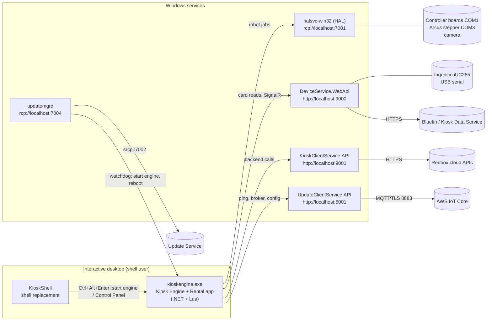

# How the Redbox kiosk software works

This folder explains how each part of the kiosk software works, down to its protocols and file formats. Start
here for the big picture, then read the document for the system you care about.

Everything here was worked out from the decompiled source in this repository and from the configuration,
scripts, data and logs in one kiosk image. Each document cites the source files behind its claims and ends with
a list of what is unknown or only inferred. No Redbox server code was available, so server behaviour is
described only as far as the kiosk side shows it. Secrets found in the image (API keys, passwords, licence keys,
encryption keys) are replaced with `<redacted>`.

## Documents

| Document | System |
|---|---|
| [kiosk-engine.md](kiosk-engine.md) | Kiosk Engine: the full-screen host process, bundles, Lua scripting, kernel extensions, Control Panel, Field Maintenance, IDE, bundle compiler |
| [rental.md](rental.md) | Rental application: browse, cart, payment, vend, return, reservations, promotions, loyalty, offline mode |
| [hal.md](hal.md) | HAL service: robot, controller boards, motors, sensors, slot geometry, the HAL command protocol, jobs, inventory database |
| [hal-scripting-and-vision.md](hal-scripting-and-vision.md) | HAL script language, disc barcode (DataMatrix) reading and cameras, HAL service tools |
| [device-service.md](device-service.md) | Card reader service: Ingenico iUC285 through the RBA SDK, SignalR and REST APIs, EMV/contactless flows, Bluefin activation, reader updates |
| [kiosk-client.md](kiosk-client.md) | Kiosk Client service: the kiosk's gateway to Redbox's cloud APIs (transactions, inventory, pricing, ads), caches and retry queue |
| [update-manager.md](update-manager.md) | Legacy Update Manager (`updatemgrd`): the update service protocol, the `.store` format, delta patching, activation, watchdog |
| [store-installer.md](store-installer.md) | Store installer: the RIX setup exe, how a new kiosk PC is provisioned from a `data.zip` seed, the 21 install steps, registry, shell and services it sets up, KioskAdmin |
| [update-client.md](update-client.md) | Update Client service: the newer cloud agent over AWS IoT (MQTT), its update state machine, remote jobs and configuration sync |
| [common-libraries.md](common-libraries.md) | Shared libraries (the `rcp://` IPC protocol, Lua hosting, macros, REDS bundle format, compression, product catalog) and tools (KioskShell, kioskutil, inventoryimport) |

[../update-store.md](../update-store.md) has a survey of the update store in this image (counts per package,
old versions found in it) for recovering historical versions.

## The kiosk at a glance

A Redbox kiosk is a Windows PC inside a DVD/Blu-ray/game vending machine. The customer uses a touch screen; a
robot ("picker") moves discs between storage slots on a rotating drum and the vend/return port; a card reader
takes payment; a camera reads the barcode on each disc case.

## Processes, services and ports

| Process | Windows service | Listens on | Runs | Document |
|---|---|---|---|---|
| `kioskengine.exe` | none (desktop process) | `rcp://localhost:8004` (engine commands), `http://localhost:9002` (web API) | .NET Framework, Lua 5.1 | [kiosk-engine.md](kiosk-engine.md) |
| `halsvc-win32.exe` | `halsvc$default` | `rcp://localhost:7001` | .NET Framework 3.5 | [hal.md](hal.md) |
| `DeviceService.WebApi.exe` | `device$service` | `http://localhost:9000` (REST, SignalR hub `/CardReaderEvents`) | .NET Core 2.2, x86 | [device-service.md](device-service.md) |
| `KioskClientService.API.exe` | `kioskclient$service` | `http://localhost:9001` | .NET Core 2.2 | [kiosk-client.md](kiosk-client.md) |
| `UpdateClientService.API.exe` | `updateclient$service` | `http://localhost:6001` (and `:60669`, see its doc) | .NET Core 2.2 | [update-client.md](update-client.md) |
| `updatemgrd.exe` | `updatemgrd$default` | `rcp://localhost:7004` | .NET Framework | [update-manager.md](update-manager.md) |
| `KioskShell.exe` | none (Windows Shell Launcher shell) | none | .NET Framework | [common-libraries.md](common-libraries.md) |

`rcp://` and `srcp://` are Redbox's own line-based TCP command protocol (plain and TLS). It is shared by the HAL,
the engine, the Update Manager and the Update Service; its framing is described in
[common-libraries.md](common-libraries.md), and HAL's fork of it in [hal.md](hal.md).

None of the local APIs require authentication; they rely on listening on `localhost`.

## How a kiosk starts

1. Windows starts the services: HAL, Device Service, Kiosk Client, Update Client and the Update Manager.
2. Windows logs on the kiosk user, whose shell is **KioskShell** instead of Explorer. It runs start-up items.
3. The Update Manager's **watchdog** (`watchdog.lua`, every 68 s) starts `kioskengine.exe` once KioskShell is
   running and HAL answers on port 7001. It also reboots the kiosk at the nightly reboot time.
4. The **Kiosk Engine** loads its bundles, registers its kernel extensions (Hardware, Update, Broker) and starts
   the **Rental Application**, whose Lua start-up script sets up the application, its timers and sync jobs.
5. In the background, the Kiosk Client service refreshes pricing, catalog and campaign caches, and both update
   systems poll for updates.

## End-to-end flows and where they are documented

| Flow | Path through the systems | Read |
|---|---|---|
| Rent a disc | Rental UI → cart and pricing → Device Service card read → HAL `vend` job starts while Kiosk Client `Authorize` runs → robot continues on approval → `Reconcile` | [rental.md](rental.md), then [device-service.md](device-service.md), [hal.md](hal.md), [kiosk-client.md](kiosk-client.md) |
| Chip card payment | Device Service: RBA 33.00 → 33.02 → 33.03 (card data to kiosk) → kiosk reports authorisation → 33.04 → 33.05 | [device-service.md](device-service.md) |
| Return a disc | Rental app → HAL `return` job → camera reads the disc's DataMatrix code → slot chosen → return reported to the cloud | [rental.md](rental.md), [hal-scripting-and-vision.md](hal-scripting-and-vision.md) |
| Robot command | Engine Hardware kernel extension → HAL client → `JOB`/`PROGRAM` commands on `rcp://localhost:7001` → scheduler runs a script or native job → poll for results | [hal.md](hal.md), [hal-scripting-and-vision.md](hal-scripting-and-vision.md) |
| Offline sale | Backend unreachable → sale approved locally within limits → queued and replayed by the Kiosk Client | [rental.md](rental.md), [kiosk-client.md](kiosk-client.md) |
| Software update (legacy) | `updatemgrd` `u p` poll → change sets downloaded by BITS → SHA-1 check → xdelta3 patching into `.staged_` → activation scripts → restart or reboot | [update-manager.md](update-manager.md) |
| Software update (newer) | Update Client over AWS IoT MQTT → BITS download from S3 → 13-state install machine → status reported back | [update-client.md](update-client.md) |
| Configuration | Update Client pulls `configuration.json` → Kiosk Client reloads it; the engine reads `data\*.config` through the Update Manager | [update-client.md](update-client.md), [kiosk-client.md](kiosk-client.md), [kiosk-engine.md](kiosk-engine.md) |

## Things worth knowing before you change anything

Each document lists the defects and oddities found while reading the code. Some affect anyone running this
software:

- **Unauthenticated local APIs:** the Kiosk Client's `GET api/configuration/current` returns every setting
  decrypted, including API keys, to any local caller. The Update Client probably also serves its full API,
  including PowerShell endpoints, on port 60669 to the network (inferred, not tested). See
  [kiosk-client.md](kiosk-client.md) and [update-client.md](update-client.md).
- **Hard-coded keys:** `Redbox.Core` encrypts with a TripleDES key compiled into the code, and the Kiosk Client
  and Update Client use a hard-coded passphrase. This is obfuscation, not protection.
- **Two update systems:** the legacy Update Manager installs the Update Client, and the two then run side by side
  with separate stores. Nothing in the code connects them at runtime.
- **The image has been modified:** some configuration points at replacement hosts instead of Redbox's, and some
  files have `.mod`/`.orig` copies. Where it matters, the documents give the original Redbox values from the
  `.staged_` copies.
