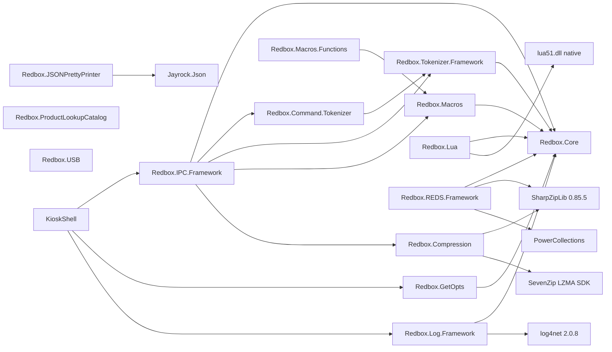

# Common libraries and tools

Shared `Redbox.*` libraries (`src/Common/*`) and the small stand-alone tools (`src/Tools/*`:
KioskShell, kioskutil, inventoryimport) of the Redbox kiosk software.

Related documents: [hal.md](hal.md) (HAL service and its own IPC fork),
[kiosk-engine.md](kiosk-engine.md) (engine, kernel, bundles, kernel functions),
[update-manager.md](update-manager.md) (updatemgrd, update store, `watchdog.lua`),
[device-service.md](device-service.md), [rental.md](rental.md).

---

## 1. Overview

The common libraries are the plumbing the older (.NET Framework) half of the kiosk stack is built on.
They were written by Redbox around 2008–2012 and are shared by the Kiosk Engine, the legacy Update
Manager (`updatemgrd`), the HAL tools and KioskShell. None of them is a process on its own; each is
a DLL loaded into a host.

| Library | One-line purpose |
|---|---|
| `Redbox.Core` | Grab-bag of helpers: logging facade, service locator, singletons, worker/buffer pools, JSON (JavaScriptSerializer) helpers, conversions, ASCII85, card-type helpers, XML/registry/shell helpers. |
| `Redbox.IPC.Framework` | The **Redbox Command Protocol** ("rcp://"): a line-oriented text command/response protocol over TCP (optionally TLS), named pipes or .NET Remoting, with attribute-based command registration. |
| `Redbox.Command.Tokenizer` | Tokenizer for one IPC command line (`MNEMONIC form key: 'value' ...`). |
| `Redbox.Tokenizer.Framework` | Generic state-machine tokenizer base, token types, `KeyValuePair`. |
| `Redbox.Macros` | `${...}` property/expression expander (a port of NAnt's expression evaluator). |
| `Redbox.Macros.Functions` | The built-in `prefix::function()` library for the macro language. |
| `Redbox.Lua` | Hosting of native **Lua 5.1** (`lua51.dll`) via P/Invoke: VM, stack, tables, functions, .NET static-method bridge, debugger. |
| `Redbox.REDS.Framework` | **REDS resource bundles**: zip (or folder) of XML `*.resource` files with a typed schema in `manifest.resource`; resource lookup by filter scoring and effective dates. |
| `Redbox.Compression` | GZip / Zip / BZip2 / LZMA (7-Zip SDK) / null codecs behind one API; zip and tar helpers. |
| `Redbox.ProductLookupCatalog` | Reader/writer of the binary `<~look~>` product (disc barcode) lookup catalog, e.g. `inventory.data`. |
| `Redbox.USB` | HID device enumeration (SetupAPI/hid.dll) and `WM_DEVICECHANGE` arrival/removal notifications. |
| `Redbox.GetOpts` | Attribute-driven command-line parser (`-name:value`, `--long=value`, `-flag+`). |
| `Redbox.JSONPrettyPrinter` | JSON pretty printer with console colouring (Jayrock.Json). |
| `Redbox.Log.Framework` | log4net adapters implementing `Redbox.Core.ILogger`. |

| Tool | One-line purpose |
|---|---|
| `KioskShell.exe` | Replacement Windows shell (installed via Windows Embedded *Shell Launcher*): runs startup items, sets wallpaper, provides the **Ctrl+Alt+Enter** "attention sequence" that opens the engine's Control Panel. It is not itself a watchdog. |
| `kioskutil.exe` | Tiny utility: get/set the desktop wallpaper, optionally re-launching itself inside the KioskShell user session. |
| `inventoryimport.exe` | One-shot migration: reads deck/slot/barcode inventory from a legacy Access `Kiosk.mdb` and writes it to HAL registry keys. |

All `src/Common` libraries target `net46` (shipped as 1.x assemblies in `REDS/Kiosk Engine/bin`);
KioskShell targets `net472`; kioskutil and inventoryimport target `net35` and carry **older inline
copies** of `Redbox.Core` (see `docs/assemblies.md`).

---

## 2. Deployment

### 2.1 Where the files are (kiosk image)

| Item | Path in image | Notes |
|---|---|---|
| Common DLLs | `REDS/Kiosk Engine/bin/Redbox.*.dll` (also copies in `REDS/Update Manager/bin`, HAL folders) | loaded by `kioskengine.exe`, `updatemgrd.exe`, ... |
| Native Lua | `REDS/Kiosk Engine/bin/lua51.dll`, `REDS/Update Manager/bin/lua51.dll` | version string inside the DLL: `Lua 5.1.4 Copyright (C) 1994-2008 Lua.org, PUC-Rio` |
| KioskShell | `KioskShell/KioskShell.exe`, `KioskShell.exe.config`, `shell-log4net.config`, `logs/shell.log*` | installed to `C:\Program Files\Redbox\KioskShell` (path seen in its log) from `REDS/Installers/kioskshell.zip` |
| kioskutil, inventoryimport | `REDS/bin/kioskutil.exe`, `REDS/bin/inventoryimport.exe`, `REDS/bin/log4net.config`, `REDS/bin/afteractivate.lua` | `REDS/bin/.staged_` holds an identical pending copy |
| Inventory snapshots | `inventory-snapshots/<kioskId>-<M>-<D>-<YYYY>-<n>.csv` | written by `HalUtilities -inventorysnapshot` (HAL tool, see [hal-scripting-and-vision.md](hal-scripting-and-vision.md)); format in §7.5 |
| Product lookup catalog | `REDS/Kiosk Engine/data/inventory.data` (464 MB, 25,790,285 records) | format in §7.3 |
| REDS bundles | `REDS/Kiosk Engine/bundles/*.bundle` | format in §7.2 |

### 2.2 IPC endpoints built on Redbox.IPC.Framework

All endpoints seen in configs use the `rcp://` (plain TCP) or `srcp://` (TLS) scheme. No named-pipe
(`rcp-p://`) or remoting (`rcp-rem://`) URL appears anywhere in the image.

| URL | Server | Clients | Source of the value |
|---|---|---|---|
| `rcp://localhost:8004` | Kiosk Engine, via the *Update Services* kernel extension (`engine`, `help`, ... commands) | KioskShell, updatemgrd | `KioskShell.exe.config` `KioskEngineIPCUrl`; machine setting `Local Services\Update Services\KioskEngineServiceUrl` (default `rcp://localhost:8004`) in `src/KioskServices/Redbox.UpdateServices.KernelExtension/UpdateServicesHost.cs` |
| `rcp://localhost:7004` | updatemgrd | updatemgr-ui | `updatemgrd.exe.config` / `updatemgr-ui.exe.config` `Url` |
| `rcp://localhost:7002`, `srcp://updatesvc.redbox.com:7002` | central Update Service | updatemgrd, update-console, updatemgr-ui | `UpdateServiceUrl` (the `bin` copy points at localhost, the `.staged_` copy at `srcp://updatesvc.redbox.com:7002`) |
| `rcp://localhost:3019` | (installer service) | installer-front-end | `installer-front-end.exe.config` |
| `rcp://127.0.0.1:7001` | **HAL service** | MSHALTester, halmgmtc, `watchdog.lua` | HAL uses its own fork, `Redbox.HAL.IPC.Framework` — see §6.1.9 and [hal.md](hal.md) |

### 2.3 Dependencies between the libraries



(Project references from the `.csproj` files; third-party binaries are in `lib/`.)

---

## 3. Redbox.Core

`src/Common/Redbox.Core` (113 files). Everything else depends on it. Key pieces:

| Area | Types | Notes |
|---|---|---|
| Logging facade | `LogHelper` (singleton), `ILogger`, `LogEntryType`, `LoggedEventHandler` | `LogHelper.Instance.Logger = x` *appends* `x` to `Loggers`; `Log(...)` goes to `Loggers[0]` only and raises `Logged`. `LogTo(name, ...)` targets a named logger. If no logger is set, logging is a no-op. |
| Service registry | `ServiceLocator` (`AddService(Type, object)`, `GetService<T>()`) | process-wide; used by every host. |
| Singletons | `Singleton<T>` | creates `T` via its *private* constructor (reflection). |
| Threading | `WorkerPool` (min/max threads, `QueueWorkItem` returns `false` when saturated), `BufferPool` (`Initialize(size,count)`, `Checkout/Checkin`), `NamedLock`, `TimeoutHelper`, `RetryableAction` + `I*Evaluator` (retry with sleep/rethrow policies) | `WorkerPool`/`BufferPool` drive the IPC server. |
| JSON | `ObjectExtensions.ToJson()`, `StringExtensions.ToObject<T>()/ToDictionary()`, `JavaScriptConverterRegistry` | `System.Web.Script.Serialization.JavaScriptSerializer` with two converters: `DateTime` → `{"theDate": <ticks>, "dateTimeKind": "Utc|Local|Unspecified", "dateString": "<ISO 8601 'o'>"}` (deserialisation prefers `dateString`), `TimeSpan` → `{"theTimeSpan": <ticks>}`. This shape appears in many JSON files written by the kiosk. |
| Conversions | `ConversionHelper.ChangeType(object, Type)` (handles `Nullable<>`, enums), `Enum<T>.ParseIgnoringCase` | used by IPC parameter binding and the Lua bridge. |
| Encodings | `ASCII85` (Adobe framing `<~ ... ~>`), `StringExtensions.HexToBytes/Base64ToBytes/Base85ToBytes`, `ByteArrayExtensions.ToBase64/ToASCIISHA1Hash/Encrypt/Decrypt` | `Encrypt/Decrypt` (and `EncryptToBase64`) use **TripleDES with a key and IV hard-coded in `ByteArrayExtensions.cs`** (`<redacted>`); it is obfuscation, not protection. |
| Payment helpers | `CardType`, `CardTypeHelper.GetCardType(number[, now, checkGCRanges])`, `BinRange`, `RedboxGiftCard`, `LuhnHelper`, `StringExtensions.ToLastFour` | BIN-range classification; gift-card ranges are injected at run time. |
| Windows helpers | `ShutdownTool` (ExitWindowsEx with privileges), `NTUserImpersonator`, `SecurityHelper` (admin / power-user checks), `ShellShortcut` (.lnk), `FontHelper`, `SelfRegistrationTool`, `AssemblyInstallerHelper`, `ResourceTool`/`ResourceUpdateSession` (Win32 resource editing), `SimpleSound` | |
| XML/config editing | `XmlFileEditor`, `XmlEdit`, `XmlNodeExtensions` (`GetAttributeValue<T>`, `GetNodeValue<T>`), `RegExFileEditor` | `GetAttributeValue<T>` is how REDS parses resources. |
| Misc | `ExecutionTimer`, `ThreadExecutionTimer`, `MultiDictionary<K,V>`, `MostRecentlyUsedDictionary`, `CircularList`, `Range`, `Pair`, `IdHelper.GeneratePseudoUniqueId`, `UsageAttribute` (used by IPC HELP), `ErrorForm`, `IConsole`/`DefaultConsole`/`NullConsole`/`RedirectedConsole` | |

`Redbox.Core.Error`/`ErrorList` exist here too, but most libraries (IPC, REDS, Tokenizer, KioskShell)
define their own `Error`/`ErrorList` with the same shape (`Code`, `Description`, `Details`,
`IsWarning`, `NewError`, `NewWarning`, `ContainsError()`).

---

## 4. Logging: Redbox.Log.Framework

`src/Common/Redbox.Log.Framework`. Two `ILogger` implementations over log4net 2.0.8:

- `SimpleLog4NetLogger(Type)` — `LogManager.GetLogger(type)`; created with
  `LogHelper.Instance.CreateLog4NetLogger(typeof(Program))`. `Configure(path)` runs
  `XmlConfigurator.Configure` and logs `SimpleLog4NetLogger configured from: '<path>'.` (visible as
  the first line of `shell.log`).
- `MultiLog4NetLogger(string loggerName)` — named logger, for hosts that keep several logs and use
  `LogHelper.LogTo(name, ...)`.

`Log(message, params object[])` formats with `string.Format`; `LogEntryType` maps to
Info/Debug/Error/Fatal levels.

---

## 5. Tokenizers

### 5.1 Redbox.Tokenizer.Framework

`src/Common/Redbox.Tokenizer.Framework`. `TokenizerBase<TState>` is a reflective state machine:
methods tagged `[StateHandler(State = X)]` are collected at construction; each returns
`StateResult.Continue` (advance one character), `Restart` (re-run with the same character in the new
state) or `Terminal`. Input comes from `StringTokenReader(line, text)` or `StreamTokenReader`.
`SimpleTokenizer<T>` accumulates `SimpleToken`s of type `Mnemonic, Label, Comment, StringLiteral,
Symbol, NumericLiteral, Operator, ConstSymbol`. A token can be a key/value pair; its value is the raw
`key<sep>value` text which `KeyValuePair` splits on the first separator (`=` by default, `:` for
command lines) and trims. `SimpleTokenList` offers `GetMnemonic()`, `GetSymbols()`,
`GetKeyValuePairs()`, `GetKeyValuePair(key)` (**case-insensitive** key match), etc.

### 5.2 Redbox.Command.Tokenizer — IPC command-line grammar

`src/Common/Redbox.Command.Tokenizer/CommandTokenizer.cs`, states in `CommandParserState.cs`.
Grammar actually implemented:

```
line      := ws* ( comment | command ) 
comment   := "--" anything                       -> one Comment token (the rest of the line)
command   := mnemonic ( ws+ item )*
mnemonic  := letter ( letter | "-" )*           -> Mnemonic (other characters are silently dropped)
item      := symbol | key ":" ws* value | redirect
symbol    := (letter|digit) non-ws*             -> Symbol           e.g. ping, list, show
key       := (letter|digit) non-ws* (up to ":")
value     := unquoted | "'" chars "'" | '"' chars '"'
unquoted  := (letter|digit) non-ws*             -> StringLiteral key/value pair (separator ":")
redirect  := ( ">" | ">>" ) ws* value           -> Operator token + StringLiteral (not used by the server)
```

Rules and quirks (all from the state handlers):

- A line starting with punctuation other than `--` is error **T006** "An invalid token was detected."
- Inside a quoted value, `\` may only escape `'`, `"` or `\`; any other `\x` is error T006. So a
  quoted Windows path must double its backslashes (`'C:\\temp\\x.txt'`), or be given unquoted
  (`path: C:\temp\x.txt`), because outside quotes `\` is an ordinary character.
- An unquoted value must start with a letter or digit; a leading `-` or `/` is skipped silently
  (`count: -5` yields `5`).
- An unterminated quote is T006. A nested redirect is **T005**.
- Keys are matched case-insensitively; the first symbol after the mnemonic is the *form* name.

Example: `macro create greeting value: 'hello world'` →
`Mnemonic(macro) Symbol(create) Symbol(greeting) StringLiteral(value:hello world, kv)`.

---

## 6. Redbox.IPC.Framework — the Redbox Command Protocol (RCP)

`src/Common/Redbox.IPC.Framework` (57 files). A synchronous, line-oriented, ASCII text protocol in
the style of SMTP/FTP: the client sends one command line, the server answers with zero or more
message lines followed by one status line (`203 ...` success / `545 ...` failure).

### 6.1 Protocol

#### 6.1.1 Addressing (URI schemes)

`IPCProtocol.Parse(uri)` (`IPCProtocol.cs`). Spaces are removed, then `System.Uri` parses it.

| Scheme | Channel | Secure | Implemented |
|---|---|---|---|
| `rcp://host:port` | TCP socket | no | client + server |
| `srcp://host:port` | TCP socket | TLS (client side) | client; server only if a certificate is configured |
| `rcp-p://host:port` | Named pipe | no | client + server (pipe name = the *port* string, see below) |
| `srcp-p://` | Named pipe | TLS over the pipe | as above |
| `rcp-rem://host:port`, `srcp-rem://` | .NET Remoting (TCP channel, binary formatter) | channel `ensureSecurity` flag | client + server |
| `rcp-amq`, `rcp-msmq`, `rcp-tems`, `rcp-oaq`, `rcp-wmq` | ActiveMQ, MSMQ, Tibco EMS, Oracle AQ, WebSphere MQ | — | parsed only; `IPCServiceHost.Create` and `ClientSession.GetClientSession` reject them |

Query parameters are kept in `Query`; `USERNAME` and `PASSWORD` are exposed as `UserName`/`Password`
but nothing in the framework uses them. Path segments go to `Properties`. Host is required; for
socket/remoting the port must be numeric.

Named-pipe caveat: the pipe name is taken from `Protocol.Port`, but `System.Uri` only accepts a
numeric port, so the pipe name can only be a number (e.g. `rcp-p://localhost:7001` → pipe `7001`).
`localhost`/`127.0.0.1` become `.` for the client. `Constants.ProtocolDefaults.NamedPipe =
"halservice"` is not used by this library. (Inferred: named pipes were not used in production;
no such URL is configured in the image.)

#### 6.1.2 Transport and framing

- Encoding: **ASCII** (`Encoding.ASCII`), both directions. Non-ASCII characters become `?`.
- Framing: every line ends with `Environment.NewLine` = **CRLF**. The server only recognises a
  command when it sees `\r\n`; a client that sends bare `\n` is never answered.
- One command per line; the server processes lines of one connection strictly in order (the next
  `BeginRead` is issued only after the previous command's response has been written). Each read
  completion processes **one** line, so a client must not pipeline: a second command that arrived in
  the same packet stays buffered until more bytes arrive. Send a command, read its full response,
  then send the next.
- TCP server: `Socket` bound to the URI host (IP literal, `localhost` → 127.0.0.1, or DNS lookup via
  `IPAddressHelper.GetAddressForHostName`), `ReuseAddress`, listen backlog = `backlogSize ?? 20`
  (hosts in this repo pass 5).
- TLS: server side `SslStream.AuthenticateAsServer(cert, clientCertRequired: false, SslProtocols.Tls,
  checkRevocation: true)` when `IPCServiceHost.EncryptionProtocol != None && Certificate != null`
  (no host in this repo sets these). Client side (`srcp`), `SslStream.AuthenticateAsClient(host)`
  with standard validation; the registry value `HKLM\SOFTWARE\Redbox\ValidateCallback` = `"false"`
  turns certificate validation failures into warnings (`TcpClientSession.cs`).
- Timeouts: TCP client default 30,000 ms (`Constants.Communications.Timeout`), applied to socket
  send/receive and to waiting for a full response; server-side TLS stream 30,000 ms.

#### 6.1.3 Session sequence

```
client                                   server
  | ---------- TCP connect ----------->   |
  | <-- "Welcome! <Product>, Version <ver>, <Copyright>\r\n"
  | --- "<command line>\r\n" ---------->  |
  | <-- "<message>\r\n" (0..n)            |
  | <-- "203 Command Success. (Execution Time:<ms>)\r\n"     or
  | <-- "545 Command failed.[ <extended msg>] (Execution Time:<ms>)\r\n"
  |      ... more commands ...            |
  | --- "quit\r\n" -------------------->  |
  | <-- "Goodbye!\r\n"  then close        |
```

- The banner is written by `ServerSession.Start()`: `Welcome! {Name}, Version {Version},
  {Copyright}` where the three values are passed to `IPCServiceHost.Create` (hosts pass the product,
  version and copyright of the assembly that defines their commands).
- `ClientSession.ConnectThrowOnError()` connects and then consumes lines until it sees `Welcome!`.
- Any line that *starts with* `quit` (case-insensitive) ends the session. `ClientSession.Close()`
  sends `quit` for socket and pipe channels.
- The client considers a response complete when a line starts with `Welcome!`, `Goodbye!`,
  `545 Command` or `203 Command` (`ClientSession.ProcessReadBuilder`). Success is
  `lastLine.StartsWith("203 Command")`.
- `Execution Time` is the server-side time in whole milliseconds.

#### 6.1.4 Response body conventions

Built by `CommandResult.ToString()` and `ProtocolHelper` (`ProtocolHelper.cs`):

| Line form | Meaning | Produced by |
|---|---|---|
| free text | a result message (`CommandContext.Messages`) | command methods |
| `\|*[CODE] ERROR: Description\|Details*\|` | an error; `WARNING` instead of `ERROR` for warnings; `Details` may span several lines (exception text), the block ends at the line ending in `*\|` | `ProtocolHelper.FormatErrors` |
| `LZMA\|<base64>` | LZMA-compressed (format §10.2) ASCII payload, base64 encoded | `FormatCompressedString/Bytes` |
| `GZIP\|<base64>` | GZip-compressed payload; `FormatCompressedFile` gzips the *base64 text* of a file | `FormatCompressedFile` |
| `<base64>` | a raw file | `FormatFile` |
| `[MSG] text` | asynchronous server event queued by `ISession.Send(text)`; delivered **inside the next command response**, not on its own | `ServerSession.Send` / `FlushSinkQueue` |
| `N/A` | conventional null for numbers/dates in result fields (`ProtocolHelper.Parse*`) | commands |
| `a\|b\|<c\|d>\|[e\|f]` | conventional field list; `ParseProperties` splits on `\|` outside `<...>`/`[...]` | commands |

`ClientCommand<T>.Execute()` post-processes the lines: error blocks are removed and parsed into
`Errors` (code from the `[...]`, `WARNING` decides warning vs. error), `LZMA|`/`GZIP|` lines are
replaced by their decompressed ASCII text, `[MSG]` lines are removed and raised as
`ClientSession.ServerEvent(textAfterBracket)`, and the last line becomes `StatusMessage`.

#### 6.1.5 Command line semantics (server)

`CommandService.Execute` (`CommandService.cs`):

1. **Macro expansion**: the whole line is passed through a process-wide
   `Redbox.Macros.PropertyDictionary.ExpandProperties`, so `${name}` is replaced by a value defined
   with `MACRO create` (§6.1.7) or by the host. (Function calls such as `${string::to-upper(x)}` work
   only if the host has scanned function assemblies, see §8.)
2. Tokenize (§5.2). A comment-only line (`-- ...`) is answered with a bare
   `203 Command Success.` status line. Tokenizer errors →
   `545 Command failed. Parsing of input '<input>' failed. Correct the command syntax and try again.`
   with the T-codes listed as error blocks.
3. Look up the mnemonic (case-insensitive) → **S514** `Invalid Command: <name>` if unknown, if it has
   no forms, if command filters reject it, or if the origin IP is not allowed (§6.1.8).
4. If there are no symbols and the command has a `Default` form, or `Default` is its only form, call
   `Default(CommandContext)`.
5. Otherwise the first symbol selects the form (case-insensitive) → **S001** if none/unknown.
6. Required named parameters are checked → **S001** `The named parameter '<key>:' is required.`
7. Parameters are bound by name (`key:` ↔ C# parameter name, or `CommandKeyValue.KeyName`) and
   converted with `ConversionHelper.ChangeType`; `byte[]` parameters are decoded per
   `CommandKeyValue.BinaryEncoding` (`Hex`, `Base64`; `Ascii95` throws NotImplemented) and then
   decompressed per `CommandKeyValue.CompressionType`. Missing optional parameters are `null`
   (value types must therefore be `Nullable<>`). Conversion failure → **S999**.
8. A **new instance** of the command class is created per call (`Activator.CreateInstance`) and the
   form method is invoked through a compiled `DynamicMethod`.
9. Exceptions → **S999** with the exception text in Details. Result logging includes messages only
   if `appSettings["IpcLogResults"]` is `true`.

`Success` = no errors (warnings allowed) in either `CommandResult.Errors` or `CommandContext.Errors`.

#### 6.1.6 Error codes

| Code | Side | Meaning |
|---|---|---|
| T005, T006 | server (tokenizer) | nested redirect; invalid token / bad escape / unterminated quote |
| S001 | server | no/unknown form, missing required parameter |
| S514 | server | unknown command, filtered, no forms, or origin IP denied |
| S999 | server | unhandled exception, parameter conversion failure |
| J777 | server | "Server too busy to service request." — worker pool saturated (or remoting connection count ≥ MaxThreads) |
| J001 | client | cannot connect (`SocketException`) |
| J888 | client | "Timeout threshold exceeded." — no complete response within `Timeout`; the client synthesises the error block and a `545 Command failed.` line |
| J999 | client | unhandled exception in `ClientCommand.Execute` |

#### 6.1.7 Built-in commands

Registered by every server that scans `Redbox.IPC.Framework.dll`:

| Command | Forms / usage | Behaviour |
|---|---|---|
| `HELP` | `help` / `help <command> ...` | without arguments lists all command names (upper case); with names prints the command's `[Description]` and each form's `[Usage]` and description |
| `STATISTICS` | `statistics show` | dumps `Statistics` fields/properties: bytes sent/received, commands executed, busy responses, total/min/max/average execution time, server start/up time, host name |
| `MACRO` | `macro list`, `macro create <name> ... value: '<expansion>'`, `macro delete <name> ...` | manages the `${name}` properties used in step 1 above (process-wide) |
| `SCRIPT` | `script execute path: <file>` | runs a file of command lines through `BatchCommandRunner` (results are only logged; stops at a line containing `quit`) |
| `COMMAND-REPOSITORY` | `command-repository` | re-scans assemblies and lists `Installed Command '<NAME>'.` |

#### 6.1.8 Filters and access rules

Two optional mechanisms, neither used by the hosts in this repository:

- **Command filters**: `[Command(name, Filter = "A|B")]` and `[CommandForm(Filter = ...)]` tags. If the
  host sets `IPCServiceHost.EnableFilters = true` and a `Filters` list, a command/form is accepted only
  when the session's filter list intersects the command's tags (case-insensitive). With filtering on,
  untagged commands are rejected.
- **Origin IP rules** (TCP and remoting only): `CommandService.SetAccesFilter(ruleFile)` reads lines
  `command, prefix` such as `engine, 127.0.0.*`; the prefix is compared octet by octet up to the first
  `*`; `*` alone allows everyone. A command with no rule is allowed from anywhere. IPv6 peers are
  reported as `0.0.0.0` (or `127.0.0.1` for `::1`).

#### 6.1.9 Relation to the HAL IPC

The HAL has its own copy, `src/HAL/Redbox.HAL.IPC.Framework` (and another inside
`src/HAL/halmgmtc`), evidently forked from this library: it keeps the same constants (`Welcome!`,
`Goodbye!`, `quit`, `[MSG]`, `203 Command`, `545 Command`) and the same tokenizer/form/attribute model,
but is a separate assembly with its own types and transports. Its protocol on
`rcp://127.0.0.1:7001` is documented in [hal.md](hal.md). Generic RCP clients work against it at the
line level; `watchdog.lua` checks HAL liveness by sending `help` to `rcp://localhost:7001` through
the Update Manager's `kernel.executeservicecommand`.

#### 6.1.10 Concrete examples

Kiosk Engine endpoint (as used by KioskShell; product/version/copyright and execution times are
placeholders, the line formats are exact):

```
S: Welcome! <product>, Version <x.y.z.w>, <copyright>
C: engine ping
S: 203 Command Success. (Execution Time:0)
C: engine load-control-panel
S: 203 Command Success. (Execution Time:15)
C: frobnicate
S: |*[S514] ERROR: Invalid Command: frobnicate|*|
S: 545 Command failed. (Execution Time:0)
C: macro create where value: 'C:\\temp'
S: 203 Command Success. (Execution Time:1)
C: help macro
S: MACRO list
S: MACRO create symbol value: 'expansion'
S: MACRO delete symbol ...
S: 203 Command Success. (Execution Time:0)
C: quit
S: Goodbye!
```

(`help macro` lists only `Usage` strings because `MacroCommand` has no `[Description]`.)

### 6.2 Server API — how a host registers commands

```csharp
[Command("engine")]                        // mnemonic; optional Filter = "A|B"
[Description("...")]                       // shown by HELP
public class EngineCommand                 // needs a public parameterless ctor; new instance per call
{
    [CommandForm(Name = "ping")]           // form = first symbol
    [Usage("engine ping")]
    public void Ping(CommandContext ctx) { }               // first parameter must be CommandContext

    [CommandForm(Name = "execute")] [NotLoggable]          // NotLoggable: input line not logged
    public void Exec(CommandContext ctx,
        [CommandKeyValue(IsRequired = true)] string script,          // key "script:"
        [CommandKeyValue(KeyName = "data", BinaryEncoding = BinaryEncoding.Base64,
                         CompressionType = CompressionType.LZMA)] byte[] payload,
        [CommandKeyValue] bool? reset) { ctx.Messages.Add("..."); ctx.Errors.Add(Error.NewError("X1","...","...")); }

    public void Default(CommandContext ctx) { }   // optional: runs when no form symbol is given
}
```

Discovery (`CommandRepository.DiscoverInstalledCommands`) runs once, when `CommandService.Instance`
is first touched: it loads every `*.dll`/`*.exe` in the directory of `Redbox.IPC.Framework.dll`, or
only the files named in `CommandRepository.AssemblyPatterns` (wildcards allowed), and registers every
class carrying `[Command]`. Example: the Update Services kernel extension sets
`AssemblyPatterns = { "Redbox.DVD.UpdateServices.dll", "Redbox.UpdateServices.KernelExtension.dll",
"kioskengine.exe", "Redbox.IPC.Framework.dll" }`.

Hosting:

```csharp
var host = IPCServiceHost.Create(IPCProtocol.Parse("rcp://localhost:8004"),
    product, version, copyright, minThreads: 3, maxThreads: 3,
    bufferSize: 8192, numberOfBuffers: 64, backlogSize: 5);
host.Start();   // TCP: returns after BeginAccept; named pipe: blocks in an accept loop
...
host.Stop();
```

Threading: each accepted socket gets a `TcpServerSession`; each read completion queues
`ProcessReadBuilder` on the host's `WorkerPool`. If the pool refuses the item, the server answers
**J777** from a `ThreadPool` thread. Sessions are tracked in a list; dead ones are pruned on
unregister. Optional hooks: `RegisterSessionAction(ISession)`, `ParamAction(key, value)` (called for
each required parameter), `ISession.SetBeforeCommandAction`. `BatchCommandRunner.ExecuteStartupFiles()`
can run every `*.txt` next to the DLL as a command script at start-up.

Performance counters (optional): `CommandRepository.InstallPerformanceCounters(category)` creates,
per `COMMAND form`, a rate counter, an average-time counter and its base, plus `Total Commands/second`.

### 6.3 Client API

```csharp
var r = ClientCommand<ClientCommandResult>.ExecuteCommand(session, disposeWhenDone: false, "engine ping");
// r.Success, r.CommandMessages (cleaned), r.Errors, r.StatusMessage, r.ExecutionTime
```

- `ClientSession.GetClientSession(protocol, timeoutMs)` → `TcpClientSession` / `NamedPipeClientSession`
  / `RemotingClientSession`.
- `ClientSessionPool(protocol, size, timeout)`: `GetSession(waitMs, attempts)` blocks while `size`
  sessions are out; disposing a pooled session returns it (and closes it — sessions are not reused).
  `TcpClientSessionPool` is an obsolete alias.
- Named-pipe client: connects with 3 × 5 s attempts. It never sets `Timeout`, so unless the caller
  sets `session.Timeout`, `ConsumeMessages` waits 0 ms and reports J888 (observation from code).
- The client does **not** retry; callers do (e.g. KioskShell, §12.3).

### 6.4 .NET Remoting variant

`rcp-rem://host:port`: server registers a `TcpServerChannel` named `ipc_tcp` on the port with a
`BinaryServerFormatterSinkProvider`, application name `IPCFramework`, and a SingleCall well-known
object `CommandService.rem` of type `RemotingHost : IRemotingHost`. The client calls
`tcp://host:port/IPCFramework/CommandService.rem` → `string ExecuteCommand(string command)`, which
returns the same text a socket session would send (message lines + status line, CRLF-separated; no
banner). Custom sinks pass the caller IP (`__IPAddress` transport header → call context
`RemoteHostIP`) for access rules. `appSettings`: `CallRemotingConfigure` (if empty,
`RemotingConfiguration.Configure(null, secure)` is called), `CustomErrorsMode`.

---

## 7. Data formats owned by the common libraries

### 7.1 Summary

| Format | Library | Example file |
|---|---|---|
| REDS bundle (zip of XML resources) | Redbox.REDS.Framework | `REDS/Kiosk Engine/bundles/cp.bundle` |
| Product lookup catalog `<~look~>` | Redbox.ProductLookupCatalog | `REDS/Kiosk Engine/data/inventory.data` |
| LZMA blob (props + length + stream) | Redbox.Compression | `LZMA|...` IPC lines |
| Update-store revlog (JSON per file) | kioskutil (copy of Update Manager code) | `REDS/Update Manager/.store/.repository/<repo>/.revlog/<n>` |
| Inventory snapshot CSV | (HAL tool), consumed by people/tools | `inventory-snapshots/59394-12-31-2024-1.csv` |

### 7.2 REDS bundle format (Redbox.REDS.Framework)

REDS = *Redbox Engine for Distributed Stores* (expanded in the error text of `ResourceBundle.Activate`).
A **bundle** is the unit of content and code the Kiosk Engine loads: an application (Lua scripts,
views, fonts, images), a library or pure content (pricing, legal text, banners). How the engine
finds, versions and activates bundles is described in [kiosk-engine.md](kiosk-engine.md); this
section is the file format and lookup rules.

**Container.** A standard ZIP file (`*.bundle`, read with SharpZipLib, Zip64 off) —
`ResourceBundleStorageType.Zipped` — or a plain directory (`FileSystem`). `Database` exists in the
enum but has no implementation. Example listing of `cp.bundle` (Control Panel Application 3.55.0.27):

```
activity-functions.resource         (XML)
application-startup.resource
manifest.resource
...
assets/scripts/activity-functions.lua   (file referenced by a resource)
```

**Loading** (`ResourceBundle.LoadResources`): `manifest.resource` is parsed first (it defines the
schema), then every other entry whose name ends in `.resource`. Other files are only read when an
aspect references them.

**Resource XML** (`Resource.FromXml`):

```xml
<resource type="script" depends="message_box_functions">     <!-- type required; depends: comma list -->
  <property name="name" value="activity_functions" />         <!-- name property = lookup key -->
  <property name="market"><value>East</value><value>West</value></property>   <!-- multi-value -->
  <aspect name="content" file="assets/scripts/activity-functions.lua" />       <!-- content by file -->
</resource>
```

- `property` values are converted to the type declared by the schema (`IPropertyType.GetTypedValue`);
  multi-value properties become `List<object>`.
- `aspect` = a named piece of content. Its other XML attributes become `Aspect.Properties`. Content is
  either inline (inner text/XML) or `file="<zip entry path>"` (loaded lazily on first `GetContent()`).
  Binary inline content needs `encoding="Base64"` or `encoding="ASCII85"` (`<~...~>`).
- Aspect types: `AspectType` (binary: `file` → `byte[]`, or decoded inline), `TextAspectType`
  (`file` → UTF-8 string, or inner text), `XmlAspectType` (the `<aspect>` node itself, cloned),
  `ManifestAspectType` (the `schema` aspect). `Redbox.REDS.Framework.BitmapAspectType` is referenced
  by real manifests but does not exist in this assembly; the type lookup then returns `null` and the
  plain binary `AspectType` is used.

**Manifest** (`manifest.resource`, built-in type `manifest`):

| Property | Meaning |
|---|---|
| `name` | must be `manifest` |
| `product_name`, `product_version` | bundle identity, e.g. `Control Panel Application`, `3.55.0.27` |
| `bundle_type` | `Application` (default), `Library`, `Content`, `HTMLApplication` |
| `startup_script` | resource name of the startup Lua script (required for Application) |
| `control_assembly` | required for `HTMLApplication` |
| `test_control`, `public_key` | optional |
| `requires` | dependencies, `Product,Version` separated by `\|` (or multi-value) |

The `schema` aspect declares the resource types:

```xml
<aspect name="schema">
  <resourceType name="root">                        <!-- properties every resource inherits -->
    <propertyType name="store_number" type="System.String" isFilter="true" score="4" label="..." category="Filters"/>
    <propertyType name="effective_date" type="System.DateTime" />
  </resourceType>
  <resourceType name="script" superType="root">
    <aspectType name="content" type="Redbox.REDS.Framework.TextAspectType">
      <property name="syntax_schema" value="Lua" />  <!-- editor hints -->
    </aspectType>
  </resourceType>
</aspect>
```

`propertyType` attributes: `name`, `type` (CLR type name; `System.Drawing.*`, `System.Windows.Forms.*`
and `Redbox.REDS.Framework.*` resolved specially, default `System.String`), `description`,
`isRequired`, `isFilter`, `score` (default 1), `label`, `category`, `defaultValue`. The real bundles
define resource types `bitmap`, `font`, `sound`, `template`, `script`, `table`, `view`, `publickey`.

**Bundle specifier** (`BundleSpecifier`): `"<product>,<version>"`; `*` in the version means 999999
(`"Control Panel Application,*"` = highest available). `BundleCollection.GetBundle` returns the exact
version or else the highest version below the requested one (errors B120/B125/B130).

**Resource lookup** (`ResourceLookup.GetResource2`). Several resources may share a name (variants for
different markets, stores, dates). For a name:

1. Drop resources that are not *effective* now: `effective_date` > now, `expiry_date` < now,
   `daypart_dayofweek_only` ≠ today, today outside `daypart_effective_weekday`..`daypart_expiry_weekday`,
   time outside `daypart_effective_time`..`daypart_expiry_time`.
2. If only one candidate exists it is returned (if effective).
3. Otherwise each candidate is scored against the runtime filter (a property bag such as store number,
   market, culture, environment, set by the engine): a resource with no filter properties set scores 1;
   a resource whose set filter properties *all* match scores the sum of their `score`s; any mismatch
   scores 0. Filter properties named `!=x` match when the resource value differs from filter `x`.
   String compares are case-insensitive; multi-value properties match by membership.
4. The highest score wins (ties: first in list).

`ResourceBundleSet` merges an application bundle with its other bundles for lookups across all of them.
Writing bundles: `ResourceBundle.Create(file, trimPrefix, ...)` + `AddEntry` + `CommitUpdate`
(zip only); `Resource.Save` serialises back to the same XML (binary aspects as Base64 or CDATA ASCII85).

Error codes: E003 (no manifest), E004 (missing startup script), E005 (missing control assembly), R001–R006
and R999 (resource XML problems), B003 (storage cannot save).

### 7.3 Product lookup catalog (Redbox.ProductLookupCatalog)

A flat, sorted, fixed-record binary file mapping a **disc barcode** to a title and status. Used for
`REDS/Kiosk Engine/data/inventory.data` (read by `src/Rental/Redbox.Rental.Data/InventoryData.cs`
with `Archive`) and by the engine's `ProductLookupCatalogService` / `DataStoreProvider`
(`<DataPath>\<store>.data`) with `MemoryArchive`. All integers little-endian.

Header — 312 bytes:

| Offset | Size | Field |
|---|---|---|
| 0 | 8 | magic ASCII `<~look~>` |
| 8 | 1 | version, must be `0` |
| 9 | 1 | flags (always written as 0) |
| 10 | 32 | origin machine name, ASCII, right-aligned with leading spaces |
| 42 | 14 | creation time UTC, ASCII `yyyyMMddHHmmss` |
| 56 | 256 | zero padding |

Record — 18 bytes, starting at offset 312, `count = (fileLength − 312) / 18`:

| Offset | Size | Field |
|---|---|---|
| 0 | 1 | number of leading `'0'` characters of the barcode |
| 1 | 8 | uint64: the barcode's numeric value without those zeros |
| 9 | 4 | uint32 `TitleId` |
| 13 | 1 | `InventoryStatusCode`: 0 Known, 1 WrongTitle, 2 Damaged, 3 Thinned, 4 PR1, 5 PR2, 6 Fraud, 7 Rebalancing, 8 Redeployment |
| 14 | 4 | uint32 `TotalRentalCount` |

Barcode = `new string('0', prefix) + value`. Only all-digit barcodes can be stored (else
`FormatException`); `"000"` is stored as prefix 2, value 0. `Find(barcode)` is a binary search
comparing the decoded barcode **strings** with `string.CompareTo` (culture-sensitive, which for
digit-only strings of equal length equals numeric order), so writers must sort records the same way.

Real file (`inventory.data` in the image): origin `UPDATESVC01`, created `20240723061643`, 25,790,285
records; first record decodes to barcode `0000000097226165`, TitleId 2496, status 1, rentals 0.

Bug to be aware of when writing: if the machine name is longer than 32 characters the writer uses
`BinaryWriter.Write(string)`, which adds a length prefix byte and misaligns the header.

### 7.4 Compression formats (Redbox.Compression)

`CompressionAlgorithm.GetAlgorithm(CompressionType)`; `byte[].Compress(type)` / `.Decompress(type)`.

| Type | Implementation | Wire/file format |
|---|---|---|
| `None` | copy | — |
| `GZip` | SharpZipLib `GZipOutputStream`/`GZipInputStream` | standard RFC 1952 gzip |
| `Zip` | SharpZipLib `ZipOutputStream` | ZIP archive with a single deflated entry named `file` |
| `BZip2` | SharpZipLib | standard bzip2 |
| `LZMA` | 7-Zip LZMA SDK (`SevenZip.dll`) | "LZMA-alone" (`.lzma`): 5 bytes coder properties, 8 bytes uncompressed length (int64 LE), raw LZMA stream with end marker. Encoder settings: dictionary 2 MiB (2097152), pb=2, lc=4 (sic), lp=0, algorithm 2, 273 fast bytes, match finder `bt4`, end marker on |

Helpers: `ZipHelper.CreateZipFile(zip, dir, recurse, fileFilter[, dirFilter[, metadata]])` — the
metadata dictionary is stored as the **zip comment, serialised as JSON**; `ZipHelper.GetMetadata(zip)`
reads it back; `ExtractAllFiles`. `TarHelper.Archive/Unpack` — plain tar via SharpZipLib.

LZMA and GZip are what the IPC framework uses (`LZMA|`/`GZIP|` lines, `CompressionType` on `byte[]`
command parameters).

### 7.5 Inventory snapshot CSV

Written by `HalUtilities.exe -inventorysnapshot` (`src/HAL/HalUtilities/Program.cs`, ~line 892) to
`C:\Program Files\Redbox\inventory-snapshots\<KioskId>-<Month>-<Day>-<Year>-<n>.csv` (n = first unused
number, no zero padding). Content:

```
Deck,Slot,Barcode
1,1,'EMPTY'
1,2,'123456789'          <- matrix read from the slot, in single quotes
...
9,1,'<matrix>'           <- deck 9 = dump bin items, numbered from 1
```

The sample in the image (`59394-12-31-2024-1.csv`, kiosk 59394) has 8 decks × 90 slots + 5 dump-bin
rows; values are 9-digit barcodes, `EMPTY` or `UNKNOWN`.

---

## 8. Redbox.Macros — the `${...}` macro language

`src/Common/Redbox.Macros` is a port of the NAnt property/expression evaluator (resource string ids
such as `NA1052` and the `[FunctionSet("property", "NAnt")]` attribute are left over).

### 8.1 Syntax

`PropertyDictionary.ExpandProperties(text, Location)` copies `text` and replaces each `${ expression }`
with the expression's value converted to string (invariant culture). A `$` not followed by `{` is
kept. An unterminated `${` → `EvaluatorException` (`'}' expected`) with a caret marker under the
offending position.

Expression grammar (`ExpressionEvalBase.cs`, precedence low → high):

```
expr      := or
or        := and ( "or" and )*
and       := rel ( "and" rel )*
rel       := add ( ("==" | "!=" | "<" | ">" | "<=" | ">=") add )?
add       := mul ( ("+" | "-") mul )*
mul       := unary ( ("*" | "/" | "%") unary )*
unary     := "-" unary | "not" unary | value
value     := 'string'          -- single quotes; '' is an escaped quote
           | number            -- int, long or double (with '.')
           | true | false
           | "(" expr ")"
           | if(cond, a, b)    -- conditional
           | prefix::name(args, ...)      -- function call
           | property-name     -- letters, digits, '_', '-', '.', '\' ; e.g. RunningPath, ProductVersion
```

- Property names must match `^[_A-Za-z0-9][_A-Za-z0-9\-:.()]*$` and not end with `-` or `.`.
- Values are typed (`int`, `long`, `double`, `string`, `bool`, `DateTime`, `TimeSpan`, ...); `+` on
  strings concatenates; comparisons work across compatible types.
- Properties may be *read-only* (`AddReadOnly`) or *dynamic* (`MarkDynamic`: its value is itself
  expanded on read; cycles → "Circular property reference").
- Undefined property → error (NA1053).

Examples: `Engine: ${ProductName} ${ProductVersion}`,
`${path::combine(RunningPath, '..\cache')}`, `${if(int::parse(x) > 3, 'big', 'small')}`.

### 8.2 Function registration

`FunctionFactory` keeps `prefix::name` → `MethodInfo` (overloads chosen by argument count). Types are
scanned by `ScanAssembly`/`ScanDir`/`ScanExecutionPath`; a type qualifies if it has
`[FunctionSet(prefix, category)]` and derives from `FunctionSetBase` (or is the evaluator); methods
need `[Function(name)]`. Instance methods are called on a new object constructed with the
`PropertyDictionary`. Only the Kiosk Engine's `MacroService` performs the scan
(`FunctionFactory.ScanDir(<entry exe dir>)`); a `PropertyDictionary` used elsewhere (e.g. the IPC
`CommandService`) only expands properties unless its host scans too.

### 8.3 Built-in functions (Redbox.Macros.Functions + evaluator)

| Prefix | Functions (arguments) |
|---|---|
| `property` | `get-value(name)` |
| `string` | `get-length(s)`, `substring(s, start, length)`, `starts-with(s, t)`, `ends-with(s, t)`, `to-lower(s)`, `to-upper(s)`, `replace(s, old, new)`, `contains(s, t)`, `index-of(s, t)`, `last-index-of(s, t)`, `pad-left(s, width, char)`, `pad-right(s, width, char)`, `trim(s)`, `trim-start(s)`, `trim-end(s)`, `remove-at(s, i)` |
| `path` | `get-full-path(p)`, `combine(a, b)`, `change-extension(p, ext)`, `get-directory-name(p)`, `get-extension(p)`, `get-file-name(p)`, `get-file-name-without-extension(p)`, `get-path-root(p)`, `get-temp-file-name()`, `get-temp-path()`, `has-extension(p)`, `is-path-rooted(p)` |
| `file` | `get-creation-time(f)`, `get-last-write-time(f)`, `get-last-access-time(f)`, `exists(f)`, `get-length(f)`, `is-assembly(f)` |
| `directory` | `get-creation-time(d)`, `get-last-write-time(d)`, `get-last-access-time(d)`, `get-current-directory()`, `get-parent-directory(d)`, `get-directory-root(d)`, `exists(d)` |
| `datetime` | `now()`, `get-year/-month/-day/-hour/-minute/-second/-millisecond/-ticks(date)`, `get-day-of-week(date)`, `get-day-of-year(date)`, `get-days-in-month(year, month)`, `is-leap-year(year)`; conversion `parse(s)`, `to-string(d)` |
| `timespan` | `get-total-days/-hours/-minutes/-seconds/-milliseconds(t)`, `get-days/-hours/-minutes/-seconds/-milliseconds/-ticks(t)`, `from-days/-hours/-minutes/-seconds/-milliseconds(double)`, `from-ticks(long)`, `parse(s)`, `to-string(t)` |
| `environment` | `get-folder-path(SpecialFolder)`, `get-machine-name()`, `get-operating-system()`, `get-user-name()`, `get-variable(name)`, `variable-exists(name)`, `get-version()`, `newline()` |
| `operating-system` | `get-platform(os)`, `get-version(os)`, `to-string(os)` |
| `dns` | `get-host-name()` |
| `math` | `round(x)`, `floor(x)`, `ceiling(x)`, `abs(x)` |
| `version` | `get-major/-minor/-build/-revision(v)`, `parse(s)`, `to-string(v)` |
| `fileversioninfo` | `get-version-info(file)`, `get-company-name(fvi)`, `get-file-version(fvi)`, `get-product-name(fvi)`, `get-product-version(fvi)` |
| `assembly` | `load-from-file(path)`, `load(name)`, `get-full-name(a)`, `get-name(a)`, `get-location(a)` |
| `assemblyname` | `get-codebase(n)`, `get-escaped-codebase(n)`, `get-full-name(n)`, `get-name(n)`, `get-version(n)` |
| `bool`, `int`, `long`, `double` | `parse(s)`, `to-string(x)` |

(120 `[Function]` methods in `src/Common/Redbox.Macros.Functions/*.cs`, one class per prefix.)

---

## 9. Redbox.Lua — Lua hosting

`src/Common/Redbox.Lua`. Used by the Kiosk Engine kernel and the Update Manager kernel (both in their
`KernelService.cs`) and by `redscc`.

### 9.1 Implementation

- **Native PUC-Rio Lua 5.1.4** in `lua51.dll`, called through `[DllImport("lua51", Cdecl)]`
  (`LuaVirtualMachine.cs`). This is not NLua/LuaInterface, although the design is similar.
  `LuaCompiler` looks for a global `jit` table to report LuaJIT version/arch; with the shipped DLL it
  reports `Not Installed`. The native DLL's bitness must match the host process (not checked here).
- `new LuaVirtualMachine()` → `luaL_newstate()` + `luaL_openlibs()` (**all** standard libraries,
  including `io`, `os`, `package`/`require`/`loadlib`, `debug`), sets registry flag
  `__redbox_lua_flag`, creates metatable `kernel_objects_mt` (`__gc`, `__call`) and a weak-valued
  registry table `kernel_objects`, installs a panic handler that throws `LuaException`.
- **No sandboxing**: scripts have full file, process (`os.execute`) and native-library access. The
  security boundary is the signing/update process of bundles and scripts, not the VM.
- Thread safety: `LuaFunction.Call` holds a single process-wide lock (`LuaObject._lock`); one Lua state
  per host.

### 9.2 API

| Member | Purpose |
|---|---|
| `DoString(chunk)` | compile + run, returns `ReadOnlyCollection<object>` results |
| `LoadString(chunk, name)`, `LoadFile(path)` | compile to `LuaFunction` (`luaL_loadbuffer`/`luaL_loadfile`) |
| `vm["a.b.c"]` get/set | dotted global path access |
| `RegisterMethod(name, MethodInfo, compileStaticCallSite[, namespacePath])` | expose a **static** .NET method as a Lua global (dotted name allowed, e.g. `kernel.log`) |
| `LuaFunction.Call(params object[])` | `lua_pcall` with all results |
| `LuaTable` | indexer, `Keys`, `Values`, `ToJson()`, `ToList<T>()`, `ToColor/ToPoint/ToRectangle/ToDateTime()`, `ImportDictionary`; `new LuaTable(vm)` is a detached .NET dictionary copied into Lua when pushed |
| `LuaUserData` | raw byte access to userdata |
| `SetDebugHook/RemoveDebugHook`, `GetStack/GetInfo/GetLocal/SetLocal/GetUpValue/SetUpValue` | debugging primitives |
| `LuaDebugger` | breakpoints per file/line, step into/over/out, call stack, locals/globals/upvalues (used by the engine IDE) |
| `LuaParse` / `LuaParseObject` | small regex parser for Lua table-literal text (`id = { ... }`) without a VM |

### 9.3 Value marshalling

Lua → .NET (`LuaStack.GetAt`): nil → `null`; boolean → `bool`; number → `double`; string → `string`;
table → `LuaTable`, function → `LuaFunction`, (light)userdata → `LuaUserData` (each holding a
`luaL_ref` registry reference, released lazily when disposed).

.NET → Lua (`LuaStack.Push`): `null` → nil; `bool`; any numeric type or `char` → number (double);
`string`; `LuaObject` → its referenced value; `LuaScriptException` → see §9.5. **Any other .NET object
is not pushed** (no userdata proxies): kernel functions return primitives or `LuaTable`s they build.

### 9.4 Calling .NET from Lua (`RegisteredMethod`, `ExecuteFunction`)

1. `RegisterMethod` stores the `RegisteredMethod` in an `ObjectCache` under an integer id, pushes that
   id **as a Lua number**, sets `kernel_objects_mt` as its metatable and stores it under the name.
   Because Lua 5.1 keeps one shared metatable per basic type for non-table values, this makes all
   numbers callable via `__call` (derived from the code; consequence: calling any number `n` in Lua
   invokes registered method `n`, and the `__gc` entry never fires for these ids).
2. On call, `ExecuteFunction` reads the id (stack slot 1), pops the arguments and picks an overload:
   among static methods of the same name and argument count, scores per argument (double → double 5,
   decimal 4, float 3, long 2, int/short/ushort/byte 1; bool/string/function-to-delegate/LuaObject 1);
   highest score wins, else the registered method.
3. Arguments are converted with `ConversionHelper.ChangeType`; a `LuaFunction` passed for a delegate
   parameter is wrapped by `DelegateFactory` (a Reflection.Emit subclass of `LuaDelegate` generated in
   dynamic assembly `Redbox.Lua.GeneratedCode`) so .NET can call back into Lua.
4. The method runs through a compiled `DynamicMethod` (if `compileStaticCallSite`) or reflection. A
   non-void return value is pushed (one result).

How hosts discover kernel functions (`[KernelFunction(Name = "kernel.xxx")]`) is described in
[kiosk-engine.md](kiosk-engine.md) and [update-manager.md](update-manager.md).

### 9.5 Errors

- A .NET exception inside a registered method is wrapped as `LuaScriptException` (with `luaL_where`
  source position), pushed as the sentinel string `"(redboxException)"` (the object goes onto a side
  stack) and raised with `lua_error`. When `pcall` returns to .NET, `ThrowExceptionFromError` pops the
  sentinel, recovers the original `LuaScriptException` and **throws it to the host**. Lua code using
  `pcall` sees only the sentinel string.
- Lua syntax/runtime errors become `LuaScriptException(message)`.
- Errors outside protected calls hit the panic handler → `LuaException("unprotected error in call to
  Lua API (...)")`.

---

## 10. Other libraries

### 10.1 Redbox.USB

`src/Common/Redbox.USB`. Win32 HID helpers (32-bit `int` handles throughout):

- `HidDeviceManager`: `HidD_GetHidGuid` + `SetupDiGetClassDevs(DIGCF_PRESENT | DIGCF_DEVICEINTERFACE)`;
  `EnumerateDevices()` returns `HidDevice[]` with `DevicePath` (e.g. `\\?\hid#vid_xxxx&pid_yyyy...`).
- `HidDevice.OpenStream()`: `CreateFile(path, GENERIC_READ|GENERIC_WRITE, share RW, OPEN_EXISTING,
  FILE_FLAG_OVERLAPPED)`, reads `HIDP_CAPS` (usage page, report lengths, ...) and returns a read-only
  `FileStream` over the handle; `CloseStream()`. (Bug: `_CloseHandle` zeroes `Handle` before calling
  `CloseHandle`, so the OS handle leaks.)
- `UsbNotification.RegisterForUsbEvents(hWnd)`: `RegisterDeviceNotification` for the HID interface
  class; `HandleMessage(ref Message)` maps `WM_DEVICECHANGE` (0x219) with `DBT_DEVICEARRIVAL` (0x8000)
  / `DBT_DEVICEREMOVECOMPLETE` (0x8004) to `NotificationEventType.DeviceArrived/DeviceRemoved`.

Consumers: the Kiosk Engine's `CardReaderDetector` (matches `vid_`/`pid_` from device paths against
configured USB card-reader keys) and `EnvironmentManager` (device change events). There is no
device-specific protocol here.

### 10.2 Redbox.GetOpts

`src/Common/Redbox.GetOpts`. `CommandLine.ParseTo(container[, console, args])` binds arguments to
fields/properties marked `[Option(ShortName, LongName, Required, Min, Max)]` and the class's
`[Usage]`. Accepted forms: `-x:value`, `-x=value`, `-x value`, `--long-name:value`, `-flag` / `-flag+`
(true) / `-flag-` (false), dictionary options `-d key=value`, bare arguments (`BareArguments`);
`--help` or `-?` sets `HelpRequested` and prints usage. Single-letter names with `--` are an error.
Errors accumulate in `Errors`; `WriteUsage(includeHelp)` prints title, version, copyright, usage and
option help. KioskShell uses it with an empty `Options` class (no options).

### 10.3 Redbox.JSONPrettyPrinter

`PrettyPrinter.Print(in, out)` / `GetPrettyString(json)` re-indent JSON using Jayrock's
`JsonTextWriter` (`PrettyPrint = true`); `JsonColorWriter` + `JsonPalette` colour members, strings,
numbers, booleans and nulls on the console (`ConsoleBrush`). `GetPrettyString` returns the input
unchanged if it does not start/end with `{}`/`[]`.

---

## 11. Configuration keys used by the libraries

| Key | Where | Effect |
|---|---|---|
| `appSettings/IpcLogResults` | host `.config` | `true` → log full IPC results including messages |
| `appSettings/CallRemotingConfigure` | host `.config` | empty → call `RemotingConfiguration.Configure(null, ...)` |
| `appSettings/CustomErrorsMode` | host `.config` | remoting custom errors mode |
| `HKLM\SOFTWARE\Redbox\ValidateCallback` (string) | registry | `"false"` disables TLS certificate validation in `srcp://` clients |
| IPC URL settings | per host (§2.2) | which endpoint to serve/connect |

---

## 12. KioskShell

`src/Tools/KioskShell` (namespaces `Redbox.Shell`, `Outerwall.Shell*`), `KioskShell.exe` 3.1.0.22,
.NET 4.7.2.

### 12.1 Role and installation

KioskShell **replaces explorer.exe** as the Windows shell of the kiosk user. It is installed by the
Update Manager installer script `REDS/Update Manager/scripts/installer-steps.lua`: unzip
`${REDS}\Installers\KioskShell.zip` to `${RedboxProgramFiles}\KioskShell`, then, if
`kernel.shelllauncherfeatureinstalled()` (SL API `EmbeddedFeature-ShellLauncher-Enabled`), call
`kernel.replaceshellwith(...)`, which runs three `wmic` calls against
`root\StandardCimv2\Embedded:WESL_UserSetting` (`src/UpdateManager/Redbox.UpdateManager.Kernel/ShellLauncherFunctions.cs`):

```
SetDefaultShell Shell="<path>\KioskShell.exe" DefaultAction=0
SetCustomShell  Sid="S-1-5-32-544" Shell="<path>\KioskShell.exe" DefaultAction=0   (Administrators)
SetEnabled      Enabled=true
```

So Windows Embedded/IoT **Shell Launcher** starts KioskShell at logon for all users (DefaultAction 0 =
restart the shell if it exits, per Shell Launcher semantics — inferred from the WESL API, not from
Redbox code).

KioskShell does **not** start or supervise the Kiosk Engine at logon. The watchdog is
`watchdog.lua`, run by the Update Manager (see [update-manager.md](update-manager.md)): it exits early
unless a process named `kioskshell` is running (i.e. a user is logged on to the kiosk shell), then
starts the engine (`kernel.kioskenginestart()`) when it is not running and the HAL answers `help` on
`rcp://localhost:7001`.

### 12.2 Start-up sequence (`Program.Main`)

1. Configure log4net from `shell-log4net.config` next to the exe (`logs\shell.log`, rolling, 50 MB,
   pattern `%d|%t|%-5p|%m%n`); log `Shell starting up...`. Unhandled exceptions → log and
   `Application.Exit()`.
2. Parse the command line (no options defined; `--help` prints usage).
3. `KioskEngineService.Initialize(KioskEnginePath, KioskEngineIPCUrl)`; registers itself as
   `IKioskEngineService` in the `ServiceLocator`.
4. Set the user's wallpaper to `Wallpaper` (`SystemParametersInfo(SPI_SETDESKWALLPAPER)`, style fill,
   not tiled) if the file exists.
5. If `StartupFile` (default `c:\startup.bat`) exists: run it hidden, log its stdout/stderr, wait for
   exit, then **rename** it to `<file>.yyyyMMdd_HHmmss.bak` (one-shot provisioning hook).
6. For each existing directory in `StartupDirectories` (default `C:\Documents and Settings\All Users\
   Start Menu\Programs\Startup`) collect files matching `StartupFileMask` (`*.lnk`, `*.exe`, `*.bat`);
   skip those whose path contains any `StartupExclusions` entry (`dvd`, `cleanup`, case-insensitive);
   `ShellExecute` the rest (no wait). This replaces Explorer's Startup-folder processing.
7. `Application.Run(new Shell())`.

The `Shell` form is a borderless, maximised, black, `TransparencyKey`-black window with
`WS_EX_TRANSPARENT | WS_EX_TOOLWINDOW`, not in the taskbar, showing the wallpaper image centred. It
trims its working set on load.

### 12.3 Attention sequence (Control Panel hot key)

A low-level keyboard hook (`WH_KEYBOARD_LL`, `LowLevelKeyboardHook`/`HotKeyManager`) watches for
`AttentionSequene` (sic) = `Control, Alt + Enter` (format: `ModifierKeys` list `+` WPF `Key` list; at
least one of each). The matching key-down is swallowed and `AttentionSequenceCommand` runs
asynchronously:

```
engine ping  ->  rcp://localhost:8004
 ├─ success (engine running): send "engine load-control-panel"
 └─ failure (not running):    start KioskEnginePath with
                              --bundle:"Control Panel Application,*"   (Verb "runas", maximised)
```

`KioskEngineProxy.ExecuteCommandString` keeps one cached `ClientSession` (30 s timeout) and retries up
to 4 times, discarding the session, when the result contains J777, J999 or J001. KioskShell's own
error code is **K999** (e.g. "Cannot activate control panel bundle; kiosk engine is not running.").
The log in the image shows exactly this sequence (`AttentionSequenceCommand.Execute() - running: True`
→ `Launch control panel successful.`, plus occasional J888 timeouts).

### 12.4 Mouse-hook window messages

The `Shell` window handles three private messages (constants also defined in
`src/KioskEngine/Redbox.KioskEngine.Environment/MessagingConstants.cs`):

| Message | Value | Action |
|---|---|---|
| `RB_LOGIN_MESSAGE` | 0x8001 (WM_APP+1) | defined, not handled |
| `RB_HOOK_MOUSE` | 0x8002 | install a `WH_MOUSE_LL` hook that **passes only injected events** (`LLMHF_INJECTED`) and blocks physical mouse input |
| `RB_UNHOOK_MOUSE` | 0x8003 | remove it |
| `RB_MOUSE_HOOK_STATUS_CHECK` | 0x8004 | returns 1 if hooked, 0 otherwise |

No sender of these messages was found in the decompiled sources (see Unknowns).

### 12.5 Configuration (`KioskShell.exe.config`, section `Redbox.Shell.Properties.Settings`)

| Setting | Image value (= default) |
|---|---|
| `StartupDirectories` | `C:\Documents and Settings\All Users\Start Menu\Programs\Startup` |
| `StartupFile` | `c:\startup.bat` |
| `StartupFileMask` | `*.lnk`, `*.exe`, `*.bat` |
| `StartupExclusions` | `dvd`, `cleanup` |
| `AttentionSequene` | `Control, Alt + Enter` |
| `KioskEnginePath` | `C:\Program Files\Redbox\REDS\Kiosk Engine\bin\kioskengine.exe` |
| `Wallpaper` | `C:\Redbox\background.bmp` |
| `KioskEngineIPCUrl` | `rcp://localhost:8004` |

---

## 13. kioskutil

`src/Tools/kioskutil`, `REDS/bin/kioskutil.exe` 2.5.0.13, .NET 3.5, namespace
`Redbox.UpdateManager.KioskUtil`. Prints `Redbox KioskUtil`. Options are `-name`, `--name` or `/name`,
with values as `-name:value`, `-name=value` or `-name value`:

| Option | Action |
|---|---|
| `-getbackground` | print `HKCU\Control Panel\Desktop\WallPaper` |
| `-setbackground:<path>` | if the file exists: `SystemParametersInfo(SPI_SETDESKWALLPAPER, path, SPIF_UPDATEINIFILE|SPIF_SENDCHANGE)`, set `WallpaperStyle`=2 (stretch) and `TileWallpaper`=0 |
| `-shell` | re-launch kioskutil as the **KioskShell user**: take the token of the single running `KioskShell` process (`OpenProcessToken`, `DuplicateToken`), `CreateProcessAsUser` on desktop `winsta0\default` with `-setbackground:"<value>"`. Fails (-1) if zero or several KioskShell processes exist. |

Real use, `REDS/bin/afteractivate.lua` (run by the Update Manager after this package activates):

```lua
retcode = kernel.executestring("c:\\Program files\\redbox\\reds\\bin\\kioskutil.exe",
    "-shell -setbackground:\"c:\\redbox\\background.bmp\"", "c:\\Program files\\redbox\\reds\\bin", 0)
```

Inferred purpose of `-shell`: updatemgrd runs as a service, so the wallpaper must be set inside the
interactive kiosk user's session. Note that the original process also processes `-setbackground`
itself (for the service account).

Dead code: `RepositoryUtil` (`ListRevisions`, `TrimRevisions`) and `Win32ServiceFunctions` are compiled
in but unreachable from `Main`; the `-trim` call in `afteractivate.lua` is commented out. They operate
on the update store `C:\Program Files\Redbox\REDS\Update Manager\.store\.repository\<name>\`:
`.current` (JSON string: current revision hash, 40 hex chars; `000…0` = none) and `.revlog\` — a
`PersistentList<RevLog>`: one JSON file per entry named `0`, `1`, … (`RevLog = {Hash, Label,
Changes: [{VersionHash, ContentHash, TargetName, TargetPath, IsSeed, Composite}]}`); a legacy single
JSON-array file is converted on open. `TrimRevisions` would delete entries between index 1 and the
current revision that contain no seed change. The store itself is documented in
[update-manager.md](update-manager.md) and `docs/update-store.md`.

---

## 14. inventoryimport

`src/Tools/inventoryimport`, `REDS/bin/inventoryimport.exe` 1.0.0.0, .NET 3.5. A one-shot migration
from the pre-HAL kiosk software:

```
inventoryimport.exe [path-to-Kiosk.mdb]      (default C:\Program Files\Redbox\DB\Kiosk.mdb)
```

1. Configure log4net from `log4net.config` next to the exe → console and `C:\HAL-InventoryImport.log`.
2. If the database file is missing → log and exit code 1.
3. Open it with `Provider=Microsoft.Jet.OLEDB.4.0` (no credentials; requires 32-bit) and run

   ```sql
   SELECT i.Deck, i.Slot, i.Barcode AS BarCode, i.DiskType
   FROM Inventory i LEFT JOIN Title t ON t.TitleId = i.TitleID
   ORDER BY Deck, Slot
   ```
4. Map each row to a HAL slot string: trimmed barcode if non-empty; else `EMPTY` if `DiskType = 2`,
   `UNKNOWN` if `DiskType = 3`, else empty string. Rows with a non-numeric deck are skipped.
5. For each deck write `HKLM\SOFTWARE\Redbox\HAL\State\Live\Decks\<deck>` value **`Slots`**
   (`REG_MULTI_SZ`) = slot strings in slot order (the list index is the slot; gaps in the source are not
   preserved).
6. Exit 0 (1 on an exception during reading).

No current source in the repository reads `HAL\State\Live\Decks` (the HAL now keeps inventory in its own
store, see [hal.md](hal.md)), and no script in the image invokes inventoryimport; it is a legacy
leftover. It contains its own older copies of `Redbox.Core` and `Redbox.Log.Framework`.

---

## 15. Error handling and logging summary

- Libraries log through `LogHelper.Instance`; if the host configured no logger, nothing is logged.
- IPC: server-side exceptions never break the connection — they become S999 error blocks; I/O errors
  close the session (`InternalClose` → `Disconnect` event, unregister). Client-side errors become J-codes
  in `ClientCommandResult.Errors`; there is no automatic reconnect or retry.
- REDS: parsing errors are returned as `ErrorList` (R/E/B codes) rather than thrown, except a missing
  `manifest.resource` (`MissingManifestResourceException`).
- Lua: exceptions propagate to the host as `LuaScriptException`/`LuaException`.
- KioskShell: logs to `KioskShell\logs\shell.log`; any unhandled exception exits the process (Shell
  Launcher then restarts it — inferred).

---

## 16. Source map

| Topic | Files |
|---|---|
| RCP URI parsing | `src/Common/Redbox.IPC.Framework/IPCProtocol.cs`, `ChannelType.cs`, `Constants.cs` |
| RCP server | `IPCServiceHost.cs`, `ServerSession.cs`, `Sockets/TcpServiceHost.cs`, `Sockets/TcpServerSession.cs`, `NamedPipes/NamedPipeServiceHost.cs`, `NamedPipes/NamedPipeServerSession.cs` |
| RCP dispatch | `CommandService.cs`, `CommandRepository.cs`, `CommandInstance.cs`, `FormMethod.cs`, `FormMethodParameter.cs`, `CommandAttribute.cs`, `CommandFormAttribute.cs`, `CommandKeyValueAttribute.cs`, `NotLoggableAttribute.cs`, `CommandContext.cs` |
| RCP results/errors | `CommandResult.cs`, `Error.cs`, `ErrorList.cs`, `ProtocolHelper.cs` |
| RCP client | `ClientSession.cs`, `ClientCommand.cs`, `ClientCommandResult.cs`, `ClientSessionPool.cs`, `Sockets/TcpClientSession.cs`, `NamedPipes/NamedPipeClientSession.cs` |
| RCP remoting | `Remoting/*.cs` |
| RCP built-ins | `HelpCommand.cs`, `StatisticsCommand.cs`, `MacroCommand.cs`, `ScriptCommand.cs`, `BatchCommandRunner.cs`, `Statistics.cs`, `PerformanceCounter*.cs` |
| Command grammar | `src/Common/Redbox.Command.Tokenizer/CommandTokenizer.cs`; `src/Common/Redbox.Tokenizer.Framework/TokenizerBase.cs`, `SimpleTokenizer.cs`, `SimpleToken.cs`, `SimpleTokenList.cs`, `KeyValuePair.cs` |
| Macros | `src/Common/Redbox.Macros/PropertyDictionary.cs`, `ExpressionTokenizer.cs`, `ExpressionEvalBase.cs`, `ExpressionEvaluator.cs`, `FunctionFactory.cs`; functions in `src/Common/Redbox.Macros.Functions/*Functions.cs` |
| Lua | `src/Common/Redbox.Lua/LuaVirtualMachine.cs`, `LuaStack.cs`, `RegisteredMethod.cs`, `DelegateFactory.cs`, `LuaFunction.cs`, `LuaTable.cs`, `LuaDebugger.cs`, `LuaParse.cs` |
| REDS bundles | `src/Common/Redbox.REDS.Framework/ResourceBundle.cs`, `Resource.cs`, `ManifestInfo.cs`, `ManifestAspectType.cs`, `AspectType.cs`, `TextAspectType.cs`, `XmlAspectType.cs`, `Aspect.cs`, `ResourceLookup.cs`, `BundleSpecifier.cs`, `BundleCollection.cs`, `ResourceBundleSet.cs`, `ZippedResourceBundleStorage.cs`, `FileSystemResourceBundleStorage.cs` |
| Compression | `src/Common/Redbox.Compression/*.cs` |
| Product lookup catalog | `src/Common/Redbox.ProductLookupCatalog/Archive.cs`, `MemoryArchive.cs`, `Inventory.cs`, `InventoryStatusCode.cs` |
| USB | `src/Common/Redbox.USB/HidDeviceManager.cs`, `HidDevice.cs`, `UsbNotification.cs` |
| Core | `src/Common/Redbox.Core/LogHelper.cs`, `ServiceLocator.cs`, `WorkerPool.cs`, `BufferPool.cs`, `JavaScriptConverterRegistry.cs`, `DateTimeConverter.cs`, `TimeSpanConverter.cs`, `ConversionHelper.cs`, `ASCII85.cs`, `ByteArrayExtensions.cs`, `StringExtensions.cs` |
| Logging | `src/Common/Redbox.Log.Framework/*.cs` |
| GetOpts | `src/Common/Redbox.GetOpts/CommandLine.cs`, `OptionAttribute.cs`, `OptionValue.cs` |
| KioskShell | `src/Tools/KioskShell/Program.cs`, `Shell.cs`, `Constants.cs`, `Properties/Settings.cs`, `Remoting/KioskEngineProxy.cs`, `Remoting/KioskEngineService.cs`, `Remoting/ShellHelper.cs`, `HotKeys/AttentionSequenceCommand.cs`, `Outerwall.Shell*/` |
| kioskutil | `src/Tools/kioskutil/Program.cs`, `BackgroundImage.cs`, `ShellHelper.cs`, `RepositoryUtil.cs`, `PersistentList.cs` |
| inventoryimport | `src/Tools/inventoryimport/Program.cs`, `HalInventory.cs`, `StringExtensions.cs`, `Constants.cs` |
| Related, outside scope | `src/KioskServices/Redbox.UpdateServices.KernelExtension/EngineCommand.cs`, `UpdateServicesHost.cs` (port 8004 server); `src/UpdateManager/Redbox.UpdateManager.Kernel/ShellLauncherFunctions.cs`; `src/HAL/HalUtilities/Program.cs` (snapshots) |

---

## 17. Unknowns and inferences

- **Who sends `RB_HOOK_MOUSE`/`RB_UNHOOK_MOUSE` to KioskShell** is not in the decompiled sources (only
  the constants exist in the engine). Possibly a native component or a removed feature.
- **Shell Launcher restart behaviour** (`DefaultAction=0` = restart shell) is taken from the Windows
  Shell Launcher API, not from Redbox code.
- **Named-pipe and remoting channels** are implemented but unused in the image; the named-pipe client
  looks broken without an explicit `Timeout` (§6.3), and pipe names are limited to numbers by URI
  parsing. Not tested.
- **TLS server mode** of the RCP framework is never configured by in-repo hosts; the central Update
  Service (server side of `srcp://updatesvc.redbox.com:7002`) is not part of the image, so its
  certificate setup is unknown.
- **Overloaded `kernel_objects_mt` on numbers**: the claim that every Lua number becomes callable is
  derived from Lua 5.1 semantics of `lua_setmetatable` on non-table values and the code in
  `RegisterMethod`; not verified at run time.
- **Product lookup catalog flags byte** is always 0 and never interpreted; the meaning of
  `InventoryStatusCode` values beyond their names (PR1, PR2) is not documented in code.
- **`BitmapAspectType`** referenced by real manifests does not exist in `Redbox.REDS.Framework`; it may
  live in an assembly that was not shipped, or the reference is simply dead.
- **inventoryimport**: the legacy `Kiosk.mdb` schema beyond the four columns used, and the meaning of
  `DiskType` values other than 2 (empty) and 3 (unknown), are unknown; no current reader of the
  `HAL\State\Live\Decks` registry keys was found.
- The product name/version/copyright in the RCP banner of each concrete server were not captured from
  a live system; examples use placeholders.
