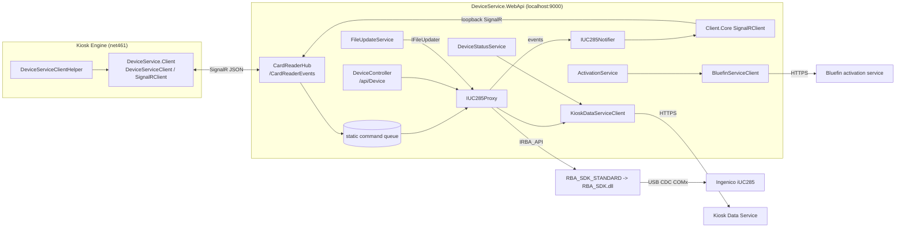
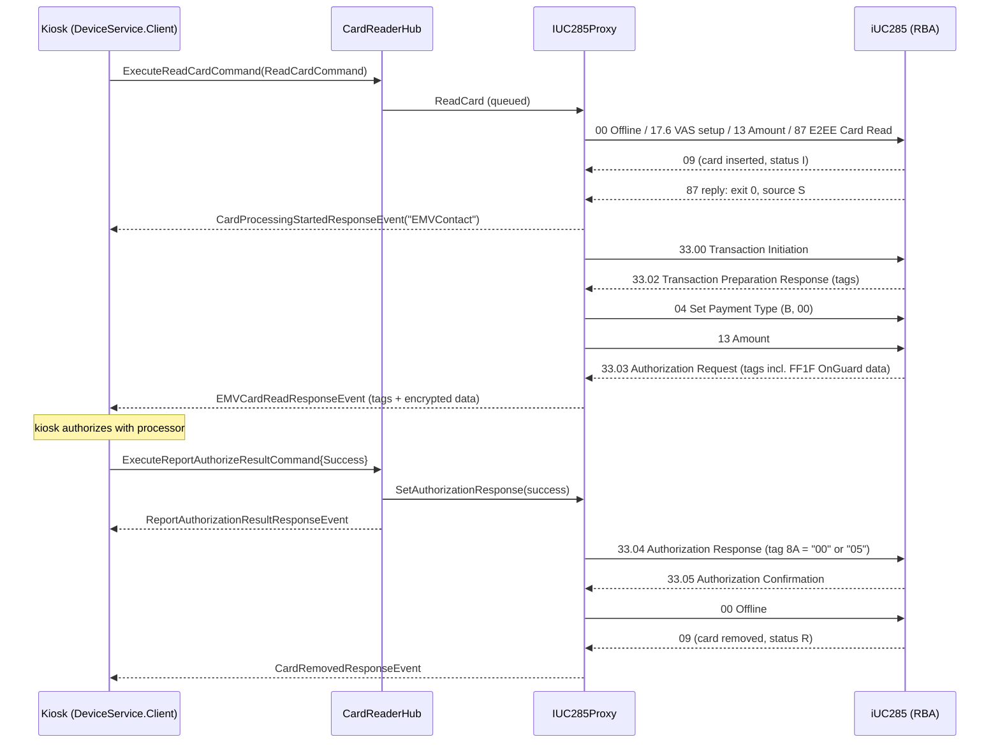

# Device Service (card reader)

## 1. Overview

The Device Service is the kiosk's payment-card reader service. It is an ASP.NET Core 2.2 (x86) Windows
service, `DeviceService.WebApi.exe`, that owns the Ingenico iUC285 unattended card reader. It talks to the
reader through Ingenico's RBA SDK (`RBA_SDK.dll`, native, wrapped by `RBA_SDK_STANDARD`) over a USB virtual
COM port. It exposes the reader to the kiosk software through:

- a SignalR hub at `http://localhost:9000/CardReaderEvents` (`CardReaderHub`): the kiosk sends commands
  (read card, cancel, report authorization result, ...) and receives response events and broadcasts;
- a REST API under `http://localhost:9000/api/Device/...` (`DeviceController`), used for diagnostics and
  tools rather than by the kiosk in normal operation (inferred: the Kiosk Engine client only uses SignalR).

It reads cards by swipe (magnetic stripe), chip insert (EMV contact, including Quick Chip), and tap (EMV and
MSD contactless, mobile wallets). It returns encrypted card data in Ingenico's OnGuard (E2EE) format plus the
EMV tags. It also does Apple/Google wallet pass reads (VAS). The service never authorizes payments and never
decrypts card data. The kiosk sends the data to the payment processor and reports the authorization result
back, so the chip can finish the EMV transaction.

Side jobs:

- Activates the reader with Bluefin (the P2PE decryption provider) by posting its serial numbers to a
  Bluefin activation service.
- Reports reader status, reboot events and per-read statistics to the Kiosk Data Service.
- Configures the reader on every connect and reboots it once a day.
- Applies firmware, EMV and configuration file updates dropped into an `Updates` folder (`FileUpdateService`).
- A companion console tool, `RBAInstaller.exe`, installs RBA firmware (`.OGZ`) and remote key injection
  (`.RKI`) files.

The assemblies in the image are version 1.10.13.0 (DeviceService.*), and the RBA SDK is 5.26.2 ("with iConnect
1.2.15-0", from `REDS/DeviceService/logs`).

## 2. Deployment

| Item | Value |
|---|---|
| Install folder | `C:\Program Files\redbox\REDS\DeviceService\bin` (target path in the update store; image: `REDS/DeviceService/bin`) |
| Executable | `DeviceService.WebApi.exe` (framework-dependent .NET Core 2.2, `Microsoft.AspNetCore.App` 2.2.1, server GC; `DeviceService.WebApi.runtimeconfig.json`) |
| Windows service name | `device$service` (hard-coded in `ApplicationControl.ShutDown`; no installer script for it is in the image) |
| Run modes | Windows service by default. With `--console` or with a debugger attached, it runs as a console app and does not change the working directory (`Program.Main`) |
| Working directory | As a service, it sets the current directory to the exe folder. All relative paths (`appsettings.json`, `.\Data`, `..\logs`, `.\RBA_SDK_Simulator.dll`) resolve from `bin` |
| Listen URL | `AppSettings:DeviceServiceUrl` = `http://localhost:9000` (HTTP only, loopback) |
| SignalR hub | `/CardReaderEvents` |
| REST | `/api/Device/*`; Swagger at `/swagger` (`/swagger/v1/swagger.json`, title "My API") |
| Reader link | USB CDC serial, VID `0B00` PID `0057`, 115200 8N1, no flow control. The COM port is found in the registry, with `COM7` as the fallback |
| Logs | `REDS/DeviceService/logs/DeviceService-yyyyMMdd.log` (Serilog RollingFile, path `../logs/...` relative to `bin`) |
| Data files | `REDS/DeviceService/bin/Data/` (`KioskData.json`, `BluefinActivationData.json`, `RebootTime.json`, optional `DeviceServiceConfig.json`) |
| Update drop folder | `REDS/DeviceService/Updates` (`Completed/` and `Not Processed/` subfolders) |
| RBA installer | `bin/RBAInstaller.exe` with `bin/rbainstallersettings.json` and `bin/RBA Files/` (`update.json`, `.OGZ`, `.RKI`) |

The Update Manager deploys the binaries (`.store/.repository/device-service`, see `update-manager.md`). Its
staging copies are in `bin/.staged_` and `bin/RBA Files/.staged_`.

`BluefinService.Client.Dll`, `Status.Client.dll` and `HttpHelper.dll` are in `bin`, but nothing references
them: they are not in `DeviceService.WebApi.deps.json` and no project references them. They are older,
standalone versions of code that now lives in `DeviceService.WebApi` (`Bluefin/`, `KDS/`, `Services/HttpService.cs`).

**Dependencies.** The service needs the reader (USB) and the native `RBA_SDK.dll`. It makes outbound HTTPS
calls to the Kiosk Data Service (URL in `Data/KioskData.json`) and the Bluefin activation service (URL from the
kiosk). It reads the registry value `HKLM\Software\Redbox\REDS\Kiosk Engine\Store\Environment` (`Production`
or other).

**Dependents.** The Kiosk Engine uses `DeviceService.Client.dll` 1.10.0.4 (net461) through
`DeviceServiceClientHelper` (see `kiosk-engine.md`, `rental.md`). Its client URL setting
`DeviceService.DeviceServiceClientUrl` defaults to `http://localhost:9000/CardReaderEvents`. The service also
connects to its own hub as a client (section 4).

## 3. Architecture

| Project (`src/DeviceService/...`) | Target | Role |
|---|---|---|
| `DeviceService.WebApi` | netcoreapp2.2 x86 exe | Host: `Program`, `Startup`, `CardReaderHub`, `DeviceController`, `ApplicationControl`, Bluefin and Kiosk Data Service HTTP clients |
| `DeviceService.Domain` | netcoreapp2.2 | `IUC285Proxy` (all reader logic), `ReadCardContext`, `ParseTags` (EMV TLV decoding), VAS types, `ActivationService`, `DeviceStatusService`, `IUC285Notifier`, `FileUpdateService` |
| `DeviceService.ComponentModel` | netstandard2.0 | Shared contract with the kiosk: commands, events, models, enums, `TagConstants` |
| `DeviceService.Client.Core` | netcoreapp2.2 | Minimal SignalR client the service uses to send events to its own hub |
| `DeviceService.Client` | net461 | Kiosk-side client (`DeviceServiceClient`, `SignalRClient`, `ReadCardJob`), shipped in `REDS/Kiosk Engine/bin` |
| `RBA_SDK_ComponentModel` | netstandard2.0 | `IRBA_API` interface, `MESSAGE_ID`, `PARAMETER_ID`, `ERROR_ID`, comm settings |
| `RBA_SDK_STANDARD` | netstandard2.0 x86 | `RBA_API`: P/Invoke wrapper over native `RBA_SDK.dll` (`RBA_SDK_*` cdecl exports) |
| `RBA_SDK_Simulator` | netstandard2.0 | **Reconstructed** stand-in for the never-shipped simulator DLL (see its `README.md`) |
| `RBAInstaller` | netcoreapp2.2 x86 exe | Console tool that installs `.OGZ`/`.RKI` files to the reader |
| `BluefinService.Client`, `Status.Client`, `HttpHelper` | netcoreapp2.2 | Unused legacy duplicates (see above) |



**Loopback events.** Anything the proxy wants to push to the kiosk on its own initiative (reader connected or
disconnected, state, tamper, shut-down notices, queue pause) goes through `IUC285Notifier`. The notifier owns a
`DeviceService.Client.Core.DeviceServiceClient` that connects as a SignalR client to
`DeviceServiceUrl + DeviceServiceClientPath` (`http://localhost:9000/CardReaderEvents`) and calls hub methods
such as `SendSimpleEvent`. The hub then broadcasts to `Clients.All`. Each send first checks the loopback
connection and, if it is down, tries to connect for up to 5 s (`IUC285Notifier.ConnectToDeviceServiceClient`).

## 4. Start-up and lifecycle

1. `Program.Main`. It decides service or console mode (section 2), loads configuration (`appsettings.json`,
   then optional `Data\DeviceServiceConfig.json`, then optional `appsettings.{ASPNETCORE_ENVIRONMENT}.json`,
   all reload-on-change), creates the Serilog logger and logs the version. It builds the web host on
   `AppSettings:DeviceServiceUrl`. As a service it runs it through `DeviceServiceWebHostService`, whose
   `OnStarting`/`OnStarted`/`OnStopping`/`OnStopped` only log ("Analytics: ...").
2. `Startup.ConfigureServices`:
   - MVC + Swagger. It binds `AppSettings` to `ApplicationSettings` and `DeviceServiceConfig` to
     `DeviceServiceConfig` (`IOptionsMonitor`, so `DeviceServiceConfig` changes apply live).
   - It builds a throw-away `ServiceProvider` to read the settings and log them.
   - If `UseSimulator` is true and `.\RBA_SDK_Simulator.dll` exists, it loads that DLL by reflection. It
     registers the DLL's controllers (MVC application part) and the types `RBA_SDK_Simulator.ISimulatorDataProvider`
     / `SimulatorDataProvider`, `ICommandQueue` / `CommandQueue`, and `IRBA_API` -> `RBA_API_Simulator`.
     Otherwise it registers `IRBA_API` -> `RBA_SDK.RBA_API`. If the flag is true but the DLL is missing,
     **no** `IRBA_API` is registered.
   - It registers the singletons. The `IUC285Proxy` factory caches the instance in a closure variable and calls
     `Connect()` the first time it is resolved. `IFileUpdater` resolves to that same object, or to null if the
     proxy has not been created yet. `IApplicationControl` is also closure-cached.
   - It starts a `new Task` that builds a **second** `ServiceProvider` from the same `IServiceCollection` and
     resolves `IDeviceStatusService`. That creates the proxy and starts the reader connection, then calls
     `PostDeviceStatus()`. The task then resolves `IFileUpdateService`, whose constructor starts the 15-minute
     update timer. The proxy and `ApplicationControl` are shared through their closures. Every other singleton
     (notifier, Kiosk Data Service client, status service) exists twice, once per provider. The logs show the
     effect: "Begin Connect" and the notifier's "Configuring IUC285Notifier ..." appear on a worker thread
     before "WebHost: OnStarted".
3. `Startup.Configure`. It adds the developer exception page or HSTS, HTTPS redirection (with no HTTPS endpoint
   configured), Swagger, MVC, and `MapHub<CardReaderHub>("/CardReaderEvents")`.
4. Reader connect (`IUC285Proxy.Connect`, guarded by an interlocked "in progress" flag):
   1. `Initialize()` runs once. It sets the SDK log handler (forwarded to the log only when
      `DeviceServiceConfig:EnableIngenicoTraceLogging`), log level TRACE, `RBA_SDK_Initialize`, the
      unsolicited-message handler `TerminalMessageHandler`, the disconnect callback (sets
      `IsConnected = false`), and comm timeouts of 5000 ms each for connect, send and receive.
   2. It enumerates COM ports. Under `HKLM\SYSTEM\CurrentControlSet\Enum\*\VID_0B00&PID_0057*\*\Device Parameters`
      it reads `PortName` and keeps the ports that exist. It falls back to `COM7`. It calls `Connect(port)`
      on each until one succeeds.
   3. `UpdateDeviceConfiguration()` runs in the `finally` block, **even when the connect failed**. This is why
      the logs repeat three "61 Configuration Read ... RESULT_ERROR_NOT_CONNECTED" lines and a pair of "28 Set
      Variable" lines every 10 s while the reader is unplugged. The steps are in section 5.6.
   4. `IsConnected = connectOk && configOk`. If the connect worked but the configuration failed, `ErrorState`
      becomes `FailedToUpdateDevice`. If the unit is tampered at that point, `ErrorState` becomes `Tampered`,
      a `DeviceTamperedEvent` is sent, and the service still treats the reader as connected. If the connect
      failed, `ErrorState` is `ConnectionError`.
5. On the transition to connected (`OnStartup`), the proxy:
   - reads 07 Unit Data (cached);
   - reads the versions of `/HOST/emvcless.xml` and `/HOST/emvcontact.xml` with message 65. The version is
     the first `<!-- ... VERSION ... -->` comment line that matches `\d+(\.\d+)+`;
   - starts the scheduled-reboot countdown;
   - posts a `RebootStatus` to the Kiosk Data Service;
   - sends `CardReaderConnectedEvent`;
   - starts the 15-minute health timer;
   - sends `DeviceTamperedEvent` if tampered, then sends `CardReaderStateEvent`;
   - initializes VAS (section 5.5).
6. On the transition to disconnected (`OnDisconnect`), it classifies the reboot type (section 5.7), cancels any
   running read (error `READERDISCONNECT`), sends `CardReaderDisconnectedEvent`, and stops the health timer.
   The 10-second reconnect timer starts and calls `Connect()` until the reader is back.
7. Steady state:
   - The health timer sends the custom message `PING` every 900 s. If that fails it calls `Reconnect()`
     (disconnect and connect). The timer stops while the hub processes queued commands and restarts when the
     queue empties.
   - `FileUpdateService` runs `UpdateFiles()` every 15 minutes.
   - The scheduled reboot fires at `RebootTime.json`.
8. Shut-down: see section 5.9.

## 5. How it works

### 5.1 Command queue model (`CardReaderHub`)

ASP.NET Core creates a new `CardReaderHub` for each invocation, so all queue state is `static`:

- `_commandQueue` (`ConcurrentQueue<QueuedCommand>`): queued commands. Each entry holds the command, the caller's
  connection id, the caller's `IClientProxy`, and a `Cancelled` flag.
- `ActiveCommand`: the command being executed.
- `_cancellationTokenSources` (`RequestId -> CancellationTokenSource`): set only for an active `ReadCard`.
- `_commandQueuePaused`.
- `_commandProcessors`: command name -> handler. The names are `IsConnected`, `GetUnitHealth`,
  `RebootCardReader`, `ReadConfiguration`, `WriteConfiguration`, `ReadCard`, `ValidateVersion`,
  `CheckActivation`, `CheckDeviceStatus`, `GetCardInsertedStatus` and `SupportsEMV`.

`AddQueuedCommand` (from `ExecuteBaseCommand`, `ExecuteReadCardCommand`, `ExecuteValidateVersionCommand`,
`ExecuteCheckActivationCommand`, `ExecuteCheckDeviceStatusCommand`):

- If `Command.IsQueuedCommand` is true and the name is not `IsConnected` or `SupportsEMV`, the command is
  enqueued.
- Otherwise the handler runs at once on the hub thread. This covers `IsConnected` and `SupportsEMV`, and
  `ValidateVersion`, whose class overrides `IsQueuedCommand => false`.
- In both cases the method then calls `StartProcessingQueuedCommands()`, which starts `ProcessQueuedCommands` on
  a pool task unless one is already running.

`ProcessQueuedCommands` dequeues commands one at a time while the queue is not paused. Before each handler it
stops the health timer, and when the queue empties it starts the timer again. Only one reader operation runs
at a time.

`ProcessReadCardCommand` is declared `async void`. The call it awaits, `IUC285Proxy.ReadCard`, has no real
`await` inside (it blocks on wait handles), so in practice the read still runs to completion before the next
command is dequeued. `ProcessCheckDeviceStatusCommand` is also `async void`, but it really awaits an HTTP call,
so the queue moves on before that command finishes.

Pause and resume. `SetCommandQueueState{CommandQueuePaused}` pauses or resumes the queue. The proxy sends it
through the loopback client around file updates (`PrepareToUpdateFiles` / `CompleteFileUpdates`). Resuming
restarts processing.

Client disconnect (`OnDisconnectedAsync` -> `ClearCommands`). The hub pauses the queue and drops every queued
command from that connection, cancelling any token sources. If the active command belongs to that connection,
it cancels its token, marks it cancelled, and calls `ReadCancel()` when it is a read. Then it resumes the
queue. The code indexes `_cancellationTokenSources[RequestId]` directly, which throws for an active command
that is not a read (not guarded).

Cancel (`ExecuteCancelCommand`, never queued):

- If `CommandToCancelRequestId` has a token source (an active read), the hub cancels it and calls
  `IUC285Proxy.ReadCancel()`, which sets every wait handle and moves the context to `Canceled`.
- Otherwise, if a queued command has that id, the hub marks it `Cancelled`, and the read handler skips it when
  it is dequeued. Only `ProcessReadCardCommand` checks this flag.
- The hub replies `CancelCommandResponseEvent{RequestId = cancel request's id, Success}` to the caller.

### 5.2 Card read: common steps (`IUC285Proxy.ReadCardInner`)

A read is described by `CardReadRequest`:

| Field | Type | Meaning |
|---|---|---|
| `Amount` | decimal? | Transaction amount in dollars. Sent to the reader in cents. If it is null or 0, `"100"` ($1.00) is sent |
| `InputType` | `DeviceInputType` | Readers to enable: `M`=1 swipe, `C`=2 tap, `S`=4 insert, `MC`=3, `MS`=5, `CS`=6, `MCS`=7 |
| `Timeout` | int ms | Overall wait for customer interaction. Raised to a minimum of 30000 |
| `SessionId` | Guid? | Kiosk shopping session. Copied into `CardStats` |
| `ExcludeCardBrandBySource` | `CardBrandAndSource[]` | Brand and source pairs to refuse (`AmexChip`, `AmexTap`, `DiscoverChip`, `DiscoverTap`, `MasterCardChip`, `MasterCardTap`, `VisaChip`, `VisaTap`) |
| `VasMode` | `VasMode` | `PayOnly`=0, `VasOnly`=1, `VasAndPay`=2 |
| `AppleVasUrl`, `GoogleVasUrl` | string | Not used by the service |

The read context (`ReadCardContext`) keeps a state built from `[Flags] ReadCardContextState`:
`VasContinue`=1, `PayContinue`=2, `Continue`=3, `Stop`=4, `Timeout`=5, `Canceled`=6, `Tampered`=7, `Blocked`=8.

- `IsPayEnabled` is true for `PayOnly` and `VasAndPay`. `IsVasEnabled` is true for `VasOnly` and `VasAndPay`.
- `UpdateStopStateFor(mode)` drops the pay or VAS branch: `Continue` becomes `VasContinue` or `PayContinue`,
  and a single branch becomes `Stop`.
- Each step runs through `PerformActionAndCheckSuccess`. It skips the step if the context can no longer
  continue, if the context id does not match the current one (error `CNTXTMM`), or if the unit is tampered
  (state `Tampered`). It checks cancellation, runs the step, and if the step returns false it stops the given
  branch.

Timeout accounting. `TimeRemainingUntilTimeout` is `Request.Timeout - stopwatch` until the
"card processing started" event. From then on it is `DeviceServiceConfig:CardReadUserInteractionTimeout`
(default 30000) minus a stopwatch restarted at that moment.

Sequence of steps:

1. `InitializeReadCard`: resets all wait handles.
2. If VAS is requested but `SupportsVas` is false, the VAS branch is stopped. When nothing else is left, error
   `VASNOTSUPPORTED` is added. With `PayOnly` the state starts as `PayContinue`, with `VasOnly` as
   `VasContinue`.
3. `Offline`: message 00, retried up to 3 times. Each success waits 5250 ms for the reader's 00 reply. If every
   attempt returned `RESULT_ERROR_TIMEOUT`, the proxy calls `Reconnect()`.
4. `PrepareVas` (section 5.5).
5. `SetAmount`: message 13 with `P13_REQ_AMOUNT` = cents. On failure: `RBA001` "Set Amount Message Failed."
6. `CardReadRequestEncrypted`: message 87 (E2EE card read). Parameters:
   - `P87_REQ_FORM_NAME` = `COD.K3Z`;
   - `P87_REQ_PROMPT_INDEX` = the `[Description]` text of the input type (for example `Please Tap or Insert Card`);
   - `P87_REQ_ENABLE_DEVICES` = the enum name (`M`, `C`, `S`, `MC`, `MS`, `CS`, `MCS`).

   On failure: `RBA001` "87 Read Card Encrypted Message Failed."
7. `WaitForVasReadStart` runs only while VAS is active. It waits for a 16 or 87 message. On timeout the state
   becomes `Timeout` with error `TimeOut`.
8. `WaitForCardReadComplete` waits for the unsolicited 87 (or 23) reply.
   - Timeout: error `TimeOut` "No User interaction.", status `Errored`.
   - Exit type other than 0: error `BadExitType` "(exitType) - text".
   - The step succeeds for swipe or MSD with data, for any EMV source (`S`, `Q`, `E`, `m`), or for `VASOnly`
     when VAS is enabled.
9. `SendCardIsBeingProcessed`: the kiosk gets `CardProcessingStartedResponseEvent` with `Data` = card source name
   (`Swipe`, `EMVContact`, ...). The user-interaction timeout starts here.
10. `GetVasData`, only while VAS is still active (section 5.5).
11. Source-specific flow (sections 5.3 and 5.4).
12. `finally`: `Offline()` again.
13. `SendCompletedCallback()` (once per read). If nothing has been sent yet, the kiosk gets the read-complete
    event (section 6.1.4).
14. Unless the state is `Timeout` or `Canceled`, the proxy posts `CardStats` to the Kiosk Data Service
    (section 6.3), fire-and-forget.

An exception in the flow sends an `EncryptedCardReadModel{Status=Errored}` with error `DS001`.

**Building the completion** (`ReadCardContext.SendCompletedCallback`):

1. If there is no response model, or the card's brand and general source (Swipe/Insert/Tap) is listed in
   `ExcludeCardBrandBySource`, an empty model is created: `EMVCardReadModel` for EMV, VAS-only and mobile
   sources, otherwise `EncryptedCardReadModel`. In the excluded case the state becomes `Blocked`. The model's
   status and error come from the state:

   | State | Status | Error code |
   |---|---|---|
   | `Tampered` | `Tampered` | `TAMPERED` |
   | `Canceled` | `Cancelled` | `CANCELLED` |
   | `Timeout` | `Timeout` | `TIMEOUT` |
   | `Blocked` | `Blocked` | `BLOCKED` |
   | anything else, unless VAS data was read | `Errored` | `SCC001` |

2. If pay is enabled, the source is EMV or MSD contactless, and a wallet was detected by VAS, the source
   becomes `Mobile`.
3. It sets `TimeTaken`, `CardSource`, `VasData` and `WalletFormat`, and appends all context errors.
4. A `Success` status that carries errors becomes `Errored`. A model created without an explicit status is
   `Success`, because that is enum value 0.
5. It builds `CardStats` and invokes the hub callback.

The hub chooses the event name from the model's runtime type: `EMVCardReadModel` ->
`EMVCardReadResponseEvent`, `EncryptedCardReadModel` -> `EncryptedCardReadResponseEvent`, anything else ->
`UnencryptedCardReadResponseEvent`. `Success = (Data.Status == Success)`, and the event is forced to failure
with status `Cancelled` if the hub's token was cancelled.

### 5.3 Swipe, MSD contactless and gift cards

When the reader sends 87, `M87e2eeCardRead` runs:

1. It reads `P87_RES_EXIT_TYPE` and `P87_RES_CARD_SOURCE`. The source letters map as `M`=Swipe,
   `E`=EMVContactless, `C`=MSDContactless, `S`=EMVContact, `Q`=QuickChip, `m`=Mobile, `c` or `cq`=VASOnly,
   anything else Unknown. If the exit type is not 0, nothing more is parsed.
2. For swipe and MSD it stops the VAS branch, reads `P87_RES_CARD_DATA`, strips FS (0x1C) characters and
   parses the result with `ParseOnGuardData` (section 6.4).
   - Empty data: error `SwipeHasNoData`.
   - Unhandled source: errors `E2EEICS` and `UnknownCardSource`.
   - Exception: errors `E2EEUH` and `87ReadCardUnhandled`.

There is no further reader dialogue for swipe or MSD. The completion is an `EncryptedCardReadResponseEvent`
(encrypted flag 1) or an `UnencryptedCardReadResponseEvent` (clear layout or Redbox gift card).

The service also handles a legacy 23 Card Read reply (`M23CardRead`). It builds an `UnencryptedCardReadModel`
from tracks 1 to 3 and reads variables 394 and 000398 without using them. The service never sends 23 itself:
`CardReadRequestUnencrypted` exists but nothing calls it.

### 5.4 Chip (EMV contact), Quick Chip and EMV contactless

For EMV sources the 87 reply carries no card data. For a contact or Quick Chip card the proxy also arms the
"card removed" handle.

**EMV contact (source `S`)**:



Details:

1. `EMVTransInitiation` sends 33.00 with `P33_00_REQ_STATUS=00`, `EMVH_CURRENT_PACKET_NBR=0`,
   `EMVH_PACKET_TYPE=0` and `RESEND_TIMER=5000`. It then waits up to 20 s for 33.02. A 33.03 or 33.05 also
   releases the wait.
   - Failure or timeout: `RBA001` "EMV Initiate Message Failed." and the completion is sent at once.
   - If 33.05 has already arrived (the chip finished early, for example a decline or an error): `EMV001`
     "EMV Data Issue." and the completion is sent at once.
2. `SetPaymentType_04` sends 04 with `P04_REQ_FORCE_PAYMENT_TYPE=0`, `P04_REQ_PAYMENT_TYPE=B` (credit) and
   `P04_REQ_AMOUNT=00`. Reply `P04_RES_FORCE_PAYMENT_TYPE` is 0 success, 1 failed, 2 changed customer
   selection. Then 13 Amount is sent again.
3. `EMVResponse`:
   1. It waits for 33.03 (remaining time).
   2. It sends the completion. The kiosk now has the data it needs to authorize.
   3. It waits for the kiosk's authorization result (`_mre3304`, set by `ExecuteReportAuthorizeResultCommand`).
      When the read came from REST (no event callback), it does not wait and answers "approved".
   4. It sends 33.04 with `P33_04_RES_STATUS=00`, packet 0, type 0, and tag 0x8A (138, Authorization
      Response Code) = `"00"` (approved) or `"05"` (declined). If the kiosk never answers, no 33.04 is sent.
   5. It waits for 33.05 (the reader's final decision).
4. Every 33.02, 33.03 and 33.05 is decoded by `EMVDataFromDevice` (section 6.5). It rebuilds the
   `EMVCardReadModel`, but only the model built from 33.03 reaches the kiosk, because the completion is sent
   only once. A decline cryptogram (9F27 = AAC) or a 1010 error code in a later message is logged and added to
   the context only.

**Quick Chip (source `Q`)**: no 33.00, 04 or 33.04 from the host. The service waits for 33.05 (timeout ->
state `Timeout`) and then sends the completion built from it.

**EMV contactless and mobile (sources `E`, `m`)**: the 87 reply releases the card-removed handle. Then
`EMVResponse` runs as above: wait 33.03, send the completion, wait for the kiosk's result, send 33.04, wait
33.05. During tag parsing an `EMVContactless` read becomes `Mobile` when tag 9F6E shows a mobile device:

- Mastercard: the device-type characters at hex offset 8, length 4, are a number greater than 0 and not 20.
- Visa: the second hex nibble has bit 0x2 set.

**Card removal and insertion.** The reader sends 09 unsolicited (`M09SetAllowedPayment`). Card type `02` or
`99` with status `I` means inserted. With status `R` it means removed: the proxy sets `CardRemoved` and sends
`CardRemovedResponseEvent` to the read's caller. This can happen after the read has completed, because the
last context is kept. `GetCardInsertedStatus` asks directly with 33.01: `P33_01_REQ_STATUS=00`, packet 0,
type 0. The reply field `P33_01_RES_F1_CHIP_CARD` = `I` means `Inserted`, anything else `Removed`.

**Fallback.** The service does not fall back to swipe by itself. It reports the advice in each model:
`FallbackStatusAction` and `FallbackReason`, taken from the reader's error code in tag 1010:

| 1010 code | FallbackStatusAction | FallbackReason |
|---|---|---|
| `CDIV` | `IncrementFallbackCounter` | `CardDataInvalid` (1) |
| `CNSUP` | `NoAction` | `CardNotSupported` (2) |
| `CRPRE` | `NoAction` | none |
| `APBLK`, `CABLK`, `CEXP` | `ResetFallbackCounter` | none |
| any other code | `NoAction` | none |
| no 1010 tag | `ResetFallbackCounter` (default) | none |

`ImmediateFallback` exists in the enum but the service never sets it. A non-empty 1010 code also becomes an
error with that code and message "Error During Read.", and stops the pay branch. The kiosk counts fallbacks per
session. When the count reaches `CardReadTechnicalFallbackCountLimit` (default 3,
`DeviceServiceTrackDataService`), the kiosk asks for a swipe. See `rental.md`.

**Card brand.** Brand comes from the AID (tag 4F or 84):

| AID contains | Brand |
|---|---|
| `A000000003` or `A00000009` | VISA |
| `A00000002` | Amex |
| `A000000004` | Mastercard |
| `A0000001` or `A000000324` | Discover |
| `A000000333` | UnionPay |
| anything else | Unknown |

Swipes never get a brand, so brand blocking only applies to chip and tap reads.

### 5.5 Mobile wallet passes (VAS, message 17 type 6)

`SupportsVas` is true only when all of these hold:

- the reader is connected and initialized;
- `DeviceServiceConfig:EnableVasCommands` is true (the default);
- the RBA application version (07 `P07_RES_APPLICATION_VERSION`) is `23kA`, `23kG` or `23kK`;
- the injected-key list (variable 810) contains `KCV_VKBPK=713F7E` in production (registry `Environment` =
  `Production`), or any `KCV_` entry otherwise.

All VAS commands are 17 Merchant Data Write messages:

- Request: `P17_REQ_TYPE=6`, `P17_REQ_VAS_CMD` = 3-digit command, and zero or more `P17_REQ_VAS_PARAMETER`
  values added with `AddParam`.
- Reply: `P17_RES_TYPE` (must be 6), `P17_RES_STATUS` (`VasStatus`), `P17_RES_IS_ADDITIONAL_DATA`,
  `P17_RES_VAS_RESULT`, and repeated `P17_RES_VAS_DATA` read until the length is negative.

`VasStatus` values: 0 Successful, 1 Failed, 2 Unsupported, 4 Invalid, 5 DataOverflow, 6 VasSuccessful,
7 NoVasData, 8 InvalidMerchant, 9 Unknown.

| VasCmd | Code | Parameters used |
|---|---|---|
| `SetEnable` | 001 | `1` or `0` |
| `SetMode` | 003 | `0` VasOnly, `1` VasAndPay, `2` PayOnly |
| `GetData` | 013 | none. Success requires status `Successful` |
| `ClearAppleMerchantList` | 500 | none |
| `AddAppleMerchantId` | 501 | pass type id, `tbd`, `0100000000`, `1` |
| `GetAppleMerchantCount` | 502 | none |
| `ClearGoogleMerchantList` | 510 | not used |
| `AddGoogleMerchantId` | 511 | merchant id, `PLACE03`, `TRMNL01`, `Google Store`, `en`, `1`, `0` |
| `GetGoogleMerchantCount` | 512 | none |

- **On connect** (`InitializeVas`): enable VAS, then add the Apple ids `pass.com.apple.wallet.vas.prodtest`,
  `pass.com.ingenico.us.vas.test` and `pass.com.redbox.kiosk`, and the Google id `70779451`.
- **Per read** (`PrepareVas`):
  - VAS not supported: if it was enabled earlier, disable it, then continue.
  - VAS enabled for this read: SetMode, clear the Apple list, add Apple `pass.com.vibes.redbox` (production)
    or `pass.com.vibes.RedboxQAEnvironment` (other), get the Apple count, add Google `44813557` (production)
    or `70779451` (other), get the Google count.
  - VAS not enabled for this read: only SetMode.
- **Reader reply 16 (contactless mode)**, `M16ContactlessMode`:
  - It reads `P16_RES_DATA` as a `VasMessageStatus` and `P16_RES_STATUS`.
  - If the status is not 0 or 6, or the message is not one of `VAS_STATUS_OK`(0), `CANCELLED`(10),
    `COMPLETE_TAP`(12), `EXPECT_PAYMENT`(14) or `VAS_ERROR_MOBILE_DATA_NOT_AVAILABLE`(139), the VAS branch
    stops. If pay is not enabled, error `VAS166` is added.
  - The full `VasMessageStatus` list is in `VasMessageStatus.cs`.
- **Reading the pass** (`GetVasData`): sends 013. `P17_RES_VAS_RESULT` `0` means Apple and `1` means Google.
  The data records are split on FS (0x1C):
  - Apple: the first record with fields `[0]=="0"`, `[1]=="0"` and `[4]` non-empty and not `"0"`. The pass
    value is `[5]` decoded from hex to ASCII.
  - Google: the first record must start `0`,`0`. In each later record with `0`,`0` the pass value is `[2]`,
    and `[3]` is a `VasCardType` (3 Loyalty, 4 Offer, 5 GiftCard, ...).

  The value goes to `VasData`, and `WalletFormat` becomes `Apple` or `Google`. In VAS-only mode the read fails
  if no value was found. The helper that turns that failure into error `VASDATA001` (`WaitForVasData`) is
  never called.
- **VAS-only card source** (`c`/`cq` -> `VASOnly`): in `VasAndPay` mode the flow waits for a 16 reply. On
  timeout the state becomes `Timeout`.

`VasErrorCode` exists on the model and in `CardStats`, but nothing sets it.

### 5.6 Reader configuration on connect (`UpdateDeviceConfiguration`)

These defaults are read with 61 and, if different, written with 60 (`sendOffline: false`). The step allows 3
read retries **in total** (shared across all items) and stops at the first failure.

| Group | Index | Value |
|---|---|---|
| 0007 | 0003 | 1 |
| 0019 | 0001 | 1 |
| 0019 | 0002 | 1 |
| 0019 | 0003 | 3 |
| 0008 | 0001 | 9 |
| 0003 | 0010 | 1 |
| 0008 | 0003 | 1 |
| 0013 | 0014 | 1 |
| 0019 | 0021 | 1 |
| 0008 | 0017 | 86400 |
| 0007 | 0014 | 25 |
| 0007 | 0001 | 0 |
| 0007 | 0039 | 0 |
| 0007 | 0022 | 0 |

The meaning of these parameters is in Ingenico's RBA configuration guide, not in this code. The 86400 in
0008/0017 is probably the reader's own 24-hour reboot interval (inferred).

Then `UpdateCardConfigurationData` reads group `0011`, indices 1 to 16. In each entry whose first
space-separated field is `1`, it forces the 7th and 9th non-empty fields to `0` and writes the entry back if it
changed. The meaning of the fields is unknown (probably the card-range table).

Finally the proxy:

- sets variable 201 to the time `hhmmss` and variable 202 to the date `MMddyy` (message 28);
- if `Data\RebootTime.json` is missing or zero, writes a random time between 03:00:00 and 03:59:59;
- sends 00 Offline.

Other configuration and variables the service uses:

| Item | How the service uses it |
|---|---|
| Config 14/1 | TGZ (EMV parameter package) version. `SupportsEMV` is true when it parses as a version other than 0.0 |
| Config 14/10 | File-update revision number, read and written by `FileUpdateService` and `RBAInstaller` |
| Variable 254 | RBA minor version (compared by `RBAInstaller`) |
| Variable 500 | Seconds until the reader's own reboot (inferred from `DeviceRebootTime`) |
| Variable 810 | Injected key check values, newline-separated (`KCV_...`). Reported as `InjectedKeys` with lines joined by `|` |
| Variables 201, 202 | Reader clock (time `HHmmss` and date `MMddyy`). Read back to get `RebootStatus.DeviceTime` |

### 5.7 Reboots

- **Scheduled.** On each connect, a task waits until `today + RebootTime.json` (tomorrow if that time is more
  than 3 minutes in the past) and sends 97 Reboot with type `Scheduled`. The time in the image is
  `"03:14:05"`.
- **Expected reboot time** (`GetExpectedRebootTime`) is the earlier of the configured time and
  `now + variable 500` seconds. `FileUpdateService` will not start within 30 minutes of it.
- **Reboot type.** On disconnect the service keeps an explicitly set type (`ServiceStart`, `Scheduled`,
  `Manual`, `FileUpdate`). Otherwise the type is `Automatic` if the disconnect is within ±3 minutes of
  24 hours after the previous disconnect, and `Disconnect` if not. After each connect it posts `RebootStatus`
  (section 6.3) and resets the type to `Disconnect`. The type starts as `ServiceStart` (enum 0).
- **Manual.** `RebootCardReader` (hub) and `GET api/Device/Reboot` send 97 with type `Manual`.

### 5.8 Activation with Bluefin (`ActivationService`)

Bluefin activation registers the reader serial numbers for this kiosk with a Bluefin activation service.
Inferred: Bluefin then accepts this reader's encrypted card data for decryption. This service makes no
decryption calls itself.

1. The kiosk sends `CheckActivation` with `BluefinActivationRequest {KioskId, BluefinServiceUrl, ApiKey,
   Timeout}`. The Kiosk Engine sends it whenever the reader becomes valid, if `BluefinAutoActivate`
   (`DeviceServiceClientHelper.CheckDeviceActivation`).
2. The service takes `MfgSerialNumber` = 07 `P07_RES_MANUFACTURING_SERIAL_NUMBER` and `InjectedSerialNumber` =
   07 `P07_RES_UNIT_SERIAL_NUMBER`.
3. It reads `Data\BluefinActivationData.json` (`{"KioskId":..., "MfgSerialNumber":"..."}`). If the file exists
   and matches the kiosk id and serial, the result is `true` and no call is made.
4. Otherwise it sends `POST {BluefinServiceUrl}/device/activate` with header `x-api-key: <ApiKey>`, JSON body
   (nulls omitted), and an HTTP timeout of `Timeout` ms:

   ```json
   {"KioskId":19707,"ReaderSerialNumber":"<mfg serial>","InjectedSerialNumber":"<unit serial>","LocalDateTime":"2024-12-02T04:04:16.86-05:00"}
   ```

   The response is a `StandardResponse` (section 6.3). On `Success` the service writes
   `BluefinActivationData.json`.
5. On failure, if `AppSettings:ActivationFailureRetry` is true, it retries after 5 minutes. A failed retry
   schedules another, so in effect it retries every 5 minutes until one succeeds.

`Deactivate` (`POST {url}/device/deactivate`, body `{KioskId, ReaderSerialNumber}`) is implemented but never
called. In the image, `system.config` sets `BluefinAutoActivate=true` and `BluefinServiceTimeout=40000`, and
`BluefinServiceUrl` points at a `/bluefinservice` path on a non-Redbox host.

### 5.9 Shut-down negotiation (`ApplicationControl`)

`ShutDown(force, reason)` comes from the hub (`ExecuteDeviceServiceShutDownCommand`) or
`POST api/Device/Shutdown`:

1. Unless `force` is set, `CanShutDown` runs:
   1. It broadcasts `DeviceServiceCanShutDownEvent`.
   2. A kiosk client answers with `ExecuteDeviceServiceCanShutDownCommand{CanShutDown}`. The kiosk client
      asks its `OnDeviceServiceCanShutDownHandler` first and answers `true` if there is none.
   3. The service waits up to 5 s. A `false` answer ends the wait early.
   4. The result is the AND of all answers received, and `true` if none arrived.
2. If allowed, it broadcasts `DeviceServiceShutDownStartingEvent{ShutDownReason}`, waits 3 s, then stops the
   Windows service `device$service` with `ServiceController.Stop()`. In console mode it calls
   `IApplicationLifetime.StopApplication()`.
3. The method returns `true` as soon as the stop task is started.

`ShutDownReason` values: `None`=0, `SoftwareUpdate`=1.

`FileUpdateService` calls `CanShutDown(SoftwareUpdate)` before applying updates, so the kiosk can postpone
them.

### 5.10 File updates (`FileUpdateService`)

Every 15 minutes, starting 15 minutes after start-up, `UpdateFiles()` runs under a lock. The base folder is the
parent of the exe folder, so the folders are:

- `REDS\DeviceService\Updates\*.zip` (input);
- `Updates\Completed\` (applied);
- `Updates\Not Processed\` (revision downgrades).

Each zip holds a `manifest.json` at its root:

```json
{
  "Id": "279dc2db-4343-4702-ac54-08dcddf0de46",
  "Revision": 3,
  "Name": "Full OGZ 1.1",
  "StartDate": null,
  "UpdateRangeStart": "02:00:00",
  "UpdateRangeEnd": "08:00:00",
  "FileModels": [
    { "Path": "RDB232a_1.3.OGZ", "Order": 1, "RebootRequired": true },
    { "Path": "RDB232a_1.3.TGZ", "Order": 2, "RebootRequired": true },
    { "Path": "EMVCLESS.XML",    "Order": 3, "RebootRequired": true },
    { "Path": "EMVCONTACT.XML",  "Order": 4, "RebootRequired": true }
  ]
}
```

That example is the real manifest of `Updates/Not Processed/IngenicoRBA232aV2.zip` in the image.

Pipeline (each check runs only while the overall result is still a success):

1. **Find.** List `Updates\*.zip`.
2. **Read manifests.** The manifest status (`ManifestPropertiesStatus`) is set as follows:
   - `MissingManifestFile`: no `manifest.json` in the zip;
   - `CorruptedManifestFile`: the manifest does not deserialize;
   - `MissingRevisionNumber`: `Revision` is 0 or less;
   - `RevisionDowngrade`: the reader's config 14/10 is greater than or equal to `Revision`;
   - `ManifestHasNoUpdateFiles`: `FileModels` is empty;
   - `ExceptionWhileReading`: any other exception.

   A file name longer than 15 characters marks the file `FileNameTooLong` and the zip `Errored`. Zips are
   sorted by revision, ascending.
3. **Validate files.** Every `Path` must exist as a zip entry. A missing one marks the file `FileMissing` and
   the zip `Errored` ("File missing from zip file.").
4. **Active set.** Zips still `NotProcessed` with `StartDate <= now` (or no start date) and the current time of
   day within `[UpdateRangeStart, UpdateRangeEnd]` (or no range). The others become `Skipped`
   (`StartDateIsInTheFuture` or `OutsideOfTimeRange`).
5. **Gates:**
   - there must be at least one active zip;
   - the file updater (the proxy) must exist (`MissingFileUpdater`);
   - the time must not be within 30 minutes of the expected reader reboot (`NearExpectedRebootTime`);
   - `CanShutDown(SoftwareUpdate)` must be true (`UnableToShutDown`);
   - the output folders must exist or be creatable (`UnableToCreateCompletedFolder`,
     `UnableToCreateNotProcessedFolder`).
6. **Apply.** `PrepareToUpdateFiles()` pauses the hub command queue. For each active zip, in revision order:
   1. For each file by `Order`, open the entry and call
      `IUC285Proxy.WriteStream(stream, Path, reboot = RebootRequired || isLastFile, waitForReconnect: true)`.
      With `waitForReconnect`, it waits up to 180 s for the reader to reconnect after the reboot.
   2. On the first failure the zip is `Errored` and the remaining zips are `Skipped`.
   3. On success, write config 14/10 = `Revision`, move the zip to `Completed\` (adding `(n)` if the name
      exists), and post a fresh `DeviceStatus`.

   `CompleteFileUpdates()` then resumes the queue.
7. **Failure path.** If the run failed before applying (any gate), zips with `RevisionDowngrade` are moved to
   `Not Processed\`. That is why `IngenicoRBA232aV2.zip` (revision 3) is there: the reader's revision was 3 or
   higher.

The result (`FileUpdateResults` with high-level status, message and per-zip, per-file statuses) is only logged.

**File transfer protocol** (`WriteStreamInner`, message 62):

- The name must be 1 to 15 characters.
- `.RKI` files are filtered to the single line that starts with the reader's unit serial number (07
  `UNIT_SERIAL_NUMBER`). If there is no such line the file is skipped and the call reports success.
- The data is escaped by `GetEncodedData` ("encoding format 8"):
  - bytes 0x00–0x1F become `0xFF, b+0x20`;
  - bytes 0x20–0xFE are sent unchanged;
  - 0xFF becomes `0xFF 0xFF`.
- Records are about 4063 encoded bytes (`P62_REQ_FILE_DATA_MAX_SIZE` is 4064).
- Each record is a 62 message, retried up to 3 times. Parameters:

  | Parameter | Value |
  |---|---|
  | `P62_REQ_RECORD_TYPE` | 0 whole file in one record, 1 first of many, 2 continuation, 3 last, 9 abort (sent on a stream read error) |
  | `P62_REQ_ENCODING_FORMAT` | `8` |
  | `P62_REQ_SEGMENT_NBR` | two digits from 01, back to 01 after 99 |
  | `P62_REQ_UNPACK_FLAG` | `1` |
  | `P62_REQ_FAST_DOWNLOAD` | `1` |
  | `P62_REQ_FILE_NAME` | the file name (first record only) |
  | `P62_REQ_FILE_DATA` | the record |
  | `P62_REQ_LAST_MESSAGE_TIMEOUT_SEC` | `180` |

- After the last record the service **always** sends 97 Reboot. `rebootAfterWrite` only decides whether the
  reboot type is recorded as `FileUpdate` and whether the caller waits for the reconnect.

The REST `WriteFile` path (`WriteFileInner`) is different. It hands a local OS path to the SDK with the
`FILE_WRITE` message:

- `P62_REQ_OS_FILE_NAME` = full path and `P62_REQ_FILE_NAME` = file name;
- record type 0, format 8, unpack 1, fast download 1, timeout 180;
- 97 Reboot afterwards only if requested, and never for `.OGZ`.

Files are also read from the reader with 65 Retrieve File:

- Request: `P65_REQ_RECORD_TYPE` `1` (first) or `0` (next), `P65_REQ_DATA_TYPE` 0 text or 1 Base64,
  `P65_REQ_FILE_NAME`.
- Reply: `P65_RES_RESULT` is 0 OK, 1 not found, 2 Base64 error, anything else a format error. On 0 the reply
  also has `TOTAL_NUMBER_OF_BLOCKS`, `BLOCK_NUMBER`, `CRC`, `DATA_TYPE` and `DATA`.

### 5.11 RBA installer (`RBAInstaller.exe`)

A console host (generic `HostBuilder`). It logs to `../logs/RBAInstaller-{Date}.log`, reads
`rbainstallersettings.json` and `Data\DeviceServiceConfig.json`, and builds its own `IUC285Proxy` with no
notifier, status client or settings. It must therefore run while the Device Service does not hold the COM port
(inferred). Steps (`RBAInstaller.StartAsync`):

1. Wait up to 180 s for the reader to connect.
2. Load `RBA Files\update.json` from the current directory. The image's file:

   ```json
   { "Revision": "111",
     "Files": [ { "Path": "RDB23KK_1.1.OGZ", "CompareVersion": "23kK" },
                { "Path": "RB410201202.RKI", "IsIntermediateVasKey": true },
                { "Path": "RB410050417.RKI" } ] }
   ```

3. For each file, wait for the connection again, then:
   - **`.OGZ`** (RBA firmware). Skip if 07 `ApplicationVersion == CompareVersion` and, when `MinorVersion` is
     given, variable 254 equals it. Otherwise call `WriteStream(..., reboot: true, waitForReconnect: true)`.
   - **`.RKI`** (remote key injection, VAS key). Skip if the reader already `HasValidVasRKI`. Install an
     intermediate-key file only when the reader has the invalid production VAS key (`KCV_VKBPK=483320`), and
     install a non-intermediate file only when it does not. `KCV_VKBPK=D668B7` marks the intermediate repair
     key.
   - Stop at the first failure.
4. If everything succeeded, write config 14/10 = `Revision` if it is higher than the current value.

What starts `RBAInstaller` is not in the code (probably the Update Manager or an install script, see
`update-manager.md`). The `RBA Files` folder holds several RBA builds (`RDB23K6`, `23K8`, `23KA`, `23KG`,
`23KK`) and two RKI files.

## 6. Protocols and interfaces

### 6.1 SignalR hub `/CardReaderEvents`

Transport: ASP.NET Core SignalR 1.1 (server `Microsoft.AspNetCore.SignalR` 1.1.0, clients
`Microsoft.AspNetCore.SignalR.Client` 1.1.0), registered with `services.AddSignalR()` and no options. The wire
format is therefore the framework default:

- negotiate (`POST /CardReaderEvents/negotiate`), then WebSockets, falling back to SSE or long polling;
- JSON hub protocol: handshake `{"protocol":"json","version":1}` followed by 0x1E, and each message a JSON
  object followed by 0x1E;
- camelCase property names (the framework's default contract resolver); enums as integers, Guids as strings,
  `System.Version` as an object with `major`, `minor`, `build`, `revision`, `majorRevision`, `minorRevision`.

There is no authentication.

Invocations from client to server use the hub method name as `target` and send one argument, the command
object. Server-to-client messages use the event name as `target` and send one argument, the event object.
Example of a read request and its completion (values illustrative):

```text
-> {"type":1,"target":"ExecuteReadCardCommand","arguments":[{
      "request":{"amount":3.18,"inputType":7,"timeout":65000,"sessionId":"5f0c...","excludeCardBrandBySource":[],
                 "vasMode":0,"appleVasUrl":null,"googleVasUrl":null},
      "signalRCommand":"ExecuteReadCardCommand","commandName":"ReadCard",
      "requestId":"0b8e...","createdDate":"2024-12-02T10:00:00-05:00","isQueuedCommand":true,
      "commandTimeout":60000,"deviceServiceClientVersion":{"major":1,"minor":10,"build":0,"revision":4,...}}]}\x1e
<- {"type":1,"target":"CardProcessingStartedResponseEvent","arguments":[{"data":"EMVContact",
      "requestId":"0b8e...","success":true,"eventName":"CardProcessingStartedResponseEvent"}]}\x1e
<- {"type":1,"target":"EMVCardReadResponseEvent","arguments":[{"data":{ ...EMVCardReadModel... },
      "requestId":"0b8e...","success":true,"eventName":"EMVCardReadResponseEvent"}]}\x1e
```

#### 6.1.1 Command base (`BaseCommandRequest`)

| Field | Type | Notes |
|---|---|---|
| `RequestId` | Guid | Generated by the client. Every response event carries the same id |
| `CommandName` | string | Routes `ExecuteBaseCommand` (see the table below) |
| `SignalRCommand` | string (get-only) | The hub method the client invokes |
| `CreatedDate` | DateTime | Client time. The client uses it for its async timeout |
| `IsQueuedCommand` | bool (get-only) | Evaluated on the server type, not from the wire |
| `CommandTimeout` | int? ms | Client-side wait. Default 180000 |
| `DeviceServiceClientVersion` | Version | Client assembly version |

#### 6.1.2 Hub methods (client -> server)

| Hub method | Argument type, extra fields | Queued? | Response event (to caller) |
|---|---|---|---|
| `ExecuteReadCardCommand` | `ReadCardCommand` + `Request: CardReadRequest` | yes | `CardProcessingStartedResponseEvent`, `CardRemovedResponseEvent`, then one of `EMVCardReadResponseEvent` / `EncryptedCardReadResponseEvent` / `UnencryptedCardReadResponseEvent` |
| `ExecuteBaseCommand` | `BaseCommandRequest` routed by `CommandName`, see below | depends | see below |
| `ExecuteCancelCommand` | `CancelCommandRequest` + `CommandToCancelRequestId: Guid` (`CommandName` `Cancel`) | no | `CancelCommandResponseEvent` |
| `ExecuteReportAuthorizeResultCommand` | `ReportAuthorizeResultCommand` + `Success: bool` | no (handled directly) | `ReportAuthorizationResultResponseEvent` (`Success` echoes the input) |
| `ExecuteValidateVersionCommand` | `ValidateVersionCommand` | no | `ValidateVersionReponseEvent` (spelled this way) |
| `ExecuteCheckActivationCommand` | `CheckActivationCommand` + `Request: BluefinActivationRequest` | yes | `CheckActivationResponseEvent` |
| `ExecuteCheckDeviceStatusCommand` | `CheckDeviceStatusCommand` + `Request: DeviceStatusRequest` (may be null) | yes | `CheckDeviceStatusResponseEvent` |
| `ExecuteDeviceServiceShutDownCommand` | `DeviceServiceShutDownCommand` + `ForceShutDown: bool`, `Reason: ShutDownReason` | no | `DeviceServiceShutDownResponseEvent` (after the decision) |
| `ExecuteDeviceServiceCanShutDownCommand` | `DeviceServiceCanShutDownCommand` + `CanShutDown: bool` | no | none (answer to `DeviceServiceCanShutDownEvent`) |
| `SetCommandQueueState` | `SetCommandQueueStateCommand` + `CommandQueuePaused: bool` | no | none |
| `SendSimpleEvent` | `SimpleEvent{EventName}` | n/a | rebroadcast to **all** clients with target = `EventName` (loopback use) |
| `SendShutDownStartingEvent` | `DeviceServiceShutDownStartingEvent` | n/a | broadcast `DeviceServiceShutDownStartingEvent` |
| `SendCardReaderStateEvent` | `CardReaderStateEvent` | n/a | broadcast `CardReaderStateEvent` |
| `SendMessage` | string | n/a | broadcast `ReceiveMessage("username", message)` |

`ExecuteBaseCommand` routing by `CommandName`:

| CommandName | Execution | Reader action | Response event and payload |
|---|---|---|---|
| `IsConnected` | immediate | none | `IsConnectedResponseEvent{IsConnected, Success=true}` |
| `SupportsEMV` | immediate | 61 14/1 | `SupportsEMVResponseEvent{SuportsEMV (spelled this way), Success=true}` |
| `GetUnitHealth` | queued | 08 with `P08_REQ_REQUEST_TYPE=0` | `GetUnitHealthResponseEvent{UnitHealthModel, Success = model != null}` |
| `RebootCardReader` | queued | 97 | `RebootCardReaderResponseEvent{Success}` |
| `GetCardInsertedStatus` | queued | 33.01 | `GetCardInsertedStatusResponseEvent{CardInsertedStatus: 0 Unknown, 1 Inserted, 2 Removed}` |
| `ReadConfiguration` | queued | 00, 61 | event `ReadConfiguration`: `SimpleResponseEvent{Data = value or null}` |
| `WriteConfiguration` | queued | 00, 60 | event `WriteConfiguration`: `SimpleResponseEvent{Data = "True" or "False"}` |
| `ValidateVersion`, `CheckActivation`, `CheckDeviceStatus`, `ReadCard` | as their typed methods | | |

`ReadConfiguration` and `WriteConfiguration` through `ExecuteBaseCommand` cannot work as written. The hub
binds the argument as `BaseCommandRequest`, so the `as ConfigCommand` cast gives null and the handler throws.
The kiosk client's `ReadConfig`/`WriteConfig` also never set the group or index, and both send
`ReadConfiguration`. Use the REST endpoints instead.

`ValidateVersion` succeeds when the client's `Major.Minor` is one of 1.5, 1.8 or 1.10
(`DeviceService.CompatibleClientVersions`). The event carries `ValidateVersionModel{IsCompatible,
DeviceServiceVersion}`.

`CheckDeviceStatus` with a `Request`:

1. Overwrites `Data\KioskData.json` with `{KioskId, ApiKey, ApiUrl}`. This is how the Kiosk Engine hands over
   the Kiosk Data Service URL and key: `KioskDataServicesUrl` and `KioskDataServicesKey`, sent once per run.
2. Builds and posts `DeviceStatus` (section 6.3).
3. Sets `Success = response.Success && response.StatusCode == 200`.

Without a `Request` it uses the stored `KioskData.json`.

#### 6.1.3 Events (server -> client)

All events derive from `BaseEvent{EventName}`. Response events add `RequestId` and `Success`.

| Event (target) | Sent to | Payload fields |
|---|---|---|
| `CardReaderConnectedEvent` | all | `EventName` |
| `CardReaderDisconnectedEvent` | all | `EventName` |
| `CardReaderStateEvent` | all (on reader connect, on every hub client connect, on `DeviceServiceConfig` change while connected) | `CardReaderState{IsConnected, IsTampered, ConnectionState (0 Disconnected, 1 Connecting, 2 Connected), SupportsEMV, SupportsVas, Version (DeviceService.Domain assembly version), ErrorState}` |
| `DeviceTamperedEvent` | all (on connect if tampered, and to each new hub client if tampered) | `EventName` |
| `DeviceServiceCanShutDownEvent` | all | `EventName` |
| `DeviceServiceShutDownStartingEvent` | all | `ShutDownReason` |
| `ReceiveMessage` | all, on each hub connect | two string arguments `"username"`, `"Hello"` |
| `CardProcessingStartedResponseEvent` | read caller | `SimpleResponseEvent{RequestId, Success=true, Data = CardSourceType name}` |
| `CardRemovedResponseEvent` | read caller | `SimpleResponseEvent{RequestId, Success=true, Data=null}` |
| `EMVCardReadResponseEvent` | read caller | `{RequestId, Success, Data: EMVCardReadModel}` |
| `EncryptedCardReadResponseEvent` | read caller | `{RequestId, Success, Data: EncryptedCardReadModel}` |
| `UnencryptedCardReadResponseEvent` | read caller | `{RequestId, Success, Data: UnencryptedCardReadModel}` |
| `IsConnectedResponseEvent`, `SupportsEMVResponseEvent`, `GetUnitHealthResponseEvent`, `GetCardInsertedStatusResponseEvent`, `RebootCardReaderResponseEvent`, `ReadConfiguration`, `WriteConfiguration`, `ValidateVersionReponseEvent`, `CheckActivationResponseEvent`, `CheckDeviceStatusResponseEvent`, `CancelCommandResponseEvent`, `ReportAuthorizationResultResponseEvent`, `DeviceServiceShutDownResponseEvent` | caller | see 6.1.2 |

`TimeoutResponseEvent` is never sent by the service. The kiosk client creates it locally when an async command
times out (6.1.5).

`ErrorState` values: 0 None, 1 FailedToInitializeConnection, 2 FailedToUpdateDevice, 3 NoDeviceFound,
4 ConnectionError, 5 EncryptionError, 6 Tampered, 7 Unknown. The image's logs show 4 while no reader was
attached.

#### 6.1.4 Card read models

`ResponseBaseModel`:

| Field | Type | Notes |
|---|---|---|
| `TimeTaken` | TimeSpan | |
| `Status` | `ResponseStatus` | 0 Success, 1 Errored, 2 Disconnected, 3 Innoperable, 4 CallAlreadyInProgress, 5 Timeout, 6 Cancelled, 7 Tampered, 8 Blocked |
| `Errors` | `[{Code, Message}]` | |

`Base87CardReadModel` adds:

| Field | Type | Notes |
|---|---|---|
| `FirstSix` | string | |
| `LastFour` | string | |
| `PANLength` | int | |
| `Mod10CheckFlag` | string | |
| `Expiry` | string | YYMM |
| `ServiceCode` | string | |
| `HasChip` | bool (get-only) | Service code starts with 2 or 6. Always true for EMV models |
| `LanguageCode` | string | |
| `NameLength` | int | |
| `Name` | string | |
| `EncryptedFlag` | bool | |
| `CardSource` | `CardSourceType` | 0 Unknown, 1 Swipe, 2 EMVContact, 3 QuickChip, 4 MSDContactless, 5 EMVContactless, 6 Mobile, 7 VASOnly |
| `FallbackStatusAction` | enum | 0 NoAction, 1 Increment, 2 Reset, 3 Immediate |
| `FallbackReason` | `FallbackType?` | |
| `ErrorCode` | string | The 1010 code |
| `VasData` | string | |
| `WalletFormat` | `WalletType` | 0 None, 1 Apple, 2 Google |
| `HasVasData`, `HasPayData` | bool (get-only) | |
| `VasErrorCode` | string | Never set |

The derived models:

- `UnencryptedCardReadModel` adds `Track1`, `Track2`, `Track3`, `CardType` (0 Unknown, 1 AmericanExpress,
  2 Discover, 3 JCB, 4 MasterCard, 5 Visa, 6 RedboxGiftCard) and `SwipeMode` (`SwipeType`).
- `EncryptedCardReadModel` adds `EncFormat`, `KSN`, `ICEncDataLength`, `ICEncData`, `AESPANLength`, `AESPAN`,
  `LSEncDataLength`, `LSEncData`, `ExtLangCode`, `MfgSerialNumber` and `InjectedSerialNumber`.
- `EMVCardReadModel` extends `EncryptedCardReadModel` with `CardRemoved`, `AID` and `Tags`. `Tags` is a
  dictionary from upper-case hex tag to lower-case hex value, holding every tag the reader returned except the
  Ingenico tags 1000–1020, FF1D–FF21, 9000 and 9001. When FF1F holds OnGuard data, its encrypted fields are
  copied into the model. `Name` comes from 5F20.

**Logging masks.** Sensitive fields are masked as `[Value not logged, length: n]` in logs, but sent in clear to
the kiosk:

- `Name`, `Expiry`, `KSN`, `ICEncData`, `AESPAN`, `LSEncData`, `Track1`, `Track2`, `Track3`;
- the EMV tags flagged as PII in `TagConstants`: 57, 5A, 5F20, 5F24, 5F34, 9F1F, 9F20, 9F26, 9F37, 1017,
  1018, 1019, FF1D, FF1E, FF1F, FF21.

#### 6.1.5 Kiosk client behaviour (`DeviceService.Client.DeviceServiceClient`)

- **Synchronous commands** (`RunCommand`): IsConnected, GetUnitHealth, RebootCardReader, ValidateVersion,
  SupportsEMV, CheckActivation, CheckDeviceStatus, ShutDownDeviceService. Each blocks on an `AutoResetEvent`
  until the event with the same `RequestId` arrives or `CommandTimeout` (default 180 s) passes.
- **Async commands** (`RunAsyncCommand`): ReadCard, Cancel, GetCardInsertedStatus, ReportAuthorizeResult.
  - They are tracked by `RequestId`. A 60-second timer removes those older than `CreatedDate + CommandTimeout`,
    calls their callback with a local `TimeoutResponseEvent{Success=false}`, and sends a Cancel for them.
  - `ReportAuthorizationResultResponseEvent` goes to the general handler, which does not run the completion
    callback, so ReportAuthorizeResult callbacks only fire through that timeout path. This is a client quirk.
- **Reconnects.** With `AutoReconnect`, the client reconnects with backoff 5 s, 10 s, 20 s ... up to 300 s.
  The Kiosk Engine helper polls `IsConnected` plus `ValidateVersion` with the same backoff. When both pass it
  raises "valid card reader" and calls `CheckActivation`.
- **Card read request built by the kiosk** (`DeviceServiceClientHelper.StartCardRead`):
  - `Amount` = cart grand total;
  - `Timeout = commandTimeout + 5000`;
  - `CommandTimeout = commandTimeout`;
  - `ExcludeCardBrandBySource` from the kiosk settings `Contactless{Visa,Amex,MasterCard,Discover}Enabled` and
    `{Visa,Amex,MasterCard,Discover}InsertChipEnabled` (category `DeviceService`).

### 6.2 REST API `api/Device`

`[ApiController]`, MVC JSON (camelCase, enums as integers). Simple parameters come from the query string unless
the table shows them in the route. No authentication.

| Method and path | Parameters | Returns | Reader action |
|---|---|---|---|
| `GET api/Device/IsConnected` | none | bool | none |
| `GET api/Device/Reconnect` | none | bool | disconnect, then connect |
| `GET api/Device/PingDevice` | none | bool | custom message `PING` |
| `POST api/Device/ReadCard` | body `CardReadRequest` | `Base87CardReadModel` (runtime subtype). Returned only after the whole read finishes | full read (section 5.2). EMV auth is answered "approved" without waiting |
| `GET api/Device/UnitHealth` | none | `UnitHealthModel` (08 counters and versions) | 08 |
| `GET api/Device/UnitData` | none | `UnitDataModel` (cached 07) or null if disconnected | 07 on first use |
| `POST api/Device/WriteFile` | `fullPath`, `rebootAfterWrite=false` | bool | SDK `FILE_WRITE` from a local path, then 97 if requested |
| `GET api/Device/ReadConfig/{group}/{index}` | route | string or null | 00, 61 |
| `GET api/Device/WriteConfig` | `group`, `index`, `data` | bool | 00, 60 (group and index zero-padded to 4) |
| `GET api/Device/Reboot` | none | bool | 97 (type Manual) |
| `GET api/Device/ValidateVersion` | `majorVersion`, `minorVersion` | bool | none |
| `GET api/Device/Variable/{value}` | int id | string | 29 |
| `GET api/Device/CardInserted` | none | `InsertedStatus` (int) | 33.01 |
| `POST api/Device/CheckActivation` | body `BluefinActivationRequest` | bool | 07 (cached) and HTTP to Bluefin |
| `GET api/Device/DeviceStatus` | none | `DeviceStatus`, or 204 if there is no `KioskData.json` | 61 14/10 and 14/1, 29 810 |
| `POST api/Device/DeviceStatus` | body `DeviceStatusRequest{KioskId, ApiKey, ApiUrl, Status}` | `StandardResponse` | saves `KioskData.json`, posts status |
| `POST api/Device/Shutdown` | `forceShutdown`, `shutDownReason` | bool | section 5.9 |
| `POST api/Device/CanShutdown` | `shutDownReason` | bool | section 5.9 |
| `GET api/Device/CardReaderState` | none | `CardReaderState` | none |

When the simulator is loaded, its controller adds `api/Simulator/...`
(`src/DeviceService/RBA_SDK_Simulator/README.md`).

Example:

```text
GET http://localhost:9000/api/Device/CardReaderState
200 {"isConnected":false,"isTampered":false,"connectionState":0,"supportsEMV":false,"supportsVas":false,
     "version":{"major":1,"minor":10,"build":13,"revision":0,"majorRevision":0,"minorRevision":0},"errorState":4}
```

### 6.3 Kiosk Data Service (outbound)

Configured by `Data\KioskData.json`: `{"KioskId":<long>,"ApiKey":"<redacted>","ApiUrl":"https://<kds-host>"}`.
`KioskDataServiceClient` reads the file once, in its constructor, and keeps that URL, key and kiosk id for the
life of the process. A `CheckDeviceStatus` that rewrites the file therefore only takes effect after a restart:
the status post that follows it still goes to the URL read at start-up. The proxy also reads its own copy of
the kiosk id at construction.

All requests:

- headers `Authorization: Bearer <ApiKey>` and `x-redbox-kioskid: <KioskId>`;
- JSON body with null properties omitted, Newtonsoft default PascalCase;
- 5 s timeout.

A transport failure becomes `StandardResponse{Success=false, StatusCode=500, Errors=[{Code:"InternalServerError", Message}]}`.

| Call | When | Body |
|---|---|---|
| `POST {ApiUrl}/api/KioskData/DeviceStatus` | at start-up; after `CheckDeviceStatus`; after a successful file update | `DeviceStatus` |
| `POST {ApiUrl}/api/KioskData/RebootStatus` | each reader connect | `RebootStatus` |
| `POST {ApiUrl}/api/KioskData/CardStats` | after each read that was not timed out or cancelled | `CardStats` |

`DeviceStatus` fields:

| Field | Source |
|---|---|
| `Id` | kiosk id |
| `Serial` | 07 unit serial |
| `MfgSerial` | 07 manufacturing serial |
| `LocalTime` | service clock |
| `Assembly` | DeviceService.Domain version |
| `RBA` | 07 application version formatted as `AA.<middle>.<last char as base-36 digit>` |
| `TgzVersion` | config 14/1 |
| `RevisionNumber` | config 14/10, or -1 |
| `EMVContactVersion`, `EMVClessVersion` | from the XML files on the reader |
| `SupportsVas` | bool |
| `InjectedKeys` | variable 810, lines joined by `|` |
| `ErrorState` | int |

Real body from the image's log (reader absent):

```json
{"Id":19707,"Serial":null,"MfgSerial":null,"LocalTime":"2024-12-02T04:04:16.8676719-05:00","Assembly":"1.10.13.0",
 "RBA":null,"TgzVersion":null,"RevisionNumber":-1,"EMVContactVersion":null,"EMVClessVersion":null,
 "SupportsVas":false,"InjectedKeys":null,"ErrorState":4}
```

`RebootStatus` fields:

| Field | Value |
|---|---|
| `Id` | unit serial |
| `Type` | `RebootType` int: 0 ServiceStart, 1 Scheduled, 2 Manual, 3 Automatic, 4 Disconnect, 5 FileUpdate, 6 OfflineCommandFailure |
| `DisconnectTime` | time of the last disconnect |
| `ConnectTime` | now |
| `ExpectedTime` | expected reboot time |
| `DeviceTime` | the reader's clock (variables 202 + 201, parsed as `MMddyyHHmmss`) |
| `KioskId` | kiosk id |

`CardStats` fields (enums serialized as strings):

| Field | Value |
|---|---|
| `SessionId` | from the request |
| `Id` | new Guid |
| `KioskId` | kiosk id |
| `ManufacturerSerialNumber` | 07 manufacturing serial |
| `RBAVersion` | formatted application version |
| `TgzVersion` | config 14/1 |
| `CardBrand` | Unknown, VISA, Mastercard, Amex, Discover, DinersClub, ExpressPay, DPASCL, UnionPay |
| `SourceType` | `CardSourceType` |
| `ReadResult` | `CardReadExitType`: GoodRead … AtLeastOneSpecifiedReaderIsDisabled, InvalidExitCode=998, NotPerformed=999 |
| `ErrorCode` | the 1010 code |
| `RevisionNumber` | always 0 (never set) |
| `HasVasData`, `HasPayData` | bool |
| `WalletFormat` | `WalletType` |
| `VasErrorCode` | always null |

`StandardResponse` (the reply format of both the Kiosk Data Service and Bluefin):
`{"Success":bool,"Errors":[{"Code":"","Message":""}],"HostName":"<machine>","StatusCode":int}`.

The response's own body is deserialized into it whatever the HTTP status code.

### 6.4 OnGuard / E2EE card data (`P87_RES_CARD_DATA`, EMV tag FF1F)

`ParseOnGuardData` reads a fixed-position ASCII string after the FS characters are removed. The OnGuard layout
is used when the string's first `=` is past offset 20, the first 6 characters are not `601056`, and the string
does not start with `B`:

| Offset | Length | Field |
|---|---|---|
| 0 | 6 | First six PAN digits |
| 6 | 4 | Last four |
| 10 | 2 | PAN length |
| 12 | 1 | Mod-10 check flag |
| 13 | 4 | Expiry (YYMM) |
| 17 | 3 | Service code |
| 20 | 1 | Language code |
| 21 | 2 | Cardholder name length *n* |
| 23 | *n* | Cardholder name |
| 23+n | 1 | Encrypted flag: `1` encrypted, `0` clear |

When the encrypted flag is `1`, these fields follow:

| Length | Field |
|---|---|
| 1 | Encryption format |
| 20 | KSN |
| 4 | "4-digit extension" (logged, not stored) |
| 2 + *a* | IC encrypted data length and data (`ICEncData`) |
| 2 + *b* | AES-encrypted PAN length and data (`AESPAN`) |
| 2 + *c* | LS encrypted data length and data (`LSEncData`) |
| 1 | Extended language code |

The result is an `EncryptedCardReadModel{Status=Success, FallbackStatusAction=ResetFallbackCounter}` with
`MfgSerialNumber`/`InjectedSerialNumber` from 07.

When the encrypted flag is `0`, these fields follow:

| Length | Field |
|---|---|
| 2 + *t1* | Track 1 length and data |
| 2 + *t2* | Track 2 length and data |
| 1 | Extended language code |

The result is an `UnencryptedCardReadModel`.

**Redbox gift cards.** If the first six characters are `601056`, the reader sends a clear track 2 (gift cards
are whitelisted in the reader's `secbin.dat`, according to a log message). The PAN length is the index of `=`.
Expiry and service code follow the `=`. The model is `UnencryptedCardReadModel{CardType=RedboxGiftCard,
Track2=<raw>}`.

If the string starts with `B` (a track 1 image), only the text after the last space is examined, and only gift
cards are accepted. Any other layout returns null, which ends as `SCC001`.

The reconstructed simulator builds data in this layout (`RBA_SDK_Simulator/OnGuardCardData.cs`). Its
encrypted blocks are dummy Base64 values. Which encryption formats Bluefin expects is outside this code.

### 6.5 RBA messages used

The service drives the reader through `IRBA_API`:

- `SetParam`/`AddParam`/`ResetParam(P_ALL_PARAMS)`, then `ProcessMessage(MESSAGE_ID)`;
- `GetParam`/`GetParamLen` on the reply;
- `GetTagParamLen`/`GetTagParam` (loop until the length is 0) to read the EMV TLVs of 33.xx messages, and
  `AddTagParam` to send them;
- unsolicited reader messages arrive on `pinpadHandler(MESSAGE_ID)` and are handled by
  `IUC285Proxy.TerminalMessageHandler`.

`ProcessMessage` returns `ERROR_ID`: 0 SUCCESS, -1 ERROR, -2 NOT_AVAILABLE, -3 UNSUPPORTED, -4 BUSY,
-50 NOT_INITIALIZED, -100 IO_COMMUNICATION, -101 TIMEOUT, -102 NOT_PAIRED, -103 NOT_CONNECTED,
-104 ALREADY_CONNECTED, -150 INVALID_RESPONSE, -151 BUFFER_SIZE, -152 PARAMETER, -153 TERMINAL_LOCKED,
-154 PARAMETER_LEN, -155 ENCRYPTION_FAILED, -200 MEMORY, -201 FILE_OPERATION, -250 JVM.

| Msg | Name | Direction / use | Parameters set or read |
|---|---|---|---|
| 00 | Offline | sent before and after reads, before config; the reader replies with an unsolicited 00 | none |
| 04 | Set Payment Type | EMV contact | `P04_REQ_FORCE_PAYMENT_TYPE=0`, `P04_REQ_PAYMENT_TYPE=B`, `P04_REQ_AMOUNT=00`. Reply: `P04_RES_FORCE_PAYMENT_TYPE`, `P04_RES_PAYMENT_TYPE` (A Debit … G PayPal), `P04_RES_AMOUNT` |
| 07 | Unit Data | on connect | `P07_RES_*`: manufacture, device, unit serial, RAM, flash, digitizer, security module, OS, application version, EFTL, EFTP, manufacturing serial (`ALERT` = tampered), EMV and contactless kernel types |
| 08 | Health Stat | GetUnitHealth | `P08_REQ_REQUEST_TYPE=0`. Reply `P08_RES_*`: swipe count, bad track 1/2/3 reads, reboot count, device name, serial, versions, RAM, flash, manufacture date, CPEM type, app name, manufacture id, digitizer version, manufacturing serial |
| 09 | Set Allowed Payment | unsolicited | `P09_RES_CARD_TYPE` (02 or 99), `P09_RES_CARD_STATUS` (I inserted, R removed, P problem) |
| 13 | Amount | before 87 and in EMV contact | `P13_REQ_AMOUNT` (cents) |
| 16 | Contactless Mode | unsolicited during VAS | `P16_RES_TYPE`, `P16_RES_STATUS`, `P16_RES_DATA` (VAS message status), `P16_RES_IS_ADDITIONAL_DATA` |
| 17 | Merchant Data Write | VAS (type 6) | section 5.5. An unsolicited 17 is only logged |
| 23 | Card Read | unsolicited reply only | `P23_RES_EXIT_TYPE`, `P23_RES_TRACK1/2/3`, `P23_RES_CARD_SOURCE` |
| 28 | Set Variable | 201, 202 | `P28_REQ_RESPONSE_TYPE=1`, `P28_REQ_VARIABLE_ID`, `P28_REQ_VARIABLE_DATA`. Reply `P28_RES_STATUS` (2 success, 3 error, 4 insufficient memory, 5 invalid id, 6 no data) |
| 29 | Get Variable | 201, 202, 254, 394, 000398, 500, 810, REST | `P29_REQ_VARIABLE_ID`. Reply `P29_RES_STATUS`, `P29_RES_VARIABLE_DATA` |
| 33.00 | EMV Transaction Initiation | EMV contact | `STATUS=00`, `EMVH_CURRENT_PACKET_NBR=0`, `EMVH_PACKET_TYPE=0`, `RESEND_TIMER=5000` |
| 33.01 | EMV Status | card-inserted query | same three header fields. Reply `P33_01_RES_F1_CHIP_CARD` |
| 33.02 | Transaction Preparation Response | unsolicited | status `P33_02_RES_STATUS` (`E` = error -> `D001`), tags |
| 33.03 | Authorization Request | unsolicited | `P33_03_REQ_STATUS`, tags (incl. FF1F, 9F27, 1010). Triggers the completion to the kiosk |
| 33.04 | Authorization Response | sent after the kiosk's result | `P33_04_RES_STATUS=00`, packet 0, type 0, tag 8A = `00` or `05` |
| 33.05 | Authorization Confirmation | unsolicited | `P33_05_RES_STATUS`, tags (1003 confirmation A/D/C/E) |
| 60 | Configuration Write | | `P60_REQ_GROUP_NUM`, `P60_REQ_INDEX_NUM` (4-digit), `P60_REQ_DATA_CONFIG_PARAM`. Reply `P60_RES_STATUS` |
| 61 | Configuration Read | | `P61_REQ_GROUP_NUM`, `P61_REQ_INDEX_NUM`. Reply `P61_RES_STATUS`, `P61_RES_DATA_CONFIG_PARAMETER`. Status texts: 1 unknown error, 2 success, 3 invalid id, 4 not updated, 5 wrong format, 9 cannot be executed |
| 62 | File Write | updates | section 5.10 |
| 65 | Retrieve File | EMV XML versions | section 5.10 |
| 87 | E2EE Card Read | every read | `P87_REQ_FORM_NAME=COD.K3Z`, `P87_REQ_PROMPT_INDEX`, `P87_REQ_ENABLE_DEVICES`. Reply `P87_RES_EXIT_TYPE`, `P87_RES_CARD_SOURCE`, `P87_RES_CARD_DATA` |
| 97 | Reboot | | none |
| custom | `PING` | health check | `SendCustomMessage("PING", false)` |

Exit types (87, 23):

| Value | Meaning |
|---|---|
| 0 | Good read |
| 1 | Bad read |
| 2 | Cancelled |
| 3 | Button pressed |
| 4 | Contactless card floor limit exceeded |
| 5 | Max contactless floor limit exceeded |
| 6 | Invalid prompt |
| 7 | Encryption failed |
| 8 | Bad key card |
| 9 | Bad format of 23 |
| `A` | Amount not set and contactless reader not enabled |
| `R` | A specified reader is disabled |

For `A` and `R` the 23 handler's `int.Parse` would throw. The 87 handler maps them to `InvalidExitCode`.

EMV tags. `ParseTags` reads these for data:

| Tag | Use |
|---|---|
| 4F, 84 | AID and brand |
| 50 | Application label |
| 57 | Track 2 equivalent: first 6 and last 4 |
| 5A | PAN (kept in the parser only) |
| 5F20 | Cardholder name |
| 9F27 | Cryptogram: AAC means decline |
| 9F6E | Mobile wallet detection |
| 1010 | Ingenico error response code |
| FF1F | OnGuard card data, hex-encoded ASCII |
| 1003 | Ingenico confirmation code |

It decodes these bit by bit for the log only: 82, 8E, 95, 9B, 9F07, 9F0D/0E/0F, 9F10, 9F33, 9F34. The tag
dictionary (133 entries with descriptions and PII flags) is `DeviceService.ComponentModel/TagConstants.cs`.

## 7. Data and storage

| File | Format | Written by | Read by |
|---|---|---|---|
| `bin/Data/KioskData.json` | `{"KioskId":long,"ApiKey":"<redacted>","ApiUrl":"https://..."}` | `CheckDeviceStatus` with a request; REST `POST DeviceStatus` | proxy, Kiosk Data Service client, status service |
| `bin/Data/BluefinActivationData.json` | `{"KioskId":19707,"MfgSerialNumber":"<serial>"}` | `ActivationService` after a successful activate | `ActivationService` |
| `bin/Data/RebootTime.json` | JSON TimeSpan string, e.g. `"03:14:05"` | first configuration when missing (random 03:00–03:59) | reboot scheduler |
| `bin/Data/DeviceServiceConfig.json` | `{"DeviceServiceConfig":{...}}` (inferred: the file is added at the configuration root and bound from the `DeviceServiceConfig` section) | not written by the service; absent in the image | configuration, reload-on-change |
| `Updates/*.zip` | zip with `manifest.json` (section 5.10) | external delivery (probably Update Manager) | `FileUpdateService` |
| `bin/RBA Files/update.json` + files | section 5.11 | external | `RBAInstaller` |
| Reader `/HOST/emvcless.xml`, `/HOST/emvcontact.xml` | XML, version in a comment | file updates | version extraction |
| Reader config 14/10, 14/1 | strings | file updates and installer | status, SupportsEMV |

No database or registry writes. Registry reads only: the `Environment` value and the USB enumeration keys.

## 8. Configuration

`bin/appsettings.json` (image values):

| Key | Image value | Meaning |
|---|---|---|
| `AppSettings:UseSimulator` | `"false"` | Load `RBA_SDK_Simulator.dll` instead of the RBA SDK |
| `AppSettings:DeviceServiceUrl` | `http://localhost:9000` | Kestrel URL, and the base of the loopback client URL |
| `AppSettings:DeviceServiceClientPath` | `CardReaderEvents` | Appended to `DeviceServiceUrl` for the loopback SignalR client |
| `AppSettings:ActivationFailureRetry` | `"true"` | Retry Bluefin activation every 5 minutes after a failure |
| `AppSettings:DataFilePath` | `.\Data` | Folder for the JSON data files |
| `Serilog:*` | Information, Microsoft/System overrides Fatal, Async + RollingFile `../logs/DeviceService-{Date}.log` | Logging |
| `Logging:LogLevel:Default` | Warning | ASP.NET logging (Serilog replaces it) |
| `AllowedHosts` | `*` | |

`DeviceServiceConfig` section (`DeviceServiceConfig.cs`; not present in the image, so defaults apply):

| Key | Default | Meaning |
|---|---|---|
| `EnableIngenicoTraceLogging` | false | Copy RBA SDK trace lines into the log |
| `EnableVasCommands` | true | Allow VAS. Changing it re-sends `CardReaderStateEvent` |
| `CardReadUserInteractionTimeout` | 30000 | ms allowed after "card processing started" |

Environment: `ASPNETCORE_ENVIRONMENT` selects `appsettings.{env}.json` (empty in the image's logs). The registry
value `HKLM\Software\Redbox\REDS\Kiosk Engine\Store\Environment` = `Production` selects the production VAS
merchant ids and key check value.

Kiosk-side settings that control this service (category `DeviceService` in the Kiosk Engine `system.config`,
class `DeviceServiceConfiguration`):

- `DeviceServiceClientUrl`
- `BluefinAutoActivate`, `BluefinServiceUrl`, `BluefinServiceApiKey`, `BluefinServiceTimeout`
- `ChipEnabled`, `ContactlessEnabled`
- the per-brand `Contactless*Enabled` and `*InsertChipEnabled` flags
- `CardReadTechnicalFallbackEnabled`, `CardReadTechnicalFallbackCountLimit`
- `DeviceServicePleaseWaitDuration`
- `HideMobilePayOption`, `HideApplePayImage`, `HideGooglePayImage`

The Kiosk Data Service URL and key come from the kiosk's `KioskDataServicesUrl` and `KioskDataServicesKey`.
See `kiosk-engine.md` and `rental.md`.

`rbainstallersettings.json`: Serilog to `../logs/RBAInstaller-{Date}.log` and an empty `AppSettings`.
`RBAInstaller.IsQA()` checks for a top-level `QA` section, but nothing calls it.

## 9. Error handling, logging and recovery

**Log format.** `yyyy-MM-dd HH:mm:ss.fff|ThreadId|ActivityId|LVL|message`. Every RBA call logs
`"<name> Result: <ERROR_ID>"`. `HandleAndLogResult` counts consecutive `RESULT_ERROR_TIMEOUT` results and logs
every 10th. Hub traffic is logged with `<<<` (in) and `>>>` (out), with card data masked. `ApiKey` is
replaced with `*** Removed ***` in logged commands.

**Recovery mechanisms.**

| Condition | Recovery |
|---|---|
| Reader unplugged or disconnected | SDK disconnect callback, then the 10 s reconnect timer. A running read is cancelled with `READERDISCONNECT` |
| Reader unresponsive | 15-minute `PING`. On failure, `Reconnect()` |
| All 00 Offline attempts time out | `Reconnect()` |
| Configuration failed after connect | `ErrorState=FailedToUpdateDevice`, `IsConnected=false`; retried by the reconnect timer |
| Tamper (manufacturing serial `ALERT`) | `DeviceTamperedEvent`; reads stop with `TAMPERED`; `GetKeys` returns null. The kiosk goes into maintenance mode and sends health alert `0099CDRR` (`DeviceServiceClientHelper`) |
| Kiosk hub client disconnects | its queued and active commands are cancelled |
| Bluefin activation failure | retry every 5 minutes (if enabled) |
| File update failure | the zip stays in `Updates` and is retried every 15 minutes; later zips are skipped |
| HTTP failures | turned into `StandardResponse` status 500 and logged; never retried |

**Card-read error codes** (in `Errors[].Code` of the read model):

| Code | Meaning |
|---|---|
| `TimeOut` | No 87 within the time limit, or no VAS start ("No User interaction.") |
| `TIMEOUT` | Context in `Timeout` state when completed |
| `Cancel` | Cancelled by client (detected in a step) |
| `CANCELLED` | Context in `Canceled` state when completed |
| `READERDISCONNECT` | Reader disconnected during the read |
| `TAMPERED` | Reader tampered |
| `BLOCKED` | Brand and source excluded by `ExcludeCardBrandBySource` |
| `BadExitType` | 87 exit type not 0 (message has the exit text) |
| `RBA001` | 13 Amount, 87, 33.00 or 04 failed |
| `EMV001` | 33.05 arrived before the host flow (bad EMV read) |
| `D001` | 33.02 status `E` |
| `EMVCardDecline` | 9F27 shows AAC |
| `EMVDataError` | Exception decoding EMV data |
| CDIV, CNSUP, CRPRE, APBLK, CABLK, CEXP, … | Reader error code from tag 1010 ("Error During Read.") |
| `SwipeHasNoData` | Empty 87 card data |
| `E2EEICS`, `UnknownCardSource` | Unsupported card source in 87 |
| `E2EEUH`, `87ReadCardUnhandled` | Exception parsing 87 |
| `SourceInvalid` | Unhandled source after the read |
| `VASNOTSUPPORTED` | VAS requested on a reader without VAS |
| `VAS166` | Contactless-mode (16) reply reported a VAS error and pay is disabled |
| `VASDATA001` | VAS data error (defined but unreachable) |
| `HTS001` | Hex-to-string conversion failed |
| `CNTXTMM` | Step ran for a context that is no longer current |
| `DS001` | Unhandled exception in the read |
| `SCC001` | No response model built (generic failure) |

## 10. Source map

| Concern | File |
|---|---|
| Entry point, configuration sources | `src/DeviceService/DeviceService.WebApi/Program.cs` |
| DI, simulator loading, second service provider, hub route | `src/DeviceService/DeviceService.WebApi/Startup.cs` |
| Windows service wrapper | `src/DeviceService/DeviceService.WebApi/DeviceServiceWebHostService.cs`, `WebHostServiceExtensions.cs` |
| Hub, command queue, events | `src/DeviceService/DeviceService.WebApi/Services/CardReaderHub.cs` |
| REST API | `src/DeviceService/DeviceService.WebApi/Controllers/DeviceController.cs` |
| Shut-down negotiation | `src/DeviceService/DeviceService.WebApi/ApplicationControl.cs` |
| Bluefin client | `src/DeviceService/DeviceService.WebApi/Bluefin/BluefinServiceClient.cs` |
| Kiosk Data Service client | `src/DeviceService/DeviceService.WebApi/KDS/KioskDataServiceClient.cs` |
| HTTP helper | `src/DeviceService/DeviceService.WebApi/Services/HttpService.cs` |
| Reader driver (connect, read flows, RBA messages, files, VAS, reboots) | `src/DeviceService/DeviceService.Domain/IUC285Proxy.cs` |
| Read state and completion | `src/DeviceService/DeviceService.Domain/ReadCardContext.cs`, `ReadCardContextState.cs` |
| EMV tag parsing, fallback codes | `src/DeviceService/DeviceService.Domain/ParseTags.cs` |
| VAS | `src/DeviceService/DeviceService.Domain/VasCmd.cs`, `VasResult.cs`, `VasStatus.cs`, `VasMessageStatus.cs`, `VasCardType.cs` |
| Activation | `src/DeviceService/DeviceService.Domain/ActivationService.cs` |
| Device status | `src/DeviceService/DeviceService.Domain/DeviceStatusService.cs` |
| Loopback notifier | `src/DeviceService/DeviceService.Domain/IUC285Notifier.cs`, `src/DeviceService/DeviceService.Client.Core/*` |
| File updates | `src/DeviceService/DeviceService.Domain/FileUpdate/FileUpdateService.cs` (+ models) |
| Client compatibility list | `src/DeviceService/DeviceService.Domain/DeviceService.cs` |
| Config and data files | `src/DeviceService/DeviceService.Domain/DeviceServiceConfig.cs`, `DataFileHelper.cs` |
| Contract (commands, events, models, enums, tags) | `src/DeviceService/DeviceService.ComponentModel/**` |
| Kiosk-side client | `src/DeviceService/DeviceService.Client/DeviceServiceClient.cs`, `SignalRClient.cs`, `Jobs/*` |
| Kiosk usage | `src/KioskEngine/Redbox.KioskEngine.Environment/DeviceServiceClientHelper.cs`, `CardDataReader/DeviceServiceTrackDataService.cs` |
| RBA SDK interface and IDs | `src/DeviceService/RBA_SDK_ComponentModel/IRBA_API.cs`, `MESSAGE_ID.cs`, `PARAMETER_ID.cs`, `ERROR_ID.cs` |
| RBA SDK P/Invoke wrapper | `src/DeviceService/RBA_SDK_STANDARD/RBA_API.cs` |
| Simulator (reconstructed) | `src/DeviceService/RBA_SDK_Simulator/*` (see its `README.md`) |
| RBA installer | `src/DeviceService/RBAInstaller/Program.cs`, `RBAInstaller.cs`, `UpdateJson.cs`, `UpdateFile.cs` |
| Unused legacy clients | `src/DeviceService/BluefinService.Client`, `src/DeviceService/Status.Client`, `src/DeviceService/HttpHelper` |

## 11. Unknowns and doubts

- **Windows service registration.** The name `device$service` comes only from `ApplicationControl`. The image
  has no installer or `sc` script for it, so the start type, account and dependencies are unknown.
- **Meaning of reader settings.** The meaning of the forced configuration values (section 5.6), of the group
  0011 edits, of variables 394, 000398 and 500, and of form `COD.K3Z` comes from Ingenico's RBA documentation,
  which is not in the repo. The meanings given here (14/1 TGZ version, 14/10 revision, 500 seconds to reboot,
  810 key list) are inferred from how the code uses them.
- **`System.Version` over SignalR.** `ValidateVersion` and the compatibility check depend on the client version
  surviving JSON. Json.NET writes it as an object, and reading it back without a `VersionConverter` may not
  restore the numbers. The real kiosk behaviour was not verified (the image's logs contain no kiosk commands,
  because no reader was attached).
- **Second service provider.** The duplicate singletons created by the start-up task (notifier, status client)
  look accidental. Whether `ApplicationControl` stops the right host in console mode was not checked.
- **Bluefin side.** The Bluefin activation service API is known only from the client: path, `x-api-key`, body,
  `StandardResponse` reply. How Bluefin uses activation, and which OnGuard encryption formats it decrypts, is
  outside this code. Card data decryption happens downstream (processor or Bluefin), not in this service.
- **Who starts `RBAInstaller.exe`, and who drops zips into `Updates`** is not visible in this code; probably
  the Update Manager or Update Client (see `update-manager.md`, `update-client.md`).
- **Code defects in the image build** (they would also affect a compatible reimplementation or client):
  - the `ExecuteBaseCommand` config read and write is broken, and the client's `ReadConfig`/`WriteConfig`
    ignore their arguments;
  - `ReportAuthorizeResult` callbacks only fire through the client's timeout path;
  - `ClearCommands` can throw for an active non-read command;
  - `WriteStream` always reboots the reader;
  - `UpdateDeviceConfiguration` runs even when the connect failed;
  - `VasErrorCode` and `CardStats.RevisionNumber` are never set.
- The **simulator** is a reconstruction: its routes, behaviour and data are new. Only the five type names and
  its MVC-controller role are known from the original.
