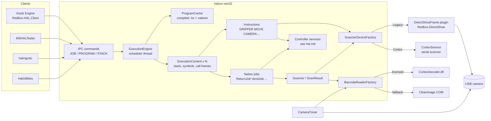
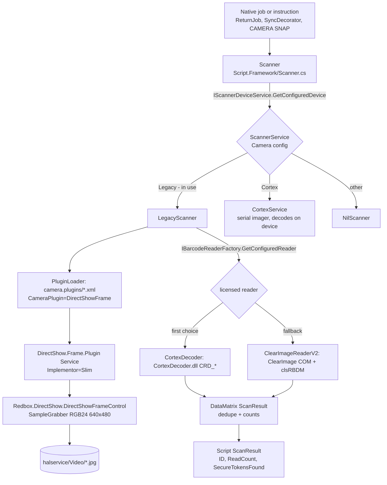

# HAL scripting, vision and service tools

This document covers the parts of the HAL (Hardware Abstraction Layer) that sit above the raw hardware
controllers:

- **The HAL script engine** (`Redbox.HAL.Script.Framework`). It covers the `.hs` script language, its
  compiler and interpreter, the built-in instructions, "native" jobs written in C#, job persistence and
  the cooperative job scheduler.
- **Vision** (`Redbox.HAL.DataMatrix.Framework`, `Redbox.HAL.DirectShow.Frame.Plugin`,
  `Redbox.DirectShow`, `Interop.ClearImage`). This is how a disc in the picker is photographed and how
  its DataMatrix ID is decoded.
- **Service tools** that drive HAL: `MSHALTester`, `halmgmtc`, `HalUtilities`, `CameraTuner`, and the
  shared WinForms helpers in `Redbox.HAL.Common.GUI.Functions`.
- **Legacy (2014) camera plugins** in `src/HAL/Legacy`.

The HAL service process itself, its IPC transport and command framing, the controller boards, motion
control, inventory store and `HAL.xml` controller settings are documented in **`hal.md`**. This document
covers only the interface to them: the `JOB`, `PROGRAM` and `STACK` IPC commands that drive the script
engine, and the controller services that the instructions call.

---

## 1. Overview

HAL is the Windows service (`halsvc-win32.exe`) that owns the robot in a Redbox kiosk. Every physical
operation is executed as a **job**, such as a vend, a return, a sync (inventory scan), thinning or
initialisation. A job is an instance of a **program**. A program is either:

- a **script**: a text file in the HAL assembly language (`*.hs`, "HAL Script"), compiled at service
  start from `halservice\Scripts\`, or
- a **native job**: a C# class tagged `[NativeJob(ProgramName = "...")]`, wrapped in a one-line synthetic
  script `NATIVEJOB <OPERAND>`.

Jobs are scheduled by clients (Kiosk Engine, the HAL tools) over HAL IPC with `JOB schedule`. They
receive arguments through a per-job data stack (`STACK push`). They report progress through
**messages** (`MSG`) and **results** (`RESULT`). They run one at a time on a single scheduler thread and
give up the robot cooperatively with `YIELD`. Each job's state (stack, symbols, call frames, results)
is serialized to disk after every change, so suspended jobs survive a service restart.

The **vision** subsystem identifies discs. The disc label carries several copies of a **9-digit
numeric ID** encoded as DataMatrix symbols. In some deployments it also carries IR "security markers".
A USB camera behind a ring light photographs the disc while it is in the picker (gripper). The frame is
saved as a 640x480 JPEG and decoded by a licensed DataMatrix decoder: the Code Corp *CortexDecoder*
software library on this kiosk, or Inlite ClearImage as a fallback. Jobs such as `return`, `sync`,
`vend` and `return-unknown` use that ID to update inventory, detect duplicates or fraud, and decide
where to file the disc.

---

## 2. Deployment

### 2.1 Files in the image

| What | Path in image (`C:\Users\...\Images\Redbox\`) | Notes |
|---|---|---|
| Script engine | `halservice/bin/Redbox.HAL.Script.Framework.dll` | Also contains the ILMerged `Redbox.DirectShow` |
| Vision framework | `halservice/bin/Redbox.HAL.DataMatrix.Framework.dll` | Also contains the ILMerged `Interop.ClearImage` |
| Camera plugin | `halservice/bin/camera.plugins/Redbox.HAL.DirectShow.Frame.Plugin.dll` + `DSFrame.Descriptor.xml` | The only plugin in the live `camera.plugins` folder |
| Native decoder | `halservice/bin/CortexDecoder.dll`, `CortexDecoderHasp.dll`, `Hasp_windows_110892.dll`, `Hasp_rt.exe` | Code Corp decoder plus its HASP licence runtime (inferred from the names) |
| Scripts (live) | `halservice/Scripts/*.hs` | 8 files: `check-picker`, `clean-vmz`, `qlm-unload`, `sync`, `sync-locations`, `thin`, `thin-vmz`, `unload-thin` |
| Scripts (staged) | `halservice/Scripts/.staged_/*.hs` | The 8 above plus older (1.3.0.119) `clear-picker`, `quick-return-*`, `return-unknown`, `vend-unknown`. These are not compiled because they are not in `Scripts\` |
| Persisted jobs | `halservice/bin/data/contexts/<JOBID>/ctx.data` | 20 job directories in the image |
| Camera images | `halservice/Video/*.jpg` | Snapshots, plus files renamed to `<barcode>_<snapname>.jpg` |
| Per-job app logs | `KioskLogs/{Return,Sync,Unknowns,VMZ,init,vend,...}/` | Written by `APPLOG` / `ApplicationLog` |
| CameraTuner | `halservice/bin/CameraTuner.exe` | |
| halmgmtc | `halservice/bin/.staged_/halmgmtc.exe` (+ `.config`) | Not present in live `bin`. Its log is `halservice/KioskLogs/HalUILog/halmgmtc.log` |
| HalUtilities | `HAL-Tools/HalUtilities.exe`, `HAL-Tools/inventory-snapshot.bat` | |
| MS HAL Tester | `MS HAL Tester/bin/MSHALTester.exe` (+ `.config`, `MSHALtester.log`, `scripts/ms-*.hs`) | |
| Legacy plugins | `halservice/bin/.staged_/Redbox.HAL.Camera.Framework.dll`, `Redbox.HAL.ClearimageV1.dll`, `CiBcfDm80000002.dll`, `CiBcfKo86572612.dll`, plus `camera.plugins/.staged_/{DirectShow,Vidcap}.Descriptor.xml` | 1.3.0.119 (2014). See section 12 |

On the kiosk these live under `C:\Program Files\Redbox\` (e.g. `...\halservice\bin\CameraTuner.exe`,
`...\KioskLogs\Service`; the paths are taken from `MSHALTester.exe.config` and from a serialized job).

### 2.2 Runtime paths used by the engine

`IRuntimeService.InstallPath(x)` resolves to `halservice\x` and `RuntimePath(x)` to `halservice\bin\x`.
This is inferred from where the files actually are.

| Purpose | Call | Resolved |
|---|---|---|
| Script directory | `InstallPath("Scripts")` (`halsvc-win32/HALService.cs`, `Compiler` static ctor) | `halservice\Scripts` |
| Job store | `RuntimePath("data\\contexts")` | `halservice\bin\data\contexts` |
| Camera plugins | `RuntimePath("camera.plugins")` | `halservice\bin\camera.plugins` |
| Image working dir | `InstallPath("Video")` (`BarcodeConfiguration` ctor) | `halservice\Video` |
| `PROGRAM get/set` file | `$(RunningPath)\..\scripts\<name>.hs` | `halservice\scripts\` |

### 2.3 How the tools reach HAL

All tools are HAL IPC clients built on `Redbox.HAL.Client.HardwareService` (see `hal.md`). The URL
configured in both `MSHALTester.exe.config` and `halmgmtc.exe.config` is **`rcp://127.0.0.1:7001`**.
`HalUtilities` uses `Constants.HALIPCStrings.TcpServer` by default and accepts `--protocol=<url>`.
`CameraTuner` does not talk to HAL. It opens the camera itself, so HAL must release the camera first
(section 10.4).

---

## 3. Architecture



| Project | Role |
|---|---|
| `src/HAL/Redbox.HAL.Script.Framework` | Tokenizer, compiler, instructions, interpreter (`ExecutionContext`), scheduler (`ExecutionEngine`), native jobs, pollers, `Scanner`/`ScanResult`, fraud validation |
| `src/HAL/Redbox.HAL.DataMatrix.Framework` | Camera configuration (`<Camera>` in HAL.xml), scanner device selection, camera plugin loading, Cortex serial scanner protocol, Cortex software decoder, ClearImage reader |
| `src/HAL/Redbox.HAL.DirectShow.Frame.Plugin` | `ICameraPlugin` implementation (`DirectShowFrame`) that grabs single frames from the USB camera |
| `src/HAL/Redbox.DirectShow` | DirectShow COM interop and frame-grabber controls (AForge-derived; inferred from the class names) |
| `src/HAL/Interop.ClearImage` | COM interop for Inlite ClearImage (`CiServer`, `CiImage`, `CiBarcodes`, ...) |
| `src/HAL/Redbox.HAL.Common.GUI.Functions` | Shared WinForms helpers (number pads, button "running" colouring, output box) |
| `src/HAL/MSHALTester`, `halmgmtc`, `HalUtilities`, `CameraTuner` | Tools (section 10) |
| `src/HAL/Legacy/*` | 2014 camera framework and plugins, not built (section 12) |

---

## 4. Start-up and lifecycle of the script engine

The steps below run in this order (`halsvc-win32/HALService.cs`):

1. Controller services are created first, then `BarcodeConfiguration.NewInstance()`. That call registers
   the `Camera` configuration and adds `ScannerDeviceFactory` as `IScannerDeviceService`.
2. `new BarcodeReaderFactory().Initialize(errors)` selects the decoder (section 8.4).
3. `ExecutionEngine.NewEngine(InstallPath("Scripts"))` creates the singleton engine and the special
   **IMMEDIATE** context (`ID="IMMEDIATE"`, program `$$$immediate$$$`, priority `Immediate`).
4. `executionService.Initialize(errors)` (`ExecutionEngine.Initialize`) does the following:
   - Registers `RedboxBarcodeValidator` as `IBarcodeValidatorService` and `FraudValidatorService` as
     `IFraudService`.
   - `PollerManager.InitializePollers()` reflects over the assembly for `[Poller(Name=...)]` classes:
     `Watchdog`, `HardwareHealer`, `IceQubeBoard`, `CCRWatchdog`, `InventoryBackup`.
   - `ProgramCache.CompilePrograms` does three things:
     1. Reflects over `Redbox.HAL.Script.Framework.dll` for `[NativeJob]` classes and records
        `ProgramName -> Operand -> Type`. The live log shows *"Time to scan for 88 native jobs"*. It also
        adds `return -> RETURN` and `quick-return -> QUICKRETURN` by hand.
     2. Compiles each native as the one-line source `NATIVEJOB <OPERAND>`.
     3. Compiles every `Scripts\*.hs` with the program name set to the file name without extension. The
        log shows *"Time to compile 8 programs"*.

     Compile errors are added to the service's start-up `ErrorList`. Any error makes the HAL service
     stop. Natives are compiled first, and because `AllowProgramCacheReplacement2=False` a `.hs` file
     with the same name as a native is ignored.
   - `LoadJobs()` deserializes every `data\contexts\*\ctx.data`. Unreadable directories are deleted.
     Jobs found **Suspended** whose program is in `NonRestartableJobs` (`init`, `return`, `vend`,
     `soft-sync`) are marked `Garbage`. A job that was `Running` when saved comes back as `Suspended`.
5. `configurationService.Load()` runs. `ExecutionEngine.NotifyConfigurationLoaded` reads the kiosk reboot
   time from `HKLM\SOFTWARE\Redbox\REDS\Kiosk Engine\Store\RebootTime` and computes the reboot
   window, which starts `RebootExecutionPreventionWindow` minutes before the reboot time (`10` in the
   image).
6. `executionService.Start()` (`ExecutionEngine.Start`):
   - `RestartYoungest(5)`: for each of `qlm-unload, thin, unload-thin, sync, sync-locations, thin-vmz,
     clean-vmz`, the newest incomplete job is set to `Pending` with a start time of at least now + 5 min.
   - `CleanupJobs(false)` disposes `Garbage` jobs and deletes their directories.
   - It starts the STA background thread **"HAL Script Scheduler"**.
   - It schedules the native **`init`** job (label `HAL Service Startup: Init`, priority `High`), sets
     the reserved symbol `__EE_BOOTSTRAP_INIT=true` and pends it. When `init` completes, the pollers
     start and `JOB init-status` reports its status.
7. The IPC listener starts.

**Shutdown** (`ExecutionEngine.Shutdown`) stops the pollers, suspends every incomplete job (a running job
gets a deferred suspend) and spins until the active context finishes its current instruction slice.

### 4.1 Scheduler loop

`ExecutionEngine.ProcessScheduler` runs:

```
loop:
  if inside reboot window: suspend any non-complete job named in NonSchedulableJobsWithinReboot
                           (qlm-unload thin unload-thin sync sync-locations thin-vmz clean-vmz),
                           stop pollers, arm a wake-up timer for RebootTime+5min
                           (on wake: RestartYoungest(1), start pollers)
  if ContextSwitchRequested or no ActiveContext:
      ActiveContext = eligible context with the lowest Priority value, oldest CreatedOn first,
                      whose StartTime is null or <= now
  if ActiveContext and not Running: ActiveContext.Execute(); ActiveContext = null
  wait up to 250 ms on SchedulerResetEvent
```

- Only **one job runs at a time**. A job runs until it completes, errors, or reaches a cooperative
  switch point (`YIELD`, `RUNTIME YIELD-ONLY`, or a native job that calls `ContextSwitchRequested()`).
- Priorities come from `ProgramPriority`: `Immediate=0, Highest=1, High=2, AboveNormal=3, Normal=4,
  BelowNormal=5, Low=6, Lowest=7`. Lower values run first.
- Job states come from `ExecutionContextStatus`: `Suspended(0), Pending, Running, Errored, Stopped,
  Garbage, Completed`. A newly scheduled job starts **Suspended**, so the client must `JOB pend`,
  `JOB resume`, or pass `resume-now`.
- External `Suspend`/`Terminate` on a **running** job only records a *deferred* status change. The
  change takes effect at the next cooperative switch point, so a script without `YIELD` cannot be
  interrupted.
- `clean-vmz` is a **singleton**: scheduling it while an incomplete instance exists fails with `E001`.

---

## 5. The HAL script language

### 5.1 Lexical structure

The source is processed **one line per statement** (`Tokenizer.cs`, a state machine).

- **Comments** start with `#` or `;`, either at the start of a line or where a new token would start.
  The rest of the line is ignored.
- **Mnemonic**: the first word of the statement (a letter or `_`, then letters, digits, `_` or `-`).
  It is matched case-insensitively against the `Mnemonic` property of every `Instruction` subclass
  (found by reflection in `Instruction.Parse`). An unknown mnemonic is compile error `C004`.
- **Labels**: `NAME:` at the start of a line. A line holding only a label compiles to a `NOP` that
  carries the label. Labels are matched case-insensitively.
- **Symbols** (variables): letters, digits, `_`, `-` (e.g. `CP-RESULT`, `MAX-SLOT-PER-DECK`). Symbol
  values are stored upper-cased, so symbol names are case-insensitive. Names starting with `__` are
  reserved (error `C005`). `TRUE`/`FALSE` are converted to booleans.
- **String literals**: `"..."` with no escape mechanism.
- **Numeric literals**: digits, optional `.` (becomes `decimal`, otherwise `int`), and a leading `-`.
- **Key/value operands**: `KEY=value`, where the value is a number, a symbol or a `"string"`. For
  example: `DECK=CUR-DECK`, `MODE=GET`, `MESSAGE="The slot is empty."`, `TIMEOUT=3000`.
- **Operators** (allowed only after the mnemonic): `==`, `!=`, `<`, `>`, `<=`, `>=`, `~=` (regex match)
  and `..` (range).
- **CONST symbols**: a name defined with `CONST` is tokenized as `ConstSymbol` from then on. Assigning
  to it with `SET`, `INC`, etc. is error `E006`, and redefining it at run time is error `E002`.

**Preprocessor**: a line containing `@INC "file"` textually includes another file. The file name is
resolved directly, or else by searching the configured script paths (`Compiler.AppendSearchPath`;
the default is `Scripts\`). This is enabled by the persistent-map flag `Compiler.EnablePreprocessor`
(default true). None of the scripts in the image use it.

### 5.2 Program structure and control flow

The compiler builds a tree. Instructions that *begin a context* (`IF`, `DO`, and the implicit
top-level `PROG`) push a new child instruction list. The matching *end* mnemonic (`ENDIF`, `LOOP`) is
appended to that child list, and then the context is closed. Unbalanced blocks give errors
`C004`/`C005`. The `CFA` (control-flow analysis) step is wired in but is a **no-op mock**
(`CFAInternalsMock`), so undefined variables and dead code are **not** detected at compile time.
Undefined symbols fail at run time with `E002 The symbol X is not defined.`

The interpreter is a **call-frame machine** (`Registers`, `CallFrame`):

- Each frame has a `ParentContext` (the instruction whose child list is executing), a `PC` index, and
  `X`/`Y` registers.
- After each instruction the frame advances its `PC`. When a child list is exhausted the frame is
  popped and the parent frame continues after the block.

| Construct | Semantics (from the code) |
|---|---|
| `IF a op b` ... `ENDIF` | `a` and `b` are each a literal or a symbol, and `b` is converted to `a`'s type. If true, a frame is pushed for the IF's body. If false, the whole body is skipped |
| `ELSEIF` / `ELSE` | They parse, but they are **ordinary statements inside the IF body**. `ELSE` does nothing, so on a true IF the "else" lines run too, and on a false IF none of them run. Real scripts never use them; they use two complementary `IF`s instead (see `return-unknown.hs`) |
| `DO n` ... `LOOP` | `n` is a literal or symbol. If `n > 0` a frame is pushed with `X=n`. `LOOP` decrements `X` and restarts the body at index 0 until `X==0` |
| `JUMP label` | Searches the current frame's list for the label. If it is not found, the frame is popped and the parent is searched, so a `JUMP` can leave any number of `IF`/`DO` blocks but cannot enter one. Error `E002` if the label does not exist |
| `EXIT ["msg" or symbol]` | Adds error `E999` with the message, which ends the job as **Errored** |
| `YIELD [ms]` | Cooperative switch: saves the job and returns it to `Pending`. With an argument, the job's start time becomes now + `ms`, so it sleeps at least that long. Every long-running script yields in its loop |
| `RUNTIME YIELD-ONLY` | Also ends the current slice (job goes back to `Pending`), but without saving or explicitly requesting a context switch |
| `NOP` | No operation. It is the target for labels at the end of a script |
| End of script | Job becomes **Completed** |

A job ends **Errored** as soon as any instruction adds an error, either through `EXIT` or through a
runtime error such as an undefined symbol, a bad operand or an unhandled exception (`E001`). When a
(non-immediate) job completes it calls `CleanupHardware()`, which turns the picker sensors off, stops
the roller and turns the ring light off.

### 5.3 Data model: the stack and the symbol table

Every job has:

- a **double-ended data stack** (`Deque<object>`) holding `int`, `decimal`, `bool` and `string` values.
  Clients push arguments onto it before the job runs, and instructions push their results onto it.
- a **symbol table** (`string -> object`), filled by `SET`, `CONST` and `POP`.

Almost every hardware instruction **pushes its status string** (upper-case `ErrorCodes` name such as
`SUCCESS`, `TIMEOUT`, `SLOTEMPTY`, `PICKEREMPTY`, `HARDWAREERROR`) onto the top of the stack. The
script then `POP`s it into a symbol and tests it. Unused results must still be popped (a bare `POP`)
to keep the stack balanced. Some instructions push several values; the order is given in 5.5.

| Instruction | Semantics |
|---|---|
| `SET sym value` | `value` is a literal or a symbol |
| `CONST sym literal` | Define a constant |
| `PUSH v1 v2 ...` / `PUSHB v...` | Push each value onto the top or bottom of the stack |
| `PUSHF "fmt {0}" a b [END=BOTTOM]` | Push `string.Format(fmt, a, b)` |
| `POP [sym] [DEPTH=n]` | Pop `n` items (default 1) from the top and keep the last one. With no symbol the values are discarded |
| `POPB sym [DEPTH=n]` | Same, from the bottom |
| `DUP`, `CLEAR` | Duplicate the top item, or empty the stack |
| `INC sym`, `DEC sym`, `ADD sym n`, `SUB sym n` | Integer or decimal arithmetic on a symbol |
| `WAIT ms` | Blocking sleep (`IRuntimeService.Wait`) |

### 5.4 Output: logs, messages, results

| Instruction | Effect |
|---|---|
| `LOG "fmt" args... [ENTRYTYPE=INFO\|ERROR\|...]` | Writes `"[<program>, <jobid>]: text"` to the service log (`halsvc-win32.log`) |
| `APPLOG "fmt" args...` | Writes a line to the job's **application log** |
| `APPLOG CONFIGURE [NAME=x] [SUBDIRECTORY=y] [FLUSHONWRITE=TRUE\|FALSE]` | Selects the app log file. Without `NAME` the file is `KioskLogs\<subdir>\<program>-<jobid>.log`; with `NAME` it is `<program>.log` and is appended to (`ApplicationLog.ConfigureLog`) |
| `MSG "fmt" args...` | Sends an **event message** to the connected client (section 6.3). Used by Kiosk Engine for UI events such as `VendStart`, `MachineError`, `ReturnEnd:<id>`, `ItemPlacementDone:<id>` |
| `RESULT CODE=c MESSAGE=m [DECK=n SLOT=n ITEM=s RETURNTIME=t PREVIOUS=s END=BOTTOM]` | Appends a structured **result** to the job's result list (section 6.3) |
| `PRINT "fmt" args` | `Console.WriteLine` (only useful in console hosts) |

Real app log lines (`KioskLogs/Sync/sync-19NALR.log`):

```
12:30 PM 11/18/2024 Sync Deck=1 Slot=1 to Deck=1 Slot=90
12:33 PM 11/18/2024 GET Deck = 1 Slot = 16 ID=195070762
12:33 PM 11/18/2024 PUT Deck = 1 Slot = 16 ID=195070762
```

### 5.5 Instruction reference

"Pushes" lists the values from first pushed to last pushed, so the **last item is on top** and is
popped first.

#### Configuration and system

| Mnemonic | Operands | Pushes / effect |
|---|---|---|
| `GETCFG "Name" TYPE=Controller\|Camera` | property name; the name may contain `{0}` placeholders | The property value. Only `controller` and `camera` are registered in 1.13. `TYPE=SCRIPT` (used by the old staged scripts) finds no configuration and **pushes nothing** (inferred from `ConfigurationService.FromKey`) |
| `SETCFG "Name" value TYPE=...` | `TYPE=KIOSK` writes to `Kiosk.xml` | Saves the configuration and broadcasts the change |
| `SECRETOPTION NAME=... [VALUE=...]` | | Reads or writes a registry "secret option" (not studied in detail) |
| `VERSION [board]` | `ControlBoards` name | One board version, or each board's response followed by `"REVISION n"` |
| `SYSCALL GC\|REBOOT` | | `REBOOT` (not allowed in immediate mode) requires `RebootKioskDuringQlm=True` and a time between 00:00 and 05:00, suspends the job, then calls `ExitWindowsEx(Reboot\|ForceIfHung)` |
| `NATIVEJOB OPERAND` | | Runs a native C# job (section 7) |
| `ESP DUMP\|DUMP-STORE` | | Dumps the empty-search-pattern service |

#### Motion and picker (these call the controller services described in `hal.md`)

| Mnemonic | Operands | Pushes |
|---|---|---|
| `MOVE DECK=d SLOT=s [MODE=GET\|PUT\|NONE]` | also `WITH-OFFSET AXIS=X\|Y UNITS=n`, or `SLOT-OFFSET=n` alone (moves to show an empty-stuck slot) | status (`SUCCESS`, `TIMEOUT`, `INVALIDLOCATION`, ...). With `SLOT-OFFSET`, pushes the offset count before the status if successful. Immediate mode refuses dump-bin locations (`INVALIDMOVETOSECURELOCATION`) |
| `MOVEVEND [MODE=GET\|PUT\|NONE]` | | status (e.g. `SUCCESS`, `DOOROPEN`) |
| `MOVEABS AXIS= UNITS= ...` | | Absolute move (engineering use) |
| `HOMEX`, `HOMEY [CLEARGRIPPER=TRUE]` | | status |
| `GET [GET-RT=TRUE] [CENTER=TRUE] [TESTONEMPTY=TRUE]` | picks from the current location | `[returnTime if GET-RT]`, previous ID, status (`SUCCESS`, `SLOTEMPTY`, `ITEMSTUCK`, ...) |
| `PUT` | ID popped from the stack | status, then `1` (the number of status values) |
| `XFER SRC-DECK= SRC-SLOT= DEST-DECK= DEST-SLOT=` | | transfer status or `PICKERFULL` |
| `GRIPPER op [TIMEOUT=ms]` | `OPEN CLOSE RENT EXTEND EXTEND-FOR-TIME RETRACT STATUS PEEK CLEAR PUSH/PUSH-IN PUSH-OUT ACCEPT-DISC-AT-DOOR REJECT-DISC-AT-DOOR VEND-DISC-AT-DOOR CHECK-PICKER [VEND-ID=x]` | finger/arm ops push `SUCCESS`/`TIMEOUT` (or a comm diagnostic). `STATUS`/`PEEK` push `FULL`/`EMPTY`. `CHECK-PICKER` pushes `PICKEREMPTY` or another `ErrorCodes` value. **Indirection:** if the operand names a string symbol, its value is used as the operation (`GRIPPER GRIPPER-MODE`) |
| `ROLLER IN\|OUT\|STOP` or `ROLLER POS=n WAIT=TRUE TIMEOUT=ms` | | status |
| `TRACK OPEN\|CLOSE\|CYCLE\|STATUS` | | status or the track state (`OPEN`, ...) |
| `VENDDOOR RENT\|CLOSE\|STATUS` | (`OPEN` always pushes `TIMEOUT`) | status or the door position |
| `SENSOR PICKER-ON\|PICKER-OFF\|READ\|READ-PICKER-INPUTS\|READ-AUX-INPUTS\|...` | | sensor data |
| `RINGLIGHT ON\|OFF` | | none |
| `CAMERA START [CENTER=TRUE]\|STOP\|SNAP\|STATUS\|RESTART\|VALIDATESETTINGS\|RESETRETURNCOUNTER\|RETURNERRORCOUNT\|IRCAMERA` | | `START`/`STOP` push a bool. `SNAP` pushes `<path>` then `SUCCESS`, or `CAPTURE ERROR`. `STATUS` pushes `RUNNING`/`STOPPED`. `IRCAMERA` always pushes `false`. `SHOWPROPERTIES` and `ISWORKING` are deprecated errors |
| `CONTROLSYSTEM CENTER\|RINGLIGHTON\|...\|ENGAGEQLM\|LIFTQLM\|...` | | |
| `MOTIONCONTROL READLIMITS\|COMSTATUS\|INITSTATUS\|POSITIONS\|XPOS\|YPOS\|HOMEALL\|COMCHECK\|RESTART\|TESTANDRESET` | | |
| `SERIALBOARD CLOSEPORT\|RESET`, `AUDIO <state>`, `AIRXCHGR ...`, `DOORSENSORS ...` | | board and peripheral utilities |

#### Inventory and locations

| Mnemonic | Operands | Pushes |
|---|---|---|
| `DECK MAXSLOTS\|RESET NUMBER=n` | | slots in the deck / resets the deck to EMPTY |
| `LOC` (no operand) | | current deck and slot |
| `LOC op DECK= SLOT=` | `AT-DRUM-LOC SLOTTYPE SETINVENTORY ID= CLEARRETURNTIME SETRETURNTIME GETRETURNTIME MARKRETURNTIME RESETRT INC-STUCK CLEAR-STUCK IS-EXCLUDED GET-INFO RESET TIMESTAMP` | per op |
| `INSPECT DECK= SLOT=` | | the inventory ID at the location |
| `LOOKUP [id\|sym]` (or ID from the stack) | | slot, deck, `FOUND`; or `NOT FOUND` |
| `FINDEMPTY [buffer]` | | slot, deck, `FOUND`; or `MACHINE FULL` |
| `INVENTORY op` | `DECK SLOT SETUNKNOWN SETEMPTY GETRETURNTIME SOFTSYNC ISDUPLICATE CLEARALL EMPTYCOUNT` | |
| `SYNC DECK= SLOT= [TYPE=...]` | | Synchronizes one slot (get, read barcode, put back, update inventory; see 8.6). Pushes a `SyncResult` name such as `GETERROR` |
| `DUMPBIN op`, `COUNTER op NAME=`, `VMZ op`, `QLM op`, `QLMDOOR`, `QUICKRETURN` | | VMZ, QLM and dump-bin merchandising helpers. `VMZ`: `IS-CONFIGURED AGGREGATE-CLEAN CLEAN-SLOT THIN-DISC THIN-REBALANCE THIN-REDEPLOY UNLOAD-DISC MARK-UNLOAD DUMP-ZONE-TO-APPLOG ...`. `QLM`: `SETUP ENGAGE DISENGAGE LIFT DROP HALT STATUS ENDQLMOP CLEAR-PICKER UNLOAD-DISK THIN-DISK ID=` |

Source: one class per mnemonic in `src/HAL/Redbox.HAL.Script.Framework/*Instruction.cs` (the camera
instruction is in `CameraInsutrction.cs`, a typo in the original).

### 5.6 Compile and runtime errors

| Code | Meaning |
|---|---|
| `T002`–`T006` | Tokenizer: bad number, unexpected character, bad operator |
| `C004` | Unknown mnemonic, unmatched or wrong block terminator |
| `C005` | Symbol starts with `__`, or block not closed |
| `C006` | `@INC` file not found or unreadable |
| `W008` | Script has no cooperative instruction (warning, disabled by default) |
| `E001` | Unhandled exception in an instruction, program not in cache, unknown operand |
| `E002` | Undefined symbol, missing label, conversion error, stack underflow, CONST redefinition |
| `E003`–`E007` | Unexpected operand, missing program, deprecated operand, invalid assignment, bad symbol value |
| `E004` | Missing DECK/SLOT, PUT without an ID on the stack |
| `E777` | Unknown native job or sync type |
| `E999` | `EXIT`, or a native job error (`AddError`) |

### 5.7 Worked example: `sync.hs` (live, version 1.13.0.27)

`Redbox.HAL.Client.HardwareService.HardSync(range)` schedules `sync` and then pushes
`range.Slots.End, range.EndDeck, range.Slots.Start, range.StartDeck`. The last value pushed (the start
deck) is on top. The script consumes them like this:

```
	GRIPPER		CHECK-PICKER          ; make sure the picker is empty
	POP		CP-RESULT
	IF		"PICKEREMPTY" != CP-RESULT
		EXIT	"Unable to clear the picker."
	ENDIF
	DECK		MAXSLOTS NUMBER=1
	POP         MAX-SLOT-PER-DECK
	POP			START-DECK            ; arguments pushed by the client
	POP			START-SLOT
	POP         END-DECK
	POP         END-SLOT
	...
	GETCFG		"SyncErrorThreshold" TYPE=Controller   ; 20 in HAL.xml
	POP			SYNC-ERROR-THRESHOLD
	SET			SYNC-ERRORS 1
_NEXT_ITEM:
	SYNC		DECK=CUR-DECK SLOT=CUR-SLOT
	POP	SYNC-RESULT
	IF	"GETERROR" == SYNC-RESULT
		INC	SYNC-ERRORS
	ENDIF
	IF			SYNC-ERRORS > 	SYNC-ERROR-THRESHOLD
		RESULT		CODE="ErrorThresholdExceeded" MESSAGE="The number of sync errors exceeded the threshold."
		EXIT		"Sync failed."
	ENDIF
	INC			CUR-SLOT
	... advance deck/slot, JUMP _SYNC_DONE when past END-DECK ...
	YIELD                             ; let a vend/return pre-empt the sync
	JUMP        _NEXT_ITEM
_SYNC_DONE:
	MOVEVEND	MODE=GET
	POP
	NOP
```

Other live scripts follow the same pattern. For example, `thin.hs` pops a count and then that many IDs
in a `DO ITEMS-TO-THIN ... LOOP`, calls `QLM THIN-DISK ID=ITEM-TO-THIN`, and `JUMP`s out of the loop on
`MACHINEFULL`/`QLMFULL`. The MS HAL Tester ships its own scripts (`ms-pull-in-dvd.hs`,
`ms-vend-disk-in-picker.hs`) that use `DO PULL-COUNT ... LOOP`, `GRIPPER GRIPPER-MODE` indirection and
`ROLLER POS=4 WAIT=TRUE TIMEOUT=3000`. In 1.13 the equivalent natives `ms-pull-in-dvd` and
`ms-vend-disk-in-picker` take precedence (section 4, step 4).

---

## 6. Interfaces: driving the engine over IPC

The command transport and framing are in `hal.md`. The script-engine commands are implemented in
`src/HAL/halsvc-win32/Commands/{JobCommand,ProgramCommand,StackCommand}.cs`. Duplicates also exist in
`Redbox.HAL.Service.Framework`.

### 6.1 Commands

| Command | Purpose |
|---|---|
| `JOB schedule name: <prog> [priority: P] [startTime: T] [label: L] [resume-now] [no-duplicates]` | Creates a job (Suspended) and returns the job line. With `no-duplicates` and an existing label, gives warning `S998` (and resurrects the existing job if `resume-now`) |
| `JOB pend\|resume\|suspend\|terminate\|trash\|connect\|disconnect\|get\|get-errors\|get-messages\|get-results\|wait-for-completion job: <id>` | Job control and inspection |
| `JOB set-label\|set-priority\|set-start-time job: <id> value: v`, `JOB signal job: <id> value: v` | |
| `JOB list`, `JOB suspend-all`, `JOB resume-all`, `JOB collect-garbage force: b`, `JOB scheduler-status`, `JOB init-status` | `init-status` returns e.g. `COMPLETED` or `ERRORED` |
| `JOB execute-immediate statement: '<line(s)>'` / `JOB execute-immediate-base64 statement: <b64>` | Compiles the text as `$$$immediate$$$`, runs it in the IMMEDIATE context and **blocks** until it completes. Only one at a time (`S001`) |
| `JOB quick-return-status` | Always `INACTIVE` |
| `STACK show\|clear\|remove-results job: <id>`, `STACK push job: <id> value: v [end: top\|bottom]`, `STACK pop job: <id> [end:]` | `push` tokenizes `"PUSH " + value`, so string values must be quoted (`HardwareJob.Push` wraps strings in `"..."`) |
| `PROGRAM list` | One line per program: `name\|<Cached or Errors: n, Warnings: m>\|False`. Names starting with `$` and `HideFromList` natives are omitted |
| `PROGRAM compile path: '<file>' [name: n]` | Compiles a file into the cache. Refused unless the name is new or `AllowProgramCacheReplacement2` is true |
| `PROGRAM set name: n data: <base64 LZMA>` | Writes `halservice\scripts\<n>.hs` and compiles it |
| `PROGRAM get name: n` | Returns the compressed source. `PROGRAM remove name: n` removes it from the cache |

### 6.2 Job line format

`CommandHelper.FormatJob` produces one pipe-separated line per job:

```
<ID>|<Label or (not labeled)>|<ProgramName>|<Priority>|<StartTime or N/A>|<Status>|<ExecutionTime or Not Started>|<Connected|Disconnected>|0|0
```

Real example (`MSHALtester.log`):

```
IMMEDIATE|HAL Script Immediate Mode|$$$immediate$$$|Lowest|N/A|Completed|00:00:00.0009711|Disconnected|0|0
```

The priority shows `Lowest` because a completed job always reports `Lowest`. Job IDs come from
`IdHelper`: 8 random bytes from `RNGCryptoServiceProvider`, of which the first 4 are read as an Int32.
The absolute value is converted to base 36, giving up to 6 characters such as `2YPD71` and `OH0IVH`.
The engine retries up to 8 times to avoid collisions with existing IDs and `IMMEDIATE`.

A real client session in `halmgmtc.log`:

```
JOB schedule name: 'backup-inventory' priority: Normal
JOB resume job: 'XNX0GA'
JOB schedule name: 'get-controller-timeouts' priority: Normal
JOB resume job: 'GUMVGC'
JOB connect job: 'GUMVGC'
```

### 6.3 Messages and results

**Messages** (`MSG`, status changes, hardware-correction events) are queued in
`ExecutionContext.Messages` as `ScriptMessage` entries:

```
<EventTime>|<text>
e.g.  1/30/2025 6:10:02 PM|>STATUS CHANGE< Running
```

Each message's timestamp is forced to be at least one second after the previous one. When a client has
done `JOB connect`, messages are pushed to its `IMessageSink` immediately. Otherwise they are kept and
flushed on connect. Status messages look like `>STATUS CHANGE< <Status>`. Native jobs also emit
`HardwareCorrectionStart:<stat>`, `HardwareCorrectionSuccess:<stat>` and
`HardwareCorrectionFailure:<stat>`.

**Results** are strings built by `ExecutionContext.CreateResult` and parsed by
`Redbox.HAL.Client.ProgramResult`:

```
RESULT|<guid>|<timestamp>|<Code>|<deck,slot or ~>|<item or ~>|<message>|<returnTime or ~>|<previousID or ~>
```

Single quotes in the message are replaced by spaces. Immediate-mode jobs do not create results.
`CreateJSONResult` puts a JSON object in the message field. For example, the camera statistics
emitted after every smart read:

```
RESULT|<guid>|<ts>|CameraStatsJson|~|175056148|{"BarcodesRead":3,"SecureCodesRead":0,"ReadAttempts":1,"ExecutionTime":"00:00:00.38"}|~|~
```

The values in that example are illustrative; the shape and keys come from `Scanner.CreateJsonResult`.

---

## 7. Native jobs

Natives derive from `NativeJobAdapter` (`ExecuteInner()`). They get `Result`, `Context` (stack,
symbols, app log, messages) and service accessors (`InventoryService`, `MotionService`,
`ControlSystem`, `ControllerService`, `DumpbinService`, `DecksService`). They are created by reflection
through a non-public `(ExecutionResult, ExecutionContext)` constructor. 88 are registered; the list
below is from the `[NativeJob]` attributes.

| Area | Program names |
|---|---|
| Core kiosk flows | `init`, `vend`, `return` (ReturnJob, registered by hand), `vend-unknown`, `return-unknown`, `soft-sync`, `vertical-sync`, `get-and-read`, `get-and-center`, `read-fraud-disc`, `file-marker-disk`, `push-in-dvd`, `pick-at-offset` |
| Vision / test | `read-barcode`, `decode-image`, `clear-images-folder`, `change-camera-configuration`, `lookup-barcodes`, `file-disk-in-picker`, `put-disk-to-location`, `put-disk-in-picker-in-bin` |
| MS tester helpers | `ms-pull-in-dvd`, `ms-take-disk-at-door`, `ms-vend-disk-in-picker`, `tester-move-to-slot` |
| Inventory | `backup-inventory`, `restore-inventory-from-backup`, `rebuild-inventory-database`, `dump-inventory-store-job`, `reset-inventory-job`, `reset-locations`, `mark-barcodes-unknown`, `mark-locations-unknown`, `mark-kiosk-inventory`, `get-inventory-stats`, `get-non-barcode-inventory`, `get-excluded-locations`, `get-barcodes-in-bin`, `load-bin` |
| VMZ / QLM merchandising | `vmz-details`, `vmz-merch-summary`, `vmz-removed-thins`, `get-nonthins-in-vmz`, `get-barcode-vmz-location`, `prep-zone-for-unload`, `prep-deck-for-redeploy`, `merch-clear-and-offset`, `clear-merch-status`, `qlm-test-sync`, `test-retrofit-deck` |
| Hardware maintenance | `hardware-healer`, `hardware-status`, `hardware-survey-job`, `test-boards-job`, `reset-controlsystem-job`, `reset-motioncontrol`, `motion-control-get-data`, `get-controller-timeouts`, `get/clear/dump(-all)-hardware-statistics`, `reset-counters-job`, `reset-fraud-sensor`, `test-and-reset-ccr`, `reset-touchscreen-controller`, `power-cycle-router`, `air-exchanger-status`, `check-iceqube-board`, `change-audio-channel-state`, `door-sensor-software-override`, `get-machine-info`, `kiosk-configuration-job`, `get-quick-return-counters`, `reset-quick-return-counters` |
| Test suites | `kiosk-function-test-data`, `load-kiosk-function-check-data`, `one-disk-quick-deck-test(-kent)`, `adjacent-bin-test(-kent)`, `loopy`; hidden: `refurbish-kiosk-test`, `qlm-kiosk-test`, `random-sync`, `one-disk-random-sync` |

`quick-return` is mapped to `NATIVEJOB QUICKRETURN`, but no class has that operand, so running it would
fail with `E777`. `QUICKRETURN` also exists as an *instruction* and `JOB quick-return-status` is
hard-wired to `INACTIVE`, so the feature appears to be retired (inferred).

The old `vend-unknown.hs` and `return-unknown.hs` in `.staged_` (1.3.0.119) are script versions of what
are now `VendUnknownJob` and `ReturnUnknownJob`. They show the instruction-level flow (move, `GET`,
`MOVEVEND`, `VENDDOOR RENT`, `GRIPPER VEND-DISC-AT-DOOR`, `ACCEPT-DISC-AT-DOOR`, `PUT`, `RESULT`).
They also use instructions that no longer exist (`READ`, `GRIPPER READ-DISC`), which is further evidence
they are obsolete.

**Pollers** (`ScriptPoller` subclasses) run their own threads and periodically schedule a native job and
block on it:

| Poller | Job | Period |
|---|---|---|
| `HardwareHealer` | `hardware-healer` | configurable |
| `IceQubeBoard` | `check-iceqube-board` | 600 000 ms |
| `CCRWatchdog` | `test-and-reset-ccr` | configurable |
| `InventoryBackup` | `backup-inventory` | configurable |
| `Watchdog` | does not schedule a job | every 30 min: Sunday 02–04 log trimming, optional `reset-counters-job`, cleanup of errored and old jobs, `GC.Collect` |

---

## 8. Vision: how a disc is identified

### 8.1 What is on the disc

`halservice/Video/175056148_m12d17y2024_h0m15s52t452.jpg` is a typical 640x480 capture (dim grayscale,
ring-lit). The disc label shows:

- **four rectangular DataMatrix symbols** around the hub, all encoding the same ID;
- **two solid square marks**;
- the printed digits `17505 6148`, which match the ID **175056148** in the file name.

The decoder pipeline expects this layout:

- `ExpectedCodes = 4` in `<Camera>`;
- `ScanResult` caps the read count at 4;
- a valid Redbox ID is **exactly 9 decimal digits** (`RedboxBarcodeValidator`, enforced while
  `EnableUnrecognizedBarcodeReject=True`);
- a decode equal to `redbox` (case-insensitive) is discarded. The old scripts treated that value as
  "disc inserted backwards".

**Security markers**: a decoded string equal to a secret token is counted as a *secure token* rather
than an ID. The token is decrypted at start-up from a Base64 constant with `IEncryptionService`
(TripleDES); its value is `<redacted>`. These markers are printed for the IR camera (*"IR hardware"*,
*"secure reads"*, *"photocopy scan"* in the code). That the two square marks in the image are those
markers is an inference.

### 8.2 Components



### 8.3 Camera capture (Legacy scanner, the configuration in use)

1. **Configuration.** `BarcodeConfiguration` is the `<Camera>` node of `HAL.xml`. Its working path is
   `halservice\Video` and its built-in properties are `VideoFormat = 640x480` and `WorkingPath`.
2. **Device selection.** `ScannerDeviceFactory` picks the device from `ScannerService` (`Legacy` in the
   image). On a configuration change it stops the device, switches to `NilScanner`, then switches back
   and starts the new one.
3. **Plugin loading.** `LegacyScanner` loads the `CameraPlugin` (`DirectShowFrame`) through
   `PluginLoader`. The loader reads every `camera.plugins\*.xml` descriptor:

   ```xml
   <Plugin>
     <PluginType Name="DirectShowFrame" Version="1.0.0.0"/>
     <Assembly Name="Redbox.HAL.DirectShow.Frame.Plugin.dll"/>
     <PluginProvider Namespace="Redbox.HAL.DirectShow.Frame.Plugin.Factory" Method="GetCameraPlugin"/>
     <Properties>
       <property name="WakeupPause" value="5000" type="System.Int32"/>
       <property name="SnapTimeout" value="5000" type="System.Int32"/>
       <property name="GrabWait" value="500" type="System.Int32"/>
       <property name="Implementor" value="Slim" type="System.String"/>
     </Properties>
   </Plugin>
   ```

   It loads the assembly, calls the static `Factory.GetCameraPlugin()`, merges `<Properties>` into
   `BarcodeConfiguration.Properties` and calls `ICameraPlugin.InitWithProperties`. If the plugin cannot
   be found, a `NilCameraPlugin` is used.
4. **Implementor.** The plugin's `Service` picks the implementor named by `Implementor`:
   - `Slim` → `SlimFrameService` (this is what the log shows: *"[DirectShowPlugin 1.13.0.27]
     Implementing service is Slim"*);
   - `Slim_v2` → `SlimFrameService_v2`, which takes `ControlType=Legacy|Modern`;
   - anything else → `LegacyService` (`VCDevice3`). `LegacyService.Snap` saves under its own timestamp
     name and ignores the requested path, so with that implementor `SnapResult` would report failure.
     This is inferred from the code.
5. **Start** (`AbstractDirectShowControl.Start`):
   - takes the first `VideoInputDevice` filter;
   - requires a capability exactly 640x480 (otherwise `Start` fails);
   - builds the graph with `DirectShowFrameControl` (capture pin → SampleGrabber, `MediaSubType.RGB24`)
     and runs it;
   - sleeps `WakeupPause` (5 s).

   A real log line: `[DirectShowSlim] graph is running; avg rate = 30.` on device
   `usb#vid_1871&pid_0f01`.
6. **Snap** (`DirectShowFrameControl.SimulateTrigger(file, SnapTimeout)`):
   - the graph thread sees the trigger and arms `m_grabImage`;
   - the next `BufferCB` copies the bottom-up DIB rows into a 24bpp `Bitmap` (flipping it vertically)
     and saves it to the requested `.jpg` path;
   - if no frame arrives within the grab wait, the log shows *"There are no captured frames from the
     device."*;
   - otherwise `ImageCapturedEvent` is set and the call returns true.
7. **Snap result.** `LegacyScanner.Snap` generates the file name with
   `IRuntimeService.GenerateUniqueFile("jpg")`, giving `m<M>d<D>y<YYYY>_h<H>m<m>s<s>t<ms>.jpg` in
   `halservice\Video`. `SnapResult.SnapOk` is simply "the file exists". A failed snap sets
   `InError=true`.
8. **Restart** (`LegacyScanner.Restart`):
   - stops the camera and waits 500 ms;
   - finds the camera through `IUsbDeviceService.FindActiveCamera`;
   - resets the driver if the device is found and enabled;
   - starts again.

   Camera generations are recognised by USB ID: `1871:0d01` or `1871:0f01` → **Fourth**, `0c45:627b` →
   **Third**. `CortexService` reports **Fifth**.
9. **Exposure.** With `DisableAutoExposureAtInit`, `init` calls `ExposureFixer.ResetCameraProperties()`.
   For a camera whose friendly name is `4th Gen`, this switches `CameraControlProperty.Exposure` from
   auto to manual at its current value.

### 8.4 Decoding

`BarcodeReaderFactory.Initialize` tries the decoders in order:

1. **`CortexDecoder`** (Code Corp software decoder, P/Invoke into `CortexDecoder.dll`):
   - `CRD_Create()` returns a handle (1..899);
   - the licence is unlocked by reading property 9, XOR-ing it with an OEM constant (`<redacted>`) and
     writing it back;
   - a result callback is installed (property 10);
   - `IsLicensed` is true when both writes succeed. The live log shows: `CRD_Create returned 1`,
     `IsLicensed: True`, `Configured reader Cortex is licensed.`
2. **`ClearImageReaderV2`** (Inlite ClearImage COM), used only if Cortex is not licensed:
   - `CiServer.OpenExt(hModule, <licence key redacted>, 0)`;
   - `clsRBDM.Find(6)` (obfuscated Redbox DataMatrix helper) collects `CiBarcode.Text`;
   - up to 2 attempts are made if an exception occurs.
3. `NilReader` if neither is available. `Initialize` then reports error `D001 No reader found`.

`CortexDecoder.OnScan(image)` works as follows:

- Loads the JPEG and builds an 8-bit grayscale buffer from **byte offset 2 of each 24bpp pixel**.
  GDI stores pixels as B,G,R, so this is the red channel.
- Sets properties 0–3 (address, width, height, row width) and the barcode ROI (306–309 = 0, 0, w, h).
- Calls `CRD_Decode`. The callback is called once per symbol found. For each symbol it reads the
  length (403), the string (404, ASCII), the corners (400), the centre (401), the symbol type (402) and
  the modifier (405), and adds the string to the results.
- The elapsed time becomes `ScanResult.ExecutionTime`.

`DataMatrix.ScanResult.Add(code)` drops `redbox` and **aggregates identical strings with a count**, so
four copies of the ID become one `DecodeResult{Matrix, Count=4}`.

`Script.Framework.ScanResult` turns that into the job-level result:

- device error → `SnapOk=false`;
- more than 2 distinct decodes → logged as unexpected and treated as **no read**;
- a decode equal to the secret token adds its count to `SecureTokensFound`;
- the remaining decode becomes `ScannedMatrix`, with `ReadCount = min(count, 4)` and `ReadCode=true`;
- default `ScannedMatrix = "UNKNOWN"`.

### 8.5 Read strategies

`Scanner` (`src/HAL/Redbox.HAL.Script.Framework/Scanner.cs`):

- **Construction.** Starts the device. If the device `RequiresExternalLighting` (Legacy yes, Cortex
  no), it turns the ring light on and waits `RinglightWarmupPause2` (1500 ms), or `IRRinglightStartupPause`
  (1000 ms) for secure-read devices. It optionally centres the disc in the picker first: `CenterDiskMethod`
  is `None`, `DrumAndBack` or `VendDoorAndBack`. On dispose it turns the ring light off (after
  `IRRinglightShutdownPause` on secure devices).
- **`OnReadWithRetry`.** One read. If the snap failed and `EnableCameraReset=True`, it calls
  `Device.Restart()` and reads once more.
- **`SmartReadDisk()`** is used by sync and unload. It tries `VendDoorAndBack` and then `DrumAndBack`,
  stopping at the first read or the first camera failure, and emits a `CameraStatsJson` result.
  - On secure-read devices, if `RetryReadOnNoMarkersFound=True` it keeps trying while a code was read
    but no secure token was found. `AdditionalFraudReadAttempts` (1 in the image) extra attempts with
    `CenterDiskMethod.None` are appended.
- **`ReadDiskInPicker(options)`** reads once with `VendDoorAndBack` centring. Depending on the flags it
  creates `CameraCaptureFailure`, `DuplicateDetected` or `BadIdRead` results.

`SupportsSecureReads` (`LegacyScanner`) is true only when **all** of these hold:

- `Kiosk.xml` has `IRHardwareInstallDate` (the image has `2024-12-02T05:59:05`);
- the configured reader is Cortex;
- the camera generation is Fourth or Fifth.

On this kiosk the service log repeatedly shows `IsLegacy: True, Camera Generation: Unknown` and
`Device.SupportsSecureReads: False`. `FindActiveCamera` did not identify the camera, even though
DirectShow was using `vid_1871&pid_0f01`, so the **non-IR (legacy) read path** was in effect. Secure
tokens are still *counted*; MS HAL Tester logged *"Found 2 secure codes."* for disc 195070762.

### 8.6 Where reads happen

| Flow | What happens with the ID |
|---|---|
| **Return** (`ReturnJob`) | Accept the disc at the door, `TrackCycle`, then `ReadDisk`. The legacy path tries centring `None` and then `DrumAndBack`. On a read: `ReturnEnd:<id>` message; the image is moved to `Video\<id>_<snap>.jpg` (`ScanResult.CopyToFraudFolder`; `FraudImagesPath` is the same Video folder) and a `PeeledImageFile` result is created. The ID is validated (9 digits) and duplicate-checked, then filed with `FileDiskOperation`. An invalid barcode gives `UnrecognizedBarcodeReturned` and the disc is pushed back out (or sent to the dump bin on VMZ machines). A failed read gives `ItemInsertError` and a return-or-file decision. A camera failure gives `CameraCaptureFailure` (subject to `FixCameraAfterReturn`/`ReturnCameraAlertThreshold`), and the camera is restarted at job end |
| **Return, IR path** | Same, plus `FraudValidator`: it reports `FraudMarkersRead` ("Peeled") when secure tokens were found, otherwise `NoFraudMarkersDetected` ("Photocopy"). This is active only if the fraud service is configured (`SupportsSecureReads && EnablePhotocopyScan`; the image has `EnablePhotocopyScan=False`) |
| **Sync** (`SYNC` → `SyncHelper`/`SyncDecorator.ReadDisk`) | `GET` the slot, `SmartReadDisk`, put the disc back and update inventory with the read ID, or `UNKNOWN` |
| **Vend, not taken** (`VendJob.OnFraudAttempt`) | Pull the disc back in and read it. If it equals the requested ID → `UnclaimedVend` and the disc is re-filed. Otherwise the vend counts as `ItemVended` and the read disc is filed as fraud |
| **Check picker / unload / dump bin / tester** | `ReadDiskInPicker` |
| **`decode-image`** | Pops a file name, decodes `Video\<file>` with the configured reader and returns results `Read-ID`, `SecureCount`, `ReadTime`, `DeviceStatus`, `NumBarcodes`, `ReadAttempts` (`ScanResult.PushTo`) |
| **`read-barcode`** | Same results for the disc in the picker, plus `DuplicateDetected` |

A real return (`KioskLogs/Return/return.log`):

```
12/19/2024 4:49 PM RA5HHU Return start.
12/19/2024 4:49 PM RA5HHU Item received into picker.
12/19/2024 4:49 PM RA5HHU The ID in the picker: 927158402
12/19/2024 4:49 PM RA5HHU Find an empty slot for item 927158402.
12/19/2024 4:49 PM RA5HHU Moving to Deck = 8 Slot = 43 to put item in picker away.
12/19/2024 4:49 PM RA5HHU PUT Deck = 8 Slot = 43 ID=927158402
12/19/2024 4:50 PM RA5HHU Job return ID RA5HHU ends with status Completed
```

and the matching image `halservice/Video/927158402_m12d19y2024_h16m49s47t175.jpg`.

### 8.7 The Cortex serial scanner protocol (`ScannerService=Cortex`; not used on this kiosk)

`CortexService` drives a Code Corp imager over a serial port. The device decodes the image itself and
can also return the captured image. The port is found by `IPortManagerService.Scan`. Each candidate
port is probed with `GetRegisterValue(21D)` and accepted only if the value is 1. `SnapDecodePort` can
pin a specific port.

**Host → device frame** (`AbstractCortexCommand.PrepCommand`):

```
EE EE EE EE | core command bytes ... | crcHi&0x7F | crcLo&0x7F
CRC = CRC-16/CCITT (poly 0x1021, init 0, table-driven) over the core bytes only.
```

| Command | Core bytes | Timeout | Purpose |
|---|---|---|---|
| Decode | `24 01 05 00` (`$`,1,5,0) | `ScanTimeout` (2000 ms) | Capture and decode |
| TakePicture | `24 01 07 00` | 8000 ms | Capture an image to a device file. The response contains an `m` packet with the image name |
| Text commands | `<prefix ASCII> <len byte> <data ASCII> 00` | 2000 ms (GetImage/GetFile: 10000 ms) | see below |

| Text command | Prefix | Data | Purpose |
|---|---|---|---|
| InfraredLight | `Q` | `(1f5)1` | Sent on start (enables IR illumination, inferred) |
| SetHighDensityField | `P` | `(AE)#640` | Before a snap when `UseCortexHDField=True` |
| GetRegisterValue | `G` | `(<reg>)` | Response `d` packet: 8 ASCII hex digits |
| SetRegister | `C` | `(<reg>)<value>` | |
| GetImage / GetFile | `^` | `<image name>` | Download the image |
| DeleteFile | `9` | `<image name>` | Delete it after download |
| Version | `I` | none | Information packet |
| Reboot | `Z` | `0` | |

**Device → host packets** (`PacketFactory`, `CortexPacket`):

```
off 0..2   01 'X' 'R'            start marker
off 3      protocol version
off 4..7   ID        (int32 big-endian)
off 8      packet number
off 9..12  timestamp (int32 BE)
off 13..14 data size N (uint16 BE)
off 15..   payload (N bytes)
last 2     CRC-16 (hi, lo) over all preceding bytes
total length = N + 17
```

- If bytes 15..17 are `01 'X' 1E`, the packet is a **non-data (response) packet**. Its type character
  is at offset 21 and its payload starts at 22 and ends at `0x04`. Known types:
  - `d` done/ack;
  - `r` and `e` failure;
  - `m` image created (name at 22, terminated by `04`);
  - `g` image descriptor: name terminated by `09`, then after 2 bytes the ASCII decimal size
    terminated by `)`.
- Otherwise it is a **data packet** whose payload is application data. For Decode the payload is ASCII
  separated by spaces: field[2] is the number of codes (0 means decode failure) and fields[3..] are
  the decoded strings.
- A Decode is valid when a `d` packet and either data packets or an `r` packet were seen.
- An image download is a `g` descriptor, then data packets concatenated to `ImageSize` bytes, then `d`.
  The bytes are an image stream that is re-saved as JPEG.

`CortexSettingsValidator` (`CAMERA VALIDATESETTINGS`) checks 17 registers against expected values:
`93=1, 26=0, d1=2, a8=100, a9=20, 66=100, 1b7=0, 256=2, 34=5, b4=1, 45=1000, a5=1000, a3=1000, 21D=1,
42=0, 08=2, 1b=6`.

---

## 9. Data and storage

### 9.1 Persisted jobs: `halservice\bin\data\contexts\<ID>\ctx.data`

The file holds a .NET `BinaryFormatter` serialization of `ExecutionContext` through
`ISerializable.GetObjectData`. It is rewritten after **every** stack, status, priority, label or result
change (`SaveUnderLock`). Immediate-mode jobs are never saved. Fields:

| Key | Type | Content |
|---|---|---|
| `IsCooperative` | bool | The program contains `YIELD` (only then are call frames and programs saved) |
| `ID`, `Label`, `ProgramName`, `Priority`, `Status` | string | |
| `CreatedOn`, `StartTime`/`HasStartTime`, `ExecutionStartTime`/`HasExecutionStartTime` | DateTime/bool | |
| `Errors` | string | `<error>\|<details>;` repeated |
| `ExecutionTime`/`HasExecutionTime` | string/bool | TimeSpan text |
| `Messages` | string | `<time>\|<text>;` repeated, newest first |
| `Results` | string | `RESULT\|...;` repeated (section 6.3) |
| `ParentID` | string | |
| `SymbolTable`/`HasSymbolTable` | `Dictionary<string,object>` | |
| `Stack` | StringBuilder | `<CLR type full name>=<value>;` repeated, top first |
| `CallFrames` | string | `PC\|X\|Y\|ProgramName\|ParentContextLineNumber;` repeated |
| `Programs` | string | program names. Each program's compiled `ProgramInstruction` tree is serialized to a sibling file named after the program |
| `AppHasLog`, `AppLogDirectory`, `AppLogName`, `AppLogFlushOnWrite`, `AppLogAppendToExisting` | | app-log state (`ApplicationLog.Serialize`) |

Example strings from `contexts/2YPD71/ctx.data`: `2YPD71`, `Hardware healer process`, `hardware-healer`,
`Lowest`, `Garbage`, `00:00:00.5804862`,
`1/30/2025 6:10:03 PM|>STATUS CHANGE< Completed;1/30/2025 6:10:02 PM|>STATUS CHANGE< Running;`,
`c:\Program Files\Redbox\KioskLogs\Service`, `hardware-healer.log`.

### 9.2 Images: `halservice\Video\`

- `m<M>d<D>y<YYYY>_h<H>m<m>s<s>t<ms>.jpg`: raw snapshots. The DataMatrix `ScanResult` never sets
  `DeleteOnDispose`, so snapshots stay until `clear-images-folder` runs (inferred).
- `<9-digit ID>_<snapshot name>.jpg`: images of successfully read discs, moved by `CopyToFraudFolder`
  in the return, fraud and sync paths.

### 9.3 Application logs: `KioskLogs\<subdir>\`

There is one file per job (`<program>-<ID>.log`, e.g. `Sync/sync-locations-1Z02MM.log`,
`init/init-QR01BW.log`) or a shared appended file (`Return/return.log`, `Return/FieldInsert.log`,
`Unknowns/VendUnknown.log`, `Unknowns/ReturnUnknown.log`). Shared files use the line format
`<date> <time> <JOBID> <text>`. Per-job files use `<time> <date> <text>`. Old files are renamed to
`<name>-m..d..y..h..m..s...log` when rotated (`ApplicationLog`).

---

## 10. Tools

### 10.1 MS HAL Tester (`MSHALTester.exe`, `src/HAL/MSHALTester`)

MS HAL Tester is the field-service and manufacturing GUI. It is a WinForms application that allows only
one instance (`NamedLock` on a GUID). It accepts the command-line options `--secure` and
`--username=<name>`.

At start-up it:

- checks the bootstrap `init` status (`JOB init-status`);
- warns if jobs are running or pending;
- reports the kiosk type (VMZ, door sensors);
- runs a hardware status check and inventory statistics.

Every button either sends an **immediate-mode statement** (`JOB execute-immediate`) or schedules a
**native job**. Examples of immediate statements found in `Form1.cs`: `GRIPPER RENT`, `GRIPPER EXTEND`,
`ROLLER IN`, `TRACK OPEN`, `VENDDOOR RENT`, `HOMEY CLEARGRIPPER=TRUE`, `MOTIONCONTROL COMSTATUS`,
`QLM ENGAGE`, `SERIALBOARD RESET`, `DOORSENSORS TESTERQUERY`, `MOVE DECK=1 SLOT=16`. After an immediate
command it reads the IMMEDIATE job's symbols prefixed `MSTESTER-SYMBOL` to display values. Scheduled
jobs include `read-barcode` ("MS read barcode"), `decode-image`, `ms-vend-disk-in-picker`,
`get-and-center`, `put-disk-to-location`, `tester-move-to-slot`, `pick-at-offset`, `kiosk-function-test`
and the hardware survey.

Tabs and forms:

- Gripper, Rollers, Track, Vend Door, Sensors, X/Y moves, Get/Put/Transfer;
- Camera: Start/Stop, Snap, "Read Disk In Picker", "Decode Test", "Launch Tuner";
- Configure Devices (`ConfiguredDevicesForm`): IceQube, AUX board, Arcus, touchscreen, router relay,
  **Install/Uninstall Cortex**, fraud sensor;
- Deck Configuration and quadrant computation;
- Kiosk Function Check, Hardware Survey.

It can also compile every `Scripts\*.hs` through `PROGRAM compile` (`CompileScripts`).

**Launch Tuner** (`TunerLaunchService`) releases the camera, runs CameraTuner, and then restarts the
camera in HAL:

```
JOB execute-immediate-base64  <- "CAMERA STOP FORCE=TRUE\r\nRINGLIGHT ON\r\n"
wait TunerStartPause (2500 ms)
run  c:\Program Files\Redbox\halservice\bin\CameraTuner.exe  (WaitForExit)
     (if missing: built-in CameraPreviewForm using ImageDirectory ...\HALService\video)
JOB execute-immediate-base64  <- "RINGLIGHT OFF\r\nCAMERA START\r\n"
```

`FORCE=TRUE` is ignored by the `CAMERA` instruction. Configuration (`MSHALTester.exe.config`):

- `CommunicationURL=rcp://127.0.0.1:7001`
- `ImmediateMoveTimeout=70000`
- `TestCommOnStartup=True`
- `CountersFile=...\KioskLogs\ErrorLogs\Timeouts.log`
- log file `MSHALtester.log`

Real log excerpt:

```
INFO : Found 2 secure codes.
INFO : Found 3 barcodes (195070762), time = 0.38 s
INFO : Filed Deck = 1 Slot = 16, id=195070762
```

### 10.2 HAL Management Console (`halmgmtc.exe`, `src/HAL/halmgmtc`)

halmgmtc is the older (1.10.0.14) developer and operator console for the script engine. It is ILMerged
with its own older copies of the HAL client, IPC and LZMA libraries; those are kept inline in the
project (see `docs/assemblies.md`). The main panels (`Redbox.HAL.Management.Console/*`) are:

- **Job list** (`JobListView`, `JobToolStrip`): schedule, resume, suspend, terminate and trash jobs,
  set priority, start time and label;
- **Stack**, **Symbol**, **Result** and **Program event** list views for the selected job;
- an **Immediate window / shell** (`ImmediateWindow`, `ShellControl`) that sends lines through
  `JOB execute-immediate` (timeout `ImmediateInstructionTimeout=120000`);
- **Execute Script**, **Move To**, slot and sensor range dialogs.

Settings (`halmgmtc.exe.config`):

- `DefaultConnectionURL=rcp://127.0.0.1:7001`;
- log `..\..\KioskLogs\HalUILog\halmgmtc.log`;
- `SecureJob=thin,thin-vmz,qlm-unload,unload-thin,sync,sync-locations,quick-return`. These jobs are
  hidden from the list while the console is **locked**. Unlocking requires an administrator password
  that is **hard-coded** in `EnvironmentHelper.cs` (`<redacted>`).

The log shows the raw commands it sends (section 6.2).

### 10.3 HalUtilities (`HAL-Tools/HalUtilities.exe`, `src/HAL/HalUtilities`)

HalUtilities is a console utility with dozens of switches (`Program.cs`; `-help` prints the list). The
groups most relevant to this document:

- **Scripting.** `-interactive` starts a REPL (`ScriptMode`, prompt `> `, `EXIT` to quit). Each line is
  sent with `JOB execute-immediate`, and afterwards the IMMEDIATE job's stack is printed.
  `--script=<file>` runs a file of statements.
- **Vision.**
  - `--cameraGeneration` prints the camera generation;
  - `--decoderType` prints the barcode decoder in use;
  - `-findActiveCamera`, `-findKFCDevices` and `--statusCamera` locate and check the camera (and can
    reset its USB driver);
  - `--decodeResults=<log>` converts a sync log into a `deck,slot,matrix,secure_found` CSV with
    decode statistics.
- **Inventory.**
  - `-inventorysnapshot` (run by `inventory-snapshot.bat`) writes
    `C:\Program Files\Redbox\inventory-snapshots\<KioskId>-<M>-<D>-<YYYY>-<n>.csv` with the header
    `Deck,Slot,Barcode` and dump-bin items as deck 9;
  - `-dumpInventory`, `-importInventory`, `-checkInventory=`, `--rebuildInventory`,
    `-restoreInventory`.
- **Jobs.** `-fullSync`, `-e` (sync empties), `-unknown` (sync unknowns), `-randomSync`, `-vendTest`,
  `-customerReturn`, `-returnUnknown`, `--loopy`, `-kioskTest`, `-qlmThin`, `-qlmUnload`,
  `--scheduleClean`.
- **Hardware and configuration.** `-resetControlSystem`, `-resetTouchscreen`, `-powerCycleRouter`,
  `--hwSurvey`, `--dumpStats`/`--resetStats`, `-updateConfiguration CONFIG:OPTION:VALUE:VALIDATE`,
  `-assemblyVersions`, `-ipcClient`, `--pipeServer`/`--msgServer`.

All HAL access goes through `Redbox.HAL.Client.HardwareService` and `ClientHelper`. Device probing uses
`UsbDeviceService` directly.

### 10.4 CameraTuner (`halservice/bin/CameraTuner.exe`, `src/HAL/CameraTuner`)

CameraTuner is a stand-alone single-instance WinForms tool ("Redbox Camera Tuner") for focusing and
adjusting the camera. It does **not** use HAL IPC. It:

- opens the first DirectShow video device itself through `Redbox.DirectShow.PlayerDevice` at 640x480
  and shows a live preview (`VideoSourcePlayer`);
- **"Camera Properties"** opens the driver's property page (exposure, focus and so on);
- **"Snap And Decode"** saves the next frame to the images folder with the same unique-file naming,
  decodes it in-process with `BarcodeReaderFactory`, and shows Snap Status, Barcode, Number of Codes,
  Time and Secure Marker Count.

Because it opens the camera directly, HAL must stop its camera first. MS HAL Tester does this
automatically (10.1).

### 10.5 Redbox.HAL.Common.GUI.Functions

These are shared WinForms pieces, merged into MSHALTester and halmgmtc:

- `NumberPad`, `NumberPadForm` and `LocationNumberPad` for touchscreen deck and slot entry;
- `QuadrantForm`;
- `ButtonAspects`/`ButtonAspectsManager`, which colour a button while its command runs;
- `OutputBox` and `TextBoxExtensions`;
- `ConfigItem`;
- `ISessionUser`/`ISessionUserService`.

---

## 11. Configuration reference (vision and engine)

`<Camera>` in `halservice/bin/hal.xml` (`BarcodeConfiguration`):

| Key | Image value | Meaning |
|---|---|---|
| `CameraPlugin` | `DirectShowFrame` | Plugin name for the Legacy scanner |
| `ScannerService` | `Legacy` | `Legacy` (USB camera + software decode) or `Cortex` (serial imager) |
| `SnapDecodePort` | `NONE` | Cortex COM port (`NONE` = auto-scan) |
| `WritePause` | 500 | Cortex port write pause (ms) |
| `ExpectedCodes` | 4 | Expected symbols per disc |
| `ScanTimeout` | 2000 | Cortex decode timeout (ms) |
| `ScannerWakeupPause` | 15000 | Wait for the scanner after boot |
| `FilterExcessReadCodes` | True | Trim reads to 4 |
| `CortexPortOpenWait`, `CortexPortBufferSize` | 50, 8192 | Serial settings |
| `CortexSnapOnDecodeFailure`, `UseCortexHDField` | False, True | |
| `UseRuntimePath` | False | Use `bin\Video` instead of `halservice\Video` |
| `UseInliteOnFail`, `UseInliteForFraudValidation` | False | ClearImage options (not referenced by the current read path) |
| `LogDetailedScan` | False | Verbose Cortex packet logging |
| `CycleCameraOnUse` | False | Legacy setting, stripped on upgrade |
| `IRHardwareInstallDate` | NONE | Moved to `Kiosk.xml` by `UpgradeInner` (`2024-12-02T05:59:05` there) |
| `CortexStartupAction` | Decode | Present in the file; no property of that name in 1.13 code |

Engine and vision-related `<Controller>` keys seen in `hal.xml`:

- `RebootExecutionPreventionWindow=10`
- `AllowProgramCacheReplacement2=False`
- `SyncErrorThreshold=20`
- `PutAwayItemAttempts=4`
- `NumberOfPulls=2`
- `ReturnSlotBuffer=1`
- `RinglightWarmupPause2=1500`
- `IRRinglightStartupPause=1000`
- `IRRinglightShutdownPause=500`
- `EnableCameraReset=True`
- `FixCameraAfterReturn=True`
- `ReturnCameraAlertThreshold=2`
- `RetryReadOnNoMarkersFound=True`
- `AdditionalFraudReadAttempts=1`
- `EnablePhotocopyScan=False`
- `EnableUnrecognizedBarcodeReject=True`
- `MarkDuplicatesUnknown=True`
- `TestSlotOnEmpty=True`
- `ErrorSyncOnCameraFailure=True`
- `CheckGen4CameraOnInit=True`
- `FixCameraOnInit2=True`
- `AutoLicenseCortexDecoder=True`
- `HandleHardwareCorrectionEvents=True`

The `<Script>` section (`RetryVendPushOut`, `ReturnRetryLimit`, `ReturnSlotBuffer`,
`QLMUnloadSlotBuffer`) is not registered as a configuration in 1.13.

Persistent-map switches (`IPersistentMapService`): `Compiler.EnablePreprocessor` (true),
`Compiler.DumpCompiledProgram` (false; writes `C:\temp\<prog>.preprocessed`), `CheckRebootTime`,
`SimulateRebootFailure`.

`halservice/bin/ServiceStartup.txt` contains
`--JOB schedule resume-now name: 'job-watchdog' priority: Normal label: 'HAL Job Watchdog' no-duplicates`.
No `job-watchdog` program exists in 1.13; the watchdog is now the in-process `WatchdogPoller`.

---

## 12. Legacy camera plugins (`src/HAL/Legacy`, version 1.3.0.119, 2014)

These are kept as source only and are not built (see `src/HAL/Legacy/README.md`). They target the 1.3
HAL APIs, which are not in the image.

- **`Redbox.HAL.Camera.Framework`**: the 2014 camera service and plugin loader (`CameraService`,
  `PluginLoader`, `CameraConfiguration`). It identifies cameras by USB ID: 1st gen `eb1a:2800`, 2nd
  `0c45:6260`, 3rd `0c45:627b` (Sonix driver 5.7.19104.104), 4th `1871:0f01` (AVEO driver 2.1.0.0).
  `SimplePipeClient` talked to a `CAMERATUNER` named pipe (`SNAP`).
- **`Redbox.HAL.ClearimageV1`**: the first ClearImage DataMatrix reader (`Reader.cs`) with interop for
  ClearImage and two "barcode flow" COM modules, `CiBcfDm80000002` and `CiBcfKo86572612` (the DLLs are
  still in `bin/.staged_`).
- **`Redbox.HAL.DirectShow.Plugin`**: plugin `DirectShow` (`Factory.GetCameraPlugin`, `Player`) built
  on an earlier copy of `Redbox.DirectShow`.
- **`Redbox.HAL.ICameraPlugin.Vidcap`**: plugin `Vidcap` wrapping the third-party *VideoCap* ActiveX
  control (`AxVIDEOCAPLib`/`VIDEOCAPLib`).

They were replaced by `Redbox.HAL.DataMatrix.Framework`, the `DirectShowFrame` plugin and the Cortex
decoder.

---

## 13. Source map

| Topic | File(s) |
|---|---|
| Tokenizer | `src/HAL/Redbox.HAL.Script.Framework/Tokenizer.cs`, `TokenizerState.cs`; tokens in `src/HAL/Redbox.HAL.Core/{Token,TokenType,KeyValuePair,TokenList}.cs` |
| Compiler, preprocessor | `src/HAL/Redbox.HAL.Script.Framework/Compiler.cs`, `CFA*.cs` |
| Instruction base, operand helpers | `Instruction.cs`, `InstructionList.cs`, `OperandsHelper.cs`, `ProgramInstruction.cs` |
| Control flow | `IfInstruction.cs`, `ElseIfInstruction.cs`, `ElseInstruction.cs`, `EndIfInstruction.cs`, `DoInstruction.cs`, `LoopInstruction.cs`, `JumpInstruction.cs`, `ExitInstruction.cs`, `YieldInstruction.cs`, `RuntimeInstruction.cs` |
| Interpreter and job state | `ExecutionContext.cs`, `Registers.cs`, `CallFrame.cs`, `ExecutionResult.cs`, `ExecutionStatus.cs`, `ScriptMessage.cs`, `ApplicationLog.cs` |
| Scheduler, program cache | `ExecutionEngine.cs`, `ExecutionContextList.cs`, `ProgramCache.cs`, `CompiledProgram.cs` |
| Native jobs | `NativeJobAdapter.cs`, `NativeJobAttribute.cs`, `NativeJobInstruction.cs`, `*Job.cs`, `Natives/*.cs` |
| Pollers | `PollerManager.cs`, `ScriptPoller.cs`, `WatchdogPoller.cs`, `HardwareHealerPoller.cs`, `IceQubeBoardPoller.cs`, `CreditCardReaderPoller.cs`, `Pollers/InventoryBackupPoller.cs` |
| Disc reading and fraud | `Scanner.cs`, `ScanResult.cs`, `ReadDiskOptions.cs`, `FraudValidator.cs`, `Services/FraudValidatorService.cs`, `RedboxBarcodeValidator.cs`, `ReturnJob.cs`, `VendJob.cs`, `SyncDecorator.cs`, `Natives/DecodeImageJob.cs`, `Natives/TesterReadDiskJob.cs` |
| IPC commands for the engine | `src/HAL/halsvc-win32/Commands/{JobCommand,ProgramCommand,StackCommand,CommandHelper}.cs`; start-up in `src/HAL/halsvc-win32/HALService.cs` |
| Client side | `src/HAL/Redbox.HAL.Client/{HardwareService,HardwareJob,ProgramResult}.cs` |
| Camera configuration and devices | `src/HAL/Redbox.HAL.DataMatrix.Framework/{BarcodeConfiguration,ScannerDeviceFactory,LegacyScanner,NilScanner,ScannerAdapter,SnapResult,ScanResult,PluginLoader,CameraPluginDescriptor}.cs` |
| Decoders | `src/HAL/Redbox.HAL.DataMatrix.Framework/{BarcodeReaderFactory,AbstractBarcodeReader,CortexDecoder,ClearImageReaderV2,NilReader}.cs`, `RBDM/clsRBDM.cs` |
| Cortex serial protocol | `src/HAL/Redbox.HAL.DataMatrix.Framework/CortexService.cs`, `CortexSettingsValidator.cs`, `Cortex/*.cs` |
| Frame plugin | `src/HAL/Redbox.HAL.DirectShow.Frame.Plugin/{Factory,Service,AbstractDirectShowControl,SlimFrameService,SlimFrameService_v2,LegacyService}.cs` |
| DirectShow | `src/HAL/Redbox.DirectShow/{DirectShowFrameControl,DirectShowFrameControl_v2,AbstractDirectShowFrameControl,FrameControlLegacy,FrameControlModern,VCDevice3,PlayerDevice,VideoSourcePlayer,ExposureFixer}.cs`, `Interop/*` |
| ClearImage interop | `src/HAL/Interop.ClearImage/*` |
| Tools | `src/HAL/MSHALTester/{Form1,TunerLaunchService,CameraPreviewForm,ConfiguredDevicesForm,DecodeExecutor,ReadDiskJob}.cs`; `src/HAL/halmgmtc/Redbox.HAL.Management.Console/*`; `src/HAL/HalUtilities/{Program,ScriptMode}.cs`; `src/HAL/CameraTuner/MainForm.cs`; `src/HAL/Redbox.HAL.Common.GUI.Functions/*` |

---

## 14. Unknowns and inferences

- **ELSE/ELSEIF.** The conclusion that these do not work as branches is drawn from the interpreter code
  (no `OnExecute`, and CFA is a mock). It was not tested on hardware. No shipped script uses them.
- **Security token.** The meaning of the secret token (an IR-printed DataMatrix on genuine discs used
  to detect photocopied or peeled labels) is inferred from the names `SecureTokensFound`,
  `FraudMarkersRead`, "Peeled", "Photocopy" and `IRHardwareInstallDate`. The token value is redacted.
- **Camera generation.** Why `FindActiveCamera` returns nothing on this kiosk, giving "Camera
  Generation: Unknown" and therefore no secure reads, was not determined. The USB device-matching
  code belongs to the controller framework (`hal.md`).
- **Instructions not fully traced.** The exact pushes of `SENSOR`, `INVENTORY`, `LOC`, `VMZ`, `QLM`,
  `COUNTER`, `DUMPBIN`, `DOORSENSORS`, `AIRXCHGR`, `SECRETOPTION` and `MOVEABS` are summarized from
  their operand lists; trace the individual files before relying on stack order.
- **Cortex `Q (1f5)1`** is assumed to enable IR illumination from the class name `InfaredLightCommand`.
  The Cortex register meanings are not documented in the code.
- **`CortexDecoder.dll` property numbers** (P_* constants) follow the Code Corp SDK header copied into
  the class. Only the ones listed in 8.4 are used.
- **Install paths** under `C:\Program Files\Redbox\` are taken from config files and serialized
  strings, not from an installer.
- **`clsRBDM`** is obfuscated (Dotfuscator). Its exact search parameters, colour tools and
  deduplication by rectangle overlap are only partially readable.
