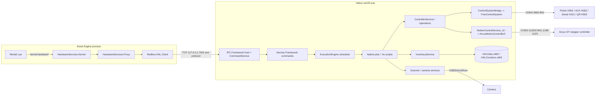

# HAL — Hardware Abstraction Layer service

This document describes the Redbox HAL service (`halsvc-win32.exe`, Windows service `halsvc$default`): what
hardware it drives, how it drives it, the text IPC protocol that clients use, the job/scheduler model, the
inventory store, its configuration, and how the Kiosk Engine reaches it.

The HAL script language (the `.hs` files, the instruction set, the compiler) and the camera/barcode
(DataMatrix) vision stack are documented in [`hal-scripting-and-vision.md`](hal-scripting-and-vision.md). This
document covers only how HAL *invokes* scripts and native jobs. HAL tools (MSHALTester, HalUtilities,
halmgmtc, CameraTuner) are also documented there.

Everything below comes from the decompiled sources under `src/HAL/`, from the kiosk image's
`halservice` folder (installed at `C:\Program Files\Redbox\HALService`) and from the image's `KioskLogs` folder. Version of everything described: **1.13.0.27**. Statements marked
*inferred* are deductions, not things read directly from code.

---

## 1. Overview

A Redbox kiosk stores up to several hundred discs in vertically stacked rotating **decks** (a drum of slots
per deck). A single **picker** (gripper on a carriage) moves vertically between decks (the Y axis) and the
drum position is driven by the X axis (*inferred* from config descriptions such as "rotate the drum 5 slots").
The picker pulls a disc out of a slot with a gripper arm and fingers, rolls it along a track past six optical
sensors, and hands it to the customer through a motorised **vend door**. A camera with a ring light reads the
barcode/DataMatrix on each disc.

HAL is the only component that talks to this hardware. It:

- owns two serial ports: **COM1** to the controller boards (picker board, AUX board, serial board, optional QR
  side terminal) and **COM3** to an **Arcus** USB stepper-motor controller (X/Y axes);
- owns the camera/barcode decoder (see the vision doc);
- keeps the authoritative **slot inventory** (which barcode is in which deck/slot) in a VistaDB database;
- runs **jobs** — named programs, either native C# jobs (`vend`, `return`, `init`, ...) or interpreted HAL
  scripts (`sync`, `thin`, ...) — one at a time, through a priority scheduler;
- exposes all of that over a line-oriented text protocol on **TCP 127.0.0.1:7001** ("RCP").

The Kiosk Engine reaches HAL through the `Redbox.HAL.Client` library, wrapped by the **HardwareServices**
kernel extension (`Redbox.HardwareServices.Proxy`), which exposes `kernel.hardware*` functions to the Lua
rental application.

---

## 2. Deployment

### 2.1 Files on the kiosk

Install root: `C:\Program Files\Redbox\HALService` (image folder `halservice`).

| Path | Content |
|---|---|
| `bin\halsvc-win32.exe` (+ `.exe.config`) | The Windows service host. |
| `bin\Redbox.HAL.*.dll` | Service.Framework, IPC.Framework, Controller.Framework, Component.Model, Core, Configuration, DataStorage, Script.Framework, DataMatrix.Framework, legacy Camera.Framework / ClearimageV1. |
| `bin\camera.plugins\` | Camera plugin `Redbox.HAL.DirectShow.Frame.Plugin.dll` + `DSFrame.Descriptor.xml` (vision doc). |
| `bin\VistaDB.NET20.dll`, `log4net.dll`, `CortexDecoder*.dll`, `Hasp_*`, `CiBcf*.dll`, `CDHelper.dll` | Third-party: database, logging, barcode decoders and licence dongle. |
| `bin\hal.xml` | Live HAL configuration (section 10.2). `HAL.xml.default` is the template; `hal-m8d21y2023_h0m15s14t363.xml` is a backup made by the installer. |
| `bin\Kiosk.xml` | Tiny XML-serialised `KioskConfiguration` (IR hardware install date). |
| `bin\data\HALData.vdb3`, `bin\data\HALCounters.vdb3` | VistaDB 3 databases (section 9). `*.vdb3.default` are empty templates. |
| `bin\data\contexts\<JOBID>\ctx.data` | Persisted jobs (BinaryFormatter). 20 present in the image. |
| `bin\data\inventory-*.xml` | Inventory snapshots written by `CONFIG set-inventory-state`. |
| `bin\qr-chamfer\*.grf`, `qr.defs.default` | Graphics for the "quick return" side terminal (QR device on selector H555). |
| `bin\register-service.bat` | `sc create halsvc$default binPath= "C:\Program Files\Redbox\HALService\bin\halsvc-win32.exe" depend= "tcpip" DisplayName= "Redbox Hardware Abstraction Layer (HAL)" start= delayed-auto` |
| `bin\ServiceStartup.txt` | One line: `JOB schedule resume-now name: 'job-watchdog' ...`. **Not executed** by 1.13 (see 4.1). |
| `bin\HAL.PackageInstaller.exe` | Post-install configurator (section 2.4). |
| `bin\CameraTuner.exe`, `bin\halmgmtc.exe` | Tools (vision doc). |
| `Scripts\*.hs` | Interpreted HAL programs: `check-picker`, `clean-vmz`, `qlm-unload`, `sync`, `sync-locations`, `thin`, `thin-vmz`, `unload-thin`. |
| `Video\*.jpg` | Camera captures (trimmed after `WatchdogImageDayAge` days). |
| `InstallLogs\Package-installer.log` | Installer output. |
| `beforeactivate\`, `afteractivate\` | Lua hooks run by the update system: they only delete obsolete files of older HAL releases. |
| `.staged_` folders | Files staged by the update system for the next activation (see `update-manager.md`). |

Logs go to `C:\Program Files\Redbox\KioskLogs` (section 11.2).

### 2.2 Process, service, endpoints

| Item | Value | Source |
|---|---|---|
| Service name | `halsvc$default` (code sets `ServiceName = "HalSvc$Default"`) | `register-service.bat`, `src/HAL/halsvc-win32/HALService.cs` |
| Display name | `Redbox Hardware Abstraction Layer (HAL)` | `register-service.bat` |
| Start type / dependency | delayed-auto, depends on `tcpip` | `register-service.bat` |
| Runtime | .NET Framework 2.0 CLR (`supportedRuntime v2.0.50727`), net35 | `halsvc-win32.exe.config` |
| Listen endpoint | `rcp://127.0.0.1:7001` (TCP, loopback only) | setting `ServiceProtocol` |
| Serial | `COM1` 9600 8N1 (controller boards), `COM3` 115200 8N1 (Arcus) | `hal.xml`, `FmeControlSystem.cs`, `ArcusMotionController2.cs` |
| Registry read | `HKLM\SOFTWARE\Redbox\REDS\Kiosk Engine\Store`: `ID` (kiosk id), `MaxSlots`, `RebootTime` | `RuntimeService.cs`, `ControllerConfiguration.cs`, `ExecutionEngine.cs` |
| Registry written | `HKLM\SOFTWARE\Redbox\HAL` `Product Version` (by the installer) | `PackageInstaller.cs` |
| Event log | Writes start/stop entries via `EventLog.WriteEntry` | `HALService.cs` |

### 2.3 Dependencies

- **Depends on:** the controller boards and Arcus controller (serial), the USB camera, the Windows registry
  values above, TCP/IP. Not on any other Redbox service.
- **Depended on by:** the Kiosk Engine (through `Redbox.HardwareServices.Proxy`, see section 8), HAL tools
  (MSHALTester, HalUtilities, halmgmtc). The Kiosk Engine's default URL is `rcp://localhost:7001`.
- The **update manager** delivers HAL packages (and the `beforeactivate`/`afteractivate` hooks). That HAL
  package installation then runs `HAL.PackageInstaller.exe` is *inferred* (the installer log exists; the
  calling side is not in HAL's code).

### 2.4 HAL.PackageInstaller

`src/HAL/HAL.PackageInstaller/PackageInstaller.cs`. Steps:

1. If service `halsvc$default` exists, stop it (30 s wait).
2. Create `bin\data` etc.; abort unless the platform is Windows 7.
3. For `HALCounters.vdb3` and `HALData.vdb3`: if absent in `bin\data`, copy from `bin\<name>.default`.
4. Register `ControllerConfiguration` and `BarcodeConfiguration` with a `ConfigurationService` on `bin\hal.xml`.
5. Load "package handlers" (types in `bin\*.dll` implementing `IPackageInstallHandler`; log shows 1).
6. If `hal.xml` exists: back it up (`hal-<timestamp>.xml`), run `LoadAndUpgrade` (forces
   `AggressiveClearPickerOnPut=false`, `RestartControllerDuringUserJobs=true`, `TrackHardwareCorrections=true`,
   `PrepositionVendFraudMove=true`), then handlers' `OnUpgrade`.
   Else: copy `HAL.xml.default` to `hal.xml` and `LoadAndImport`, which imports the deck layout from the
   legacy GAMP files `C:\gamp\SlotData.dat` / `SystemData.dat` (errors `H322`, `H323`).
7. Write `HKLM\SOFTWARE\Redbox\HAL\Product Version`.
8. If the service is not installed, run `register-service.bat` (errors `I003`, `I004`).

---

## 3. Architecture

| Project (`src/HAL/...`) | Role |
|---|---|
| `halsvc-win32` | `ServiceBase` host: builds the service graph, starts the listener. Also contains copies of the command classes and `IPCProxy` (namespace `Redbox.HAL.Service.Win32.Commands`). |
| `Redbox.HAL.Service.Framework` | The IPC command classes actually served: `JOB`, `STACK`, `SYMBOL`, `PROGRAM`, `CONFIG`, `SERVICE` (identical to the copies in the exe except for the namespace; see 4.1 for why the DLL copies are the live ones). |
| `Redbox.HAL.IPC.Framework` | Server and client side of the text protocol: tokenizer, command repository/dispatcher, TCP & named-pipe hosts and sessions, `ClientCommand<T>`, compression helpers. Also `HELP`, `STATISTICS`, `IPCTEST`, `SCRIPT`, `COMMAND-REPOSITORY` commands. |
| `Redbox.HAL.Controller.Framework` | Hardware: controller-board command set (`CommandType`), `FmeControlSystem` (serial boards), `ArcusMotionController2`, `MotionControlService_v2`, deck geometry, picker operations (GET/PUT/vend/accept/reject), inventory/dumpbin/door-sensor/air-exchanger/power-cycle services, `ControllerConfiguration`. |
| `Redbox.HAL.Script.Framework` | `ExecutionEngine` (scheduler), `ExecutionContext` (job), `ProgramCache`, native jobs (`[NativeJob]`), pollers, script instructions (vision/scripting doc). |
| `Redbox.HAL.DataMatrix.Framework` | Barcode readers / camera services (vision doc). |
| `Redbox.HAL.Configuration` | `ConfigurationService` (reads/writes `hal.xml`), `AttributeXmlConfiguration`, GAMP import. |
| `Redbox.HAL.DataStorage` | VistaDB tables (inventory, counters, dumpbin, stats, options). |
| `Redbox.HAL.Core` | Serial port wrapper (`RedboxSerialPort`, `AsyncReadPort`, `PortManager`), USB device service (SetupAPI), device descriptors, tokenizer base, timers. |
| `Redbox.HAL.Component.Model` | Interfaces, enums (`ErrorCodes`, `ProgramPriority`, ...), `ServiceLocator`, `RuntimeService`, LZMA/GZip compression, logging helpers. |
| `Redbox.HAL.Client` | Client library: `HardwareService`, `HardwareJob`, executors. Shipped in `REDS\Kiosk Engine\bin`. |
| `HAL.PackageInstaller` | Installer (2.4). |



All services are wired through a global `ServiceLocator` (`Redbox.HAL.Component.Model`); the interfaces
(`IControlSystem`, `IMotionControlService`, `IInventoryService`, `IExecutionService`, ...) live in
`Redbox.HAL.Component.Model`.

---

## 4. Start-up and lifecycle

### 4.1 Start

`Program.Main` installs an `UnhandledException` handler (appends to
`c:\program files\redbox\kiosklogs\UnhandledException.log` and exits -1) and runs `HALService`. `OnStart`
spawns a listener thread that runs `HALService.ExecuteListener` (`src/HAL/halsvc-win32/HALService.cs`):

1. Register base services: table factory, log factory, logger (`HALService` itself), TripleDES encryption,
   `RuntimeService`, `PortManager`, zip service, device setup class factory, `UsbDeviceService(UsbServiceDebug)`,
   `DataTableService(CountersDBExclusiveMode)`, `PersistentMapService`.
2. `ConfigurationService.Make(<bin>\HAL.xml)`; `KioskConfiguration.Initialize` (loads/creates `Kiosk.xml`).
3. `ControllerService.Initialize` — registers `ControllerConfiguration` ("controller" section) and the deck
   manager, then creates Inventory, PersistentCounter, HardwareCorrectionStatistic, KioskFunctionCheck,
   EmptySearchPattern services, `MotionControlService_v2`, `ControlSystemBridgeModern`, IceQube air
   exchanger, dumpbin bridge, door sensor service, power-cycle device service.
4. `BarcodeConfiguration.NewInstance()` ("camera" section) and `BarcodeReaderFactory.Initialize` (vision doc).
5. `ExecutionEngine.NewEngine(<install>\Scripts)` and `Initialize`: registers the barcode validator and fraud
   service, discovers **pollers** (`[Poller]` types), **compiles programs** (all `[NativeJob]` types plus every
   `Scripts\*.hs`), and **reloads persisted jobs** from `bin\data\contexts\*\ctx.data` (unreadable ones are
   deleted; suspended `init`/`return`/`vend`/`soft-sync` jobs are marked Garbage).
6. `configurationService.Load` — reads `hal.xml` into every registered section, then broadcasts
   `NotifyConfigurationLoaded`. Most hardware objects are only created at this point (e.g. the bridge creates
   `FmeControlSystem` and opens nothing yet; the motion service creates `ArcusMotionController2`; dumpbin picks
   real or nil implementation; the engine reads `RebootTime`).
7. If any error was collected (e.g. `P005` slot-count mismatch with registry `MaxSlots`, `P006` no decks), log
   "The HAL service encountered startup problems, and is stopping." and call `Stop()`.
8. `IPCProxy.InitializeServices(ServiceHostGeneration)` and `IPCProxy.Parse(ServiceProtocol)`; if the URI is
   bad, log fatal and do not listen.
9. `executionService.Start()`: restart youngest unfinished maintenance jobs (5 min delay), clean garbage, start
   the **"HAL Script Scheduler"** thread (STA), and schedule the **`init`** job (priority High, label
   `HAL Service Startup: Init`, symbol `__EE_BOOTSTRAP_INIT=true`) in Pending state.
10. `Proxy.StartListener()`: the TCP accept loop runs on this listener thread until stop.

The IPC `CommandService` singleton (and thus command discovery) is created lazily on the first received
command. Discovery (`CommandRepository.DiscoverInstalledCommands`) loads every `*.dll` in the directory of
`Redbox.HAL.IPC.Framework.dll` and registers every type with `[Command("name")]`. Because only `*.dll` files are
scanned, the command classes compiled into `halsvc-win32.exe` are never registered — the live commands are
those in `Redbox.HAL.Service.Framework.dll` and `Redbox.HAL.IPC.Framework.dll`.
`IPCProxy.ExecuteStartupFile` (which would run `ServiceStartup.txt`) is never called; the old `job-watchdog`
script is replaced by the `Watchdog` poller.

A real start (from `KioskLogs\Service\halsvc-win32.log`, 2025-01-06) takes about 4 s to the listener
(`TCP Server: start processing incoming requests on address 127.0.0.1.`); the `init` job then waits
`MinInitWakeupTime` (5 s) for COM ports, opens COM1 and COM3, and finishes about 85 s later after starting the
camera.

### 4.2 The `init` job

`src/HAL/Redbox.HAL.Script.Framework/InitJob.cs` (applog `KioskLogs\init\init-<JOBID>.log`):

1. On bootstrap only: optionally reset camera exposure; wait `MinInitWakeupTime`.
2. If the control system is already initialised, shut it down (close COM1) and wait 2 s.
3. `ControlSystem.Initialize()` → board `RESET` (`X` to H101, 60 s wait), wait 2 s, audio off. Failure →
   result `RESET` and job error.
4. `MotionService.Initialize()` → open COM3, send the Arcus init block (5.3).
5. Read board versions (`Y` to H101, `W` to H001 and H002) → results `VERSION INFO`.
6. Track test: open/close/open/close, 200 ms apart (`TRACK OPEN FAILED` / `TRACK CLOSE FAILED`).
7. `ClearGripper` (result `PICKER OBSTRUCTED` on failure).
8. `InitAxes()`: home X twice (moving to X=-200 after the first), then home Y (result `InitError`).
9. Start the camera; run check-picker (put away any disc found in the picker).
10. Move to the vend position (`MOVEVEND`).
11. Finally: on bootstrap, check the System event log for dirty shutdown (IDs 41/12, `TrackDirtyShutdown`);
    send `INIT STOP`.

When `init` completes, the pollers are started and `JOB init-status` returns its final status.

### 4.3 Steady state

- The scheduler thread loops: if inside the reboot window, suspend maintenance jobs; otherwise pick the
  eligible job and run it (section 6). It wakes every 250 ms or on a context-switch request.
- Pollers (each a background thread that periodically schedules a job and blocks on it):

| Poller | Job scheduled | Period | Enabled when | Priority |
|---|---|---|---|---|
| `Watchdog` | none — runs in-process: trims logs (Sunday 02–04 h), runs `reset-counters-job` (if `ResetTimeoutCountersWeekly`), GC, cleans errored and old completed jobs | 1 800 000 ms | always | Normal |
| `HardwareHealer` | `hardware-healer` | `HardwareHealerPauseTime` (900 000) | `EnableHardwareHealing` | Highest |
| `CCRWatchdog` | `test-and-reset-ccr` | `CCRWatchdogSleep` (1 800 000) | value > 0 | High |
| `IceQubeBoard` | `check-iceqube-board` | 600 000 | `EnableIceQubePolling` | High |
| `InventoryBackup` | `backup-inventory` | `InventoryBackupPause` (0 = off) | value > 0 | High |

  Pollers stop when the engine leaves `Normal` mode (`SERVICE mm-status`, `merch-mode`, `diagnostic-mode`)
  and restart when it returns to `Normal` (`src/HAL/Redbox.HAL.Script.Framework/ScriptPoller.cs`).
- **Reboot window:** if `RebootExecutionPreventionWindow` (10 min) > 0 and registry `RebootTime` is set
  (`04:01:00` in the logs), from `RebootTime-10min` to `RebootTime` the scheduler suspends jobs named
  `qlm-unload, thin, unload-thin, sync, sync-locations, thin-vmz, clean-vmz`, stops pollers, and 5 min after
  the reboot time restarts the youngest such job and the pollers.

### 4.4 Power events and stop

- `OnPowerEvent(Suspend)`: engine `Suspend()` (stop pollers, suspend all jobs), controller and scanner
  `Shutdown()` (close ports). `ResumeSuspend`: engine `Restart()` (schedule a new non-bootstrap `init`,
  restart youngest maintenance job, start pollers).
- `OnStop` / `OnShutdown`: engine `Shutdown()` (stop pollers, disable scheduler, suspend all, wait for the
  active job to end), controller `Shutdown()` (Arcus port and COM1 closed), scanner `Shutdown()`, event-log
  entry, stop the TCP listener.
- IPC `SERVICE power-down` / `power-up` call the engine's `Suspend()` / `Restart()` without closing ports.

---

## 5. Hardware and how HAL controls it

### 5.1 Physical model and coordinates

- **Decks** are configured in `hal.xml` under `Controller/Decks` (`src/HAL/Redbox.HAL.Controller.Framework/Deck.cs`).
  The image's kiosk has 8 decks of 90 slots (720 slots); the inventory snapshot has 720 items. Each deck has:
  `Number`, `Offset` (Y coordinate of the deck, negative motor units), `IsQlm`, `SlotWidth` (default 166.6667),
  `NumberOfSlots` (90 "dense" = 15 slots/quadrant, or 72 "sparse" = 6/quadrant), optional `SellThruSlots` /
  `SellThruOffset` (default 915), and child `Quadrant` elements (`Offset`, `StartSlot`, `EndSlot`,
  `IsExcluded`). Only one QLM deck is allowed.
- **X coordinate of a slot** = quadrant `Offset` + (slot − quadrant `StartSlot`) × `SlotWidth`, truncated to
  int; for a sell-thru (wide) slot (`slot % SellThruSlots == 0`) the in-quadrant offset is `SellThruOffset`.
  Example: deck 1 slot 20 → 3465 + 4×166.6667 = 4131.
- **Y coordinate** = deck `Offset` ± `50 × GearY.StepRatio()` (or `QlmYOffset` on the QLM deck): minus for a
  GET, plus for a PUT. With `GearY` StepResolution 4, StepRatio 20 → step ratio 4×(20/10)=8 → ±400. The
  Arcus trace confirms `Y-19640` for a GET on deck 1 (−19240 − 400).
- **Vend position**: `Y = VendYPosition` (−86400), minus `VendPositionReceiveOffset` (100) for a receive
  (`MoveMode.Get`) and plus for `Put`; the trace shows `Y-86500` and `PY=-86500`.
- **QLM** deck (one with `IsQlm=true`): a deck that can be engaged/disengaged by a lifter on the AUX board, has
  a door lock, presence and bay-door sensors. The kiosk is in `QLM` merchandizing mode if a QLM deck exists,
  otherwise `VMZ_Gen2` (the image's kiosk is `VMZ_GEN2`). The exact physical meaning of QLM/VMZ is not
  spelled out in code (*inferred*: QLM = removable bulk-load module; VMZ = a slot zone used for
  thinning/merchandising on machines without a QLM).
- **Dumpbin** (VMZ machines only): slots 82–84 of the **last** deck, capacity 60 discs; discs put there are
  recorded in table `BarcodesInBin` (`DumpbinService.cs`). The "put location" is slot 83.

### 5.2 Controller boards (COM1)

`src/HAL/Redbox.HAL.Controller.Framework/FmeControlSystem.cs`, `CoreCommand.cs`, `CommandType.cs`,
`src/HAL/Redbox.HAL.Core/AsyncReadPort.cs`.

Transport: one RS-232 port `ControllerPortName` (COM1), **9600 baud, 8N1**, ASCII. Several boards share it;
each exchange first **selects** a board by sending its address, then sends the opcode.

| Selector | Board (from `ComputeCommunicationError`) |
|---|---|
| `H001` | "PCB" — the picker board (gripper, track, roller, picker sensors, ring light) |
| `H002` | "AUX board" (vend door, QLM lifter/door, AUX sensors, auxiliary power outputs) |
| `H101` | "SER board" (serial board: reset, audio, version) |
| `H555` | "QR device" (quick-return side terminal: LEDs, LCD, button) |

Framing for every write: the ASCII text followed by `CR` (0x0D) (`WriteTerminator = {13}`). Before each write the
input/output buffers are discarded; after writing, HAL waits `WritePause` (10 ms default) and reads
asynchronously until the accumulated reply contains `OK` or `EER`. Read timeout: 5000 ms for the selector,
`CommandWait` for the opcode (8000 ms default, 60000 for `RESET`). A timeout or I/O error gives
`ErrorCodes.CommunicationError` (logged as `[SendCommand] Selector H001 ( port = COM1 )communication error.`).

Exchange for one command:

```
HAL -> board : "H001" CR          ; select picker board (reply must contain OK/EER)
HAL -> board : "L1"   CR          ; GripperExtend
board -> HAL : "...OK"            ; ack
; if the command has a StatusBit: poll until the bit clears or the operation timeout expires
HAL -> board : "H001" CR, "S" CR  ; every WaitPauseTime ms
board -> HAL : status string; character [StatusBit] == '1' means "still moving"
; on timeout: send each ResetCommand (e.g. "K1"; "K4,P1" means K4 then P1) and return Timeout
```

The command table (`CommandType.cs`; StatusBit/Reset/WaitPause only where defined):

| Command | Sel. | Opcode | Status bit | Reset | Notes |
|---|---|---|---|---|---|
| Reset | H101 | `X` | | | CommandWait 60000 |
| AudioOn / AudioOff | H101 | `I` / `J` | | | |
| Version101 / Version001 / Version002 | H101/H001/H002 | `Y` / `W` / `W` | | | board version strings |
| Status001 / Status002 | H001/H002 | `S` | | | also used for polling |
| ReadPickerInputs | H001 | `R` | | | 20 inputs, see 5.4 |
| AuxSensorsRead | H002 | `R` | | | 20 inputs, see 5.4 |
| SensorBarOn / Off | H001 | `O1` / `P1` | | | picker optical sensors power (same opcodes as Junction4On/Off) |
| RinglightOn / Off | H001 | `O2` / `P2` | | | camera ring light |
| FraudSensorEnableTransistor / Disable | H001 | `O3` / `P3` | | | |
| FraudSensorEnablePowerTransistor / Disable | H001 | `O4` / `P4` | | | |
| GripperExtend | H001 | `L1` | 5 | `K1` | wait 50 |
| GripperRetract | H001 | `M1` | 6 | `K1` | wait 50 |
| GripperExtendHalt | H001 | `K1` | | | |
| ExtendGripperArmForTime | H001 | `I1` | | | timed extend, then `K1` |
| TrackClose / TrackOpen | H001 | `L2` / `M2` | 7 / 8 | `K2` | wait 50 |
| GripperClose / GripperOpen / GripperRent | H001 | `L3` / `M3` / `V` | 9 / 10 / 12 | `K3` | finger positions |
| RollerIn / RollerOut / RollerStop | H001 | `J4` / `I4` / `K4` | | | |
| RollerToPos1..3 | H001 | `U1`..`U3` | 18..20 | `K4,P1` | wait 20; roll disc to sensor n |
| RollerToPos4..6 | H001 | `T4`..`T6` | 15..17 | `K4,P1` | wait 20 |
| VendDoorClose / VendDoorOpen / VendDoorRent | H002 | `L2` / `M2` / `V` | 7 / 8 / 10 | `K2` | wait 60 |
| UnknownVendDoorCloseCommand / ...Open | H002 | `J2` / `I2` | | | used in close back-off |
| VendDoorKillCommand | H002 | `K2` | | | |
| QlmEngage / QlmDisengage | H002 | `M1` / `L1` | 6 / 5 | `K1` | 120 s timeout |
| QlmLift / QlmDrop / QlmHalt | H002 | `M1` / `L1` / `K1` | | | no polling |
| QlmDoorLock / QlmDoorUnlock | H002 | `P2` / `O2` | | | also IceQube fan on/off |
| AuxSensorsOn / Off | H002 | `O1` / `P1` | | | |
| PowerAux20 / DisableAux20 | H002 | `O3` / `P3` | | | |
| PowerAux21 / DisableAux21 | H002 | `O4` / `P4` | | | router power relay |
| QR terminal commands | H555 | `I1/I2/I3`, `R1..R3`, `T1..T3`, `Z1..Z3`, `W1..W3`, `S{text}`, `X{n}`, `Y`, `J`, `K`, `U9x/U8x`, `M/L/V/O/N{n}`, `g/l/d/e{n}`, `m`, `c` | | | LEDs, backlight, text/graphics display, EEPROM, button read |

Behaviour on top of the raw commands (`FmeControlSystem`):

- **Initialize** = `Reset`, wait 2 s, audio off. **Shutdown** closes the port.
- Finger moves and track moves are retried once (`OnRetryable(…, 2, 5000)`), stopping early on comm error.
  With `EnableSecureDiskValidator` the "rent" finger position uses `GripperOpen` and "open" is refused.
- **Extend** with timeout: if it times out but the Extend input reads active, it is treated as success.
- **Vend door close**: up to 2 tries with 5500 ms timeout; on timeout a back-off (`J2`, `K2`); if not closed and
  `MoveVendDoorToAuxSensor` is set, back off and close again.
- Failures are logged with the inputs of the relevant board; timeouts of finger/extend/retract/track/vend door/
  QLM increment persistent **timeout counters** (`TimeoutCounters`), dumped to `KioskLogs\ErrorLogs\Timeouts.log`.

### 5.3 Motion controller (Arcus, COM3)

`src/HAL/Redbox.HAL.Controller.Framework/ArcusMotionController2.cs`, `MotionControlService_v2.cs`.

The Arcus controller is a USB device (VID `1589`, PID `A001`, `ArcusDeviceDescriptor.cs`) presenting a virtual
COM port, `MotionControllerPortName` (COM3), **115200 baud, 8N1**. Commands are ASCII terminated by `CR NUL`
(`{13, 0}`); a reply is complete when it contains byte `0x04` (EOT), and the text up to the first `CR` is the
response. Read timeout = `MotionControllerTimeout` (5000 ms); `ArcusWritePause` (20 ms) after each write.
No response → `ArcusNotResponsive`. With `EnableArcusTrace` every exchange is logged to
`KioskLogs\Service\MotionControlErrorLog.log` (`ArcusMotionController: Instruction=MSTX, Response=4`).

Commands HAL uses (all observed in the trace):

| Command | Meaning (as used by HAL) |
|---|---|
| `$` | Ping; reply `OK` = communication OK |
| `RSTOP` | Stop motion |
| `MECLEARX` / `MECLEARY` / `MECLEARZ` / `MECLEARU` | Clear motor error per axis |
| `I1=…`, `I2=…`, `I3=…` … `I11=…` | Controller parameters; `I3` = X encoder ratio `PulseRatio×4096×StepRatio()+EncoderRatio`; `I7` = position tolerance (10 normal, 15 during moves, 2/5 during error-correct) |
| `HSPD n`, `LSPD n`, `ACCEL ms` | High/low speed (configured speed × gear step ratio) and acceleration |
| `ABS` / `INC` | Absolute / incremental mode |
| `EX=0`, `PX=0`, `EY=0`, `PY=0` | Zero encoder/position |
| `HOMEX-`, `HOMEY+` | Home X in the negative direction, Y in the positive direction |
| `X n`, `Y n`, `YnXm` | Move (written without space: `X4131`, `Y-19640`, `Y-19640X4131` in smooth mode) |
| `MSTX`, `MSTY` | Motor status: `0` stopped, `1` accelerating, `2` decelerating, `4` constant speed, `8` upper limit, `16` lower limit |
| `MIOY` | Y I/O status; values 1–7 are treated as a Y motor error |
| `EX`, `PY` | Read X encoder / Y position (`EX=1422`, `PY=-86500`) |
| `MIOY` + `Y-n` | Drop-back move before `HOMEY+` when `HomeYDropBack` ≠ 0 |
| `???` | Read limits |

- **Init block** (on port open and on configuration change): `$ $ $ RSTOP MECLEARX MECLEARY MECLEARZ MECLEARU
  I1=4204544 I2=3136 I3=<enc> I4=0 I5=0 I6=0 I7=10 I8=0 I9=2000 I10=0 I11=2`.
- **Move preamble**: `$ RSTOP MECLEARY MECLEARX HSPD/LSPD/ACCEL (MoveXYAxisSpeed) ABS I7=15 I2=3136`.
- **XY move**: send `X…` and `Y…` (or combined), poll `MSTY` then `MSTX` every `ArcusMotorQueryPause` (75 ms)
  until 0 or `MoveTimeout` (30 s); then an error-correct pass (`LSPD <8×100>`, `I7=2`, same target again,
  wait), then `I7=10`. After the move `MIOY`/`MECLEARY` checks for a Y motor error. During every wait the
  **door sensor** is queried; an open door halts motion (`RSTOP`) and returns `DoorOpen`.
- **Home X**: `$ RSTOP MECLEARX I1=4204544 <InitAxisXSpeed> INC EX=0 PX=0 I2=3072`, wait, `HOMEX-` (64 s),
  `I2=3136 I7=15`, wait, `MECLEARX`. **Home Y**: `$ RSTOP MECLEARY <InitAxisYSpeed> INC EY=0 PY=0`, optional
  drop-back, `HOMEY+` (60 s).
- **Move to vend**: if `QueryPositionForVendMove` and `PY` already equals the target, no move; otherwise
  clear Y error and move Y only.

`MotionControlService_v2` adds:

- **Move vetoes** checked before every move/home: `ControllerService.CanMove` (vend door must close; gripper
  must clear; if arm not retracted then set fingers to Rent (`GripperRentOnMove`) and retract; refuse if both
  Extend and Retract inputs are active) and `DoorSensorService.CanMove` (front door). A veto failure returns
  its error code (`VendDoorNotClosed`, `ObstructionDetected`, `SensorReadError`, `GripperRentTimeout`,
  `GripperRetractTimeout`, `SensorError`, `DoorOpen`).
- **Home tracking**: moves fail with `MotorNotHomed` unless both axes have been homed since start
  (`ValidateControllerHomeStatus`).
- **Self-healing**: on `ArcusNotResponsive` during a move, if `RestartControllerDuringUserJobs`, it resets the
  Arcus — close port, **disable and re-enable the USB device** through SetupAPI
  (`ArcusDeviceDescriptor.OnResetDriver`), reopen, re-home both axes — raises
  `HardwareCorrectionStart/End` events on the running job, records an `Arcus` hardware-correction statistic,
  and retries the move once. `LowerLimitError` becomes `Timeout` unless `LowerLimitAsError`.

### 5.4 Sensors

Both boards answer `R` with 20 digit flags. With `ValidateInputsReadResponse` (true in the image) the reply must
have `R` at index 21 and whitespace at index 16; a real reply is `0010100000000000 0000R OK`. Digit *i* = input
*i*, `'1'` = Active.

| Index | Picker input (`PickerInputs`) | AUX input (`AuxInputs`) |
|---|---|---|
| 0 | Extend (arm extended) | QlmDown (used as **front door closed** sensor on VMZ machines) |
| 1 | Retract | QlmUp |
| 2 | TrackClose | VendDoorClosed |
| 3 | TrackOpen | VendDoorSell |
| 4 | FingerClose | VendDoorRent |
| 5 | FingerSell | QlmBayDoor (also IceQube status) |
| 6 | FingerRent | Unused1 |
| 7, 8 | Unused1, Unused2 | QlmPresence, UpperExternalVend |
| 9 | Sensor6 | LowerExternalVend |
| 10 | Sensor4 | Unused |
| 11 | Sensor2 | Unused |
| 12 | Unused3 | Unused |
| 13 | Sensor1 | Unused |
| 14 | Sensor5 | Unused |
| 15 | Sensor3 | Unused |
| 16–19 | Unused | Unused |

Disc-path sensors 1–6 are read with the sensor bar powered (`O1`, spin `PickerSensorSpinTime`, `R`, `P1`), after
closing the track. The picker is **full** if any of sensors 1–6 is active; "blocked count" = number active
(`PickerSensorReadResult.cs`). From their use: sensor 1/2 are at the slot side, 5/6 at the vend door side
(*inferred* from GET pulling to sensor 4 and accept-at-door waiting for sensor 5).

### 5.5 Picker operations

Implemented as `AbstractOperation` subclasses (`src/HAL/Redbox.HAL.Controller.Framework/*Operation.cs`) and
exposed by `ControllerService` (`IControllerService`):

- **GET** (`GetOperation`): close track, refuse if picker full (`PickerFull`); for wide slots settle the disc;
  open track, roller out, **pull** (fingers Rent (or Open for wide slots) → extend arm (QLM: `QlmExtendTime`)
  → fingers Close → retract; `NumberOfPulls` pulls; then Rent), close track, re-pull if only sensor 1 lit,
  roll to position 4 (6 s). Success → inventory slot set to `EMPTY`. Disc not at sensor 4 but present → stuck:
  roll in, push it back into the slot → `PickerObstructed` or `ItemStuck`. Nothing in picker → `SlotEmpty`
  (observer decides whether to mark the slot EMPTY).
- **PUT** (`PutOperation`): requires the picker full; pushes the disc into the slot; on success the slot gets
  the disc's id. `ControllerService.PutTo` moves (MoveMode.Put), cycles the track, then puts; a put to a
  dumpbin location records the barcode in `BarcodesInBin`.
- **Transfer** = GET from source + PUT to destination(s).
- **Vend item in picker** (`VendItemOperation`): roll to position 5, open vend door to Rent, push out; poll
  sensors up to `VendDiskPollCount` times at 1 s: if sensors 1–4 are lit the disc fell back — push again; after 2
  failures with `TrackPushOutFailures` → `PickerFull`/not presented. Picker empty → taken (`PickerEmpty`), then
  close door.
- **Accept disc at door** (`AcceptDiskOperation`, used by return): door to Rent, roller in, wait for sensor 5
  up to `AcceptDiskTimeout` (15 s), roll to position 3; > 3 sensors blocked → `PickerObstructed`; then close
  the door.
- **Reject disc** (`RejectDiskOperation`, `RejectAtDoorAttempts`), **push out**, **clear gripper**
  (`ClearGripperOperation`: if sensor 1 lit push the disc into the slot; if only sensor 6 lit roll it in;
  if both → `PickerObstructed`), **peek** (test whether a slot is occupied).
- **Center** a disc for imaging (`DrumAndBack`: roller to position 1 then 5; else 6 then 3; then track cycle).

### 5.6 Other devices

| Device | How HAL controls it | Source |
|---|---|---|
| Front door sensor | `AuxInputs.QlmDown` must be active on VMZ machines, else moves are vetoed / halted (`DoorOpen`). A persistent **software override** (`SensorSoftwareOverride` in table `SecretOptions_v2`) disables it (`door-sensor-software-override` job). | `DoorSensorService.cs` |
| Vend door | AUX `L2/M2/V`, position from AUX inputs 2–4. | 5.2 |
| IceQube air exchanger | If `EnableIceQubePolling`: fan on = `QlmDoorLock` (`P2`), off = `QlmDoorUnlock` (`O2`), OK when `QlmBayDoor` input active; reset = off, 1.5 s, on. Failures counted in counter `IceQubeResetFailures`. | `IceQubeAirExchangerService.cs` |
| Router power relay | `power-cycle-router` job: cut = `PowerAux21` (`O4`), restore = `DisableAux21` (`P4`), pause `RouterPowerCyclePause` (0 = not configured). | `RouterPowerCycleDevice.cs` |
| Audio channel | H101 `I`/`J` (`change-audio-channel-state` job). | `FmeControlSystem.SetAudio` |
| Ring light | H001 `O2`/`P2`, used around camera captures. | `ControlSystemBridgeModern.ToggleRingLight` |
| Camera / decoder | `IScannerDeviceService`, `IBarcodeReaderFactory` (Cortex decoder; DirectShow camera plugin). HAL starts the camera in `init`, restarts it after return failures (`FixCameraAfterReturn`). Details in the vision doc. | `Redbox.HAL.DataMatrix.Framework` |
| Touch screen | USB descriptors for 3M MicroTouch (`0596:0001`) and generic touch screens; `reset-touchscreen-controller` job sends 3M reset commands. | `Redbox.HAL.Core/Descriptors` |
| Credit-card reader (CCR) | Only power-cycle/test (`test-and-reset-ccr` via `CCRWatchdog`); card handling is in `device-service.md`. ID TECH descriptors `0ACD:0200`, `0ACD:0520`. | `Redbox.HAL.Core/Descriptors/IdTechRev*.cs` |
| Quick return device | FTDI `0403:6001` descriptor, `QuickReturnComPort` (NONE in the image); `JOB quick-return-status` always answers `INACTIVE`. | `QuickReturnDescriptor.cs`, `JobCommand.cs` |
| "ABE device" | HID `2047:0902`; only presence is reported (`AbeDeviceStatus`, `HasABEDevice`). Its function is not described in code. | `AbeDeviceDescriptor.cs` |
| Gen5 camera | `11FA:0204` descriptor. | `Gen5DeviceDescriptor.cs` |

USB devices are enumerated/enabled/disabled with SetupAPI (`src/HAL/Redbox.HAL.Core/UsbDeviceService.cs`);
`UsbServiceDebug` makes it log every hardware id it sees (visible in the log after `init`).

There is **no receipt printer** in HAL.

---

## 6. Jobs and the scheduler

### 6.1 Programs

A *program* is a named, compiled item in the `ProgramCache` (`src/HAL/Redbox.HAL.Script.Framework/ProgramCache.cs`):

- **Native jobs** — C# classes marked `[NativeJob(ProgramName = "...", Operand = "...")]`. For each, HAL compiles
  the one-line script `NATIVEJOB <OPERAND>` under the program name; running it instantiates the class (88
  native jobs registered in the logs). `return` and `quick-return` are added by hand (`RETURN`, `QUICKRETURN`).
- **Script programs** — every `Scripts\*.hs`, named after the file (8 in the image).
- `PROGRAM compile`/`set` add or replace programs at runtime; `$`-prefixed names (e.g. `$$$immediate$$$`) are
  hidden from `PROGRAM list`.

Main programs and the stack arguments the client pushes (top of stack is pushed **last**; scripts `POP` from
the top). Push order shown is the order of `STACK push` calls:

| Program | Kind | Pushed by the client (in order) | Purpose |
|---|---|---|---|
| `init` | native | — | Board reset, homing, camera start (4.2). |
| `vend` | native | ids…, count, `"BY-ID"`; or (slot, deck)…, count, `"BY-LOCATION"`; or ids…, count, `"PREPOSITION-PICKER"` (optionally ids…, slot, deck, count, `PREPOSITION-PICKER`) | Vend discs. |
| `return` | native | — | Accept a disc at the door, read it, file it. |
| `return-unknown` | native | return time | Return of a disc without a known rental (the time is pushed by the client). |
| `vend-unknown` | native | slot, deck | Remove an UNKNOWN slot's disc. |
| `sync` | script | end-slot, end-deck, start-slot, start-deck | Read barcodes of a deck/slot range and update inventory. |
| `sync-locations` | script | (slot, deck)…, count | Sync a location list. |
| `soft-sync`, `hardware-status`, `get-machine-info`, `kiosk-configuration-job`, `get-inventory-stats`, ... | native | — | Status/inventory reporting via RESULT lines. |
| `thin`, `qlm-unload`, `unload-thin`, `thin-vmz`, `clean-vmz` | script | arrays (count on top) | Merchandising operations. |
| `load-bin` | native | ids…, count, `"BARCODE"` or locations…, count, `"LOCATION"` | |
| `reset-locations`, `mark-locations-unknown`, `mark-barcodes-unknown` | native | location / id lists | Inventory corrections. |
| `mark-kiosk-inventory` | native | `"EMPTY"` or `"UNKNOWN"` | Set every slot. |
| `reset-inventory-job` | native | file name in `bin\data` | Load an inventory XML (CONFIG set-inventory-state). |
| `dump-inventory-store-job` | native | — | Write `KioskLogs\StoreDump-<ts>.txt`. |
| `power-cycle-router`, `test-and-reset-ccr`, `reset-touchscreen-controller`, `reset-motioncontrol`, `reset-controlsystem-job` | native | — | Device recovery. |
| `hardware-healer`, `backup-inventory`, `check-iceqube-board`, `reset-counters-job` | native | — | Run by pollers. |

The full native list (from `[NativeJob]` attributes): adjacent-bin-test, adjacent-bin-test-kent, air-exchanger-status,
backup-inventory, change-audio-channel-state, change-camera-configuration, check-iceqube-board,
clear-all-hardware-statistics, clear-hardware-statistics, clear-images-folder, clear-merch-status, decode-image,
door-sensor-software-override, dump-hardware-statistics, dump-inventory-store-job, file-disk-in-picker,
file-marker-disk, get-all-hardware-statistics, get-and-center, get-and-read, get-barcode-vmz-location,
get-barcodes-in-bin, get-controller-timeouts, get-excluded-locations, get-hardware-statistics, get-inventory-stats,
get-machine-info, get-non-barcode-inventory, get-nonthins-in-vmz, get-quick-return-counters, hardware-healer,
hardware-status, hardware-survey-job, init, kiosk-configuration-job, kiosk-function-test-data, load-bin,
load-kiosk-function-check-data, lookup-barcodes, loopy, mark-barcodes-unknown, mark-kiosk-inventory,
mark-locations-unknown, merch-clear-and-offset, motion-control-get-data, ms-pull-in-dvd, ms-take-disk-at-door,
ms-vend-disk-in-picker, one-disk-quick-deck-test(-kent), one-disk-random-sync, pick-at-offset,
power-cycle-router, prep-deck-for-redeploy, prep-zone-for-unload, push-in-dvd, put-disk-in-picker-in-bin,
put-disk-to-location, qlm-kiosk-test, qlm-test-sync, random-sync, read-barcode, read-fraud-disc,
rebuild-inventory-database, refurbish-kiosk-test, reset-controlsystem-job, reset-counters-job, reset-fraud-sensor,
reset-inventory-job, reset-locations, reset-motioncontrol, reset-quick-return-counters,
reset-touchscreen-controller, restore-inventory-from-backup, return-unknown, soft-sync, test-and-reset-ccr,
test-boards-job, test-retrofit-deck, tester-move-to-slot, vend, vend-unknown, vertical-sync, vmz-details,
vmz-merch-summary, vmz-removed-thins. A few programs the client library can schedule do not exist in 1.13
(`field-insert-with-fraud-check`, `fraud-sensor-post-test`, `update-qr-eeprom`); scheduling an unknown name
returns error `E001` "The program '...' was not found in the program cache."

### 6.2 Jobs (execution contexts)

A **job** = `ExecutionContext` (`src/HAL/Redbox.HAL.Script.Framework/ExecutionContext.cs`): a copy of a program
plus its own data stack (deque), symbol table, cached results, message queue, label, priority, optional start
time and status.

- **ID**: base-36 of a random positive Int32 → up to 6 characters, e.g. `DUDL9V`. The immediate-mode job has ID
  `IMMEDIATE`.
- **Status** (`ExecutionContextStatus`): `Suspended`(0), `Pending`, `Running`, `Errored`, `Stopped`, `Garbage`,
  `Completed`. *Complete* = Errored, Completed, Garbage or Stopped.
- **Priority** (`ProgramPriority`, lower value runs first): `Immediate`=0, `Highest`=1, `High`=2,
  `AboveNormal`=3, `Normal`=4, `BelowNormal`=5, `Low`=6, `Lowest`=7.

Lifecycle:

```
JOB schedule ─► Suspended ──JOB resume / JOB pend / Resurrect──► Pending ──scheduler──► Running
                    ▲                                                             │
                    └────────JOB suspend (deferred if Running)────────────────────┤
Running ──program ends──► Completed | Errored ;  JOB terminate ─► Stopped ;  JOB trash ─► Garbage
```

- A new job starts **Suspended**; the client must `JOB resume` (or the server `Pend()`s it for SERVICE-scheduled
  jobs).
- Status changes requested while a job is **Running** (suspend, terminate, trash) are stored as
  `DeferredStatusChangeRequested` and take effect only at a cooperative point: a script `YIELD`/`SYSCALL`
  instruction, or a native job calling `ContextSwitchRequested()`. There is no pre-emption: a running job
  normally runs to completion.
- Every change of state of a non-immediate job is **persisted** by serialising the whole context with
  `BinaryFormatter` to `bin\data\contexts\<ID>\ctx.data`; garbage collection deletes the directory.
- A job that ends logs `Job <program> ID <id> ends with status <status>`; for non-immediate jobs HAL then turns
  the sensor bar, roller and ring light off (`CleanupHardware`).
- Singleton program: `clean-vmz` (a second one is refused with `E001`).
- `JOB schedule ... label: L no-duplicates` refuses (warning `S998`) if a job with that label exists, and with
  `resume-now` resurrects the existing one(s).

### 6.3 Scheduler

`ExecutionEngine.ProcessScheduler` (thread "HAL Script Scheduler", STA):

1. If inside the reboot window, suspend the maintenance jobs (4.3).
2. If no job is active (or a switch was requested), choose among **Pending** jobs: sort by priority then
   creation time, take the first whose `StartTime` is null or due.
3. Run it synchronously (`ExecutionContext.Execute`) on the scheduler thread: send
   `>STATUS CHANGE< Running`, execute instructions until the status must change, then send
   `>STATUS CHANGE< <final>`.
4. Wait up to 250 ms and repeat.

Only one job drives hardware at a time. `JOB scheduler-status` returns the active job ID or `idle`.

**Immediate mode**: `JOB execute-immediate statement: '<script text>'` compiles the text as program
`$$$immediate$$$` into the single `IMMEDIATE` context with priority `Immediate`, pends it, **waits for it to
complete** inside the IPC call, and returns the job line. Only one immediate job at a time (`S001`). Immediate
jobs never persist and produce no RESULT lines.

**Engine modes** (`EngineModes` flags): Normal 0, Maintenance 1, Diagnostic 2, Merchandizing 4, entered/left
via `SERVICE mm-status|diagnostic-mode|merch-mode status: true|false`. Leaving Normal stops pollers.

### 6.4 Results, messages and signals

- **Messages (events)**: a job sends free-text events (`Context.Send`). Each is queued as
  `<EventTime>|<text>` (times forced to be strictly increasing by one-second steps) and forwarded to the
  connected client session (7.6). Examples from `vend`/`return`: `VendStart`, `FindItemToVend`,
  `ItemNotFound`, `VendGraphicDisplay`, `PickupGraphicDisplay`, `ItemVended`, `MachineError`, `MachineFull`,
  `DisableCancel`, `BlockingOnSensor`, `ItemInsertError`, `UnrecognizedBarcodeReturned`, `Bail`,
  `CheckPickerStart`, `CheckPickerStop`, `GripperTimedOut`, `MaxPutAwayAttemptsExceeded`,
  `HardwareCorrectionStart:Arcus`, `HardwareCorrectionSuccess:Arcus`, `HardwareCorrectionFailure:<stat>`, and the
  status events `>STATUS CHANGE< <Status>`.
- **Results**: structured outcome records appended to the job and fetched with `JOB get-results`:

  ```
  RESULT|<guid>|<timestamp>|<code>|<deck>,<slot>|<item-id>|<message>|<return-time>|<previous-id>
  ```

  Missing fields are `~`; `'` in the message is replaced by a space; the message may be a JSON object
  (`CreateJSONResult`; the client deserialises messages starting with `{`). Codes seen in code:
  `ItemVended`, `ItemReturned`, `VendError`, `MachineError`, `MachineFull`, `BarcodeNotFound`, `BadIdRead`,
  `DuplicateDetected`, `CameraCaptureFailure`, `ItemStuckInGripper`, `PrepositionedItem`, `UnclaimedVend`,
  `EmptySlotCount`, `DumpBinRemainingCapacity`, `ReturnSlotBufferValue`, `NonRedboxDiskReturnedToUser`,
  `PutToBinOK`, `PutError`, `MoveFailure`, `EmptyStuckThresholdExceeded`, and init's `RESET`, `VERSION`,
  `VERSION INFO`, `TRACK OPEN FAILED`, `TRACK CLOSE FAILED`, `PICKER OBSTRUCTED`, `InitError`.
- **Signals**: `JOB signal job: <id> value: <text>` delivers a string to a handler the job registered (cached
  until it registers). Used by `vend` in `PREPOSITION-PICKER` mode: the job prepositions the disc below/at the
  vend door, then waits up to 300 s for a signal; `continue` proceeds to present the disc, anything else (or
  timeout, which pushes `TIMEOUT`) files the disc back and fails the job. `return-unknown` also registers a
  handler.
- **Errors**: script/job errors are `Error` objects (`code`, description, details); `JOB get-errors` returns them.
  Native jobs add `E999 Execution context error.`; unhandled exceptions add `E001`.

---

## 7. IPC protocol ("RCP")

Server: `src/HAL/Redbox.HAL.IPC.Framework` (`TcpServiceHost.cs`, `ServerSession.cs`, `CommandService.cs`,
`CommandTokenizer.cs`, `CommandResult.cs`, `ProtocolHelper.cs`). Client: `ClientSession.cs`, `TcpClientSession.cs`,
`ClientCommand.cs`, `Redbox.IPC.Framework/IPCProtocol.cs`.

### 7.1 Endpoint URI

`IPCProtocol.Parse` accepts `scheme://host:port`:

- scheme `rcp` (plain) or `srcp` (a leading `s` sets `IsSecure`); anything else is rejected.
- `rcp://host:port` → **TCP socket** (channel `Socket`, the enum default). Host must be letters/digits/dots.
- `rcp-p://host:port` → **named pipe** `\\.\PIPE\<host><port>` (the `-p` suffix selects the pipe channel;
  syntax *inferred* from the tokenizer states).
- Server default and image value: `rcp://127.0.0.1:7001`. Client default (Kiosk Engine): `rcp://localhost:7001`.

TLS: a server session only wraps the stream in `SslStream` if the host has a certificate and an
`EncryptionProtocol`, which `halsvc-win32` never sets — HAL always serves plain TCP. A client given `srcp://`
would attempt TLS and fail against it.

Two server implementations exist, selected by `ServiceHostGeneration`: `Legacy` (image value; thread-pool async
reads, `TcpServiceHost`/`ServerSession`) and `Modern` (`Sockets/TcpServiceHost`, `AbstractServerSession`, one
work item per connection). They speak the same protocol. Named pipes use the same text, but every write is
framed as a 4-byte little-endian length followed by the bytes (`Pipes/BasePipeChannel.cs`).

### 7.2 Framing and session

- Encoding: **ASCII**. Every line ends with **CRLF** (`Environment.NewLine`). One request = one line.
- On accept the server sends one line:

  ```
  Welcome! Hardware Abstraction Layer (HAL) Service, Version 1.13.0.27, Hardware Abstraction Layer (HAL) Service
  ```

  (product, version, and — due to a bug in `HostInfo` — the product name again in the copyright position).
- The client then sends command lines; the server answers each with zero or more data lines and a final
  **status line**:
  - success: `203 Command completed successfully. (Execution Time = 00:00:00.0156250)`
  - failure: `545 Command failed.[ <extended message>] (Execution Time = hh:mm:ss.fffffff)`
- A line starting with `quit` (any case) ends the session; the server answers `Goodbye!` and closes.
- Commands on one connection are processed strictly in order; the server buffers input until it has full CRLF
  lines and processes all complete lines in the buffer.
- Client read timeout: 30 000 ms by default (`ClientSession.Timeout`); on timeout the client synthesises
  error `J888 Timeout threshold <n> exceeded.` and `545 Command failed.`. Connection failure → `J001 Unable to
  connect to command service on host:port`, logged to `KioskLogs\IPCFramework\IPCClientErrors-<process>-<pid>.log`
  (the image has `ConnectionRefused, Native = 10061` entries from `kioskengine`).
- `ClientCommand<T>.Execute(protocol, cmd)` opens a **new connection per command**: connect, read Welcome, send
  the command, read to the status line, send `quit`, read `Goodbye!`, close. Long-lived sessions are used only
  for job event polling (7.6).

### 7.3 Request syntax

```
line      = mnemonic [ SP form ] *( SP flag | SP key ":" SP value ) CRLF
mnemonic  = 1*( ALPHA / "-" )                  ; case-insensitive: JOB, job, Job
form      = symbol                             ; first bare symbol = form name, case-insensitive
flag      = symbol                             ; further bare symbols, e.g. resume-now, no-duplicates
symbol    = ( ALPHA / DIGIT ) *( any non-space except ":" )
key       = symbol                             ; matched case-insensitively against parameter names
value     = bare | "'" chars "'" | DQUOTE chars DQUOTE | "@'" literal "'"
```

Rules from `CommandTokenizer`:

- A bare value ends at whitespace. Quoted values may contain spaces; inside quotes the only escapes allowed are
  `\'`, `\"` and `\\` — any other backslash is a tokenizer error `T006 An invalid token was detected.`. Therefore
  Windows paths must use the literal form `@'C:\temp\x.hs'` (no escape processing).
- A line containing only a `--` comment is not executed; the server just answers `203 Command completed successfully.`.
- Before tokenizing, `$(Name)` macros are expanded (`$(RunningPath)` = the `bin` directory).
- The form's parameters come from the C# method signature: each parameter is `name:` (or the
  `CommandKeyValue.KeyName`); missing required ones → `S001 The named parameter 'x:' is required.`; values are
  converted with `ConversionHelper.ChangeType` (bool `true|false`, ints, enums by name, `DateTime` by
  `DateTime.Parse`); `byte[]` parameters are Base64 and optionally LZMA-compressed.
- Unknown mnemonic → `S514 Command X not recognized.` (extended message added to the status line); unknown
  form → `S001 An unknown form was used ...`; no form → `S001 No form symbol was specified ...`.

### 7.4 Response lines

Order inside one response: command data lines, then error lines, then queued event lines (`[MSG] ...`, 7.6),
then the status line.

- **Error line**: `|*[<code>] ERROR: <description>|<details>*|` (or `WARNING`). Details may span several lines
  (exception text); the client concatenates lines from `|*` to the line ending in `*|`.
- **Compressed data line**: `LZMA|<base64>` or `GZIP|<base64>`. The LZMA payload is the 7-Zip "LZMA alone"
  format produced by `SevenZipHelper`: 5 property bytes (dictionary 8 MiB, lc=3, lp=0, pb=2), 8-byte
  little-endian uncompressed length, then the stream. Text inside is ASCII. The client decompresses these
  transparently.
- **Job line** (`CommandHelper.FormatJob`), 10 `|`-separated fields:

  ```
  <id>|<label or "(not labeled)">|<program>|<Priority>|<start time or N/A>|<Status>|<execution time or Not Started>|<Connected|Disconnected>|0|0
  ```

  The last two fields (debugging, trace) are always `0`. Clients split with `ProtocolHelper.ParseProperties`
  (which ignores `|` inside `<...>` and `[...]`).
- Inputs that are LZMA+Base64 (`CONFIG set data:`, `CONFIG set-inventory-state data:`, `PROGRAM set data:`)
  use the same LZMA format.

### 7.5 Command reference

All forms below exist in 1.13 (`src/HAL/Redbox.HAL.Service.Framework/*.cs`, `src/HAL/Redbox.HAL.IPC.Framework/*Command.cs`).

**JOB**

| Form | Parameters | Response data |
|---|---|---|
| `schedule` | `name:` (req), `priority:`, `startTime:`, `label:`, `debugging:` (ignored), flags `resume-now`, `no-duplicates` | job line |
| `get` | `job:` | job line |
| `list` | — | one job line per job, sorted by priority |
| `resume` / `suspend` / `pend` / `terminate` / `trash` | `job:` | — |
| `connect` / `disconnect` | `job:` | — (connect binds the job's events to this session) |
| `signal` | `job:`, `value:` | — |
| `set-label` / `set-priority` / `set-start-time` | `job:`, `value:` | — |
| `get-errors` | `job:` | the job's errors as error lines; the status line stays `203` (the client still parses them into `Errors`) |
| `get-messages` | `job:` | queued `time|message` lines not yet delivered |
| `get-results` | `job:` | `RESULT|...` lines |
| `wait-for-completion` | `job:` | — (blocks until the job completes; subject to the client timeout) |
| `collect-garbage` | `force: true|false` | — |
| `scheduler-status` | — | active job id or `idle` |
| `execute-immediate` | `statement:` (script text) | job line of `IMMEDIATE` after completion |
| `execute-immediate-base64` | `statement:` (Base64, uncompressed) | same |
| `init-status` | — | status of the last `init` job, upper case (`PENDING`, `COMPLETED`, `ERRORED`, ...) |
| `quick-return-status` | — | always `INACTIVE` |
| `suspend-all` / `resume-all` | — | always error `C999 Unsupported Client API` |

**STACK**: `show job:` (lines `<n>: <value>` for stack items then results), `clear job:`, `remove-results job:`,
`pop job: [end: Top|Bottom]` (value), `push job: value: [end:]`. `value:` is tokenized as a script literal:
`'"abc"'` (double quotes inside) pushes a string, `'42'` pushes a number.

**SYMBOL**: `show job:` (`KEY: value` lines, reserved symbols hidden), `clear job:`.

**PROGRAM**: `compile path: @'...' [name:]`, `remove name:`, `get name:` (LZMA of `Scripts\<name>.hs`), `set name:
data:` (writes `Scripts\<name>.hs` and compiles), `list` (`<name>|Cached|False` per program), `properties` (error
`S002`).

**CONFIG**: `get name: controller|camera` (LZMA XML of the section's properties), `set name: data:` (LZMA+Base64
XML; applies, saves `hal.xml`, broadcasts change), `save [path:]` (writes current values to `hal.xml`; the path is
only checked for existence), `get-inventory-state` (LZMA XML `<inventory-items>` with `item` and `bin-item`
elements, section 9.2; error `S005` if the store is inconsistent), `set-inventory-state data:` (writes the XML to
`bin\data\<unique>.xml`, runs `reset-inventory-job`, waits, returns the final status or `ERRORED`).

**SERVICE**: `test-comm` (`ACK`), `get-version` (`1.13.0.27`), `get-kiosk-id` (registry `ID` or `UNKNOWN`),
`mm-status status: true|false`, `merch-mode status:`, `diagnostic-mode status:`, `sync-unknowns` / `sync-empty`
(schedule `sync-locations` Low with all UNKNOWN / EMPTY slots, pended; job line, or nothing if none),
`full-sync` (schedule `sync` over first deck slot 1 to last non-QLM deck last slot; job line), `mark-kiosk-empty`,
`mark-kiosk-unknown`, `dump-inventory-store` (High-priority jobs; job line), `power-down`, `power-up`,
`last-user-job` (`NONE`), `hardware-status` (`E221` deprecated), `update-gamp` (`C999`).

**Other**: `HELP` (list of commands, or usage of named commands), `STATISTICS show`, `IPCTEST test-comm`
(`ACK`), `IPCTEST test-ipc-xfer size: n` (n-character payload), `SCRIPT execute path:` (runs a file of command
lines through `BatchCommandRunner`), `COMMAND-REPOSITORY` (rescans and lists commands).

The client library also emits commands that **1.13 does not implement**: `CONFIG load|restore`, all
`DEBUG ...` forms (breakpoints, trace, step), and `HEALTH check`. They fail with `S001`/`S514`.

### 7.6 Events

There is no unsolicited push. Event delivery works like this:

1. A client opens a dedicated session and sends `JOB connect job: <id>`. The job's message sink becomes that
   server session; queued messages are flushed into it immediately.
2. Each job message is enqueued on the session as `[MSG] <time>|<text>` and **written out at the end of the next
   response on that session**, just before the status line.
3. `HardwareJob.Connect()` (client) therefore starts a thread that sends `JOB scheduler-status` on that session
   about every 250 ms; every `[MSG]` line received is raised as `EventRaised(job, time, text)`, and
   `>STATUS CHANGE< <Status>` additionally as `StatusChanged`. If a poll fails the client raises
   `>IPC EXCEPTION<`.
4. On `Disconnect()` the client sends `JOB disconnect job: <id>` (on a new connection) and closes the session.
   If the server session closes, the job is disconnected automatically and later messages queue in the job.

### 7.7 Examples

Schedule and start a vend by barcode (what `HardwareService.Vend` + the proxy's `ConfigureJob` send; each
client call is a separate connection; `C:` client, `S:` server):

```
S: Welcome! Hardware Abstraction Layer (HAL) Service, Version 1.13.0.27, Hardware Abstraction Layer (HAL) Service
C: JOB schedule name: 'vend' priority: Highest
S: GHWHHC|(not labeled)|vend|Highest|N/A|Suspended|Not Started|Disconnected|0|0
S: 203 Command completed successfully. (Execution Time = 00:00:00.0312500)
C: quit
S: Goodbye!

C: STACK push value: '"016860002"' job: 'GHWHHC'
S: 203 Command completed successfully. (Execution Time = 00:00:00)
C: STACK push value: '1' job: 'GHWHHC'
C: STACK push value: '"BY-ID"' job: 'GHWHHC'
C: STACK show job: 'GHWHHC'                     ; the proxy logs the stack
S: 3: BY-ID
S: 2: 1
S: 1: 016860002
S: 203 Command completed successfully. (...)

; event session (kept open)
C: JOB connect job: 'GHWHHC'
S: 203 Command completed successfully. (...)
; other connection
C: JOB resume job: 'GHWHHC'
S: 203 Command completed successfully. (...)
; event session polling
C: JOB scheduler-status
S: GHWHHC
S: [MSG] 11/18/2024 12:27:01 PM|>STATUS CHANGE< Running
S: [MSG] 11/18/2024 12:27:02 PM|VendStart
S: [MSG] 11/18/2024 12:27:03 PM|FindItemToVend
S: 203 Command completed successfully. (...)
...
C: JOB scheduler-status
S: idle
S: [MSG] 11/18/2024 12:27:30 PM|PickupGraphicDisplay
S: [MSG] 11/18/2024 12:27:35 PM|ItemVended
S: [MSG] 11/18/2024 12:27:36 PM|>STATUS CHANGE< Completed
S: 203 Command completed successfully. (...)

C: JOB get-results job: 'GHWHHC'
S: RESULT|5f1c...|11/18/2024 12:27:35 PM|ItemVended|4,66|016860002|The item was successfully vended.|~|~
S: 203 Command completed successfully. (...)
```

(Job id, slot and barcode are from `KioskLogs\vend\vend.log`; timestamps, GUID and line timings are illustrative.
Date format follows the server's culture.)

Error response:

```
C: JOB get job: 'NOPE'
S: |*[S001] ERROR: The job for ID 'NOPE' does not exist.|Correct your command and resubmit.*|
S: 545 Command failed. (Execution Time = 00:00:00)
```

Reading the configuration:

```
C: CONFIG get name: 'controller'
S: LZMA|XQAAgAD//////////wA...        ; LZMA "alone" stream of the controllerConfig XML
S: 203 Command completed successfully. (...)
```

### 7.8 Client library (`Redbox.HAL.Client`)

`HardwareService(IPCProtocol)` (`src/HAL/Redbox.HAL.Client/HardwareService.cs`) wraps the commands above:
`Init`, `Vend(ids|locations)`, `PreposVend`, `Return`, `ReturnUnknown`, `VendUnknown`, `HardSync(range|locations)`,
`SoftSync`, `QlmUnload`, `Thin`, `ThinVMZ`, `LoadBin`, `GetMachineInfo`, `GetHardwareStatus`, `PowerCycleRouter`,
`ExecuteImmediate`, `GetConfiguration/SetConfiguration`, `GetInventoryState/SetInventoryState`, `GetJobs`,
`GetSchedulerStatus`, `GetInitStatus`, `GetKioskID`, `ExecuteServiceCommand(string)`, etc. Each scheduling method
does `JOB schedule name: '<prog>' priority: <p> [startTime: '...'] [label: '...']`, parses the job line into a
`HardwareJob`, and pushes the arguments (`PushArray` pushes each element then the count; an empty array pushes
`0`; `PushLocs` pushes slot, deck per location then the count).

`HardwareJob` wraps per-job commands (`Resume`, `Suspend`, `Pend`, `Trash`, `Terminate`, `Signal`, `Push`,
`Pop`, `GetStack`, `GetSymbols`, `GetResults` → `ProgramResult[]`, `GetErrors`, `GetMessages`, `Connect`,
`Disconnect`, `WaitForCompletion`). Executors in `Executors\` (e.g. `MachineConfiguration`,
`HardwareStatusExecutor`) schedule a job, wait for it and parse its RESULT lines (e.g. `MachineConfiguration`
gives `SupportsFraudScan`, `HasABEDevice`, `HasRouterPowerRelay`, `CurrentCameraGeneration`, `BarcodeDecoder`,
`IRHardwareInstall`).

---

## 8. How other systems call HAL

### 8.1 Kiosk Engine — HardwareServices kernel extension

`src/KioskServices/Redbox.HardwareServices.Proxy/HardwareService.cs` (singleton `HardwareService.Instance`),
hosted by `Redbox.HardwareServices.KernelExtension/HardwareServicesHost.cs` (loaded by
`KioskEngine/kioskengine/EngineApplication.cs`; see `kiosk-engine.md`).

- URL: machine setting `Remote Services\Store Services\HardwareServiceURL`, default `rcp://localhost:7001`;
  timeout setting `HardwareServiceTimeout` default 600 000 ms (stored; no code path applying it to the HAL
  client was found). Editable in the engine's preference page "Hardware Services/General".
- `Reset()` creates a new `Redbox.HAL.Client.HardwareService`, disconnects all tracked jobs, and publishes macros
  `HALVersion` (client assembly version) and `HALServiceVersion` (registry `HKLM\SOFTWARE\Redbox\HAL\Product Version`).
- Every job it starts goes through `ConfigureJob`: add to the active list, hook `EventRaised` (forwarded to the Lua
  handler through the engine's callback queue, except the message `DisableCancel`) and `StatusChanged`
  (forwarded; on `Stopped/Completed/Errored/Garbage` the job is disconnected and dropped), log the HAL stack,
  `job.Connect()`, then `job.Resume()`.
- `Vend` uses priority **Highest**; with a prepositioned deck/slot it schedules `vend` and pushes ids…, slot,
  deck, count, `PREPOSITION-PICKER`. `Init` uses Highest. `ScheduleJob(scriptName, label, ..., allowMultiple)` reuses
  an existing Pending/Running/Suspended job with the same program and label unless `allowMultiple`.
- `SuspendAllJobsForMaintenance` suspends (`JOB suspend`) every Pending/Running job with a priority lower than
  `Highest` (except `IMMEDIATE`) and remembers them; `ResumeAllMaintenanceSuspendedJobs` resumes them
  (`JOB resume`). The server's `suspend-all`/`resume-all` forms always fail with `C999`.
- Lua functions (`src/KioskServices/Redbox.HardwareServices.Kernel/HardwareFunctions.cs`), e.g.
  `kernel.hardwareinint`, `kernel.hardwarevend`, `kernel.hardwarepreposvend`, `kernel.hardwarevendlocations`,
  `kernel.hardwarereturn`, `kernel.hardwarereturnunknown`, `kernel.hardwarevendunknown`, `kernel.hardwaresync`,
  `kernel.hardwaresynclocations`, `kernel.hardwaresoftsync`, `kernel.hardwareqlmunload`, `kernel.hardwareqlmthin`,
  `kernel.hardwarevmzthin`, `kernel.hardwareschedulejob`, `kernel.hardwaresuspendjob`, `kernel.hardwareresumejob`,
  `kernel.hardwaretrashjob`, `kernel.hardwareterminatejob`, `kernel.hardwareexecuteimmediate`,
  `kernel.hardwaregetprogramresults`, `kernel.hardwaregetjoberrors`, `kernel.hardwaregetjobs`,
  `kernel.hardwareexecuteservicecommand`, `kernel.hardwaregetinitstatus`, `kernel.hardwarenotifymaintmodestate`,
  `kernel.hardwaregetmachineinfo`, `kernel.hardwaregethardwarestatus`, `kernel.sync_unknowns`, `kernel.sync_empties`,
  `kernel.hasabedevice`, `kernel.irhardwareinstalled`. Their Lua-side use is described in `rental.md`.

### 8.2 Tools

MSHALTester, HalUtilities and halmgmtc use the same client library/protocol (vision/scripting doc). The
`HalUtilities` preposition test is the only code found that sends `JOB signal` (`continue` or `bail`).

---

## 9. Data and storage

### 9.1 Databases

VistaDB 3 files (`src/HAL/Redbox.HAL.DataStorage/`), opened with `VistaDBConnectionStringBuilder` (no password
in the connection string):

| File | Open mode | Tables |
|---|---|---|
| `bin\data\HALData.vdb3` | exclusive read/write, transactions | `Inventory_v1`, `BarcodesInBin` |
| `bin\data\HALCounters.vdb3` | exclusive if `CountersDBExclusiveMode` (True), pooled otherwise; no transactions | `Counters`, `HardwareCorrection_v2`, `KioskFunctionCheckData`, `SecretOptions_v2` (+ legacy `BarcodesInBin`, `HardwareCorrection` readers) |

Schemas (from the `CREATE TABLE` statements):

```sql
CREATE TABLE [Inventory_v1] ( [Deck] Int NOT NULL, [Slot] Int NOT NULL, [ID] VarChar(100) NOT NULL,
  [LastReturnTime] DateTime, [Excluded] Bit NOT NULL, [EmptyStuckCount] Int NOT NULL, [MerchFlags] Int NOT NULL,
  CONSTRAINT inventory_PK PRIMARY KEY ( Deck, Slot ) )
CREATE TABLE [BarcodesInBin] ( [Barcode] VarChar(100) NOT NULL, [PutTime] DateTime NOT NULL )
CREATE TABLE [Counters] ( [Name] VarChar(100) NOT NULL, [Value] Int NOT NULL, [LastUpdateTime] DateTime, ... PRIMARY KEY )
CREATE TABLE [HardwareCorrection_v2] ( [Type] Int NOT NULL, [Job] VarChar(100) NOT NULL,
  [CorrectionTime] DateTime NOT NULL, [Success] Bit NOT NULL )
CREATE TABLE [KioskFunctionCheckData] ( [SampleDate] DateTime NOT NULL, [UserToken] VarChar(64) NOT NULL,
  [VerticalTestResult], [VendDoorTestResult], [TrackTestResult], [SnapDecodeTestResult], [CameraDriverTestResult],
  [TouchScreenDriverTestResult], [InitTestResult] VarChar(16) NOT NULL,
  CONSTRAINT kfc_PK PRIMARY KEY ( SampleDate, UserToken ) )
CREATE TABLE [SecretOptions_v2] ( [OptionName] VarChar(32) NOT NULL, [OptionValue] VarChar(64) NOT NULL,
  [OptionEncrypted] Bit NOT NULL, ... PRIMARY KEY )
```

- **Inventory**: one row per deck/slot. `ID` is a barcode or the special values `EMPTY` and `UNKNOWN`.
  `Excluded` marks unusable slots (3 in the image). `EmptyStuckCount` counts GET failures; when it reaches
  `MarkLocationUnknownThreshold` (2) the slot becomes `UNKNOWN` (logged to `ErrorLogs\ErrorLocationsHistory.txt`).
  `MerchFlags`: `None`, `Thin`, `Unload`, `Rebalance`, `ThinRedeploy` (`MerchFlags` enum). At load,
  `InventoryService` checks that each deck has exactly `NumberOfSlots` rows; a mismatched deck is deleted and
  re-created as `UNKNOWN`. `CheckIntegrity` failure makes `CONFIG get-inventory-state` return `S005`.
- **Counters**: named persistent counters — timeout counters (`FingerClose`, `GripperExtend`, `TrackOpen`,
  `VendDoorClose`, `QlmEngage`, ... rendered as e.g. `VendDoorRentTimeout` in `Timeouts.log`),
  `EmptyOrStuckCount`, `IceQubeResetFailures`, quick-return counters. Weekly reset by `reset-counters-job`.
- **HardwareCorrection_v2**: one row per self-healing attempt; `Type` = `HardwareCorrectionStatistic`
  (`Arcus`=1, `Camera`, `Touchscreen`, `ControllerRestart`, `RouterRecycle`, `UnexpectedPowerLoss`,
  `CreditCardReaderReset`), `Job` = program name.
- **SecretOptions_v2**: the persistent key/value map (`PersistentMapService`), e.g. `SensorSoftwareOverride`;
  values may be TripleDES-encrypted (`OptionEncrypted`).

### 9.2 Inventory XML

Produced by `CONFIG get-inventory-state`, consumed by `CONFIG set-inventory-state` / `reset-inventory-job`
(`InventoryService.GetState/ResetState`, `DumpbinService.GetState`). Real file
`bin\data\inventory-m12d31y2024_h13m46s44t576.xml`:

```xml
<?xml version="1.0" encoding="us-ascii"?>
<inventory-items>
  <item deck="1" slot="1" id="EMPTY" ReturnTime="NONE" excluded="False" emptyStuckCount="0" merchFlags="None" />
  ...
  <bin-item PutTime="11/18/2024 1:27:12 PM" id="016860002" />
</inventory-items>
```

On import every deck must be present with exactly its slot count (`P004`); `deck`, `slot`, `id` are required
(`P003`/`P004`).

### 9.3 Persisted jobs

`bin\data\contexts\<ID>\ctx.data`: the `ExecutionContext` serialised with .NET `BinaryFormatter` (custom
`ISerializable`: ID, label, program name, priority, status, created/start/execution times, errors, messages,
results, symbol table, stack, call frames, program copies, applog state). Not
intended to be read by anything but HAL. A context that fails to deserialise is deleted at start.

### 9.4 Other files

`Kiosk.xml` (`<KioskConfiguration><IRHardwareInstallDate>2024-12-02T05:59:05</IRHardwareInstallDate>`),
`KioskLogs\StoreDump-<ts>.txt` (inventory dump), `Video\*.jpg` (captures named `<id>_<timestamp>.jpg` or
`<timestamp>.jpg`).

---

## 10. Configuration

### 10.1 `halsvc-win32.exe.config`

log4net appenders: `ServiceLog` (INFO) → `C:\Program Files\Redbox\KioskLogs\Service\halsvc-win32.log` (1 MB × 20),
`ErrorLog` (ERROR) → `...\KioskLogs\ErrorLogs\HAL-err-log.log` (1 MB × 20). Layout `%d [%t] %-5p: %m%n`.

User settings (`src/HAL/halsvc-win32/Properties/Settings.cs`):

| Setting | Default | Image | Meaning |
|---|---|---|---|
| `ServiceProtocol` | `rcp://127.0.0.1:7001` | same | Listen URI (7.1). |
| `ServiceHostGeneration` | `Legacy` | `Legacy` | `Legacy` or `Modern` TCP host. |
| `CountersDBExclusiveMode` | True | True | Open `HALCounters.vdb3` exclusively. |
| `UsbServiceDebug` | True | True | Verbose USB enumeration logging. |
| `MotionControlServiceVersion` | `Modern` | `Modern` | Read nowhere in 1.13 (always `MotionControlService_v2`). |

### 10.2 `hal.xml`

Root `<HAL>` with sections `<Controller>` (`ControllerConfiguration`, registered as `controller`), `<Camera>`
(`BarcodeConfiguration`, registered as `camera`; keys documented in the vision doc) and `<Script>` (legacy
`Property` elements `RetryVendPushOut`, `ReturnRetryLimit`, `ReturnSlotBuffer`, `QLMUnloadSlotBuffer`; not read by
any 1.13 code).

Loading (`AttributeXmlConfiguration.LoadProperties`): every child element of `<Controller>` whose name matches a
public property carrying `[XmlConfiguration]` is converted and assigned; **unknown elements are ignored** (many in
the image are leftovers: `Mode`, `UseDoorSensor`, `XHomeMethod`, `KeepSerialPortsOpen`, `SensorReadMode`,
`EnableAutoVMZClean`, `EnableFraudSensorCheck`, `ArcusReadWait`, ...). Defaults come from the attribute.
`config save` / `config set` rewrite the known elements in place. Structured children are read separately and
are **required**: `GearX`, `GearY` (`StepRatio`, `PulseRatio`, `EncoderRatio`, `StepResolution`; step ratio =
`StepResolution × StepRatio/10`), `InitAxisXSpeed`, `InitAxisYSpeed`, `MoveXAxisSpeed`, `MoveYAxisSpeed`,
`MoveXYAxisSpeed` (`Low`, `High`, `AccelerationTime`) and `Decks` (errors `P002`–`P006`). Registry `MaxSlots` must
equal deck 1's slot count (`P005`).

Controller keys (`src/HAL/Redbox.HAL.Controller.Framework/ControllerConfiguration.cs`). "Image" shows the
`hal.xml` value where it differs from the default; times are ms unless stated.

| Key | Default | Image | Meaning |
|---|---|---|---|
| `ControllerPortName` | COM1 | | Serial port of the controller boards. |
| `MotionControllerPortName` | COM3 | | Arcus virtual COM port. |
| `MotionControllerTimeout` | 5000 | | Arcus read/write timeout. |
| `ArcusWritePause` / `ArcusMotorQueryPause` | 20 / 75 | | Pause after write; pause between `MST` polls. |
| `ArcusSmoothMove` | false | | Combined `YnXm` moves. |
| `WidenArcusTolerance` | false | | `I7=5` instead of 2 in error-correct. |
| `EnableArcusTrace` | false | True | Log every Arcus exchange (`MotionControlErrorLog.log`). |
| `EnableCommandTrace` | false | | Log every board command. |
| `PrintEncoderPositionAfterMove2` | false | | Log encoder positions after each move. |
| `MoveTimeout` | 30000 | | Arcus move timeout. |
| `VendYPosition` | -86200 | -86400 | Y of the vend door. |
| `VendPositionReceiveOffset` | 100 | | Y back-off when receiving at the door (legacy key `ReceivePositionOffSet` is imported). |
| `QueryPositionForVendMove` | true | | Skip vend move if already there. |
| `HomeYDropBack` | 0 | -5000 | Y drop-back before homing Y. |
| `ValidateControllerHomeStatus` | true | | Require homed axes before moves. |
| `LowerLimitAsError` | false | | Treat Arcus lower-limit as error. |
| `RestartControllerDuringUserJobs` | true | | Reset Arcus (USB re-enable) on comm loss during moves. |
| `ClearPickerOnHome` | false | | Clear picker before homing. |
| `PushTime` | 350 | 180 | Timed gripper push. |
| `RollInExtendTime` | 120 | | Extend timeout when putting. |
| `TestExtendTime` | 800 | | Extend timeout when testing a slot. |
| `GripperArmExtendRetractTimeout` | 2000 | | Extend/retract timeout. |
| `QlmExtendTime` / `QlmTimedExtend` / `QlmApproachOffset` / `QlmYOffset` | 1500 / false / 500 / 50 | | QLM deck handling. |
| `NumberOfPulls` | 2 | | Pull attempts per GET. |
| `PutAwayItemAttempts` | 4 | | Attempts to put away a disc found in the picker. |
| `AdditionalPutPush` | false | | Extra push on PUT. |
| `AggressiveClearPickerOnPut` | false | | |
| `GripperRentOnMove` / `CheckGripperArmSensorsOnMove` | true / true | | Move veto behaviour (5.3). |
| `PickerSensorSpinTime` | 20 | | Pause around sensor reads. |
| `WaitSensorPauseTime` / `ClearSensorPauseDelay` | 100 / 300 | 100 / 200 | Sensor polling pauses. |
| `DefaultRollSensorTimeout` | 6000 | | Roller-to-position timeout. |
| `AcceptDiskTimeout` | 15000 | | Wait for a disc at the door. |
| `VendDiskPollCount` | 15 | | Polls for "disc taken". |
| `TrackPushOutFailures` | true | | Fail vend after 2 failed push-outs. |
| `PushOutSleepTime2` | 50 | | |
| `RejectAtDoorAttempts` | 10 | | |
| `MoveVendDoorToAuxSensor` | true | False | Extra close attempt to the AUX sensor. |
| `ValidateInputsReadResponse` | true | | Strict `R` reply format. |
| `PeekDuringVend` / `TestSlotDuringRemoval` / `TestSlotOnEmpty` | false / false / true | | Slot tests. |
| `TrackProblemLocations` / `MarkLocationUnknownThreshold` | true / 2 | | Empty/stuck tracking. |
| `EmptyStuckAlertThreshold` / `AlertForEmptyStuck` | 15 / false | | Alert RESULT for many empty/stuck vends. |
| `MarkDuplicatesUnknown` / `MarkOriginalMatrixUnknown` / `LeaveDuplicateResultInReturn` | true | | Duplicate barcode handling. |
| `RotateDrumDuringUnknownRemoval2` | true | | |
| `ReturnSlotBuffer` | 1 | | Slots kept free for returns. |
| `TakeInvalidDiskOnReturn` / `EnableUnrecognizedBarcodeReject` | false / true | | Unreadable / non-Redbox discs on return. |
| `SyncErrorThreshold` / `ErrorSyncOnCameraFailure` | 20 / true | | Abort sync. |
| `DumpVMZState` | true | | |
| `RebootExecutionPreventionWindow` | 10 (min) | | Reboot window (4.3). |
| `MinInitWakeupTime` | 5000 | | Wait for COM ports at bootstrap init. |
| `TrackDirtyShutdown` | true | | Check event log in init. |
| `ResetTimeoutCountersWeekly` | true | | Watchdog resets counters. |
| `TrackHardwareCorrections` / `HandleHardwareCorrectionEvents` | true / true | | Correction stats and job events. |
| `EnableHardwareHealing` / `HardwareHealerPauseTime` | true / 900000 | | Hardware healer poller. |
| `EnableArcusHealing` / `EnableCameraHealing` / `EnableLeiweHealing` | true / true / true | True / False / True | Healer options. |
| `FixArcusDuringStatusJob` | false | | |
| `EnableIceQubePolling` | false | | IceQube air exchanger. |
| `RouterPowerCyclePause` | 0 | | Router relay pause (0 = not configured). |
| `CCRWatchdogSleep` | 1800000 | | CCR watchdog period (0 = off). |
| `InventoryBackupPause` | 0 | | Inventory backup poller period (0 = off). |
| `EnableInventoryDatabaseCheck` | false | | |
| `WatchdogImageDayAge` / `ApplogDayAge` | 90 / 60 (days) | | Log/image retention. |
| `QuickReturnComPort` / `QuickReturnPowerOffWindow` | NONE / 0:6 | | Quick-return device. |
| `EnableDoorCheckInStatus` | true | | Door sensors in hardware-status job. |
| `RinglightWarmupPause2` / `RinglightShutdownPause` / `IRRinglightStartupPause` / `IRRinglightShutdownPause` | 1500 / 500 / 1000 / 500 | 1500 / 0 / 1000 / 500 | Ring light timing. |
| `CheckGen4CameraOnInit` / `FixCameraOnInit2` / `EnableCameraReset` / `FixCameraAfterReturn` / `ReturnCameraAlertThreshold` / `DisableAutoExposureAtInit` | true/true/true/true/2/false | | Camera recovery (vision doc). |
| `EnableSecureDiskValidator`, `EnablePhotocopyScan`, `RetryReadOnNoMarkersFound`, `AdditionalFraudReadAttempts`, `PrepositionVendFraudMove` | false, true, true, 1, true | EnablePhotocopyScan False | Fraud/secure-disc features (vision doc). |
| `AutoLicenseCortexDecoder` | true | | Licence the Cortex decoder automatically. |
| `SignalWaitTimeout` | 30000 | | Time to wait for a client signal (the vend job hard-codes 300 s). |
| `AllowProgramCacheReplacement2` | false | | Allow programs to be overwritten. |
| `RebootKioskDuringQlm`, `EnableVMZTrace`, `DisableKFC*` | false | | QLM reboot, VMZ trace, MSHALTester KFC buttons. |

The full key list with descriptions can be regenerated from the `[XmlConfiguration]`/`[Description]` attributes in
`ControllerConfiguration.cs`.

### 10.3 Registry and Kiosk Engine settings

| Key | Value | Used for |
|---|---|---|
| `HKLM\SOFTWARE\Redbox\REDS\Kiosk Engine\Store\ID` | kiosk id | `SERVICE get-kiosk-id` |
| `...\Store\MaxSlots` | e.g. 90 | must match deck slot count (`P005`) |
| `...\Store\RebootTime` | e.g. `04:01:00` | reboot window |
| `HKLM\SOFTWARE\Redbox\HAL\Product Version` | `1.13.0.27` | written by installer, read by the engine |
| Engine setting `Remote Services\Store Services\HardwareServiceURL` / `HardwareServiceTimeout` | `rcp://localhost:7001` / 600000 | client side (8.1) |

---

## 11. Errors, logging and recovery

### 11.1 Error codes

- **Hardware result codes** (`ErrorCodes` enum, `src/HAL/Redbox.HAL.Component.Model/ErrorCodes.cs`), shown
  upper-case in logs (`ITEMSTUCK`, `TIMEOUT`): `Success, Timeout, CommunicationError, MotorNotHomed, HomeXTimeout,
  DoorOpen, SensorError, RollerToPos1..6Timeout, GripperExtendTimeout, GripperRetractTimeout, TrackOpenTimeout,
  TrackCloseTimeout, GripperOpenTimeout, GripperCloseTimeout, GripperRentTimeout, VendDoorRentTimeout,
  VendDoorCloseTimeout, CameraCapture, PickerFull, SlotEmpty, LocationOutOfRange, ItemStuck, PickerObstructed,
  PickerEmpty, SlotInUse, SensorReadError, MotorError, DeckOutOfRange, InvalidLocation, ArcusNotResponsive,
  QlmNotEngaged, QlmBayEmpty, SlotOutOfRange, VendDoorNotClosed, ObstructionDetected, InvalidMoveToSecureLocation,
  DiskNotFiled, MachineFull, DeviceNotConfigured, FraudPostFailure, InvalidDeviceState, LowerLimitError,
  UpperLimitError, ServiceChannelError, StoreError`. `PickerEmpty`/`PickerFull` are also normal outcomes.
- **Protocol/service error codes** (`Error.Code` strings):

| Code | Meaning |
|---|---|
| `S001` | Bad/missing parameter, unknown job, unknown form, file not found, immediate job already pending |
| `S002` | Unsupported call (`PROGRAM properties`) |
| `S005` | Inventory store invalid (`CONFIG get-inventory-state`) |
| `S322` | Command has no forms |
| `S514` | Command not recognized |
| `S998` (warning) | Duplicate label with `no-duplicates` |
| `S999` | Unhandled exception / parameter conversion failure |
| `T006` | Tokenizer: invalid token |
| `C999` | Unsupported client API (`suspend-all`, `resume-all`, `update-gamp`) |
| `E221` | Deprecated (`SERVICE hardware-status`) |
| `E001` | Program not in cache / singleton refused / unhandled exception in a job |
| `E002` | Undefined script symbol |
| `E201` | Cleared from a job's errors by `JOB resume` / resurrect; nothing in 1.13 sets it |
| `E999` | Job-level error from a native job ("Execution context error.") |
| `J001`, `J888`, `J999` | Client side: connect failure, timeout, unhandled exception |
| `P001`–`P006`, `P999` | Configuration/inventory load errors |
| `I001`–`I004`, `I055`, `I346`, `H322`, `H323` | Installer / table creation / GAMP import errors |
| `KCL001` | `Kiosk.xml` load failure |

### 11.2 Logging

| File | Writer |
|---|---|
| `KioskLogs\Service\halsvc-win32.log` | All service logging (log4net `ServiceLog`), including job context lines `[<program>, <id>]: ...`. |
| `KioskLogs\ErrorLogs\HAL-err-log.log` | Errors only. |
| `KioskLogs\Service\MotionControlErrorLog.log` | Arcus trace / motion errors. |
| `KioskLogs\ErrorLogs\Timeouts.log` | Hardware timeout counter dumps. |
| `KioskLogs\ErrorLogs\ErrorLocationsHistory.txt` | Empty/stuck increments and UNKNOWN marking. |
| `KioskLogs\<subdir>\*.log` | Per-job application logs: `init\init-<ID>.log`, `vend\vend.log`, `vend\field-remove.log`, `Return\return.log`, `Sync\`, `VMZ\`, `Unknowns\`, `InventoryStats.log`. |
| `KioskLogs\IPCFramework\IPCClientErrors-<proc>-<pid>.log` | Client-side connection errors (in the client process). |
| `KioskLogs\UnhandledException.log` | Fatal unhandled exceptions of the service. |
| Windows Application event log | Service start/stop and fatal start-up errors. |

### 11.3 Recovery behaviour

- **Stuck disc / failed GET**: the disc is pushed back into the slot; result `ItemStuck` or `PickerObstructed`;
  the slot's `EmptyStuckCount` is incremented and at the threshold the slot is marked `UNKNOWN`, which
  excludes it from vending until a sync (`SERVICE sync-unknowns`, `vend-unknown`) resolves it. Real example:
  `GET Deck = 5 Slot = 19 returned error status ITEMSTUCK` after `SetGripperArm( Extend ) returned error status
  TIMEOUT` with inputs `0010100000000000 0000R OK`.
- **Disc left in picker**: every job that needs an empty picker first runs check-picker / clear-gripper
  (`CheckPickerOperation`), which files the disc (by reading it) or reports `ItemStuckInGripper`.
- **Disc not taken at the door**: `PickerFull`; the vend job re-homes Y if not presented and treats it as a
  possible fraud attempt (`OnFraudAttempt`).
- **Homing**: done by `init` (and `reset-motioncontrol`); `MotorNotHomed` guards all moves; after an Arcus
  reset both axes are re-homed. A Y motor error (`MIOY` 1–7) before a move triggers a Y home.
- **Arcus communication loss**: USB disable/enable + re-home (5.3), recorded as a hardware correction; the
  `hardware-healer` poller job retries periodically.
- **Board communication loss** (`[SendCommand] Selector H001 ... communication error`): commands fail with
  `CommunicationError`; `init` / `reset-controlsystem-job` re-reset the boards.
- **Front door open**: all motion halts with `DoorOpen`.
- **Service restart**: persisted jobs reload; suspended `init/return/vend/soft-sync` are discarded; interrupted
  maintenance jobs restart 5 minutes later; a new `init` always runs.
- **Configuration errors at start**: the service stops itself (logged and in the event log).

---

## 12. Source map

| Topic | Source |
|---|---|
| Service host, start/stop, power events | `src/HAL/halsvc-win32/Program.cs`, `HALService.cs`, `Properties/Settings.cs` |
| Listener bootstrap | `src/HAL/halsvc-win32/Commands/IPCProxy.cs` |
| IPC commands (live) | `src/HAL/Redbox.HAL.Service.Framework/{Job,Stack,Symbol,Program,Configuration,Service}Command.cs`, `CommandHelper.cs` |
| URI parsing | `src/HAL/Redbox.HAL.IPC.Framework/Redbox.IPC.Framework/IPCProtocol.cs` |
| Server hosts/sessions | `src/HAL/Redbox.HAL.IPC.Framework/TcpServiceHost.cs`, `ServerSession.cs`, `TcpServerSession.cs`, `Sockets/*`, `AbstractServerSession.cs`, `Pipes/*`, `Server/IpcServiceHostFactory.cs`, `Server/HostInfo.cs` |
| Dispatch and parsing | `CommandService.cs`, `CommandRepository.cs`, `CommandTokenizer.cs`, `FormMethod.cs`, `FormMethodParameter.cs`, `CommandResult.cs`, `ProtocolHelper.cs` |
| Client protocol | `ClientSession.cs`, `TcpClientSession.cs`, `ClientCommand.cs`, `ClientSessionFactory.cs` |
| LZMA format | `src/HAL/Redbox.HAL.Component.Model/SevenZip.Compression.LZMA/SevenZipHelper.cs` |
| Client library | `src/HAL/Redbox.HAL.Client/HardwareService.cs`, `HardwareJob.cs`, `ProgramResult.cs`, `Executors/*` |
| Scheduler and jobs | `src/HAL/Redbox.HAL.Script.Framework/ExecutionEngine.cs`, `ExecutionContext.cs`, `ExecutionContextList.cs`, `ExecutionStatus.cs`, `ProgramCache.cs`, `NativeJobAdapter.cs`, `IdHelper.cs`, `ScriptMessage.cs` |
| Native jobs | `src/HAL/Redbox.HAL.Script.Framework/InitJob.cs`, `VendJob.cs`, `ReturnJob.cs`, `*Job.cs`, `Natives/*` |
| Pollers | `ScriptPoller.cs`, `PollerManager.cs`, `WatchdogPoller.cs`, `HardwareHealerPoller.cs`, `CreditCardReaderPoller.cs`, `IceQubeBoardPoller.cs`, `Pollers/InventoryBackupPoller.cs` |
| Controller boards | `src/HAL/Redbox.HAL.Controller.Framework/FmeControlSystem.cs`, `ControlSystemBridgeModern.cs`, `CoreCommand.cs`, `CoreResponse.cs`, `CommandType.cs`, `AddressSelector.cs`, `AbstractReadInputsResult.cs`, `PickerSensorReadResult.cs` |
| Serial port | `src/HAL/Redbox.HAL.Core/RedboxSerialPort.cs`, `AsyncReadPort.cs`, `PortManager.cs` |
| Motion | `ArcusMotionController2.cs`, `MotionControlService_v2.cs`, `MotorWaitDecoder.cs`, `MotorGear.cs`, `MotorSpeed.cs`, `ArcusDeviceDescriptor.cs` |
| Geometry | `Deck.cs`, `DecksManager.cs`, `Quadrant.cs` |
| Operations | `ControllerService.cs`, `AbstractOperation.cs`, `GetOperation.cs`, `PutOperation.cs`, `VendItemOperation.cs`, `AcceptDiskOperation.cs`, `RejectDiskOperation.cs`, `ClearGripperOperation.cs`, `TransferOperation.cs`, `PeekOperation.cs` |
| Other devices | `DoorSensorService.cs`, `IceQubeAirExchangerService.cs`, `RouterPowerCycleDevice.cs`, `Services/PowerCycleDeviceService.cs`, `DumpbinService.cs`, `src/HAL/Redbox.HAL.Core/UsbDeviceService.cs`, `Descriptors/*` |
| Inventory | `Services/InventoryService.cs`, `Services/PersistentCounterService.cs`, `Services/HardwareCorrectionStatisticService.cs` |
| Storage | `src/HAL/Redbox.HAL.DataStorage/*Table.cs`, `AbstractVistaDBDataTable.cs`, `DataTableService.cs`, `PersistentMapService.cs` |
| Configuration | `src/HAL/Redbox.HAL.Configuration/ConfigurationService.cs`, `AttributeXmlConfiguration.cs`, `GampHelper.cs`; `ControllerConfiguration.cs`, `KioskConfiguration.cs` |
| Runtime paths, macros, kiosk id | `src/HAL/Redbox.HAL.Component.Model/Services/RuntimeService.cs` |
| Installer | `src/HAL/HAL.PackageInstaller/PackageInstaller.cs` |
| Engine-side proxy | `src/KioskServices/Redbox.HardwareServices.Proxy/HardwareService.cs`, `src/KioskServices/Redbox.HardwareServices.Kernel/HardwareFunctions.cs` |

---

## 13. Unknowns and doubts

- **Physical semantics** of QLM, VMZ, "thin", "redeploy", the ABE device and the exact placement of picker
  sensors 1–6 are inferred from names and usage; no hardware documentation is in the code. The H001/H002/H101
  board firmware semantics are known only through the opcodes HAL sends; the meaning of each status-string
  position beyond the `StatusBit`s used is unknown.
- The **meaning of individual Arcus `I`-parameters** (`I1=4204544`, `I2=3136/3072`, `I7`, ...) and of the `MIOY`
  value is not documented in code; the table gives only how HAL uses them.
- **Named-pipe URI syntax** (`rcp-p://`) is reconstructed from the tokenizer state machine and was not seen in any
  configuration.
- The **HAL package install trigger** (who runs `HAL.PackageInstaller.exe`) is not in HAL's code; see
  `update-manager.md`.
- Several client-library calls target commands/programs absent from 1.13 (`DEBUG`, `HEALTH`, `CONFIG load/restore`,
  `field-insert-with-fraud-check`, `fraud-sensor-post-test`, `update-qr-eeprom`). Whether older HAL versions supported them is unknown.
- `HardwareServiceTimeout` (engine setting) and `MotionControlServiceVersion` (service setting) are stored but no
  code using them was found.
- Example timestamps, GUIDs and timing in 7.7 are illustrative; the date/time text format depends on the server's
  Windows culture (US format in the logs).
- `return-unknown`/`vend-unknown` exist both as native jobs and as staged `.hs` scripts; which one wins after the
  staged files are activated depends on cache replacement rules (`AllowProgramCacheReplacement2`), not verified.
