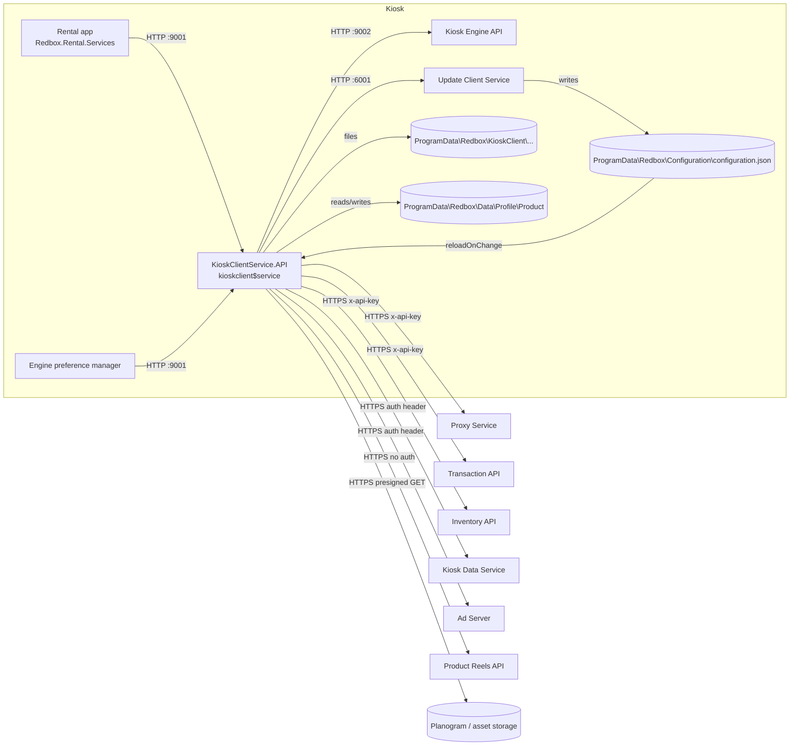

# Kiosk Client Service (KioskClientService.API)

## 1. Overview

The Kiosk Client Service ("KCS" in the rental code and logs) is a local ASP.NET Core 2.2 web API that runs on
every kiosk as a Windows service. It is the kiosk's **gateway to the Redbox cloud**: the rental application
does not talk to most cloud services directly. Instead it calls KCS on `http://localhost:9001`, and KCS:

- forwards the call to the right cloud API (Transaction API, Inventory API, Proxy Service, Kiosk Data
  Service, Ad Server, Product Reels API), adding the kiosk id, an activity id, a time-zone header and the API
  key taken from the kiosk configuration;
- caches reference data on disk (pricing, subscription plans, product-group sort order, planograms,
  campaigns/start screens, product catalog, "more like this" recommendations, profile product data) and
  refreshes it on schedules;
- stores failed "must deliver" requests (returns, reconciles, reservation changes, kiosk data/health
  messages, opt-ins, merchandizing status) in a file queue and **replays** them until the cloud accepts them;
- serves ads (Ad Server; an older Vistar client is still in the code), downloads ad and start-screen assets,
  and aggregates ad analytics;
- exposes the current kiosk configuration (`configuration.json`, written by the Update Client) to the rental
  app, and fixes a "session" snapshot of it per customer session;
- offers small utilities (QR code generation, a file-backed test-data store used to fake cloud answers).

It has no database, no message broker and no push channel: everything is HTTP request/response plus files
under `%ProgramData%\Redbox`.

Assembly: `KioskClientService.API` 1.0.207.0 (netcoreapp2.2), see `docs/assemblies.md`.

## 2. Deployment

| Item | Value | Source |
|---|---|---|
| Install folder | `C:\Program Files\Redbox\REDS\Kiosk Client\bin` (image: `REDS/Kiosk Client/bin`) | `REDS/Update Manager/scripts/repositories.lua` |
| Executable | `KioskClientService.API.exe` (framework-dependent .NET Core 2.2 app host) | image |
| Windows service | name `kioskclient$service`, display name "Redbox Kiosk Client Service", `start= delayed-auto` | `repositories.lua` lines 164-209, `installer-steps.lua` "Register Kiosk Client Service" |
| Listening URL | `AppSettings:ServiceUrl` = `http://localhost:9001` (HTTP only, loopback) | `bin/appsettings.json`, `Program.cs` |
| Swagger | `/swagger/v1/swagger.json`, UI at `/swagger` (title "Kiosk Client API") | `Startup.cs` |
| Logs | `%PROGRAMDATA%\Redbox\KioskClient\Logs\kioskclient-{Date}.log` | `bin/appsettings.json` (Serilog) |
| Data root | `%ProgramData%\Redbox\KioskClient` (`StoreService.DataPath`) | `Services/StoreService.cs` |
| Update package | Update Manager repository `kioskclient` (73 revisions in the image's store) | `docs/update-store.md` |

`web.config` (IIS in-process hosting with `AspNetCoreModuleV2`) ships in `bin` but is not used: the service is
started by the Service Control Manager, not IIS.

**Installation / update** (`repositories.lua`, repository `kioskclient`, `shutdown_engine = true`,
`update_group = 1`): before activation the Update Manager stops `kioskclient$service` (if it exists) and waits
20 s; after activation it creates the service with `sc.exe create` if it did not exist, copies
`m.VisualStudio.Web.CodeGeneration.EntityFrameworkCore.dll` to
`Microsoft.VisualStudio.Web.CodeGeneration.EntityFrameworkCore.dll` (the long name exceeds the update service's
64-character file name limit, see `bin/afteractivate.lua`), then starts the service. See
[update-manager.md](update-manager.md).

**Dependencies (runtime):**

| Depends on | How | Required for |
|---|---|---|
| Registry `HKLM\SOFTWARE\Redbox\REDS\Kiosk Engine\Store` values `ID`, `Market`, `Banner` | `Registry.GetValue` | kiosk id in every cloud call (0 if missing) |
| `%ProgramData%\Redbox\Configuration\configuration.json` | JSON config source, reload on change | all cloud URLs, API keys, feature flags |
| Update Client Service, `http://localhost:6001` | HTTP | profile product data updates ([update-client.md](update-client.md)) |
| Kiosk Engine API, `http://localhost:9002` (hard-coded) | HTTP | product ids for profile data, loyalty test cart ([kiosk-engine.md](kiosk-engine.md)) |
| Cloud APIs (Proxy Service, Transaction API, Inventory API, Kiosk Data Service, Ad Server, Product Reels API) | HTTPS | most features |

**Who calls KCS:**

- The rental application, through `src/Rental/Redbox.Rental.Services/KioskClientService/*` (base URL
  setting `system / KioskClientService / KioskClientServiceBaseUrl`, default `http://localhost:9001`,
  `Rental/Redbox.Rental.Services/Configuration/Configuration.cs`). This is nearly all traffic. See
  [rental.md](rental.md).
- The Kiosk Engine preference manager / control panel
  (`src/KioskEngine/Redbox.KioskEngine.PreferenceManager/KioskClientServiceClient/*`, base URL
  `http://localhost:9001` hard-coded) for test data and subscription plans. See [kiosk-engine.md](kiosk-engine.md).
- KCS itself: the replay queue re-sends stored requests to its own endpoints, and the queue alerting
  service posts alerts to its own `api/data/kioskalert`.

There is no authentication on the KCS API; it relies on listening on loopback only.

## 3. Architecture

Single project: `src/KioskClient/KioskClientService.API` (~600 files, ~25 k lines). Layering:

- `Controllers/` - 25 MVC controllers (the local API).
- `Services/<Area>/` - one service per feature area plus API clients for the cloud.
- `App/` - HTTP plumbing: `HttpService` (outgoing calls), `APIResponse<T>`, base response types, middleware,
  logging filter, replay helpers.
- `Services/Configuration/` - typed view over the kiosk configuration (`configuration.json`).
- `Services/HttpQueue/` - persistent replay queue and its two background services.
- Coravel scheduler jobs registered in `Startup.Configure`.



Dependency injection (`Startup.ConfigureServices`): almost every service and API client is **scoped** (one
instance per HTTP request or job run). Singletons: `ApplicationSettings`, `StoreService`, `AnalyticsQueue`,
`MoreLikeThisData`, `MoreLikeThisCache`, `PersistentDataCacheService`, `DualCacheService`, the options
wrappers `IOptionsKioskConfiguration`/`IOptionsMonitorKioskConfiguration`. Several services also keep state in
`static` fields (session, ad cache, refresh timers), which survives across scopes.

## 4. Start-up and lifecycle

1. `Program.Main` (`Program.cs`). If no debugger is attached and `--console` is not on the command line the
   process runs as a service: the working directory is set to the exe folder and `ApplicationControl.IsService
   = true`.
2. Configuration is built from, in order: `appsettings.json` (required), `%ProgramData%\Redbox\Configuration\configuration.json`
   (optional), `appsettings.{Environment}.json` (optional; `Production` when unset). All three use
   `reloadOnChange: true`. Later sources override earlier ones.
3. Serilog is configured from the `Serilog` section plus a console sink and thread-id enrichment.
4. The web host is created with `UseUrls(AppSettings:ServiceUrl)` and run either with `Run()` (console) or
   `RunAsDeviceServiceService()` (wraps it in `ApplicationWebHostService : WebHostService` and calls
   `ServiceBase.Run`).
5. `Startup.Configure` installs, in this order: developer exception page (Development only) or HSTS,
   `ExceptionMiddleware`, a no-op "compressed request payload" hook, `UpdateMerchandizingStatusMiddleware`,
   HTTPS redirection (no effect - no HTTPS endpoint), Swagger, the Coravel scheduler (section 5.9), MVC. It
   then logs the `AppSettings` values and every kiosk configuration value (secrets masked, see 8.3).
6. Two hosted `BackgroundService`s start: `HttpQueueService` (replay loop) and `HttpQueueDepthService`
   (queue depth alert loop).
7. `ApplicationWebHostService.OnStarted` (service mode only): deletes analytics files older than 30 days,
   posts `ServiceStarting` (with the time `OnStarting` ran) and `ServiceStarted` events to the Kiosk Data
   Service, then in the background re-sends the `ServiceStopping`/`ServiceStopped` events saved at the last
   shutdown and deletes them.
8. Shutdown: `OnStopping`/`OnStopped` save `ServiceStopping.json` / `ServiceStopped.json` under
   `Data\Analytics\ServiceEvent\` (they cannot be sent while stopping; they go out at next start).

`ApplicationControl` (stop the Windows service or the console host after asking clients) is registered but
nothing resolves it, so there is no remote shutdown endpoint.

## 5. How it works

### 5.1 Outgoing HTTP (`App/HttpService.cs`)

All cloud calls go through `HttpService` (typed `HttpClient`, transient). Behaviour:

- URL = `baseUrl.TrimEnd('/') + "/" + endpoint`; if `baseUrl` is empty, `endpoint` must be absolute
  (used for presigned/Vistar URLs).
- Body: `JsonConvert.SerializeObject(obj, NullValueHandling.Ignore)`, `application/json; charset=utf-8`.
  Default Newtonsoft settings: **PascalCase property names, enums as numbers** unless the type has a
  `StringEnumConverter` attribute. `SendGZipRequest`/`SendDeflateRequest` wrap the body in `CompressedContent`
  (`Content-Encoding: gzip|deflate`, no `Content-Length`).
- Handler: auto redirect, cookies kept, response gzip decompression.
- Timeout: `HttpService.Timeout` (default 20 000 ms) applied with a `CancellationTokenSource`. Each API client
  overrides it from its configuration (`*Timeout` settings).
- Result: `APIResponse<T>` with `StatusCode`, `Response` (deserialized body, or default if empty),
  `ResponseContent`, `ResponseTime` (ms), `Errors`. Any exception (timeout, DNS, bad JSON) becomes
  `StatusCode = 500` with one error `{Code:"InternalServerError", Message:"StatusCode: InternalServerError,
  Message: <ex>[, Inner: <inner>]"}`. `IsSuccessStatusCode` is true only for 200-299 with a real HTTP response.
- Every call is logged: `Request: <method>, Uri: <uri>, Status: <code>, Time:<ms>, Length:<n>` and (unless
  disabled) the response content, passed through the type's `IMessageScrub.Scrub()` which masks personal data.

**Kiosk cloud headers** (`Services/Configuration/KioskCloudClientConfiguration.cs`), added to most calls:

| Header | Value |
|---|---|
| `x-redbox-activityid` | the request's `MessageId` when the caller passes one, else a new GUID |
| `x-redbox-kiosk-timezone-offset` | local UTC offset, `TotalHours.ToString("00") + ":" + Minutes.ToString("00")`, e.g. `-05:00` |
| `x-redbox-kioskid` | kiosk id (when known) |
| `<AuthHeader>` | `<APIKey>` - only if both are set; header name/key per backend (table in 6.2) |

Some Proxy calls also add `Accept-Encoding: gzip`.

### 5.2 Configuration (`Services/Configuration/`)

The Update Client downloads the kiosk's configuration settings from the cloud and writes
`%ProgramData%\Redbox\Configuration\configuration.json` ([update-client.md](update-client.md)). KCS binds its
`KioskConfigurationSettings` section:

```json
{
  "KioskConfigurationSettings": {
    "KioskId": 12345,
    "ConfigurationVersion": 678,
    "ConfigurationVersionHash": "...",
    "Categories": [
      { "Name": "KioskClientDefault",
        "Settings": [
          { "Name": "TransactionApiUrl", "SettingId": 1, "DataType": "string",
            "SettingValues": [
              { "ConfigurationSettingValueId": 1, "EncryptionType": null, "Value": "https://...",
                "SegmentId": 1, "SegmentName": "...", "SegmentationName": "...", "Rank": 1,
                "EffectiveDateTime": "2021-01-01T00:00:00", "ExpireDateTime": null } ] } ] } ]
  }
}
```

(Shape from `KioskConfigurationSettings`, `KioskConfigurationCategory`, `KioskSetting`, `KioskSettingValue`;
values above are illustrative.)

Value resolution (`KioskConfigurationSettingExtensions.InnerGetKioskSettingValue`): category and setting
names are matched case-insensitively; among the setting's values those with `EffectiveDateTime <= now` and no
or future `ExpireDateTime` are kept; the one with the highest `Rank`, then the latest `EffectiveDateTime`, wins.
If `EncryptionType` is set the value is decrypted (5.2.1). The string is converted with
`Convert.ChangeType` to the property type. If no value applies or conversion fails, the C# default of the
property is used (table in 8.2).

`BaseConfiguration` maps each public property of type `BaseCategorySetting` to a category: the category name
is the `[Category(Name=...)]` attribute or the class name, the setting name is the property name. The class is
re-populated when `IOptionsMonitor` reports a file change. `IOptionsSnapshotKioskConfiguration` (scoped)
gives each request/job a consistent snapshot.

`ConfigurationJob` (every 3 minutes) remembers the last `ConfigurationVersion`; when it changes it logs the
whole configuration and runs `ProductGroupSortOrderService.RefreshIfNeeded` and
`SubscriptionService.RefreshIfNeeded`.

#### 5.2.1 Encrypted settings (`Services/Encryption/EncryptionService.cs`)

`EncryptionType = EncryptType1` (enum value 0) is the only scheme:

- ciphertext = Base64( salt[32] || AES-CBC(PKCS7) ciphertext )
- key material: `Rfc2898DeriveBytes(password, salt)` (PBKDF2-HMAC-SHA1, default 1000 iterations); first 32
  bytes = AES-256 key, next 16 bytes = IV
- plaintext is UTF-8 text (written with `StreamWriter`)
- password: a fixed string hard-coded in `EncryptionService._key` (`<redacted>` here; it is in the source)

### 5.3 Customer session and application events

The rental app tells KCS about the application and session life cycle:

1. `POST api/application/start` - starts the Ad Server cache (`AdServerService.StartApplication`: creates a
   static 3-minute timer that expires ads older than 120 minutes, then calls `Cache()`).
2. `POST api/session` `{ "KioskSessionId": "<guid>" }` - creates the static `KioskSession` and attaches the
   current configuration snapshot to it. `GET api/configuration/kiosksession` returns that snapshot until the
   next session, so a whole customer session sees one configuration version.
3. `POST api/session/start?sessionType=Browse|Pickup|Return|None` - records the user interaction start and
   pre-loads ads (`StartSession`).
4. `POST api/application/viewchangedevent` `{Type, FromView, ToView}` - when `ToView` is `zip_code_view` the
   VSM ad is pre-loaded, for `vsm_view` the Vending ad (`ApplicationConfiguration.AdsToPreloadByView`).
5. `POST api/session/end`, `POST api/application/end` (expires all cached ads at the Ad Server).

### 5.4 Transactions (rental, purchase, gift card, reservation, return)

`TransactionController` -> `TransactionService` -> `TransactionApiClient` (base `KioskClientDefault.TransactionApiUrl`,
header `x-api-key: <TransactionApiKey>`, timeout `TransactionApiTimeout`, default 60 s).

Typical rental: the rental app posts `Authorize` (card + cart). KCS forwards to
`POST api/transaction/authorize`. If the Transaction API answers 500 with a body, KCS adds error `(A100)
"Server Error"` and sets `Success=false`. KCS returns the Transaction API body with HTTP 200 (the controller
always uses `OkObjectResult`, even if the body is `null`). After vending, the rental app posts `Reconcile`;
this one is replayable: if the cloud call fails it is stored in the replay queue (5.7) and retried until
accepted. Returns (`Return`) are also queued, except for errors that will never succeed
(`ReturnErrorCodes.DoNotQueueErrorCodes`: `(RTN004)`-`(RTN008)`, `(V001)`, `(V002)`).

Reservations: `ValidatePickup` (which reservations are valid for the card), `PickupAuthorize`/`ReservationAuthorize`,
`ReservationPickup` (queued like Reconcile), `CancelReservation` and `ExpireReservation` (queued).

Return-visit promo: `GET api/transaction/return/{barcode}/promocheck` calls
`GET api/transaction/return/{barcode}/promocheck` at the Transaction API (timeout `ReturnPromoCheckTimeout`,
8 s). The answer lists all discs of the original transaction (`Discs[{Barcode, IsReturned}]`) and a
`Promotion`. KCS caches the answer in memory for 30 min under every disc's barcode; it returns the promotion
only when this is the last un-returned disc (`IsLastDisc = true`), otherwise marks the disc returned in the
cache and returns `Promotion = null`.

### 5.5 Inventory

- **Snapshot sync**: `POST api/inventory/sync` with every disc (`Barcode, Deck, Slot, Status`) is forwarded
  **gzip-compressed** to the Inventory API `POST api/kiosk/sync`, with `x-redbox-activityid = MessageId` and
  `x-redbox-kioskid = request.KioskId`. Not queued on failure (the caller decides).
- **Disc actions / fraud**: `api/inventory/discaction` -> `api/disc/discaction`, `api/inventory/discfraud` ->
  `api/disc/discfraud`. The controllers call `CheckAndReplay`, but `InventoryResponse` does not implement
  `IReplayableApiCall`, so failures are **never** queued (inferred from code; probably a defect).
- **Merchandizing**: `GET api/inventory/MerchandizingOrders` -> `GET api/merchandizingorder/{kioskId}/{yyyy-MM-dd}`
  (today, UTC) returns orders (`RebalancingExtract`/`Fill`/`ThinningExtract` per title). Status updates
  `POST api/inventory/UpdateMerchandizingStatus` -> `POST api/disc/updatemerchandizingstatus` are replayable:
  `UpdateMerchandizingStatusMiddleware` adds a `MessageId` GUID to the first array element if the caller did
  not, so the request can be queued.
- **Kiosk titles count / dual kiosks**: `api/inventory/kiosktitlescount` and the `api/dual/*` endpoints call
  the Proxy Service `POST api/inventory/kiosktitlescount` to learn title stock in other kiosks. `api/dual/refresh`
  loads the partner kiosk's full title->count map into an in-memory cache, `api/dual/updatetitles` refreshes
  some titles, `api/dual/instockinother` answers from the cache (titles with count > 0).
- **Product-group sort order**: `ProductGroupSortOrderService` downloads
  `GET api/productgroupsortorder/{KioskClientDefault.ProductGroupSortOrderType}` from the Inventory API and
  stores it (with a 1-based `Position`) as `DataCache\ProductGroupSortOrder.json`. Refreshed when missing,
  when the type setting changes, or when the cache is from before today; deleted when the type is 0.

### 5.6 Kiosk data and health reporting

`api/data/*` endpoints forward kiosk telemetry to the Kiosk Data Service (`KioskClientDefault.KioskDataServiceUrl`,
auth header `KioskDataServiceAuthHeader` default `Authorization`, value `KioskDataServiceAPIKey`):

| KCS endpoint | Kiosk Data Service endpoint |
|---|---|
| `POST api/data/kioskversions` | `POST api/kioskdata/kioskversion` |
| `POST api/data/kioskstatistics` | `POST api/kioskdata/kioskstatistics` |
| `POST api/data/kioskproperties` | `POST api/kioskdata/kioskproperties` |
| `POST api/data/kioskalert` | `POST api/kioskdata/kioskalert` |
| `POST api/data/auditevent` | `POST api/kioskdata/auditevent` |
| `POST api/data/kioskevents` | `POST api/kioskdata/kioskevents` |
| `POST api/data/kioskfunctioncheck` | `POST api/kioskdata/kioskfunctioncheck` |
| (service start/stop, internal) | `POST api/KioskData/KioskClientServiceEvent` |

The request body is forwarded as received (re-serialized from the model). `KioskDataResponse.Replayable =
!Success`: if the cloud call fails (non-2xx or exception) the original request is queued. The answer is the
cloud's body (HTTP 200 from KCS, or 204 if the body was empty).

The `KioskHealth` configuration category (touch screen, router, card reader, ping settings) is only exposed to
the rental app through `api/configuration/*`; KCS itself does not run health checks.

### 5.7 Replay queue ("HttpQueue", `Services/HttpQueue/`)

The replay queue makes selected calls "at least once". It stores the **incoming** KCS request, not the
outgoing cloud request, and later re-sends it to KCS itself, so the full controller logic runs again.

**Enqueue decision** (`APIResponse<T>.CheckAndReplay`, `BaseResponse.CheckAndReplay`, `ApiBaseResponse.CheckAndReplay`):

- needs a non-empty `MessageId` in the request; otherwise nothing happens;
- `APIResponse<T>` variant (used by transactions, data, opt-in): only if `T` implements `IReplayableApiCall`;
  replay when the cloud call was not 2xx and either there is no response body or `Response.Replayable` is true;
- `BaseResponse`/`ApiBaseResponse` variant (merchandizing status, disc action/fraud, loyalty update account):
  replay when status is not 200 and not 400 and the response object implements `IReplayableApiCall` with
  `Replayable = true`;
- if not replaying, `Finalize` deletes any queue file for that `MessageId` (this is how a successful replay
  removes itself).

Replayable calls in practice:

| Endpoint | Response type | Replayable when |
|---|---|---|
| `api/transaction/Return` | `ReturnResponse` | failure and no error in `DoNotQueueErrorCodes` |
| `api/transaction/Reconcile`, `ReservationPickup` | `ReconcileResponse` | any failure |
| `api/transaction/CancelReservation`, `ExpireReservation` | `Cancel/ExpireReservationResponse` | any failure |
| `api/data/*` (7 endpoints) | `KioskDataResponse` | failure |
| `api/marketing/kioskoptin` | `KioskOptInResponse` | failure |
| `api/inventory/UpdateMerchandizingStatus` | `UpdateMerchandizingStatusResponse` | status not 200/400 |
| `api/inventory/discaction`, `discfraud`; `api/loyalty/updateaccount` (with `Replay=true`) | not `IReplayableApiCall` | never (only finalize) |

**Storage**: one file per message, `%ProgramData%\Redbox\KioskClient\HttpQueue\{MessageId}.json`, Newtonsoft
`TypeNameHandling.Auto`, indented:

```json
{
  "Id": "3f9c1c2e-0000-0000-0000-000000000000",
  "Retries": 2,
  "Request": {
    "Scheme": "http",
    "Host": "localhost",
    "Port": 9001,
    "Path": "/api/transaction/Reconcile",
    "QueryString": "",
    "Method": "POST",
    "Headers": [ { "Key": "Content-Type", "Value": "application/json" }, { "Key": "Host", "Value": "localhost:9001" } ],
    "Body": "{\"MessageId\":\"3f9c1c2e-...\",\"KioskId\":12345, ... }"
  }
}
```

The body is read back from the already-consumed request stream by seeking to 0; this works because the MVC
JSON input formatter buffers request bodies (inferred: ASP.NET Core 2.2 default behaviour, no explicit
`EnableRewind` in KCS). Enqueuing an id that already exists only touches the file.

**Replay loop** (`HttpQueueService`, hosted):

1. Every `_pollingInterval` ms (starts at `HttpQueuePollingInterval` = 30 000): take the file with the oldest
   `CreationTimeUtc`, increment `Retries`, rewrite it and set its creation/write/access time to now (so it
   moves to the back of the queue - round robin).
2. If `Retries > 0` and `Retries % HttpQueueAlertRetryThreshold (30) == 0`, post an alert (below).
3. Re-send the stored request (`HttpRequestMetadata.ToHttpRequestMessage`: same scheme/host/port/path/query,
   headers copied with `TryAddWithoutValidation` (content headers are silently dropped), body as
   `application/json`), timeout = interval - 1000 ms.
4. Success (2xx from KCS): interval = max(min, interval / 2). Failure: interval = min(max, interval * 2),
   max = `HttpQueueMaxPollingInterval` = 300 000. Empty queue: interval halves toward the minimum.

The re-sent request goes through the controller again; if the cloud now accepts it, `CheckAndReplay`
finalizes (deletes) the file; if not, the file stays. There is no maximum retry count and no expiry.

**Depth alert** (`HttpQueueDepthService`): every `HttpQueueDepthPollingIntervalMinutes` (240) minutes, if
the number of queue files is greater than `HttpQueueDepthToAlert` (7), posts an alert.

Alerts are posted to KCS itself, `POST {ServiceUrl}/api/data/kioskalert`, with `AlertType = 9`,
`SubAlertType = "HttpQueueDepth"` ("KCS http queue depth for kiosk: {id} is over threshold of {n}") or
`"HttpQueueRetryThreshold"` ("Request {id} has been retried {n} times on kiosk {kiosk}"); a new GUID as
`UniqueId`/`MessageId`, so a failed alert is itself queued.

Local management: `GET api/HttpQueue/List`, `POST api/HttpQueue/Enqueue` (body = `HttpQueueServiceRequest`),
`DELETE api/HttpQueue/delete?id=<guid>`.

### 5.8 Reference data caches

All use `PersistentDataCacheService` (`Services/App/`): files `%ProgramData%\Redbox\KioskClient\DataCache\<name>.json`
containing `{ "DataType": "<CLR type>", "Modified": "<local time>", "Data": { ... } }` (indented, nulls omitted,
enums as strings), with an optional in-memory copy cleared on write/delete.

| Cache file | Source | Refresh rule | Job |
|---|---|---|---|
| `PricingDefault`, `PricingRentalByPrice`, `PricingPurchaseByPrice` | Proxy `GET api/pricing/kiosk/{id}/rental/default`, `/rentalbyprice`, `/purchasebyprice` | missing; or age >= 26 h and the per-type "next refresh" time passed (`Pricing.RefreshIntervalMinutes`, 30; first one random 1..30 min after start); or between 04:00 and 06:00 after a random per-process second offset with age > 2 h | `PricingJob` every 5 min + random 0-300 s delay, only if `KioskClientDefault.PricingActive` |
| `SubscriptionPlans` | Proxy `GET api/subscription/subscriptionplans` and `GET api/subscription/redboxpluspromocampaigns` | `SubscriptionPlansActive` false -> delete; missing; Starz plan ids changed; age >= 26 h; or the 04:00-06:00 random window with age > 2 h | `SubscriptionJob` every 5 min; `ConfigurationJob` on config change |
| `ProductGroupSortOrder` | Inventory `GET api/productgroupsortorder/{type}` | see 5.5 | `ProductGroupSortOrderJob` every 10 min |
| `CurrentPlanograms` (+ files) | Proxy `GET api/planogram/allcurrent?lastReportedTime=...` | 5.8.2 | `SyncPlanogramsJob` every 5 min, if `PlanogramSyncEnabled` |
| `Campaigns` | Proxy `POST api/cms/campaign/kiosk/{id}` | 5.8.3 | `CampaignJob` every 15 s, if `Campaigns.JobActive` |
| `ProductCatalog` | Proxy `POST api/product/bytitleids` | on demand; entries older than 7 days are dropped | - |
| `ProfileDataUpdateStatus` | (status of profile product data) | 5.8.4 | `ProfileDataJob` every 1 min |

#### 5.8.1 Pricing calculation (`Services/Pricing/ProductPricing.cs`)

`POST api/pricing/product` `{ProductId, PriceLevelType, RentalTaxRate, PurchaseTaxRate, State}` builds a
`ProductPricing` from the three caches (current time `now`):

- **RentalPriceDefault**: across `FormatPricing[].Prices[]`, prices active at `now` (`StartDate <= now <
  EndDate`) whose format `Name == PriceLevelType`, or `Name == Title` with `PriceLevelTypeValue == ProductId`;
  ordered by `StartDate` desc, `LocationRank` asc, `InitialNight` asc; first wins.
- **RentalPrice**: same filter over `RentalPricing[].PriceLevel[]`; the first with `InitialDays == 1`. If the
  price has attribute bit `PriceTest (1)`, its own nights are used as "default" prices, else the
  RentalPriceDefault ones. Missing -> RentalPriceDefault.
- **MultiNightRentalPrices**: the matches with `InitialDays > 1`.
- **PurchasePrice**: `PurchasePricing[]` active entries whose `Titles` contains `ProductId`, lowest
  `PurchasePrice` of the latest `StartDate`.
- In Maryland only (`State == "MD"`) all prices are tax-inclusive: `round(price * (1 + rate/100), 2)`.
- Validation: default rental price must exist and be valid (`InitialNight > 0, InitialDays >= 1, ExtraNight > 0,
  NonReturnDays > 0, NonReturnPrice > 0`) else HTTP 500; invalid RentalPrice falls back to default; invalid
  multi-night list is cleared; purchase price `< 0` is dropped.
- Output flags: `IsMultiNightPrice` (`InitialDays > 1`), `IsPriceTest`, `IsDeal` (not a price test and
  `InitialNight < DefaultInitialNight`).

`PriceLevelType`: `None=0, Title=1, Dvd=2, Bluray=3, Games=4, FourKUHD=6`.

#### 5.8.2 Planograms (`Services/Planograms/`)

Planograms are XPS documents shown to field staff. Files live in `%ProgramData%\Redbox\KioskClient\Planograms`
(`AppSettings:PlanogramFolder`). File names must be `<Name>_<Mmm><d|dd>.<xps|rtf>` (e.g. `Front_Jan15.xps`):
one underscore, month as a 3-letter abbreviation, day; the year is inferred (Jan in December -> next year,
Nov/Dec in Jan/Feb -> previous year). Only `*.xps` files are listed.

Sync (`SyncPlanograms`): call `GET api/planogram/allcurrent?lastReportedTime=<yyyy-MM-ddTHH:mm:ss|null>` with
the latest `LastUpdateUtc` already seen (`null` when `forceOverwrite`). HTTP **208 Already Reported** means
nothing changed. Otherwise `Planograms[{Name, StartDate, FileType, Filename, LastUpdateUtc, PresignedUrl}]` is
saved in `CurrentPlanograms.json` with `SyncComplete=false`, and in the background each file that is missing,
older than `LastUpdateUtc`, or all when forced, is downloaded from `PresignedUrl` (the selected planogram
first); local files not in the list are deleted; then `SyncComplete=true`. A failed download is retried every
5 minutes until the retry counter reaches 3600/300 = 12 (11 retries).

`RefreshIfNeeded` syncs when there is no cache, or (before 17:00) when the last sync is more than 1 h plus a
random per-process offset ago. Active planograms (`GET api/planogram`) = per name, the latest with
`StartDate <= now`. The selected planogram name is stored in `Planograms\selected_planogram.json`
(`{"Name":"..."}`).

#### 5.8.3 Campaigns and start screens (`Services/Campaigns/`)

`CampaignService.Refresh` posts `{ "LastSyncTime": <last or null> }` to Proxy `api/cms/campaign/kiosk/{kioskId}`.
208 = no change. A 200 body has `LastSyncTime`, `InCarts` (null = unchanged) and `StartScreens` (null =
unchanged). Start-screen controls are a polymorphic list (`ControlListConverter`, keyed by `ControlType`):

- `StartAsset`: `ControlId, DisplayDuration, Asset{Id, Name, Url, FullPath}, Target (ProductGroupId|PromoCode|None|BrowseFilter),
  TargetValue, Order, ShowPressToStart, IncludeIfNoInventory`
- `Carousel`: `ControlId, DisplayDuration, MaxTitles`

Asset images are downloaded to `%ProgramData%\Redbox\KioskClient\Assets\<file name from URL>` (kept if it
already loads as an image; files not accessed for `Assets.LifespanDays` (60) or not loadable are deleted).
Promo codes used by start assets are validated through the Proxy (5.10) and cached in memory for
`Campaigns.PromoCodeCacheTTLMinutes` (60).

`GET api/campaign/startscreen` returns the active start screen (date-valid, highest `Rank`, latest start),
with asset URLs removed, assets that are not valid local images dropped, and promo-code assets dropped unless
the code validates (the validation result is attached). `GET api/campaign/incart` returns the active in-cart
offer `{InCartType: RentOneGetFixedOff|FirstNightFree, Amount, PromoCode, ExcludeTitles}`. Both answer 204
when the matching `Campaigns.*Active` flag is off and 404 when nothing is active.

`CampaignJob` runs every 15 s but only refreshes when the static next-refresh time has passed (first: random
60 s .. `RefreshInterval`x60 s after start, then every `Campaigns.RefreshInterval` = 30 minutes).

#### 5.8.4 Profile product data (`Services/ProfileData/`, `Services/DataTableService/`)

A local table of product metadata (`Product`: `ProductId, ProductGroup{ProductGroupId, ProductFormats[{Format,
ProductId}]}, Duration, Starring, ProductType, Format (DVD=1, Bluray=2, _4KUHD=19), Rating, LongName,
SortName, ImageFile, Description, Genres, ReleaseDate, SellThru, SellThruNew, BoxOfficeGross, Directors,
ComingSoonDate, SortDate, NationalStreetDate, ClosedCaptioned, MerchandiseDate, ProductWebPageURL`) at
`%ProgramData%\Redbox\Data\Profile\Product\ProductData.json`:

```json
{ "Data": { "12345": { "Id": 12345, "Data": { "ProductId": 12345, ... }, "Hash": "..." } } }
```

Update cycle (only if `ProfileData.ProfileDataUpdateEnabled`):

1. `ProfileDataJob` (every minute) checks `DataCache\ProfileDataUpdateStatus.json.json` (the code passes a name
   that already ends in `.json`; `Path.ChangeExtension` keeps it, inferred file name). An update is due when
   the last success is older than `ProfileDataSettings.RefreshIntervalHours` (25) and the retry back-off since
   the last attempt has passed (5, 10, 20, then 30 min max).
2. Product ids = ids already in the table + `GET http://localhost:9002/api/profiledata/kioskproductids`
   (Kiosk Engine, `Content` = list of ids) + other-format ids found in product groups but missing locally.
3. `POST {UpdateClientServiceUrl}/api/dataupdate/changes` with `DataUpdateRequest {RequestId, TableName:
   Product(1), KioskId, RequestType: List(2), RecordRequests[{Id, Hash}], FileType: ProfileData(17),
   CreatedDateTime}` (hash of each existing record is included so the server can answer "no change"). The Update
   Client returns `{ "DataUpdateResponseFileName": "<path>" }`.
4. KCS reads that file (`DataUpdateResponse {RequestId, TableName, RecordResponses[{Id, RecordStatus:
   NoChange|Changed|Deleted|Error, Data (JSON string), Hash}]}`), checks `RequestId` and `TableName`, applies
   the changes, writes `ProductData.staged`, renames the active file to `ProductData old.json`, renames the
   staged file to active (rolls back on failure), and deletes the response file.
5. The rental app polls `GET api/profiledata/instance/haspendingupdate` and reloads with
   `GET api/profiledata/instance?refreshFromFiles=true`.

`POST api/profiledata/product` (body: list of ids) adds specific products on demand.

### 5.9 Scheduled jobs (Coravel, `Startup.Configure`)

| Job | Schedule | Overlap guard |
|---|---|---|
| `ConfigurationJob` | cron `*/3 * * * *` | `PreventOverlapping("kiosk")` |
| `ProductGroupSortOrderJob` | `*/10 * * * *` | `"kiosk"` |
| `SubscriptionJob` | `*/5 * * * *` | `"kiosk"` |
| `PricingJob` | `*/5 * * * *` (+ random 0-300 s sleep inside) | `"kiosk"` |
| `SyncPlanogramsJob` | `*/5 * * * *` | `"kiosk"` |
| `CampaignJob` | every 15 s | none |
| `ProfileDataJob` | `*/1 * * * *` | `"kiosk"` |

All guarded jobs share the same key `"kiosk"`, so (as Coravel implements it) only one of them runs at a time
and a job whose turn comes while another holds the lock is skipped for that tick (inferred from Coravel
semantics). Background services outside Coravel: replay loop, depth alert loop, ad expiry timer (3 min).

### 5.10 Customer, loyalty, marketing and promotions (via the Proxy Service)

All go to the Proxy Service (`KioskClientProxyApi.ProxyApiUrl`, or `AppSettings:DefaultProxyServiceUrl` when
that setting is empty), header `x-api-key: <ProxyApiKey>`, timeout `ProxyApiTimeout` (60 s).

- **Login** `POST api/customerprofile/login` - `CustomerProfileLoginRequest {MessageId, KioskId, ActivityId,
  EmailAddress, Password, PhoneNumber, IsEncrypted, Pin, CustomerProfileNumber, LanguageCode}` ->
  `CustomerProfileKioskLoginResponse {MessageId, Response: {Customer{CPN, FirstName, LoginEmail, MobilePhoneNumber,
  IsMobilePhoneNumberVerified, IsEmailVerified, PromptForPerks, PromptForEarlyId, TextClubEnabled}, Loyalty{LoyaltySystemOnline,
  IsEnrolled, PointBalance, CurrentTier, CurrentTierCounter, PointsExpiring, PointsExpirationDate},
  Recommendations, AcceptedOffers, PromoCodes, OptIns, Subscriptions{EligibleSubscriptionPlanIds, ExistingSubscriptions[...]}}}`.
  KCS sets `SubscriptionTier` to `Tier1`/`Tier2` for `RBPLUS` subscriptions with plan `RBPLUS_OFFER_1`/`_2`,
  and on a non-2xx answer with `Success=true` forces `Success=false` and adds `(KLI008) "ProxyService API Error"`.
  The controller returns the deserialized `CustomerProfileKioskLoginResponse` (HTTP 200, or 204 if the Proxy
  returned no body).
- **Loyalty** `api/loyalty/estimateaccrual|estimateredemption` with `CartPayload {MessageId, KioskId,
  CustomerProfileNumber (digits), RentDate (now), ShoppingCart}` -> `{Items[{ProductId, Points}], Error}`.
  KCS maps errors: `"Account not found"` -> `(EA001)/(ER001)`, `"Loyalty error"` -> `(EA002)/(ER002)`, other
  -> `(EA003)/(ER003)`, empty success -> `(EA000)/(ER000)`. `api/loyalty/updateaccount` (timeout forced to
  60 s): `UpdateAccountPayload {MessageId, KioskId, CustomerProfileNumber, Email (required), MobilePhoneNumber,
  Pin, PunchcardOptin, TextClubOptin, AccountSourceType, Replay}` -> `{CustomerProfileNumber, MobilePhoneNumber,
  TempPassword, Error}`.
- **Marketing** `api/marketing/emailconfirmation` `{MessageId, KioskId, Email, AccountNumber, TransactionDate}`
  -> `EmailConfirmationResponse {MessageId, ConfirmationStatus, CustomerProfileNumber, MobilePhoneNumber,
  PromptForPerks, PromptForEarlyId, TextClubEnabled, EmailVerified}`; `api/marketing/kioskoptin` `{MessageId,
  KioskId, RequestDate, OptInItems[{ItemId, Item_Type, OptInMethodType, OptInMethodData, TemplateName,
  CampaignName}]}` (replayable).
- **Promo code** `api/promotion/promocodevalidation` `{MessageId, KioskId, Code (2-24 chars)}` ->
  `PromotionCodeValidationResponse {MessageId, KioskId, Error, Amount, PromotionIntentCode, RentQty,
  RentFormat, GetQty, GetFormat, CampaignTitles{Include, Titles}, ProductTypeId, FormatIds, ActionType,
  AllowFullDiscount, DefaultPromo{PromoCode, PromotionIntentCode, Amount}}`. KCS passes the Proxy status code
  through (200 valid, 422 invalid code - inferred from the campaign code treating 422 as a valid answer).
  Error codes: `(D001)` not valid, `(D002)` not valid at location, `(D003)` already used, `(D005)` kiosk missing,
  `(D006)` on-demand code, `(U001)` error.
- **Kiosk/installer**: `api/kiosk/authenticate` (field staff login: `{Username, Password, KioskId,
  UseNtAuthentication}`), `GET api/kiosk/{id}/nearby`, `api/installer/getpendingstates|getpendingbanners|getpendingkiosks|getopsmarket`.

### 5.11 Ads (`Services/Ads/AdServer/`)

Active implementation: `AdServerService` (Ad Server at `KioskClientAds.AdServerUrl`, default
`http://localhost:5005/api`, header `<AdServerAuthHeader, default x-api-key>: <AdServerAPIKey>`).

- `Cache()` (application start): `GET api/ads/cache?locations=Welcome&locations=TitleDetail&...` (all
  locations except `Unknown`/`Multiple`) returns `Data[{Id, AssetId, Provider, Expirable, AssetUrl, Location,
  MimeType}]`; every asset is downloaded to `%ProgramData%\Redbox\KioskClient\Ads\Assets\<AssetId>.json` (metadata)
  and `<AssetId>.jpg|png` (creative). Asset metadata files older than 14 days and no longer referenced are deleted.
- `GetAd(location)`: returns a cached ad for the location that is not "requested" or was requested >= 120 s
  ago; otherwise `GET api/ads/{location}`, and if the asset is not on disk the ad is expired at the server
  (`POST api/ads/{id}/expire`), the asset downloaded for next time, and 404 returned. Ads are only pre-loaded
  between 08:00 and 23:00. Pre-load list: `TitleDetail`, `Welcome`.
- Proof of play: `POST api/ads/{advertisementId}/proofofplay` `{DisplayedTime, DisplayedMilliseconds}` is
  forwarded to Ad Server `POST api/ads/proofOfPlay` with `AdvertisementId` set, and the ad leaves the cache.
- Expire: `POST api/ads/{id}/expire` (only if the ad is `Expirable`). A 3-minute timer expires ads cached more
  than 120 min; `application/end` expires all.

`AdLocation`: `Unknown, Welcome, TitleDetail, VSM, ZipCode, Pickup, Return, EmailNotification, Vending,
PleaseWait, Multiple` (strings on the KCS API). Display sizes: 728x90 for all except VSM 1024x576; media
`image/jpeg`, `image/png`.

**Ad analytics** (`AnalyticsService`, only if `KioskClientAds.AdAnalyticsActive`): each event is appended to
`Data\Analytics\<Type>\<Type>-yyyyMMdd.json` (JSON array built by appending `[`, `,obj`, `]`). When the first
event of a new day arrives, older day files are closed and moved to `Pending\`, and all pending files are
aggregated (count, median/max response time, success rate per location ...) and posted to the Ad Server
`POST api/analytics/get_ad|proof_of_play|expire|cache|download_asset|get_ad_timeout_event`; files move to
`Complete\` or `Error\`. The rental app reports client-side ad timeouts through `POST api/analytics/getadtimeoutevent`
`{CreatedOn, AdLocation, TimeoutSetting, KioskId}`.

The `Vistar/` folder (direct Vistar `api/v1/get_ad/json`, `api/v1/get_asset/json`, proof-of-play/expiration
URLs) and `AssetService.Cache()` remain in the code but are not reached from any controller in this version
(inferred: `IAdService` is bound to `AdServerService`).

### 5.12 More like this and product catalog

- `POST api/productgroups/morelikethis/refresh` (body: list of product group ids; ids 0 and 1139 are removed)
  returns immediately and in the background calls the Product Reels API `POST products/reels/bulkmorelikethis`
  `{"productIds":["<id>",...]}` (no auth headers) -> `[{"id":"<groupId>","productIds":["<id>",...]}]`. A full
  refresh happens when the file has expired (`KioskClientDefault.MoreLikeThisDataRefreshFrequency` = 7 days) or
  the cache is empty; otherwise only missing groups are fetched. Stored in
  `%ProgramData%\Redbox\KioskClient\Data\MoreLikeThisData.json` `{ExpireTime, Items{groupId:[ids]}}`.
  `GET api/productgroups/{id}/morelikethis` answers from memory (404 if unknown).
- `POST api/product/bytitleids` `{TitleIds:[...]}` returns `Products[{TitleId, ProductGroup, ProductPage}]`
  from `DataCache\ProductCatalog.json`, first fetching missing ids from the Proxy `POST api/product/bytitleids`.

## 6. Protocols and interfaces

### 6.1 KCS local API (served on `http://localhost:9001`)

Conventions:

- JSON in and out. Responses use the ASP.NET Core 2.2 MVC defaults: **camelCase** property names (inferred:
  default `MvcJsonOptions` contract resolver), plus `StringEnumConverter` (enums as names), nulls omitted.
  Requests are matched case-insensitively; enums may be names or numbers.
- `[ApiController]`: complex parameters are read from the body, simple ones from route/query. Model validation
  failures return 400 with the standard `ValidationProblemDetails` and are logged.
- Two response families:
  - `BaseResponse` fields: `success`, `errors[{code, message}]`, `hostName` (machine name), `statusCode`,
    `responseTime`; the HTTP status is `statusCode`.
  - `ApiBaseResponse` fields: `error` (string, often a JSON-serialized error list); its `StatusCode` is
    `[JsonIgnore]` and only appears as the HTTP status.
- Unhandled exceptions: HTTP 500, body `{"StatusCode":500,"Message":"Exception Middleware - Internal Server Error"}`.
- Each action is logged `START: Controller.Action, args` / `END: ..., statuscode=..., elapsed=...` with
  personal data masked (`LoggingActionFilter`, `IMessageScrub`).

| Method & path | Request | Response | Notes |
|---|---|---|---|
| `GET api/ads?location=<AdLocation>` | - | `{statusCode, success, errors?, adLocation, advertisementId, assetPath, height, mimeType, width}` | 503 if ads inactive, 404 none |
| `POST api/ads/preload` | `[AdLocation]` | `GetAdsResponse{getAdResponses[...]}` | |
| `GET api/ads/cache` | - | `CacheResponse{responseTime, assetCacheCount}` | re-caches assets |
| `POST api/ads/{id}/proofofplay` | `{DisplayedTime, DisplayedMilliseconds}` | `{statusCode, success, errors?}` | |
| `POST api/ads/{id}/expire` | - | same | |
| `POST api/analytics/getadtimeoutevent` | `GetAdTimeoutEvent` | `BaseResponse` | |
| `POST api/application/start` / `end` | - | `BaseResponse` | ad cache start / expire all |
| `POST api/application/viewchangedevent` | `{Type: Reset|ShowErrors|Pop|ClearCache|PopDiscard|EnterTopOfStock|Push, FromView, ToView}` | `BaseResponse` | ad pre-load by view |
| `GET api/campaign/startscreen` | - | `{startScreen{controls[...]}}` | 204/404/500 |
| `GET api/campaign/incart` | - | `{inCart{...}}` | 204/404/500 |
| `POST api/campaign/refresh` / `refreshifneeded` | - | `ApiBaseResponse` | 208 if unchanged |
| `GET api/configuration/current` | - | `{kioskConfiguration{configurationVersion, campaigns{...}, kioskClientDefault{...}, ...}}` | **includes decrypted API keys** |
| `GET api/configuration/kiosksession` | - | same, session snapshot | 404 before `POST api/session` |
| `POST api/customerprofile/login` | `CustomerProfileLoginRequest` | `CustomerProfileKioskLoginResponse{messageId, response{...}, success, errors}` | |
| `POST api/data/kioskversions` etc. (7, table 5.6) | `KioskVersionRequest{MessageId, KioskId, SendToTable, CreatedOn, CreatedOnLocal, Versions{}}`, `KioskStatisticsRequest{... Statistics{}}`, `KioskPropertiesRequest{... Properties{}}`, `KioskAlertRequest{UniqueId(=MessageId), CreatedOn, CreatedOnLocal, AlertType, SubAlertType, AlertMessage}`, `AuditEventRequest{LogDate, CreatedOnLocal, EventType, Username, Message, Source}`, `KioskEventsRequest{CreatedOn, CreatedOnLocal, KioskEventsData}`, `KioskFunctionCheckRequest{CreatedOn, CreatedOnLocal, ReportTime, UserName, InitTest, TrackTest, VendDoor, VerticalSlot, CameraDriver, SnapDecode, TouchScreenDriver}` | `KioskDataResponse` (cloud body) | replayable |
| `POST api/dual/refresh` | `{DualKioskId}` | `ApiBaseResponse` | |
| `POST api/dual/updatetitles` | `{DualKioskId, TitleIds[]}` | `{titlesCount{titleId: count}}` | |
| `POST api/dual/instockinother` | `{TitleIds[]}` | `{inStock[]}` | memory cache only |
| `GET api/HttpQueue/List` | - | `[HttpQueueServiceRequest]` | |
| `POST api/HttpQueue/Enqueue` | `HttpQueueServiceRequest` | `true/false` | |
| `DELETE api/HttpQueue/delete?id=` | - | `true/false` | |
| `GET api/installer/getopsmarket?kioskid=` | - | `{opsMarket, kaseyaServer, ...BaseResponse}` | |
| `GET api/installer/getpendingbanners?stateid=` | - | `{banners[{id, name}]}` | |
| `GET api/installer/getpendingkiosks?stateid=&bannerId=` | - | `{pendingKiosks[{id, address, city, state, zipCode, dueTime, marketName, kaseyaMarketName}]}` | |
| `GET api/installer/getpendingstates` | - | `{states[{id, description}]}` | |
| `GET api/inventory/MerchandizingOrders` | - | `{merchandizingOrders[{kioskId, merchandizingOrderType, titleId, unitCount}]}` | |
| `POST api/inventory/UpdateMerchandizingStatus` | `[{MessageId?, ThinDateUTC, ThinReasonCode, MerchandStatus, Barcode, UpdateDateTimeUTC}]` | `{failedBarcodes[...], error}` | replayable; middleware adds MessageId |
| `POST api/inventory/sync` | `{MessageId, KioskId, Discs[{Barcode, Deck, Slot, Status}]}` | `{messageId, success, errors, statusCode}` | gzip upstream |
| `POST api/inventory/discaction` | `{MessageId, KioskId, UserName, JobName, ActionDate, Actions[{k:v}]}` | same | |
| `POST api/inventory/discfraud` | `{MessageId, KioskId, Barcode, TransactionDate, Properties{k:v}}` | same | |
| `POST api/inventory/kiosktitlescount` | `{MessageId, SourceKioskId, KioskIds[], TitleIds[]}` | `{messageId, kioskTitlesCount[{kioskId, titlesCount{}}]}` | |
| `POST api/kiosk/authenticate` | `{Username, Password, KioskId, UseNtAuthentication}` | `BaseResponse` | |
| `POST api/kiosk/nearby` | `{MessageId, KioskId}` | `{messageId, kiosks[{kioskId, isDual, label, locationName, locationType, address, distanceMiles}]}` | |
| `POST api/loyalty/estimateaccrual` / `estimateredemption` | `CartPayload` | `{items[{productId, points}], messageId, kioskId, success, errors}` | |
| `POST api/loyalty/updateaccount` | `UpdateAccountPayload` | `{messageId, kioskId, customerProfileNumber, mobilePhoneNumber, tempPassword, error}` | |
| `POST api/marketing/emailconfirmation` | `EmailConfirmationPayload` | `EmailConfirmationResponse` | |
| `POST api/marketing/kioskoptin` | `KioskOptInPayload` | `KioskOptInResponse{messageId, ...}` | replayable |
| `GET api/planogram` | - | `[{name, startDate, fileType, filename, path}]` | 404 if none |
| `GET api/planogram/selected` | - | `Planogram` | 404 if none |
| `POST api/planogram/selected?planogramName=` | - | `ApiBaseResponse` | 400 if no such file |
| `POST api/planogram/sync?forceOverwrite=` | - | `ApiBaseResponse` | |
| `POST api/planogram/syncifneeded` | - | 200 | |
| `POST api/pricing/{all|rentaldefault|rental|purchase}/refresh` and `.../refreshifneeded` | - | 200 | |
| `GET api/pricing/rentaldefault` / `rental` / `purchase` | - | `{formatPricing}` / `{rentalPricing}` / `{purchasePricing}` | 500 if cache empty |
| `DELETE api/pricing/{all|rentaldefault|rental|purchase}` | - | 200 | deletes caches |
| `POST api/pricing/product` | `{ProductId, PriceLevelType, RentalTaxRate, PurchaseTaxRate, State}` | `{productPricing{productId, rentalPriceDefault, rentalPrice, multiNightRentalPrices[], purchasePrice}}` | 5.8.1 |
| `POST api/pricing/product/pricelevel` | same without ProductId | same, without purchase price | |
| `POST api/product/bytitleids` | `{TitleIds[]}` | `{products[...]}` | |
| `POST api/product/{titleid}/remove` | - | `ApiBaseResponse` (404 if absent) | |
| `GET api/productgroups/{id}/morelikethis` | - | `{moreLikeThis[]}` | 404/500 |
| `POST api/productgroups/morelikethis/refresh` | `[groupId]` | 200 immediately | |
| `GET api/productgroups/sortorder` | - | `{productGroupSortOrder{sortOrderType, sortOrders[{productGroupId, forecastedRents, position}]}}` | 404 if empty |
| `POST api/productgroups/sortorder/refresh` / `refreshifneeded`; `DELETE api/productgroups/sortorder` | - | 200 | |
| `POST api/profiledata/triggerproductdataupdate` | - | `ApiBaseResponse` | |
| `POST api/profiledata/product` | `[productId]` | `{dataObjects[Product], tableFileUpdated}` | |
| `GET api/profiledata/instance?refreshFromFiles=` | - | `{profileDataInstance{products[...]}}` | |
| `GET api/profiledata/instance/haspendingupdate` | - | `{hasPendingUpdate}` | |
| `POST api/promotion/promocodevalidation` | `PromotionCodeValidationPayload` | `PromotionCodeValidationResponse` | Proxy status passed through |
| `POST api/session` | `{KioskSessionId}` | `BaseResponse` | |
| `POST api/session/start?sessionType=` | - | `BaseResponse` | |
| `POST api/session/end` | - | `BaseResponse` | |
| `GET api/subscription/plans` | - | `{active, browseStarzSubscriptionPlan, myBagStarzSubscriptionPlan, subscriptionPlans[...], redboxPlusPromoCampaigns[...]}` | only currently effective plans |
| `POST api/subscription/plans/refresh` / `refreshifneeded`; `DELETE api/subscription/plans` | - | 200 | |
| `POST api/testdata/writepropertyvalue?category=&propertyName=&propertyValue=` | - | `BaseResponse` | needs `TestData.TestDataEnabled` |
| `GET api/testdata/readpropertyvalue?category=&propertyName=` | - | `{propertyValue, ...}` | |
| `GET api/testdata/istestdataenabled` | - | `{isTestDataEnabled}` | |
| `POST api/transaction/Authorize` | `AuthorizeRequest` | `AuthorizeResponse` | always HTTP 200 |
| `POST api/transaction/GiftCardAuthorize` | `GCAuthRequest` (= AuthorizeRequest) | `GCAuthResponse` | |
| `POST api/transaction/PickupAuthorize` | `+ReferenceNumber, CartWasModified` | `AuthorizeResponse` | |
| `POST api/transaction/ReservationAuthorize` | `+ReferenceNumber (string)` | `AuthorizeResponse` | |
| `POST api/transaction/CancelReservation` | `{MessageId, KioskId, ReferenceNumber, ReasonCode}` | `BaseResponse` | replayable |
| `POST api/transaction/ExpireReservation` | `{MessageId, KioskId, ReferenceNumber}` | `BaseResponse` | replayable |
| `POST api/transaction/Reconcile` | `ReconcileRequest` | `{customerProfileNumber, ...BaseResponse}` | replayable |
| `POST api/transaction/ReservationPickup` | `ReservationPickupRequest` | `ReconcileResponse` | replayable |
| `POST api/transaction/Return` | `{MessageId, KioskId, ReturnType, Barcode, Deck, Slot, ReturnDate, FailedSecurityRead}` | `{messageId, ...BaseResponse}` | replayable (filtered) |
| `POST api/transaction/GetCustomerOffers` | `{MessageId, KioskId, CreditCard, ShoppingCart, UtcOffset, Lang, StorefrontEventType}` | `{accountNumber, customerProfileNumber, emailAddress, storedOffers[], newOffers[]}` | `ExpirationDate` converted from `DateTimeOffset` to local `DateTime` |
| `POST api/transaction/ValidatePickup` | `{MessageId, KioskId, CreditCard, ReferenceNumbers[]}` | `{customerProfileNumber, accountNumber, referenceNumbers, cancelledReservations, validReservations, allowRop, transactionEntities}` | |
| `GET api/transaction/return/{barcode}/promocheck` | - | `{promotion{promoCode, promoType: AmountOff|FirstNightFree, amount, expirationDate}, isLastDisc}` | 5.4 |
| `GET api/utilities/getqrcode?valueToEncode=` | - | `{qrCodeBitmapBase64String}` | PNG, ECC level Q, 20 px/module, Base64 then **URL-encoded** |

#### Transaction message models (`Services/Transaction/`)

```text
MessageBase        { MessageId: Guid, KioskId: long }
BaseAuthorizeRequest : MessageBase { TransactionDate, CreditCard, ShoppingCart, CustomerProfileNumber }
AuthorizeRequest   : + AuthAcceptFlag?, AuthRuleId?, AuthAmount?, SkipAuthRule?
CreditCard         { FirstName, LastName, Number, PostalCode, ExpirationMonth, ExpirationYear, KeyId?, CardId,
                     CardType: byte, Track2, IsEncrypted, BIN, LastFour, KSN, ICEncryptedData, ReaderSerialNumber,
                     CardSourceType?: Unknown|Swipe|EMVContact|QuickChip|MSDContactless|EMVContactless|Mobile,
                     EmvEnabledTerminal, ContactlessEnabled, FallbackType?: byte, EmvTags: {tag: value} }
ShoppingCart       { Groups: [LineItemGroup], Discounts: [Discount] }
LineItemGroup      { GroupType: Rental=1|Purchase=2|Subscription=3, Items: [LineItem], Totals }
LineItem           { ProductId, SubscriptionId, Barcode, VendStatus, ProductFamily, ProductType, ProductName,
                     Pricing, BlurayUpsell{ProductGroupId, Offer, TitleId, TypeId?}, SourceType?, OfferCode,
                     TivoQueryId, TempPassword }
Pricing            { InitialNight, ExtraNight, NonReturn, Purchase, Expiration, NonReturnDays, PriceSetId,
                     ProductPriceId?, InitialDays?, DefaultInitialNight?, DefaultExtraNight? }
Totals             { TaxRate, Subtotal, DiscountedSubtotal, TaxAmount, GrandTotal }
Discount           { ProductId, DiscountType: PromotionCode=1|Loyalty=2|Discount=3, PromotionCode, PromotionCodeValue?,
                     PromotionIntentCode?, RedemptionPoints?, Amount, Status: short, ApplyOnlyToProduct? }
VendStatus         Vended=0, HardwareError=7, DiskNotTaken=8, CriticalHardwareError=9, EmptyOrStuck=11,
                   KioskFull=14, CustomerDisabled=15, NotVended=28
ReconcileRequest   : MessageBase { ReferenceNumber?, Blocklisted, Email, TransactionDate?, CreditCard, ParentTransactionId?,
                     ShoppingCart, IsOffline, PlayPassPromptAccepted, PlayPassPointsEarned, CustomerProfileNumber,
                     UtcOffset, DiscOfferCodes[{Barcode, OfferCode}], IsEarlyId, IsEarlyIdApple, IsEarlyIdGoogle,
                     RedeemedCustomerOffer{OfferId, CampaignId?, StoredOfferId?} }
ReservationPickupRequest : MessageBase { ReferenceNumber?, Blocklisted, Email, CreditCard, ShoppingCart,
                     CustomerProfileNumber, CartWasModified, IsEarlyId*, RedeemedCustomerOffer, PickupDateTime }
AuthorizeResponse  : BaseResponse { MessageId, Email, ReferenceNumber, CustomerProfileLastName, CustomerProfileFirstName,
                     Limits[{ProductType, ProductLimit}], HasProfile, CustomerProfileNumber, ConfirmationStatus,
                     AccountNumber, KioskTransactionSuccess, SubscriptionTransactionSuccess }
GCAuthResponse     : AuthorizeResponse { GiftCardSummary{Exists, Status: None|Unregistered|Registered, Balance, MaxDiscs, MaxGames} }
CustomerOffer      { OfferId, ExpirationDate (DateTimeOffset), PromotionCode, IncludeTitleIds, ExcludeTitleIds,
                     ExcludeIfWithinRedboxReleaseDate (TimeSpan), DiscountAmount, DiscountType, ProductType,
                     IncludeFormatIds, ExcludeFormatIds, OfferScopeType, CustomerSegmentType, StoredOfferId?,
                     OfferProducts[{ProductId, NumberOfNights?, DiscountedPrice?, TotalDiscountAmount?}],
                     OfferDiscountCode, CampaignId, RedeemedDateTime?, ActionCode }
```

Error codes defined in KCS: authorize `(A030)`-`(A038)`, `(A100)`-`(A106)`, `(A203)` (`TransactionService.Constants`);
return `(RTN001)`-`(RTN010)`; validation `(V000)`-`(V004)`. Card numbers and names are masked in logs
(`CreditCard.ScrubData`).

Example (rental app -> KCS -> Transaction API):

```http
POST http://localhost:9001/api/transaction/Return
Content-Type: application/json

{"MessageId":"6b1f...","KioskId":12345,"ReturnType":1,"Barcode":"<barcode>","Deck":3,"Slot":41,
 "ReturnDate":"2022-03-01T18:22:10","FailedSecurityRead":false}
```

```http
POST <TransactionApiUrl>/api/transaction/return
x-redbox-activityid: <new guid>
x-redbox-kiosk-timezone-offset: -05:00
x-redbox-kioskid: 12345
x-api-key: <redacted>
Content-Type: application/json; charset=utf-8

{"ReturnType":1,"Barcode":"<barcode>","Deck":3,"Slot":41,"ReturnDate":"2022-03-01T18:22:10",
 "FailedSecurityRead":false,"MessageId":"6b1f...","KioskId":12345}
```

KCS answers with the Transaction API body (`{"messageId":..., "success":true, "errors":[], "hostName":...,
"statusCode":200}`); on failure (e.g. timeout -> 500) the original request is written to the replay queue.

### 6.2 Backends called by KCS

| Backend | Base URL setting | Auth | Timeout setting |
|---|---|---|---|
| Proxy Service | `KioskClientProxyApi.ProxyApiUrl`, else `AppSettings:DefaultProxyServiceUrl` | `x-api-key: ProxyApiKey` | `ProxyApiTimeout` 60 000 |
| Transaction API | `KioskClientDefault.TransactionApiUrl` | `x-api-key: TransactionApiKey` | `TransactionApiTimeout` 60 000; promo check `ReturnPromoCheckTimeout` 8 000 |
| Inventory API | `KioskClientDefault.InventoryApiUrl` | `x-api-key: InventoryApiKey` | `InventoryApiTimeout` 60 000 |
| Kiosk Data Service | `KioskClientDefault.KioskDataServiceUrl` | `<KioskDataServiceAuthHeader, default Authorization>: KioskDataServiceAPIKey` | `KioskDataServiceTimeout` 20 000 |
| Ad Server | `KioskClientAds.AdServerUrl` (default `http://localhost:5005/api`) | `<AdServerAuthHeader, default x-api-key>: AdServerAPIKey` | `AdServerTimeout` 20 000 |
| Product Reels API | `KioskClientDefault.ProductReelsApiUrl` | none | `ProductReelsApiTimeout` 60 000 |
| Update Client Service | `AppSettings:UpdateClientServiceUrl` = `http://localhost:6001` | none | 20 000 |
| Kiosk Engine API | `http://localhost:9002` (constant) | none | 20 000 |
| Presigned planogram / asset / ad URLs | absolute URLs from responses | none | 20 000 |
| Vistar (unused path) | `KioskClientAds.VistarUrl` | none (network id/API key in body) | `VistarTimeout` 5 000 |

Endpoint list (all relative to the base URL):

| Backend | Method & path | Body -> response |
|---|---|---|
| Proxy | `GET api/subscription/subscriptionplans` | -> `{SubscriptionPlans[{Id, Description, SubscriptionId, EffectiveStartDate, EffectiveEndDate, IsPromotional, PlanItems[{Price, BillingPeriod, IsPromoPrice, PeriodLength, PeriodUnit, SequenceNum, Benefits}]}]}` |
| Proxy | `GET api/subscription/redboxpluspromocampaigns` | -> `{RedboxPlusPromoCampaigns[...]}` |
| Proxy | `POST api/customerprofile/login` | 5.10 |
| Proxy | `GET api/installer/getpendingstates`, `getpendingbanners?stateid=`, `getpendingkiosks?stateid=&bannerid=`, `getopsmarket?kioskid=` | installer models |
| Proxy | `POST api/kiosk/authenticate` | `{Username, Password, KioskId, UseNtAuthentication}` |
| Proxy | `GET api/kiosk/{kioskId}/nearby` | -> `NearbyKiosksResponse` |
| Proxy | `POST api/marketing/emailconfirmation`, `api/marketing/kioskoptin` | 5.10 |
| Proxy | `POST api/loyalty/estimateaccrual`, `estimateredemption`, `updateaccount` | 5.10 |
| Proxy | `POST api/promotion/promocodevalidation` | 5.10 |
| Proxy | `GET api/pricing/kiosk/{id}/rental/default` | -> `{FormatPricing[{Name: PriceLevelType, Prices[{StartDate, EndDate, Attributes, PriceLevelType, PriceLevelTypeValue, LocationRank, InitialNight, InitialDays, ExtraNight, NonReturnDays, NonReturnPrice, ExpirePrice}]}]}` |
| Proxy | `GET api/pricing/kiosk/{id}/rentalbyprice` | -> `{RentalPricing[{StartDate, EndDate, Attributes, PriceLevel[{PriceLevelType, PriceLevelTypeValue}], LocationRank, InitialNight, InitialDays, ExtraNight, NonReturnDays, NonReturnPrice, ExpirePrice}]}` |
| Proxy | `GET api/pricing/kiosk/{id}/purchasebyprice` | -> `{PurchasePricing[{StartDate, EndDate, PurchasePrice, Titles[]}]}` |
| Proxy | `GET api/planogram/allcurrent?lastReportedTime=` | 5.8.2 (208 = unchanged) |
| Proxy | `POST api/cms/campaign/kiosk/{id}` | 5.8.3 (208 = unchanged) |
| Proxy | `POST api/inventory/kiosktitlescount` | `{MessageId, SourceKioskId, KioskIds, TitleIds}` -> `{KioskTitlesCount[{KioskId, TitlesCount{}}]}` |
| Proxy | `POST api/product/bytitleids` | `{TitleIds}` -> `{Products[{TitleId, ProductGroup, ProductPage}]}` |
| Transaction | `POST api/transaction/authorize`, `giftcardauthorize`, `pickupauthorize`, `reservationauthorize`, `return`, `reconcile`, `reservationPickup` | models in 6.1 |
| Transaction | `POST api/reservation/cancel`, `api/reservation/expire`, `api/reservation/validatepickup` | models in 6.1 |
| Transaction | `POST api/customeroffers` | `GetCustomerOffersRequest` -> `GetCustomerOffersResponse` |
| Transaction | `GET api/transaction/return/{barcode}/promocheck` | -> `{Promotion, IsLastDisc, Discs[{Barcode, IsReturned}], Error}` |
| Inventory | `GET api/merchandizingorder/{kioskId}/{yyyy-MM-dd}[?orderType=n]` | -> `[MerchandizingOrder]` |
| Inventory | `POST api/disc/updatemerchandizingstatus` | `[MerchandStatusUpdate]` -> `{Data[failed], error, hostName}` |
| Inventory | `GET api/productgroupsortorder/{type}` | -> `{ProductGroupSortOrderType, ProductGroupSortOrders[{ProductGroupId, ForecastedRents}]}` |
| Inventory | `POST api/kiosk/sync` (gzip), `api/disc/discaction`, `api/disc/discfraud` | -> `InventoryResponse` |
| Kiosk Data | `POST api/kioskdata/<kioskversion|kioskstatistics|kioskproperties|kioskalert|auditevent|kioskevents|kioskfunctioncheck>` | 5.6 |
| Kiosk Data | `POST api/KioskData/KioskClientServiceEvent` | `{KioskId, AssemblyVersion, EventType: "ServiceStarted"|"ServiceStarting"|"ServiceStopped"|"ServiceStopping", EventTime, EventTimeUtc}` |
| Ad Server | `GET api/ads/{location}`, `GET api/ads?locations=..`, `GET api/ads/cache?locations=..`, `POST api/ads/proofOfPlay`, `POST api/ads/{id}/expire`, `POST api/analytics/<type>` | 5.11 |
| Product Reels | `POST products/reels/bulkmorelikethis` | 5.12 |
| Update Client | `POST api/dataupdate/changes` | 5.8.4 |
| Kiosk Engine | `GET api/profiledata/kioskproductids`; `GET api/shoppingcart/loyaltytestshoppingcartitems` (test data only) | `{Success, Errors, HostName, StatusCode, ResponseTime, Content}` |

The cloud host names are not in the image; they come from `configuration.json` at run time (section 10).

## 7. Data and storage

All paths below `%ProgramData%` (normally `C:\ProgramData`).

| Path | Content | Writer |
|---|---|---|
| `Redbox\Configuration\configuration.json` | kiosk configuration (5.2) | Update Client; read by KCS |
| `Redbox\KioskClient\Logs\kioskclient-yyyyMMdd.log` | Serilog rolling log, `{Timestamp:yyyy-MM-dd HH:mm:ss.fff}|{ThreadId}|{ActivityId}|{Level:u3}|{Message:j}` | KCS |
| `Redbox\KioskClient\HttpQueue\{guid}.json` | replay queue (5.7) | KCS |
| `Redbox\KioskClient\DataCache\*.json` | `PersistentDataWrapper` caches (5.8) | KCS |
| `Redbox\KioskClient\Planograms\*.xps`, `selected_planogram.json` | planogram documents | KCS |
| `Redbox\KioskClient\Assets\*` | start-screen images | KCS |
| `Redbox\KioskClient\Ads\Assets\{assetId}.json/.jpg/.png` | ad metadata and creatives | KCS |
| `Redbox\KioskClient\Analytics\<Type>\{,Pending,Complete,Error}\<Type>-yyyyMMdd.json` | ad analytics (30-day purge) | KCS |
| `Redbox\KioskClient\Analytics\ServiceEvent\ServiceStopping.json`, `ServiceStopped.json` | `{EventType, EventTime}` saved at stop | KCS |
| `Redbox\KioskClient\Data\MoreLikeThisData.json` | more-like-this map (5.12) | KCS |
| `Redbox\KioskClient\Data\Test\<category>.json` | test data `{property: value}` | KCS (test data API) |
| `Redbox\Data\Profile\Product\ProductData.json` (+ `.staged`, `ProductData old.json`) | profile product table (5.8.4) | KCS |
| response file named by Update Client | `DataUpdateResponse` (deleted after use) | Update Client |

In-memory only: the session object, ad cache, dual-kiosk title counts, promo-code validation cache,
return-promo-check cache, profile data instance.

Registry (read only): `HKLM\SOFTWARE\Redbox\REDS\Kiosk Engine\Store` - `ID` (kiosk id, parsed with
`Convert.ToInt32`), `Market`, `Banner` (read but not used outside `StoreService`).

## 8. Configuration

### 8.1 `appsettings.json` (`REDS/Kiosk Client/bin/appsettings.json`; `.staged_` copy identical)

| Key | Value in image | Meaning |
|---|---|---|
| `Logging:LogLevel:Default` | `Warning` | MS logging (superseded by Serilog) |
| `Serilog:MinimumLevel` | `Information`; `Microsoft`, `System` -> `Fatal` | |
| `Serilog:WriteTo` | Async -> RollingFile `%PROGRAMDATA%\Redbox\KioskClient\Logs\kioskclient-{Date}.log` | |
| `AppSettings:ServiceUrl` | `http://localhost:9001` | listen URL and self-alert target |
| `AppSettings:DataFilePath` | `.\Data` | logged only, unused |
| `AppSettings:UpdateManagerAddress` / `UpdateManagerPort` | `127.0.0.1` / `7004` | logged only, unused |
| `AppSettings:HttpQueuePollingInterval` | `30000` | replay loop min interval (ms) |
| `AppSettings:HttpQueueMaxPollingInterval` | `300000` | replay loop max interval (ms) |
| `AppSettings:HttpQueueDepthPollingIntervalMinutes` | `240` | depth check period |
| `AppSettings:HttpQueueDepthToAlert` | `7` | alert when files > this |
| `AppSettings:HttpQueueAlertRetryThreshold` | `30` | alert every N retries of one item |
| `AppSettings:PlanogramFolder` | `Planograms` | under the KCS data root |
| `AppSettings:DefaultProxyServiceUrl` | `<replacement host>` | Proxy URL when the kiosk config has none (this image points at a non-Redbox host; the original Redbox value is not in the image) |
| `AppSettings:UpdateClientServiceUrl` | `http://localhost:6001` | Update Client |
| `AppSettings:ProfileDataSettings` | `RefreshIntervalHours 25`, `StartingRetryIntervalMinutes 5`, `MaxRetryIntervalMinutes 30` | 5.8.4 |
| `AllowedHosts` | `*` | |

`appsettings.Staging.json` only overrides `DefaultProxyServiceUrl` (same value) and is used only when
`ASPNETCORE_ENVIRONMENT=Staging`.

### 8.2 Kiosk configuration categories (from `configuration.json`)

Category name = attribute or class name; defaults are the C# initializers used when the setting is absent.

| Category | Setting (default) |
|---|---|
| `KioskClientDefault` | `KioskDataServiceUrl`, `KioskDataServiceTimeout` (20000), `KioskDataServiceAPIKey`, `KioskDataServiceAuthHeader` (`Authorization`), `ProductReelsApiUrl`, `ProductReelsApiTimeout` (60000), `MoreLikeThisDataRefreshFrequency` (7 days), `InventoryApiUrl`, `InventoryApiTimeout` (60000), `InventoryApiKey`, `ProductGroupSortOrderType` (0 = off), `TransactionApiUrl`, `TransactionApiTimeout` (60000), `TransactionApiKey`, `ReturnPromoCheckTimeout` (8000), `PricingActive` (true), `PlanogramSyncEnabled` (true) |
| `KioskClientProxyApi` | `ProxyApiUrl`, `ProxyApiTimeout` (60000), `ProxyApiKey` |
| `KioskClientAds` | `AdsActive` (true), `AdAnalyticsActive` (false), `VistarUrl`, `VistarTimeout` (5000), `VistarNetworkId`, `VistarAPIKey`, `AdServerEnabled` (true, unused), `AdServerUrl` (`http://localhost:5005/api`), `AdServerTimeout` (20000), `AdServerAPIKey`, `AdServerAuthHeader` (`x-api-key`) |
| `KioskClientSubscription` | `SubscriptionPlansActive` (false), `BrowseStarzSubscriptionPlan`, `MyBagStarzSubscriptionPlan` |
| `Campaigns` | `JobActive` (true), `RefreshInterval` (30 min), `InCartsActive` (true), `StartScreensActive` (true), `PromoCodeCacheTTLMinutes` (60) |
| `Assets` | `LifespanDays` (60) |
| `Pricing` | `RefreshIntervalMinutes` (30) |
| `ProfileData` | `ProfileDataUpdateEnabled` (false) |
| `TestData` | `TestDataEnabled` (false) |
| `DeviceService` | `ChipEnabled`, `ContactlessEnabled`, `DeviceServiceClientUrl` (`http://localhost:9000/CardReaderEvents`), `BluefinAutoActivate`, `BluefinServiceUrl`, `BluefinServiceApiKey`, `BluefinServiceTimeout` (5000), `CardReadTechnicalFallbackEnabled`, `CardReadTechnicalFallbackCountLimit` (3), `DeviceServicePleaseWaitDuration` (90000), per-brand contactless/insert flags, `HideMobilePayOption`, `HideApplePayImage`, `HideGooglePayImage` - consumed by the rental app / device service, not by KCS ([device-service.md](device-service.md)) |
| `Browse`, `CMS`, `MarketingGeneral`, `MarketingAd`, `MarketingReturn`, `ABTesting`, `KioskHealth` | UI and health settings, passed through to the rental app (see `Services/Configuration/*.cs` for the full list and defaults) |

### 8.3 Secrets

API keys come from `configuration.json`, usually encrypted (`EncryptType1`). At start-up and on version
change KCS logs every setting; settings with `[MaskLogValue(VisibleChars = 4)]` (all API keys and the auth
header names) are logged as `XXXX...` plus the last 4 characters; other encrypted settings are logged as
`[Encrypted]`. **`GET api/configuration/current` and `api/configuration/kiosksession` return all settings
decrypted**, including API keys, to any local caller.

### 8.4 Test data

When `TestData.TestDataEnabled` is true, many services check a category file for `<Area>.LiveCall = false`
and then return canned responses built from other properties in the same file instead of calling the cloud:

| Category | Used by |
|---|---|
| `TransactionService` | Authorize/GCAuth/AfterSwipeCustomerOffers |
| `ProxyServiceCustomerProfile` | Login |
| `ProxyServiceLoyalytService`, `ProxyServicePersonalizationService` | loyalty estimates, update account |
| `ProxyServiceMarketingService`, `ProxyServicePromotionService` | email confirmation, promo codes |
| `ProxyServiceAuthentication`, `ProxyServiceStoreServices` | staff login, installer |
| `ProxyServiceSubscriptions` | subscription plan ids |

The Kiosk Engine preference manager edits these through `api/testdata/*`.

## 9. Error handling, logging and recovery

- Outgoing failures never throw to the caller: they become `APIResponse` with status 500 and an error entry
  (6.1/5.1). Most controllers then pass the cloud status through (`ToObjectResult`), but the authorize
  family always returns HTTP 200 with the cloud body (possibly `null`).
- Cloud error bodies are mapped to stable codes in a few places (`(A100)`, `(KLI008)`, `(EAxxx)/(ERxxx)`,
  `(V000)` "Null response returned from Inventory Services ...", `(U001)` promo).
- Guaranteed delivery: replay queue (5.7) with exponential back-off 30 s .. 5 min, alerts at queue depth > 7
  and every 30 retries; no dead-letter handling.
- Cache refreshes keep the old file when the cloud call fails; jobs simply try again on the next tick.
  Profile data uses staged-file + rename with rollback; planogram downloads retry every 5 min (11 times).
- Unhandled request exceptions: `ExceptionMiddleware` -> HTTP 500 JSON body. Unhandled host exceptions are
  logged as fatal and the process exits (the SCM restarts it only if recovery options are set; none are set
  by the install script).
- Logging: Serilog (8.1). Each request: `START`/`END` lines with scrubbed arguments/results; each cloud call:
  URI, status, time, length and (usually) scrubbed content. Personal data (names, e-mail, phone, card data,
  PIN/temp password) is masked by `ObfuscationHelper` in `Scrub()` implementations; note
  `UpdateAccountPayload.Scrub` still logs `Pin` and the QR endpoint logs the raw value to encode.

## 10. Source map

All paths are under `src/KioskClient/KioskClientService.API/`.

| Concern | Files |
|---|---|
| Host, service wrapper, settings | `Program.cs`, `Startup.cs`, `ApplicationWebHostService.cs`, `WebHostServiceExtensions.cs`, `AppSettings.cs`, `ProfileDataSettings.cs`, `ApplicationControl.cs` |
| HTTP plumbing | `App/HttpService.cs`, `App/HttpExtensions.cs`, `App/CompressedContent.cs`, `App/APIResponse.cs`, `App/BaseResponse.cs`, `App/ApiBaseResponse.cs`, `App/ExceptionMiddleware.cs`, `App/LoggingActionFilter.cs`, `App/UpdateMerchandizingStatusMiddleware.cs`, `App/ObfuscationHelper.cs` |
| Local API | `Controllers/*.cs` |
| Kiosk configuration | `Services/Configuration/BaseConfiguration.cs`, `KioskConfigurationSettings*.cs`, `KioskSetting*.cs`, category classes, `KioskCloudClientConfiguration.cs`, `ConfigurationJob.cs`, `KioskConfigurationConstants.cs`; `Services/Encryption/EncryptionService.cs` |
| Kiosk id / paths | `Services/StoreService.cs` |
| Replay queue | `Services/HttpQueue/*.cs` |
| Persistent caches | `Services/App/PersistentDataCacheService.cs`, `PersistentDataWrapper.cs` |
| Proxy Service client | `Services/ProxyApi/ProxyApi.cs` (+ models in the same folder) |
| Transactions | `Services/Transaction/TransactionService.cs`, `Services/Transaction/API/TransactionApiClient.cs`, models in `Services/Transaction/` |
| Inventory | `Services/Inventory/InventoryService.cs`, `Services/Inventory/API/InventoryApiClient.cs`, `Services/Inventory/Models/` |
| Kiosk data | `Services/Data/DataService.cs`, `DataClient.cs`, `Models/DataModels.cs`; service events `Services/Analytics/KioskDataService/` |
| Pricing | `Services/Pricing/PricingService.cs`, `ProductPricing.cs`, `PricingJob.cs` |
| Planograms | `Services/Planograms/PlanogramService.cs`, `Planogram.cs`, `SyncPlanogramsJob.cs` |
| Campaigns / assets | `Services/Campaigns/CampaignService.cs`, `ControlListConverter.cs`, `Services/Campaign/CampaignJob.cs`, `Services/Assets/AssetsService.cs` |
| Subscriptions | `Services/Subscription/*.cs` |
| Sort order | `Services/ProductGroup/*.cs` |
| Profile data | `Services/ProfileData/ProfileDataService.cs`, `ProfileDataJob.cs`, `Services/DataTableService/DataTableService.cs`, `Services/UpdateClientServiceApi/UpdateClientServiceClient.cs`, `Services/KioskEngineApi/*.cs` |
| Ads & analytics | `Services/Ads/AdServer/AdServerService.cs`, `AdServerClient.cs`, `Services/Ads/AssetService.cs`, `Ads/*.cs`, `Services/AnalyticsService.cs`, `Services/Analytics/**`, `Vistar/*.cs` (legacy) |
| Customer / loyalty / marketing / promo | `Services/CustomerProfile/`, `Services/Loyalty/`, `Services/Marketing/`, `Services/Promotion/`, `Services/Authentication/`, `Services/Installer/`, `Services/Kiosk/` |
| Dual kiosks | `Services/Dual/*.cs` |
| More like this / catalog | `Services/Products/MoreLikeThis/*.cs`, `Services/Products/ProductReelsApi/ProductReelsApiClient.cs`, `Services/ProductCatalog/*.cs` |
| Test data, QR | `Services/TestData/*.cs`, `Services/Utilities/QRCodeUtilitiesService.cs` |

Callers: `src/Rental/Redbox.Rental.Services/KioskClientService/**` (rental app),
`src/KioskEngine/Redbox.KioskEngine.PreferenceManager/KioskClientServiceClient/**`. Writer of
`configuration.json` and the data-update endpoint: `src/UpdateClient/UpdateClientService.API/Services/Configuration/ConfigurationService.cs`,
`Controllers/DataUpdateController.cs`. Installer scripts: image `REDS/Update Manager/scripts/repositories.lua`,
`installer-steps.lua`.

## 11. Unknowns and doubts

- **Cloud host names and keys**: the real Proxy/Transaction/Inventory/Kiosk Data/Ad Server/Product Reels URLs
  are only in `configuration.json`, which is not in the image. `DefaultProxyServiceUrl` in the image points at
  a non-Redbox host (`<replacement host>`); the original value is unknown.
- **Server-side behaviour** of the cloud APIs (exact response fields beyond what KCS models, status codes other
  than those KCS checks, e.g. 208 for "unchanged" and 422 for an invalid promo code) is inferred from the
  client code only.
- **JSON casing on the KCS API** (camelCase) is inferred from ASP.NET Core 2.2 defaults; KCS does not set it
  explicitly. Callers deserialize case-insensitively, so both work.
- **Request body capture for replay** relies on the MVC input formatter having buffered the body (inferred).
- **Coravel `PreventOverlapping("kiosk")`** with one shared key: the exact skip semantics are Coravel's, not
  verified against the 4.0.2 package.
- `ProfileDataUpdateStatus.json.json` file name is inferred from `Path.ChangeExtension` behaviour.
- Apparent defects (from reading code, not tested): inventory disc action/fraud and loyalty update-account
  replays never happen (response types lack `IReplayableApiCall`); `TransactionApiClient.GetCustomerOffers`
  builds a header list with the message id as activity id but sends the default headers; `InventoryApiClient`
  dereferences `response.HttpResponse` when it is null (would throw on a network error); the
  time-zone header is malformed for half-hour offsets.
- The `Vistar` direct integration and `AssetService.Cache()` look dead in this version; whether older
  versions used them was not checked (the update store holds 73 `kioskclient` revisions, see
  `docs/update-store.md`).
- No KCS log files are present in the image (`KioskLogs` has none), so runtime behaviour was not confirmed from
  logs.
