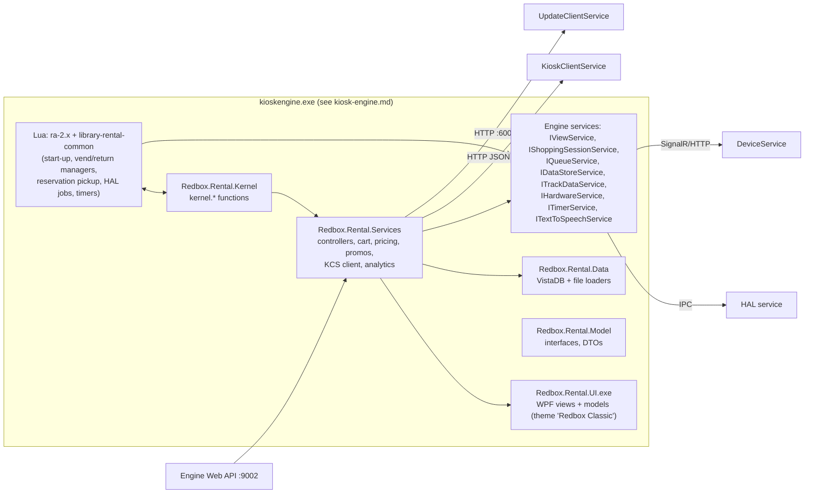

# Rental application

The customer-facing Redbox kiosk application: start screen, browse, title details, cart, card
payment, disc vend, disc return, online-reservation pickup, promo codes, Redbox Perks (loyalty),
gift cards and Redbox+ subscriptions.

Sources: `src/Rental/*` (Redbox.Rental.Model, .Services, .UI, .Kernel, .Data, version 1.88.0.80) plus
the Lua bundles `ra-2.x.bundle` ("Rental Application" 3.55.0.27) and `library-rental-common.bundle`
from the image (`REDS/Kiosk Engine/bundles`). Hosting (engine, kernel, view service, bundles, queue,
data stores) is in [kiosk-engine.md](kiosk-engine.md). The card reader is in
[device-service.md](device-service.md), the robot in [hal.md](hal.md), and the local backend proxy
in [kiosk-client.md](kiosk-client.md). This document describes only the interfaces to those systems.

---

## 1. Overview

The rental application is not a separate process. It is a set of .NET assemblies and a Lua resource
bundle that the **Kiosk Engine** (`kioskengine.exe`) loads:

* **Lua bundle `ra-2.x.bundle`** (manifest `product_name = "Rental Application"`, `startup_script =
  application_startup`). It holds the original 2009–2016 application logic. It still drives
  start-up, timers, sync jobs, the **vend manager**, the **return manager** and **reservation
  pickup**, and every HAL job.
* **.NET assemblies.** Over time most of the UI and business logic moved here: the WPF views, the
  view controllers, the shopping cart, pricing, promotions, loyalty, payment authorisation and
  the backend client. Lua and .NET call each other through about 158 `kernel.*` functions
  (`[KernelFunction]` attributes in Redbox.Rental.Kernel and Redbox.Rental.Services) and through
  callbacks that Lua registers (`kernel.register_*_callback`).

Every backend call goes over plain HTTP/JSON to **KioskClientService (KCS)** on
`http://localhost:9001`. KCS talks to Redbox's cloud services, holds the offline queue and returns
`{Success, Errors[]}` envelopes ([kiosk-client.md](kiosk-client.md)). Robot work is done as
**HAL jobs** (`vend`, `return`, `soft-sync`, ...). Card reads go through the engine's
`ITrackDataService`, which is backed by the Device Service (EMV, contactless, mobile wallet) or by a
legacy USB MSR.

## 2. Deployment

| Item | Value |
|---|---|
| Binaries | `REDS/Kiosk Engine/bin/Redbox.Rental.{Model,Services,Kernel,Data}.dll`, `Redbox.Rental.UI.exe` (net472 WPF "WinExe"; it is used as a library, and `App` is empty) |
| Lua bundles | `REDS/Kiosk Engine/bundles/ra-2.x.bundle` (zip of `*.resource` XML files: scripts, views, fonts, strings, `config`; it requires `Content Legal`, `Library Rental Common` and `Content Speech`), `library-rental-common.bundle` (shared Lua objects: hardware manager, store manager, reservation manager, idle timer, sync, scheduler). Content bundles: `content-pricing`, `content-promo`, `content-speech`, `content-vend-screen`, `content-legal`, `content-*-rundata`, `content-email-opt-in`, `content-banner-marketing`. |
| Default bundle | `system.config` → `General/DefaultBundle = "Rental Application,*"` |
| Data dir | `REDS/Kiosk Engine/data` (engine `DataPath`) |
| Logs | `REDS/Kiosk Engine/logs/kioskengine.log*` (`yyyy-MM-dd HH:mm:ss,fff|thread|LEVEL|message`), `logs/error`, `logs/UI/CP-Actvity.log*`, plus a `CardReaderLog` named log |
| Process | inside `kioskengine.exe` (no service of its own) |

Outbound endpoints (defaults from `Configuration.Initialize`, `src/Rental/Redbox.Rental.Services/Configuration/Configuration.cs`):

| Setting (`system` config) | Default | Used for |
|---|---|---|
| `KioskClientService/KioskClientServiceBaseUrl` | `http://localhost:9001` | all business calls (KCS) |
| `UpdateClientService/UpdateClientServiceBaseUrl` | `http://localhost:6001` | broker register/ping, setting changes ([update-client.md](update-client.md)) |
| `KioskEngineApiService/KioskEngineApiServiceBaseUrl` | `http://localhost:9002` | the engine's own Web API (it hosts the reservation endpoints below) |
| `DeviceServiceConfiguration.DeviceServiceClientUrl` (KCS config) | `http://localhost:9000/CardReaderEvents` | card-reader events |

None of these three keys is overridden in the image's `system.config`, so the defaults apply.

Inbound: the engine's Web API (`Redbox.KioskEngine.API`) exposes reservation routes that are
implemented by `ReservationService` in this system (section 5.7).

Dependencies: Kiosk Engine (host, kernel, views, queue, data stores), KCS, HAL service,
Device Service, Update Client Service (broker). Nothing depends on the rental application except the
engine, which treats it as the default bundle, and the control panel/FMA, which share some services.

## 3. Architecture



Project dependencies, taken from the `*.csproj` files:

| Project | References | Role |
|---|---|---|
| `Redbox.Rental.Model` | Redbox.Core, KioskEngine.ComponentModel, Lua, DeviceService.ComponentModel, BrokerServices.Proxy.ComponentModel | ~510 files: interfaces (`IRentalShoppingCart`, `IConfiguration`, `IKioskClientService*`), KCS DTOs (`KioskClientService/*`), enums, reservation file formats, `ShoppingCartMessageHelper` |
| `Redbox.Rental.UI` | Model, Redbox.Controls, KioskEngine.* | ~230 view files (77 themed `UserControl`s), ~120 models, controls and animations, `assets/` (fonts, 164 images, `styledictionary.xaml`) |
| `Redbox.Rental.Services` | Model, **UI**, KioskEngine.*, HardwareServices/FraudServices/KioskDataServices/BrokerServices proxies | ~500 files: `Controllers/*` (static view controllers and flow functions), `ViewDefinitions/*`, `KioskClientService/*` (HTTP client), `ShoppingCart/*`, `Pricing/*`, `PromotionService`, `Loyalty`, `Personalization`, `Reservations`, `Analytics`, `KioskHealth`, `Configuration` |
| `Redbox.Rental.Data` | Model, Services, ProductLookupCatalog, KioskEngine.* | VistaDB/file loaders: `ProfileData`, `CacheData`, `LocalData`, `InventoryData`, `ReservationData` |
| `Redbox.Rental.Kernel` | Model, Services, UI, Lua, ControlPanel.UI, HardwareServices.Proxy.ComponentModel | `[KernelFunction]` bindings that Lua uses |

Services are created and registered with `ServiceLocator` by the engine in
`EngineApplication.InitializeRedboxRental()` (`src/KioskEngine/kioskengine/EngineApplication.cs:687`):
`RentalSessionService`, `RentalHealthService`, `InventoryService(InventoryData)`,
`RentalShoppingCartService`, `RedboxRentalService` (`IRedboxRental`),
`DataService(ProfileData, CacheData, LocalData, ReservationData)`, `PricingService`,
`KioskClientService.Instance` and others. The engine then calls
`RegisterAssemblyFunctions("Rental Kernel", ...)` to expose the kernel functions to Lua.

### 3.1 UI structure: views, controllers, navigation

* **View definitions** (`Redbox.Rental.Services/ViewDefinitions/*.cs`). Each class has the attribute
  `[ViewDefinition(ViewName="...")]` and sets `ControlName`, `OnEnter` and `OnLeave`. `OnEnter` calls
  a static controller method, for example `SwipeViewController.ConfigureSwipeView()`.
* **Controls** (`Redbox.Rental.UI/Views/*UserControl.xaml`). Each one is tagged
  `[ThemedControl(ThemeName="Redbox Classic", ControlName="SwipeView")]`. At start-up
  `RedboxRentalService.InitializeDesktop()` calls
  `IThemeService.RegisterThemedControls("Redbox.Rental.UI.exe")` (and the same for
  `Redbox.ControlPanel.UI.exe` and `Redbox.FMA.UI.dll`), then makes **"Redbox Classic"** the default
  and current theme. The engine merges `Redbox.Rental.UI;component/Assets/StyleDictionary.xaml`
  (554 keyed resources).
* **Controllers** (`Redbox.Rental.Services/Controllers/*ViewController.cs`). A controller builds a model
  (`Redbox.Rental.UI.Models.*ViewModel`), wires its commands (`DynamicRoutedCommand`, in
  `Redbox.Rental.UI/DynamicRouting.cs`) and sets `viewUserControl.DataContext`.
* **Navigation** uses the engine's view stack (`IViewService`): `ViewShow` pushes,
  `ViewGoBackSafe` pops, `UnwindToSafe(view)` unwinds to a view, `Peek` returns the top view, and
  `GetStartOverViewName()` returns `start_view`. A new session pops the whole stack. Lua uses the
  same stack (`view_show_safe`, `view_unwindto_safe`). A few legacy views are still rendered from
  bundle resources: `message_view`, `two_line_message_view`, `error_message_view` and
  `maintenance_sync_view`. `kernel.getviewrendertype()` returns `"WPF"` for .NET views.
* **Accessibility (ADA/TTS).** When headphones are plugged in, `ITextToSpeechService` raises an
  event. `RedboxRentalService` restarts the session in ADA mode and sets
  `ApplicationState.IsADAAccessible`. Each view has a `*TextToSpeech.cs` that builds speech
  sequences, and cart contents are published as macros (`TTS:CartTitle_{n}_Name`,
  `TTS:NumberOfTitlesInCart`, ...).
* **Idle timer.** Lua `idle_timer` uses `OrchestrationService.GetIdleTimerTimeout()`: 40 000 ms, or
  `Personalization/SignInTimeout` (20 000) while a Perks member is signed in, adjusted for TTS. When
  it expires the app shows `idle_timeout_message_view`. If that expires too, the cart is abandoned
  and a new session starts.
* **Dark mode.** `General/StartViewDarkModeEnabled`, `StartViewDarkModeStartTime` (19:00) and
  `StartViewDarkModeEndTime` (07:00).

View names and their WPF controls:

| View name | Control | Purpose |
|---|---|---|
| `application_load_view` | ApplicationLoadView | start-up wait |
| `start_view` | StartView | attract/carousel; buttons for Browse, Pick up, Return, Sign in |
| `browse_view` | BrowseView | grid of titles, filters (format, genre, rating, sort, price) |
| `format_filter_popup_view`, `genre_selection_popup_view`, `rating_selection_popup_view`, `sort_selection_popup_view` | ... | browse filters |
| `product_detail_view` | TitleDetailsView | title details, Rent or Buy |
| `title_details_full_details_popup_view`, `title_details_watch_options_popup_view`, `multi_night_pricing_popup_view`, `recommended_titles_popup_view` | ... | detail popups |
| `upsell_view` | UpsellView | Blu-ray/4K upsell |
| `shopping_cart_view` (+ `shopping_cart_update_ada_view`) | ShoppingCartView | cart, promo entry, Perks redemption, checkout |
| `apply_promo_view`, `keyboard_promo_view`, `promo_confirmation_view` | ... | promo codes |
| `swipe_view` | SwipeView | "insert/tap/swipe card" (also used for pickup and tap-to-login) |
| `remove_card_view` | RemoveCardView | prompt to remove a Quick Chip card |
| `zip_code_view` | ZipCodeView | billing ZIP for AVS |
| `general_message_view`, `please_wait_view`, `please_wait_message_view`, `message_popup_view`, `option_selection_dialog_view`, `idle_timeout_message_view` | ... | messages |
| `PresentOffersView`, `promo_offer_browse_view`, `new_cart_confirm_view` (+ADA), `OfferAbandonConfirmView` | ... | after-swipe customer offers |
| `multi_disc_vend_view` | MultiDiscVendView | warning for multi-disc titles |
| `email_receipt_view`, `keyboard_email_receipt_view`, `keyboard_email_change_view`, `email_optin_view`, `keyboard_email_coming_soon_view` | ... | receipt and email opt-ins |
| `vend_view`, `vsm_view`, `coming_soon_view` | VendView, VsmView, ComingSoonView | while the robot vends: animation, "VSM" video ad, coming-soon slideshow |
| `return_view`, `animated_disc_return`, `return_visit_promo_offer_view` | ReturnView, ... | returns |
| `reservation_details_view`, `recommendation_on_pickup_view`, `reserve_online_popup_view` | ... | online pickup |
| `sign_in_view`, `keyboard_sign_in_view`, `phone_and_pin_view`, `sign_in_thanks_view` | ... | Perks sign-in |
| `member_perks_view`, `member_points_view`, `member_perks_popup_view`, `perks_*` (offer details, sign-up, thanks, confirm, info), `keyboard_perks_signup_view`, `join_text_club_promo_view` | ... | loyalty |
| `redbox_plus_*` (info popup, offer selection, offer detail, terms acceptance, lead generation), `keyboard_redbox_plus_signup_view`, `subscription_sign_up_confirmation_view`, `avod_lead_generation_offer_view`, `lead_generation_offer_confirmation_view`, `keyboard_lead_generation_signup_view` | ... | subscriptions and marketing |
| `help_document_view` | HelpViewUserControl | FAQ/terms documents (`Documents/*` config) |
| `maintenance_view` | MaintenanceView | out of service |
| `control_panel_login_view` | ControlPanelLoginView | entry to the control panel |

## 4. Start-up and lifecycle

1. The engine constructs the rental services (section 3). `RedboxRentalService.Initialize()` →
   `InitializeDesktop()` sets the `DefaultCulture` macro, hooks TTS, registers themes, registers
   card-reader connect/disconnect/tamper and corrupt-DB callbacks, registers maintenance-mode
   callbacks and the Device Service "can shut down" check (false while a customer is interacting),
   and calls `POST /api/application/start` on KCS.
2. `Configuration` loads the lifetime `KioskConfiguration` from KCS (`GET /api/configuration/current`).
   For every session it reloads `GET /api/configuration/kiosksession`. Categories: `DeviceService`,
   `Browse`, `CMS`, `Kiosk`, `Dual`, `Inventory`, `MarketingGeneral`, `MarketingAd`, `MarketingReturn`,
   `ABTesting`, `KioskHealth` (`Redbox.Rental.Model/KioskClientService/Configuration/*`). If KCS does
   not answer, it falls back to the lifetime values or the defaults.
3. The engine activates the bundle and runs **`application-startup.lua`**:
   * exits (`kernel.applyunsafeshutdown`) if `Store/OutOfOrder=true`; shows `application_load_view`;
     sets market and vendor from the `Store/Market` and `Store/Banner` machine settings; reads the
     default and alternate cultures;
   * creates `StoreManager`, `kernel.register_pricing_service(...)`, `StoreManager:reload_pricing_data("_v2")`,
     `HardwareManager`, the idle timer, and the callbacks (`start_new_rental_session`, `start_idle_timer`,
     `idle_timer_expire_session`, `localization_reload`);
   * builds the coming-soon cache (`ProductCatalog` cache table) when the profile data is newer;
   * starts `HardSyncMonitor`; runs a remote thin when `Store/RemoteThinRequested` or
     `RemoteThinWithRebalRequested` is set; shows `maintenance_sync_view` if a "maintenance sync by"
     HAL job is active;
   * polls `kernel.hardwaregetinitstatus()` every 1 s until HAL init is `COMPLETED` or `ERRORED`
     (if it is nil, the maintenance reason is `HAL/HALSVCNR`). It then runs the HAL
     `hardware-status` job. Any result other than `HardwareStatusOk` causes maintenance mode
     `HALSTS-043` and a `HardwareError` alert;
   * runs `VENDDOOR CLOSE`, then `get-machine-info` once a day (QlmDeck, MaxDecks, MaxSlots, MerchType,
     BufferSlot; stored in the `Store` machine settings), then `get-excluded-locations`, then starts the scheduler;
   * `start_the_application`: preloads the help view, runs the initial sync if needed, otherwise
     `initialize_scheduled_tasks` (QLM monitor, `ReservationManager:init`, `kernel.sync_reservations`,
     sync timers, `kernel.sync_unknowns`), then `kernel.close_open_session_and_start_new_rental_session()`,
     and finally `kernel.start_the_rental_application()`;
   * timers: `pricing-reload-timer` (`Store/PricingReloadTimeout`, default 300 000 ms; only runs when
     no session is active) and `inventory-check-for-new-files-timer` (first after 26 s, then every
     120 s; picks up new `RapidStatus` / `InventoryAction` files and on VMZ kiosks runs the
     `thin-vmz` → `clean-vmz` → soft-sync chain);
   * `kernel.setup_the_rental_application()` turns on the air-exchanger fan if configured, runs the
     kiosk function check, caches product images and checks Device Service activation and status.
4. **Session loop.** `RedboxRentalService.CloseOpenSessionAndStartNewRentalSession(context)`:
   * closes cart analytics, abandons the current cart, stops card reads
     (`ITrackDataService.StopAllSessionCardReads`), reports `authorize=false` to the Device Service,
     and calls `POST /api/session/end`;
   * `StartNewRentalSession`: if the card reader is missing, enters maintenance (`0072CDRR`).
     Otherwise it pops the view stack, starts the `reservation-expire-timer`, creates a new
     `Session` (new `KioskSessionId`), calls `POST /api/session {KioskSessionId}`, reloads the
     session configuration, refreshes the track-data encryption certificate, resets browse state, and
     invokes the Lua `start_new_rental_session_callback`. That callback reloads pricing, refreshes the
     `is_available`/`is_coming_soon` flags, runs `check-picker` if needed, and creates a Lua
     `ShoppingCart` (see 5.2). Finally the app loads the campaign (`GET /api/campaign/startscreen`,
     `/incart`) and shows `start_view`.
5. **Maintenance mode.** `ApplicationState.AddMaintenanceModeReason(source, code)` shows
   `maintenance_view`. When the last reason is removed, the app unwinds and starts a new session.
   Codes seen in code: `HALSTS-043`, `HALSVCNR`, `005PMXA` (max put-away attempts), `0064SCBE`
   (vend false inventory, or no HAL job), `0072CDRR` (card reader disconnected; a timer of 90 s for
   the Device Service or 10 s for USB sends a `mm:USBCardReaderOffline` alert), `0099CDRR`
   (tampered reader), `0100CDRR` (chip card not removed), `SOFT-FILE01` (corrupt DB), `0128VNDR`
   (vend door).
6. **Shutdown.** The engine calls `IPricingService.Stop()` and `KioskClientServiceApplication.End`
   (`POST /api/application/end`).

## 5. Customer flows

Common objects in every flow:

* **Engine shopping session** (`IShoppingSessionService` / `IShoppingSession`, see
  [kiosk-engine.md](kiosk-engine.md)). Lua creates it with
  `kernel.sessionstartnew2(store)` and `sessionsetcurrent`. It holds the store number, postal code,
  email, reference number, property bag (`EarlyIdIndicator`, ...), cart type (`Offline`) and status
  (`Committed` after `ShoppingCartCommit`). Its id (a GUID) is the cart id everywhere.
* **Rental shopping cart** (`RentalShoppingCart`, `src/Rental/Redbox.Rental.Services/ShoppingCart/RentalShoppingCart.cs`).
  Created by `kernel.create_rental_shopping_cart(session_id)`. Capacity is 5 items. It holds title
  items (rental or purchase) and subscription items, the promotion, the service fee, upsell and
  coming-soon opt-in data.
* **Rental session** (`Session.Instance`, `Services/Session/Session.cs`): `KioskSessionId`, `TrackData`,
  `CardReadAttemptCollection`, `BrowseState`, `UserInfo` (email, postal code, CPN, account number),
  `PersonalizationSession` (Perks/Redbox+), `PromoOfferState`, `IsVendProcessStarted`.

### 5.1 Browse and title details

1. `start_view` (`StartViewController`) shows a carousel built by `DataService.GetCarouselProducts`
   and the KCS campaign start-screen content. A tap opens `browse_view` or `product_detail_view`,
   and the Lua analytics session starts.
2. `BrowseViewController` and `BrowseFunctions` call `DataService.GetProducts(filter, family, type, sort,
   genre, rating, include, exclude, isADA, priceLow, priceHigh, …)`.
   Filters (`BrowseViewFilter`): All, ForSale, ComingSoon, RedboxPlus, Deals.
   Sorts (`BrowseSort`): Alpha, MerchandiseDate, SortDate, InitialNightPrice, MerchandiseDateDescending.
   Sort order comes from `GET /api/productgroups/sortorder`. "More like this" uses
   `GET /api/productgroups/{productGroupId}/morelikethis`. For titles out of stock, "in stock at
   other kiosks" uses `POST /api/dual/instockinother`, `POST /api/kiosk/nearby` and
   `POST /api/inventory/kiosktitlescount`.
3. Products (`KioskProduct/*`): `TitleProduct` (one format of a title), `TitleRollupProduct`
   (the product group that combines DVD, Blu-ray and 4K), `MDVProduct` (multi-disc), and
   `SubscriptionProduct` / `RedboxPlusSubscriptionProduct`. Each `TitleProduct` holds
   `BarCodeProducts` (barcode → deck/slot/status from the cache) and pricing records (section 6).
4. Add to cart: `BrowseFunctions.AddProductToCart(titleProduct, isPurchase[, pricingRecord])` →
   `RentalShoppingCart.AddTitleItem(item, pricingRecord)`. The pricing is set at this point
   (section 6). Upsell (`upsell_view`, `BluRayUpsellEnabled` / `4KUpsellEnabled`), multi-night
   offers and in-cart offers can change the item.
5. While a Perks member is signed in, `shopping_cart_view` calls `POST /api/loyalty/estimateaccrual`
   and `/estimateredemption` (section 5.9).

### 5.2 Rent or buy with a card (regular checkout)

Implementation: `src/Rental/Redbox.Rental.Services/Controllers/CheckoutFunctions.cs`,
`SwipeViewController.cs`, the Lua `check-out.lua`, `shopping-cart-functions.lua` and
`vend-functions.lua`, and `KioskClientService/Transactions/KioskClientServiceTransaction.cs`.

```mermaid
sequenceDiagram
  participant C as Customer
  participant UI as WPF views
  participant Svc as CheckoutFunctions (.NET)
  participant Lua as Lua VendManager
  participant DS as TrackDataService/DeviceService
  participant HAL
  participant KCS
  C->>UI: Check out (shopping_cart_view)
  UI->>Svc: BeginCheckout()
  Svc->>Svc: AssignBarcodesToVend (choose discs)
  Svc->>Lua: ExecuteScript("check_out") → swipe_view
  UI->>DS: StartCardRead(CardReadRequestInfo)
  DS-->>UI: CardReadComplete(TrackData)
  UI->>Svc: SwipeViewContinue → after-swipe offers
  Svc->>Lua: preposition_vend callback
  Lua->>HAL: job "vend" [barcodes..., "PREPOSITION-PICKER"]
  Svc->>UI: zip_code_view
  Svc->>KCS: POST /api/transaction/Authorize
  KCS-->>Svc: AuthorizeResult
  alt approved (online or offline)
    Svc->>Svc: ShoppingCartCommit; email, receipt and sign-up screens
    Svc->>Lua: finish_vend → vend_view
    Lua->>HAL: JOB signal job: <id> value: continue
    HAL-->>Lua: results ItemVended/VendError/UnclaimedVend…
    Lua->>Svc: regular_checkout_preposition_vend_complete(results)
    Svc->>KCS: POST /api/transaction/Reconcile
  else declined
    Svc->>Lua: preposition_vend_abort → JOB signal abort
    Svc->>UI: error popup → shopping_cart_view
  end
```

Step by step:

1. **Begin checkout.** `CheckoutFunctions.BeginCheckout()` calls
   `RentalShoppingCartService.AssignBarcodesToVend(cart)`, which calls
   `KioskProductView.GetBarcodesForProducts`. For each title item without a barcode it takes the
   title's barcodes that are not already in use, groups them by cache status, and tries the statuses
   in the order **Known → Thinned → Redeployment → Rebalancing**. For a **rental** it picks the disc
   with the *lowest* `TotalRentalCount` (from `inventory.data`); for a **purchase** it picks the disc
   with the *highest* count. If no barcode is found, the item status becomes `InventoryError`, or
   `ProductSelected` if the only barcodes are already in use.
   Items without a barcode are removed. If none are left, the app shows an inventory-error popup.
   A promotion that no longer matches any item is cleared. The session event `Checkout` is added,
   the swipe parameters are set (`SwipeViewType.RegularCheckOut`) and Lua `check_out` runs. It
   registers `finish_vend`, `preposition_vend` and `preposition_vend_abort` callbacks and shows
   `swipe_view`.
2. **Card read.** `SwipeViewController.ConfigureSwipeView()` picks the input type: chip if
   `KioskSession.DeviceService.ChipEnabled`, contactless if `ContactlessEnabled` and the reader
   supports EMV, VAS (Perks Pass mobile wallet) if `PerksPassEnabled`. It does not offer chip or
   contactless while the reader is in technical fallback. It then calls
   `ITrackDataService.StartCardRead(new CardReadRequestInfo{Timeout, IsZeroTouchRead=false,
   InputType, VasMode, SessionId=cart id}, onJobCreated, onStarted, onComplete)`.
   On completion (`OnCardReadCompleteHandler`) it stores `Session.TrackData` and checks it:
   * invalid or empty data → a popup chosen by error type: card not recognised, technical fallback,
     "swiped card is chip-enabled", mobile wallet not allowed for reservations, **tampered reader**
     (maintenance `0099CDRR`), bad chip read, bad contactless read, Google wallet without a pass;
   * a VAS-only read while not signed in → Perks Pass login with the VAS payload as the CPN
     (`LoginWithCustomerProfileNumber`), then `sign_in_thanks_view`;
   * a Quick Chip card still in the reader → `remove_card_view`;
   * otherwise `SwipeViewContinue()`.
3. **After-swipe offers.** `AfterSwipeOfferService.StartOfferFlow` may call
   `POST /api/transaction/getcustomeroffers` `{KioskId, MessageId, CreditCard, ShoppingCart, UtcOffset,
   Lang, StorefrontEventType}` and show `PresentOffersView`, `promo_offer_browse_view` or
   `new_cart_confirm_view`. When it finishes, `ContinueAfterOfferFlow(true)` runs.
4. **Preposition vend.** Multi-disc companion discs are added to the cart. If the cart has title
   items, `IsVendProcessStarted=true` is set and Lua `ShoppingCart:prepos_vend()` runs →
   `VendManager:prepos_vend(barcodes)` → `HardwareManager:prepos_vend` → `kernel.hardwarepreposvend`
   → HAL job program **`vend`**, with the barcodes pushed followed by the literal
   `PREPOSITION-PICKER` (`src/HAL/Redbox.HAL.Client/HardwareService.cs:455`). The robot fetches the
   discs and waits at the door while payment is authorised. If no barcodes are left, or the job
   cannot be created, the kiosk enters maintenance `0064SCBE` and the cart is cleared.
5. **Gift card or credit card.**
   * `OrchestrationService.IsGiftCard()` is true when `TrackData.CardType == CardType.RedboxGiftCard`.
     If `General/GiftCardsEnabled` is true (it is `True` in the image) and the cart has no
     subscription item, the flow goes straight to `Authorize(GiftCardAuthorize)`. Otherwise the
     app shows a "gift card not enabled" popup.
   * Credit card: the auth values are preset (`SetVariableAuthValues(false, 0, 0, skipAuthRule=true)`),
     `zip_code_view` collects the postal code into `UserInfo.PostalCode`, then `Authorize(Authorize)` runs.
6. **Authorize.** The app shows `general_message_view` ("authorizing", idle timer off). The postal
   code is written to the engine session, barcodes are re-assigned, and an in-cart promo is cleared
   if any item has an inventory error. Then
   `KioskClientServiceTransaction.Authorize(sessionId, type, CPN, OnAuthorizeComplete)` runs on a
   thread-pool thread (see 7.2 for the wire format). The endpoint is `POST /api/transaction/Authorize`,
   or `/api/transaction/GiftCardAuthorize` for a gift card. The timeout is `General/AuthorizeTimeout`
   (default 60 000 ms).
7. **Result** (`OnAuthorizeComplete` → `ProcessAuthorizeResult`):
   * The result is reported to the Device Service (`IDeviceServiceClientHelper.ReportAuthorizeResult(bool)`).
   * If it is approved, `ShoppingCartCommit(session, "User checked out successfully.")`. If the
     errors contain `(D003)` (code already used), the promo is cleared.
   * If the result is offline or stand-alone, the offline rules apply (section 8).
   * `ConfirmationStatus` → `cart.MarketingOptInConfirmationStatus`; CPN and account number →
     `UserInfo`.
   * On failure: `preposition_vend_abort` (HAL `JOB signal job: <id> value: abort`). Then either an
     `OfflineSwipeDeclined` message (Reconcile is sent with every item `NotVended`) or
     `ProcessPrimaryAuthorizeError`, which maps the response (`Declined`, `RentalLimitExceeded`,
     `GameLimitExceeded`, `NewCustomerRentalLimitExceeded`, the offline limit codes, ...) to a
     localised popup and returns to `shopping_cart_view`.
   * On success: idle timer off; any non-critical subscription failure is shown;
     `multi_disc_vend_view` if needed; **email**: when `HasProfile` and an email is present →
     `email_receipt_view`, otherwise `keyboard_email_receipt_view`
     (`CheckIfEmailEntryIsNeeded`/`PromptForEmailAddress`); then the sign-up prompts: Redbox+ lead
     generation, AVOD lead generation, Perks sign-up (`PerksSignupService.StartSignupFlow(AfterSwipe)`),
     `subscription_sign_up_confirmation_view` (when `SubscriptionTransactionSuccess`); and finally
     `ContinueCheckoutFlow()`.
8. **Vend.** `ContinueCheckoutFlow` → Lua `finish_vend()` shows `vend_view` and
   `vend_manager:show_movie_or_coming_soon()` (a VSM ad if `kernel.is_vsm_ad_available()`, otherwise
   coming-soon titles after a 5 s timer, otherwise an animation), then
   `prepos_vend_continue` → `JOB signal job: <id> value: continue`. HAL events drive the screen:
   `VendGraphicDisplay` (VSM or coming soon or animation), `PickupGraphicDisplay` (animation
   `RentalsOnTheirWay` or `RecomendationOnPickupVend`), and with Arcus reset enabled
   `HardwareCorrectionStart/Success/Failure` and `ItemVended`.
9. **Vend results.** When the job completes, each HAL result code maps to a line-item status:

   | HAL result code | Status sent to .NET | Notes |
   |---|---|---|
   | `ItemVended` | `Fullfilled` | counted as vended |
   | `VendError` | `InventoryError` | triggers a soft sync afterwards |
   | `UnclaimedVend` | `ItemNotTaken` | the robot puts the disc back |
   | `MachineFull` | `InventoryCapacity` | |
   | `PutRequiresRetry` | `PutRequiresRetry` (barcode `UNKNOWN`) | |
   | `EmptyStuckThresholdExceeded` | `NotVended` + `HardwareError` alert | |
   | `CameraCaptureFailure` | (dropped) + alert | |
   | `ItemStuckInGripper`, `ObstructionDetected`, `MachineError`, `PutFailureMaxAttempts`, `MoveFailure` | `HardwareError` | |
   | anything else | `NotVended` | |

   `kernel.regular_checkout_preposition_vend_complete(vend_results)` →
   `CheckoutFunctions.RegularCheckoutPrepositionVendComplete`: it sets each item's `LineItemStatus`,
   and items still `Pending`/`ProductSelected` become `NotFullfilled`. It clears the in-cart promo if
   not every item vended, and clears a `FirstNightGameGameRequired` promo if no game vended. If the
   engine session is `Committed` it calls **Reconcile** (`POST /api/transaction/Reconcile`). Then it
   ends the engine session and closes analytics. If fewer discs vended than requested, the app shows
   `show_message_popup_view_vend_error` and runs `handle_critical_hardware_errors`. Otherwise it
   starts a new session.

### 5.3 Return a disc

Lua `return-product.lua` and `return-manager.lua`; .NET `InventoryFunctions.InnerReturn` →
`InventoryService.Return` → `KioskClientServiceTransaction.ReturnAsync`; `ReturnFunctions.cs`.

1. Return button on `start_view` → `OrchestrationService.ExecuteScript("return_product")`. If a
   return job is already running (`last_return_job_id`), the return is marked pending and a "hardware
   busy" message shows; a 60 s watchdog restarts the return if the job has disappeared.
2. `ReturnManager:begin_return("standard_return")` registers HAL event responders:
   `MachineError`, `ReturnEndWithBackwardDisc` (popup and `ReturnRejected` alert), `MachineFull` /
   `NoEmptySlot` (machine-full warning), `ReturnEnd`, `ItemInsertError`, `ReturnRetry`, `DisableCancel`,
   `MaxPutAwayAttemptsExceeded` (maintenance `005PMXA`), `VendDoorError` (maintenance `0128VNDR`). It
   then starts HAL job program **`return`** (`HardwareManager:return_item`). It also sets the session
   value `BrowseState.InReturnFlow = true`.
3. **On ready** (the door is open): `return_view` is shown and the analytics `return` node starts.
4. **On complete**: the job results are read:
   * `EmptySlotCount`, `DumpBinRemainingCapacity` and `ReturnSlotBufferValue` decide whether to
     schedule a `thin-vmz` job to free slots (`free_slots_schedule_thin`);
   * `ItemReturned` with `item_id`, `deck`, `slot`, `return_time` →
     `kernel.invsvcs_return2(store, "KioskReturn", barcode, deck, slot, return_time, false,
     peel_image_file)`. `PeeledImageFile` is the HAL result that names the image file;
   * `SLOTINUSE` after max put-away attempts → `kernel.invsvcs_return(..., "KioskReturn", barcode, 0, 0, ts)`.
5. `InventoryService.Return` → **`POST /api/transaction/return`**
   `{MessageId, KioskId, ReturnType (byte), Barcode, ReturnDate, Deck, Slot, FailedSecurityRead}`.
   `ReturnType` values (`Redbox.Rental.Model/ReturnType.cs`): Unknown=1, ServiceMenu=2,
   InventorySync=3, Qlm=4, ExceptionReturn=5, **KioskReturn=6**, **QuickReturn=7**,
   BackwardsDiscReturn=8, UnplayableReturn=9, CrossBorderReturn=10, FailedIRSecurity=11,
   FailedLabelAudit=12. The `fraudFileName` argument is passed down but **not** put in the request.
6. Success: `ShoppingCartCommit` and then
   `kernel.show_return_complete_view_with_promo_check(barcode)`. When
   `KioskSession.MarketingReturn.ReturnVisitPromoOfferEnabled` is set, the app calls
   `GET /api/transaction/return/{barcode}/promocheck` → `{Promotion:{PromoCode, PromoType
   (AmountOff|FirstNightFree), Amount, ExpirationDate}, IsLastDisc}` and shows
   `return_visit_promo_offer_view`. Otherwise it shows a "return success" popup. The culture is
   reset and a new session starts.
7. Barcodes are 9-digit numbers (`ReturnFunctions.IsValidBarcode`).

**Quick Return** (a disc inserted while nobody is using the screen) is a HAL job `quick-return`.
Every 30 s the Lua `quickreturn-timer` collects its `ItemReturned` results →
`kernel.invsvcs_return(store, "QuickReturn", ...)` and then trashes the job.

### 5.4 Online reservation and pickup

There are two kinds of reservation:

* **Prepaid** reservations, paid online at reservation time.
* **RAP** ("authorize at pickup", `AuthorizeAtPickup`). The card is authorised at the kiosk. RAP is
  `True` in the image.

On pickup the customer may also be offered **ROP** (Recommendations On Pickup): more titles added
to the same transaction.

**Creating the reservation on the kiosk.** The online system holds the disc on the kiosk itself.
The engine's Web API (`src/KioskEngine/Redbox.KioskEngine.API/Controllers/Reservation/ReservationsController.cs`)
calls `ReservationService`:

| Route (engine API, default `http://localhost:9002`) | Method | Implementation |
|---|---|---|
| `api/reservation/getreservationservicestatus` | GET | `{IsRegisteredWithBrokerService, BrokerServiceRegistrationDateTime, AuthorizeAtPickup, GiftCardsEnabled, RecommendationOnPickupEnabled, KioskEngineVersion}` |
| `api/reservation/getreservations` | GET | all local reservations |
| `api/reservation/getreservabletitles` | GET | in-stock titles `{ProductId, TitleType, TitleFamily, LongName, BarcodeCount, PurchasePrice, OneNightRentalPrice}` |
| `api/reservation` | POST `ReservationRequest` | `ReservationFunctions.CreateReservation` |
| `api/reservation/cancelreservation?referenceNumber=` | POST | cancel locally and on the server |

`ReservationRequest` fields (`Redbox.Rental.Model/Reservation/ReservationRequest.cs`): `KioskID`, `ReferenceNumber`
(long, must not be 0), `CardID` **or** `ReservationCardHash {CardBinHash, Last4}`, `AlternateCardHashes[]`,
`Titles[] {ItemID, TitleID, ReservationType (Rental|Purchase), Price, Discount, DiscountType,
DiscountedPrice, NumberOfCredits, LoyaltyPoints}`, `ReserveDate`, `Email`, `CcIds[]`, `GcIds[]`, `IsGc`,
`SubTotal`, `DiscountedSubTotal`, `Tax`, `TaxRate`, `GrandTotal`, `PromoCode`, `HiveOnlinePromotionDiscount`,
`AppliedHiveOnlinePromotion`, `AppliedTitleMarketing`, `CustomerNumber`, `HistoryTitleIDs[]`, `Zip`, `IsMdv`,
`IsMnp`, `LoyaltyRedemption`, `DefaultServiceFeeAmount`, `ActualServiceFeeAmount`, `AuthorizeAtPickup`.

Processing, done under a lock: barcodes already "in play" are excluded. That means the current cart's
barcodes plus the barcodes the customer can currently *see* on `start_view`, `browse_view`,
`product_detail_view`, `upsell_view` or `recommendation_on_pickup_view`. The same disc-selection
rule as checkout picks a disc for each title. If every title gets a barcode, the barcodes get
status `Reserved` (Lua `update_barcode_status` callback) and a `Reservation` is saved. When the card
hash is supplied, `HashedCardId = CardBinHash + CardHelper.GenerateHash(Last4)`. The record also
stores `ReservationVersion = 3` and the current `PricingSet`. Result status: `ReservationCreated`
(200), `InvalidRequest` (400), `TitleNotAvailable` (404, "Title(s) unavailable: ..."), `SystemError` (500).
Reservations are also synced at start-up (`kernel.sync_reservations`) and the kiosk registers with
the broker (5.8).

**Expiry.** The `reservation-expire-timer` runs `ReservationFunctions.ExpireReservations()`. Every
reservation whose `TransactionDate` is before the store's return-time cutoff (`Store.ReturnTime`;
the previous day if that time has not yet passed today) is expired: `POST /api/transaction/ExpireReservation
{MessageId, KioskId, ReferenceNumber}`, then deleted locally. The sentinel `HashedCardId == "deddie"`
("reservations downloaded" flag) is skipped.

**Pickup flow** (`pickup-reserved-product.lua`, `pickup-next.lua`, `ReservationFunctions.cs`):

1. Pick-up button (or a zero-touch card read on `start_view` when `ZeroTouch/ZeroTouchEnabled` and
   `ZeroTouchPickupEnabled`) → stop the expire timer, start a new Lua cart and analytics
   `OnlinePickup`, then `swipe_view` with type `ReservationPickup`.
2. After the card read, `swipe_view_next_func` → `ReservationManager:start_new()`;
   `kernel.get_account_reservations_count(true)` finds the reservations whose hashed card id matches
   the card read (`GetReservationsForHashedCardId`). If there are none → "reservation not found" view.
3. **Validate**: `ShoppingCart:validatepickup(refs)` → `kernel.merchsvcs_validatepickup` →
   `POST /api/transaction/ValidatePickup {MessageId, KioskId, CreditCard, ReferenceNumbers[]}` →
   `{Success, Errors, CustomerProfileNumber, AccountNumber, ReferenceNumbers, CancelledReservations,
   ValidReservations, AllowRop, TransactionEntities[], ...}`. Error `PV999` means offline. Errors
   `(A002)` and `(A038)` give the cancel reason (block-listed).
   * Offline or stand-alone → every reservation for the account is cancelled (`kernel.cancel_reservation`
     + `kernel.resvsvcs_cancel`) and the validation fails.
   * Cancelled references are removed. If nothing is left to vend, the validation fails.
   * On failure with a cancel reason: cancel with that reason and show an "authorization failure"
     message. On any other failure: cancel and show the "customer blacklisted" message.
4. On success: `ShoppingCartCommit("Pickup Validation Successful.")`. Then:
   * **ROP**: when `General/RecommendationOnPickup`, `AllowRop`, online, qualified, and not TTS →
     `recommendation_on_pickup_view`. The customer can add titles, which means
     `ReservationAuthorize` (`POST /api/transaction/ReservationAuthorize`; the request is
     `AuthorizeRequest` + `ReferenceNumber` string). The postal code is hard-coded to `99999`
     (`TODO-RECO`). If that fails, only the reserved titles vend. For RAP reservations it is
     `PickupAuthorize` with `CartWasModified`.
   * **RAP** without ROP: for each RAP reference in turn, `populate_shopping_cart_with_reservation_items`
     → `PickupAuthorize` (`POST /api/transaction/PickupAuthorize`, `AuthorizeRequest` +
     `ReferenceNumber` long + `CartWasModified`). If it is declined or offline, that reservation is
     cancelled and a message shows ("authorize at pickup declined/offline").
   * Prepaid only → `reservation_details_view` → vend.
5. **Vend**: `ShoppingCart:vend_reservation_cart` or `ReservationManager:vend()` runs the same HAL
   `vend` job with an immediate `continue`. On completion
   `kernel.preposition_vend_complete` / `kernel.recommendation_on_pickup_preposition_vend_complete`
   → `ReservationFunctions.ProcessReservation`, which sets per-item statuses, resets the barcodes
   that did not vend, and deletes the reservation. For RAP it then calls
   `POST /api/transaction/ReservationPickup` (`ReservationPickupRequest`: `ReferenceNumber`,
   `Email`, `CreditCard` incl. Track2, `ShoppingCart`, `CustomerProfileNumber`, `CartWasModified`,
   `PickupDateTime`, `IsEarlyId*`). For prepaid reservations it only ends the engine shopping
   session; the pickup report presumably goes through the engine's shopping-session upload
   (inferred, see [kiosk-engine.md](kiosk-engine.md)).

`POST /api/transaction/CancelReservation {MessageId, KioskId, ReferenceNumber, ReasonCode}` cancels a
reservation on the server.

### 5.5 Promo codes and promotions

1. `shopping_cart_view` → `apply_promo_view` (stored codes of a signed-in member) or `keyboard_promo_view`
   → `PromotionFunctions.ValidatePromoCode(code)` → `general_message_view` ("validating") →
   `PromotionService.ValidatePromoCodeOnServer` → **`POST /api/promotion/promocodevalidation`**
   `{MessageId, Code, KioskId}` (timeout `Jarvis/KioskClientServicePromoCodeValidationTimeout`, 5000 ms).
2. Response (`PromotionCodeValidationResponse`): `Success`, `Errors[{Code, Message}]`, `ActionType`
   (Rental|Purchase), `Amount`, `PromotionIntentCode`, `RentQty`/`RentFormat`, `GetQty`/`GetFormat`,
   `CampaignTitles{Include, Titles[]}`, `ProductTypeId`, `FormatIds[]`, `AllowFullDiscount`,
   `DefaultPromo{PromoCode, PromotionIntentCode, Amount}`. Error codes map to `PromotionValidationResponse`
   (`(D001)` not valid, `(D002)` not valid at this location, `(D003)` already used, `(D004)` new customer only).
   In stand-alone mode the code is rejected (`Error`, `is_online=false`).
3. The kiosk then validates the code against the cart locally
   (`RentalShoppingCart.ValidateAndUpdatePromoCode`), using the intent codes `PromotionIntentCode`:
   `FirstNightDVD=1`, `FirstNightBluray`, `FirstNightGame`, `FixedValue`, `PercentOffCartTotal`,
   `FirstNightGameGameRequired`, `RxGx` (rent X get Y), `FirstNightFreeItem`, `MultiNightItem`. It
   also handles title-specific fixed value, externally validated promos, and Redbox+ free one-night
   rentals. The result sets `Promotion.Price` or `Percent`, `QualifyingItems` and `PromotionItems`.
   Multi-night-priced items, flash deals and items with a `DiscountRestriction` are excluded. When a
   restricted cart fails and `AllowFullDiscount` is false, the app offers the `DefaultPromo`.
4. Other promotion sources: **in-cart offers** (KCS campaign `GET /api/campaign/incart`: free item,
   rent-two, fixed price, first night free), **after-swipe customer offers**
   (`getcustomeroffers`, recorded as `RedeemedCustomerOffer {OfferId, StoredOfferId, CampaignId}` and
   `DiscOfferCodes[{Barcode, OfferCode}]`), and the **return-visit promo**.
5. After the vend, `ReValidatePromoCodeAfterVend()` drops the discount for items that did not vend.
   The promotion goes to KCS as `Discounts[]` with `DiscountType = PromotionCode (1)`.

### 5.6 Redbox Perks (loyalty) and sign-in

* **Sign-in** (`sign_in_view`, `phone_and_pin_view`, `keyboard_sign_in_view`, or a VAS tap):
  `PersonalizationFunctions.StartLoginProcess` → `KioskClientServiceCustomerProfile.Login*` →
  **`POST /api/customerprofile/login`** (timeout 100 000 ms) with `CustomerProfileLoginRequest`
  `{MessageId, KioskId, ActivityId (engine session id), EmailAddress, Password, PhoneNumber, Pin,
  CustomerProfileNumber, IsEncrypted=true, LanguageCode}`. Password and PIN are encrypted with
  `StringExtensions.EncryptToBase64` (`src/Common/Redbox.Core/StringExtensions.cs`). Login only works
  when `Personalization/EarlyIDEnabled` is set (`True` in the image).
  Response `KioskLoginResponse`: `Customer {CPN, FirstName, LoginEmail, MobilePhoneNumber, ...,
  PromptForPerks, PromptForEarlyId, TextClubEnabled}`, `Loyalty {LoyaltySystemOnline, IsEnrolled,
  PointBalance, CurrentTier, CurrentTierCounter, PointsExpiring, PointsExpirationDate}`,
  `Recommendations`, `AcceptedOffers[]`, `PromoCodes[] {Code, CampaignId, CampaignName, PromotionUsage,
  RedemptionType, ExpirationDate, ...}`, `OptIns[]`, `Subscriptions {EligibleSubscriptionPlanIds,
  ExistingSubscriptions}`.
* **Points**: `POST /api/loyalty/estimateaccrual` and `/estimateredemption` with a `CartMessage
  {MessageId, KioskId, MessageType, CustomerProfileNumber, ShoppingCart (title items only)}` →
  `{Success, Errors, MessageId, KioskId, Items[{ProductId, Points}]}`. Items the customer redeems are
  sent in `Discounts[]` with `DiscountType = Loyalty (2)`, `RedemptionPoints` and `Amount =
  InitialNight`, and they are removed from the taxable subtotal. Views: `member_perks_view`,
  `member_points_view`.
* **Sign-up / account update**: `PerksSignupService` (after swipe, or after the Redbox+ sign-up) →
  `POST /api/loyalty/updateaccount` `{MessageId, KioskId, CustomerProfileNumber, Email,
  MobilePhoneNumber, PunchcardOptIn, Pin (encrypted), TextClubOptIn, AccountSourceType, Replay}`.
  If the phone/PIN step times out, the update is queued and sent again with `Replay=true`. The
  response can carry a `TempPassword`.

### 5.7 Gift cards

A Redbox gift card is read like a payment card; its `CardType` is `RedboxGiftCard`. Checkout uses
`POST /api/transaction/GiftCardAuthorize` with the same `AuthorizeRequest`. The response `GCAuthResult`
adds `GiftCardSummary {Exists, Status (None|Unregistered|Registered), Balance, MaxDiscs, MaxGames}`,
which is copied into `AuthorizeResult.GiftCard*`. Approval is checked against
`GCAuthorizeResponse.Approved`. Gift cards are refused when the cart has a subscription item or
`GiftCardsEnabled=false`. Offline they are refused (`OfflineGCDeclined`). Reservations can carry
`IsGc` / `GcIds`.

### 5.8 Subscriptions (Redbox+, Starz)

`SubscriptionType`: `Starz=1`, `RedboxPlus=2`. Plans come from `GET /api/subscription/plans`
(`SubscriptionPlans` → `SubscriptionPlan`, `BillingPeriod`, `Benefit`, `Trait`, `RedboxPlusPromoCampaign`).
A subscription is a cart item with `Action = subscription`. It is sent as a `LineItemGroup` with
`GroupType = Subscription (3)` and `LineItem{SubscriptionId, TempPassword}`, and it is authorised
in the same `Authorize` call. The response fields `SubscriptionTransactionSuccess` and the error
codes `(A031)`–`(A033)` report the outcome. Views: `redbox_plus_offer_selection_view`,
`redbox_plus_offer_detail_view`, `redbox_plus_terms_acceptance_view`,
`subscription_sign_up_confirmation_view`. For members with an active plan, "free one-night rental"
benefits appear as stored promo codes (`RedboxPlusFunctions`). A Redbox+ QR code comes from
`GET /api/utilities/getqrcode?valueToEncode=...`. Subscriptions are refused offline
(`OfflineSubscriptionDeclined`).

### 5.9 Broker registration, analytics and other background calls

* `ReservationService.RegisterWithAWSBrokerServiceAsync` → UpdateClientService
  `POST api/Broker/Register` (body: `MessageId`, `KioskId`; headers `app-name: <ProductName macro>`,
  `x-redbox-activityid: <MessageId>`). `api/Broker/UnRegister` carries `{AppName, Reason}`. If
  registration fails it is retried on a timer. Legacy broker: `IReservationServices`
  (`Jarvis/UseLegacyBrokerService`).
* KCS application and analytics: `POST /api/application/viewchangedevent` (every view change),
  `/api/session/start?sessionType=` (None|Browse|Pickup|Return), `/api/session/end`, `GET /api/ads?location=`
  + `POST /api/ads/{id}/proofofplay` and `/expire` (Vistar ads), `POST /api/analytics/getadtimeoutevent`.
* Health and data: `POST /api/data/{kioskversions, kioskstatistics, kioskproperties, kioskalert,
  auditevent, kioskevents, kioskfunctioncheck}`.
* Inventory: `POST /api/inventory/sync` (soft-sync snapshot `{MessageId, KioskId, Discs[]}`, plus the
  barcodes in the `RemovedQueue`), `/discaction` (FMA), `/discfraud`, `GET /api/inventory/MerchandizingOrders`,
  `POST /api/inventory/updatemerchandizingstatus`; planograms `GET /api/planogram`, `/selected`,
  `POST /api/planogram/sync?forceOverwrite=`.
* Marketing: `POST /api/marketing/emailconfirmation`, `/kioskoptin`.
* Session analytics are written as JSON to `data/AnalyticsSessions/<sessionId>.json` (deleted after
  7 days) and queued as `AddKioskSessionJson` on the engine queue (`IQueueService`) when
  `SendJsonKioskAnalyticsToKioskDataService` is set.

## 6. Pricing, tax and fees

**Price source**, in priority order (`src/Rental/Redbox.Rental.Services/Pricing/PricingService.cs`):

1. **KCS pricing** (`Jarvis/UseKCSPricing`, default `true`). `CachePricing()` loads
   `GET /api/pricing/rentaldefault`, `GET /api/pricing/rental` and `GET /api/pricing/purchase`
   (20 s timeout) and builds a `ProductPricing` per product and per `PriceLevelType`
   (`TitleType.ToPriceLevelType()`). Records: `RentalPrice` (one night), `MultiNightRentalPrices`,
   `RentalPriceDefault` (per format), `PurchasePrice`. A per-product endpoint
   `POST /api/pricing/product` exists as well.
2. **Pricing engine** (`General/EnablePricingEngine`, default `true`, **`False` in the image**).
   `KioskPricingService` reads `data/Pricing.active` and `PricingVersion.active` (staged as
   `Pricing.staged` / `PricingVersion.staged`; JSON
   `{"KioskPricing":{"<kioskId>":{"KioskId":..,"DefaultRentalPricing":[ids],"RentalPricing":[ids],...}}}`).
3. **Bundle default**: hard-coded in `BundleBasedPricingService.cs`. Movies DVD/Blu-ray 2.25,
   4K UHD 2.50, Games 3.00 per night; non-return after 16 nights (22 for games). South Carolina
   set: 2.36 / 2.70 / 3.20. `NonReturn = InitialNight × NonReturnDays`.

A pricing record (`IPricingRecord`) holds `InitialNight`, `ExtraNight`, `ExpirationPrice`,
`NonReturn`, `NonReturnDays`, `Purchase`, `PromoValue`, `InitialDays`, `PriceSetId`, `ProductPricingId`,
and the default initial and extra night prices.

**Line price** (`RentalShoppingCart.SetRentalShoppingCartItemPricing`): for a rental,
`Price = InitialNight` (0 for the second and later discs of a multi-disc title) and
`TaxRate = Store.RentalTaxRate / 100`. For a purchase, `Price = Purchase` and
`TaxRate = PurchaseTaxRate / 100`, or `DigitalPurchaseTaxRate` for digital codes.
`ExtendedPrice = Price × Quantity`.

**State rules** (`PricingService.GetAdjustedPrice`, `GetRentalTaxRate`): in **MD** prices are shown
tax-inclusive (`round(price × (1 + rate/100), 2)`) and no separate tax is charged. **MD and SC** both
use tax rate 0.

**Totals** (`ShoppingCart/Totals.cs`, `SubTotalGroup.cs`). There is one group per action
(rental, purchase, subscription):

```
Amount            = max(Σ ExtendedPrice of items with status Pending|ProductSelected|Fullfilled (+ subscriptions), 0)
DiscountedAmount  = Amount − promotion.Price (if promotion.CartItemAction == group action)
                           − Σ ExtendedPrice of loyalty-redeemed items     (only if either > 0)
SubTotal          = DiscountedAmount ?? Amount
TaxAmount         = SubTotal × TaxRate        (digital/non-digital split for purchases;
                                               Σ price×rate for subscriptions; rounded to 16 dp)
Cart.SubTotal     = Σ SubTotal;  Cart.TaxAmount = Σ TaxAmount + ServiceFee.TaxAmount
Cart.GrandTotal   = SubTotal + ServiceFee.ActualAmount + TaxAmount
```

**Service fee** (`General/ServiceFeeEnabled`, default false): `ActualAmount = Store.ServiceFee` when
the subtotal excluding empty-case purchases is above 0. `TaxRate = Store.ServiceFeeTaxRate`.
**Empty case price** = the DVD purchase "initial_night" setting.

KCS does the final charging (rental fee now, extra nights and non-return later). The kiosk sends
the pricing record of every line so the backend can do this.

## 7. Protocols and interfaces

### 7.1 HTTP conventions with KCS

* Two client stacks are in use. The older one is `BaseClientService.ExecuteWebRequest` and
  `ExecuteAsyncWebRequest` (`src/Rental/Redbox.Rental.Services/BaseClientService.cs`), built on
  `System.Net.WebRequest`: JSON via Newtonsoft, `Content-Type: application/json`, a default timeout
  of **3000 ms**, and the response body is **URL-decoded** before it is deserialised. The newer one
  is `HttpService.GenerateRequest` / `SendRequestAsync` (`App/HttpService.cs`, HttpClient, default
  20 s). Neither stack sends an authentication header.
* Response envelope `BaseResponse`: `{ "Success": bool, "Errors": [{"Code","Message"}], "HostName": str,
  "StatusCode": int }`.
* Every message carries `MessageId` (a new GUID) and `KioskId`. Requests are logged through
  `Scrub()`, which masks card and PII fields.
* `KioskClientService.TestData` (`GET /api/testdata/readpropertyvalue?category=TransactionService&propertyName=Authorize.LiveCall`)
  can switch Authorize and Login to test data. It only changes the log text.

### 7.2 Transaction messages

```jsonc
// POST /api/transaction/Authorize   (also GiftCardAuthorize; PickupAuthorize adds ReferenceNumber:long,
//                                     CartWasModified; ReservationAuthorize adds ReferenceNumber:string)
{
  "MessageId": "guid", "KioskId": 59394,
  "TransactionDate": "2025-01-30T17:18:00",
  "CustomerProfileNumber": "<cpn or null>",
  "AuthAcceptFlag": false, "AuthRuleId": 0, "AuthAmount": 0.0, "SkipAuthRule": true,
  "CreditCard": {
    "FirstName": "..", "LastName": "..", "Number": "<encrypted PAN, MSR only>", "Track2": "<redacted>",
    "PostalCode": "12345", "ExpirationMonth": "..", "ExpirationYear": "..",
    "KeyId": 1, "CardId": "<card hash>", "CardType": 0, "IsEncrypted": true, "BIN": "first six",
    "LastFour": "1234", "KSN": "..", "ICEncryptedData": "..", "ReaderSerialNumber": "..",
    "CardSourceType": 2, "EmvEnabledTerminal": true, "ContactlessEnabled": true,
    "FallbackType": null, "EmvTags": { "9F02": ".." }
  },
  "ShoppingCart": {
    "Groups": [ { "GroupType": 1,                  // 1 Rental, 2 Purchase, 3 Subscription
      "Items": [ { "ProductId": 316673, "Barcode": "212787235", "VendStatus": 28,
                   "ProductFamily": "Movies", "ProductType": "DVD", "ProductName": "..",
                   "Pricing": { "InitialNight": 2.25, "ExtraNight": 2.25, "NonReturn": 36.0,
                                "Purchase": 0, "Expiration": 2.25, "NonReturnDays": 16,
                                "PriceSetId": 1, "ProductPriceId": 0, "InitialDays": null,
                                "DefaultInitialNight": null, "DefaultExtraNight": null },
                   "BlurayUpsell": null, "SourceType": 3, "OfferCode": null, "TivoQueryId": null,
                   "PersonalizationTitleTags": null, "MultiDisc": false, "DiscNumber": null,
                   "SubscriptionId": null, "TempPassword": null } ],
      "Totals": { "TaxRate": 6.0, "Subtotal": 2.25, "DiscountedSubtotal": 2.25,
                  "TaxAmount": 0.135, "GrandTotal": 2.385 } } ],
    "Discounts": [ { "ProductId": 0, "DiscountType": 1, "PromotionCode": "..",
                     "PromotionCodeValue": 1.0, "PromotionIntentCode": 4, "RedemptionPoints": null,
                     "Amount": 1.0, "Status": 0, "ApplyOnlyToProduct": null } ],
    "ServiceFee": { "DefaultAmount": 0, "ActualAmount": 0, "TaxRate": 0, "TaxAmount": 0 }
  }
}
```

The example values are illustrative: no live Authorize request appears in the image logs.
`CardSourceType`: 0 Unknown, 1 Swipe, 2 EMVContact, 3 QuickChip, 4 MSDContactless, 5 EMVContactless, 6 Mobile.
`VendStatus` (per line): Vended 0, HardwareError 7, DiskNotTaken 8, CriticalHardwareError 9, EmptyOrStuck 11,
KioskFull 14, CustomerDisabled 15, NotVended 28. It is mapped from `LineItemStatus` in
`ShoppingCartMessageHelper.ConvertToVendStatus`. In requests `Totals.TaxRate` is a percentage
(×100). `DiscountType`: 1 PromotionCode, 2 Loyalty, 3 Discount. `SourceType` (`ItemSourceType`):
Reservation, Recommendation, Wishlist, Browse, BlurayUpsell, _4kUpsell.

`AuthorizeResult` response: `Success`, `Errors[]`, `MessageId`, `SessionId`, `AuthorizeType`, `IsOnline`, `StandAlone`,
`ServerName`, `Response`, `Email`, `ReferenceNumber` (string; stored with `ShoppingCart.SetReferenceNumber`),
`HasProfile`, `IsRBI`, `FirstName`, `LastName`, `ConfirmationStatus` (`OptInConfirmationStatus`),
`AccountNumber`, `CustomerProfileNumber`, `StoreNumber`, `GiftCard*`, `KioskTransactionSuccess`,
`SubscriptionTransactionSuccess`. The kiosk ignores `Response` from the server. It derives the
outcome from `Errors[0].Code` through `AuthorizeResponse` (`Redbox.Rental.Model/Transaction/AuthorizeResponse.cs`):

| Code | Meaning | Code | Meaning |
|---|---|---|---|
| (none) | Approved | (A024) | EnforceAccertify |
| (A001) | MissingKiosk | (A025)/(A026) | Missing / cancelled reservation |
| (A002) | CustomerDisabled | (A027) | ROP rental limit exceeded |
| (A003) | RentalLimitExceeded | (A028) | New customer rental limit exceeded |
| (A004) | CreditCardError | (A029) | Reservation for other customer |
| (A005) | AvsFailure | (A030)/(A034) | Checkout API error / invalid response |
| (A006) | Declined | (A031)–(A033) | Subscription line / CP mismatch / not processed |
| (A008) | ProcessorError | **(A100)** | AuthorizeProcessingError → *offline* |
| (A009)/(U001) | Error | **(A101)** | MerchantServiceConnectionError → *offline* |
| (A010) | GameLimitExceeded | **(A102)** | KioskDat connection error → *offline* |
| (A014) | CheckIfCustomerWantsToUseCredits | **(A203)** | CP service connection error → *offline* |
| (D001)–(D004) | promo code errors | **(A104)** | Promo service connection error → *offline* |
| (TBS004) | Blocked mobile/EMV contactless | **(KCS500)** | CommunicationError → *offline* |

`AuthErrorCodeIndicatesOnline()` treats the bold codes as "backend unreachable", and the kiosk then
follows the offline path. An exception or no response at all is treated as *approved offline*
(`IsOnline=false`).

```jsonc
// POST /api/transaction/Reconcile  — after the vend (also after an offline decline, with items NotVended)
{ "MessageId": "guid", "KioskId": 59394, "ReferenceNumber": 123, "IsOffline": false,
  "Email": "<redacted>", "TransactionDate": "2025-01-30T17:18:30-05:00", "UtcOffset": "-05:00",
  "CreditCard": { ... Track2 only when IsOffline ... }, "CustomerProfileNumber": "..",
  "ShoppingCart": { ...same shape, VendStatus filled in... },
  "PlayPassPromptAccepted": false, "PlayPassPointsEarned": 0,
  "RedeemedCustomerOffer": { "OfferId": 1, "StoredOfferId": 2, "CampaignId": 3 },
  "DiscOfferCodes": [ { "Barcode": "..", "OfferCode": ".." } ],
  "IsEarlyId": false, "IsEarlyIdApple": false, "IsEarlyIdGoogle": false,
  "ParentTransactionId": null, "Blocklisted": false }
// → { "Success": true, "Errors": [], "CustomerProfileNumber": ".." }
```

Other transaction endpoints are given in sections 5.3–5.4. They all use `AuthorizeTimeout`, apart
from Return, which uses the 3 s default.

### 7.3 Other KCS endpoints used

| Endpoint | Method | Purpose / body |
|---|---|---|
| `/api/application/start`, `/end`, `/viewchangedevent` | POST | app lifecycle, view analytics |
| `/api/session` `{KioskSessionId}`, `/api/session/start?sessionType=`, `/api/session/end` | POST | session |
| `/api/configuration/current`, `/kiosksession` | GET | `{Kioskconfiguration}` |
| `/api/kiosk/authenticate` | POST | control-panel user authentication (20 s) |
| `/api/campaign/startscreen`, `/incart` | GET | campaigns (500 ms) |
| `/api/product/bytitleids` | POST | product lookup (2 s) |
| `/api/productgroups/sortorder`, `/{id}/morelikethis` | GET | browse (500 ms) |
| `/api/productgroups/morelikethis/refresh` | POST | refresh cache |
| `/api/dual/refresh`, `/updatetitles`, `/instockinother`; `/api/kiosk/nearby`; `/api/inventory/kiosktitlescount` | POST | dual kiosks, other kiosks |
| `/api/pricing/rentaldefault`, `/rental`, `/purchase` (GET), `/product` (POST) | | pricing |
| `/api/promotion/promocodevalidation` | POST | promo |
| `/api/customerprofile/login`; `/api/loyalty/estimateaccrual`, `/estimateredemption`, `/updateaccount` | POST | Perks |
| `/api/subscription/plans` | GET | Redbox+ |
| `/api/utilities/getqrcode?valueToEncode=` | GET | QR image (falls back to `qr-code-default-redbox.png`) |
| `/api/ads?location=`; `/api/ads/{id}/proofofplay`, `/expire`; `/api/analytics/getadtimeoutevent` | GET/POST | ads |
| `/api/marketing/emailconfirmation`, `/kioskoptin` | POST | marketing |
| `/api/data/*` (7 routes) | POST | health/statistics |
| `/api/inventory/*`, `/api/planogram*` | | inventory (section 5.9) |
| `/api/installer/getopsmarket?kioskid=`, `/getpendingstates`, `/getpendingbanners?stateid=`, `/getpendingkiosks?stateid=&bannerid=` | GET | installer |
| `/api/testdata/istestdataenabled`, `/readpropertyvalue`, `/writepropertyvalue` | GET/POST | test hooks |

### 7.4 Device Service / card reader interface

The rental application uses only engine abstractions ([device-service.md](device-service.md)):

* `ITrackDataService.StartCardRead(CardReadRequestInfo{Timeout, IsZeroTouchRead, InputType, VasMode
  (VasOnly/...), SessionId}, onJobCreated(IReadCardJob), onStarted(Guid), onComplete(request,
  CardReadCompleteDetails{Success, TrackData, VasData, CardRemoved, RequestId}))`, and
  `StopAllSessionCardReads(sessionId, CancelReason.EndingSession)`.
* `ITrackData` and its subtypes `IUnencryptedTrackData` (MSR: `EncryptedAccountNumber`,
  `EncryptedTrack2` SecureString, `EncryptionCerificateKeyId`), `IEncryptedTrackData` (KSN,
  `ICEncData`, `MfgSerialNumber`, FirstSix/LastFour) and `IEMVTrackData` (`Tags`). Common fields:
  `CardHashId`, `CardType`, `CardSourceType`, `HasPay`, `HasVas`, `WalletType`,
  `IsInTechnicalFallback`, `CardHasChip`.
* `IDeviceServiceClientHelper`: `CheckDeviceActivation`, `CheckDeviceStatus`, `ReportAuthorizeResult(bool)`
  (after every authorisation, and `false` when a session ends), `SupportsEMV`, `IsCardReaderTampered`,
  `SendTamperedCardReaderKioskAlertMessage`, `RegisterOnDeviceServiceCanShutDownHandler`.
* `IEnvironmentNotificationService` callbacks: card reader connected, disconnected, tampered, and
  corrupt DB.

### 7.5 HAL interface

The rental application drives HAL through Lua `HardwareManager` (library bundle) → `kernel.hardware*`
→ `IHardwareService` ([hal.md](hal.md)):

| Use | HAL program / command |
|---|---|
| vend (checkout, pickup) | `vend` with stack `[barcodes..., "PREPOSITION-PICKER"]`; then `JOB signal job: <id> value: continue` or `abort` |
| return | `return`; Quick Return results come from `quick-return` jobs |
| start-up | `init` status, `hardware-status`, `get-machine-info`, `get-excluded-locations`, `VENDDOOR CLOSE` (immediate), `check-picker` |
| inventory | `soft-sync`, `sync`/`sync-locations`, `thin`, `thin-vmz`, `clean-vmz`, `qlm-unload`, `get-inventory-stats`, `read-fraud-disc`, ... |

Event names the rental app reacts to: `VendGraphicDisplay`, `PickupGraphicDisplay`, `ItemVended`,
`HardwareCorrection{Start,Success,Failure}`, `MachineError`, `MachineFull`, `NoEmptySlot`, `ReturnEnd`,
`ReturnEndWithBackwardDisc`, `ItemInsertError`, `ReturnRetry`, `DisableCancel`,
`MaxPutAwayAttemptsExceeded`, `VendDoorError`. HAL logs for these jobs are in `KioskLogs/vend/vend.log`
(for example `Vend start, Method = Location` … `GET Deck = 4 Slot = 66 ID=016860002` … `The item 016860002 was taken.`)
and in `KioskLogs/Return/return.log`.

## 8. Offline and stand-alone behaviour

* **Stand-alone** (`IStoreServices.IsStandAlone`): Authorize, PickupAuthorize, ReservationAuthorize
  and ValidatePickup are not sent. They return `Approved` with `IsOnline=false` after a 1 s wait.
  Promo validation fails.
* **Offline approval**: when KCS cannot be reached (exception, null response, or one of the bold
  codes in 7.2), `PrcoessOfflineOrStandAloneAuthorizeResult` sets the engine cart type to `Offline`
  and runs `CheckOfflineValidations`. The first rule that matches decides the result:

  | Response | Rule |
  |---|---|
  | `OfflineSwipeDeclined` | the card was magstripe-swiped |
  | `OfflineFallbackDecline` | technical-fallback swipe of a chip card |
  | `OfflineGCDeclined` | gift card |
  | `OfflineItemsLimitZero` | `OfflineItemsLimit == 0` |
  | `OfflineGameRental(And Purchase)LimitZero` | game limits are 0 |
  | `OfflineGameRental/PurchaseLimitExceeded` | queued + cart game rentals/purchases > limit |
  | `OfflineItemsLimitExceeded` | queued + cart items > `OfflineItemsLimit` |
  | `OfflineSubscriptionDeclined` | cart has a subscription |
  | `OfflineSellThruNewRefused` | a new-release sell-through title |

  "Queued" counts come from `QueueFunctions.GetPendingCounts()`. It scans the engine's message queue
  (`IQueueService`) for messages with the same card (`CardId`, plus `BIN` or `LastFour`) and counts
  unvended rental and purchase lines by family. Lines priced at 0 are not counted.
  Defaults: `OfflineItemsLimit` 3, `OfflineGameRentalLimit` 1, `OfflineGamePurchaseLimit` 2. The
  image sets all three to **5**.
* Offline transactions are reconciled with `IsOffline=true`, and the `CreditCard` then includes
  **Track2** so the backend can charge later. Queuing and later delivery are done by KCS or the
  engine queue (see [kiosk-client.md](kiosk-client.md)).
* Pickup offline: validation fails and every reservation for the account is cancelled. A RAP
  reservation that cannot be authorised is cancelled with an "offline" message.
* Pricing, the catalogue and inventory are all local, so browsing works offline. Configuration falls
  back to the lifetime or default `KioskConfiguration`.
* `LocalData` keeps an offline **bad-card list** (`BadCardList`: `{number_of_attempts, last_attempt
  yyyyMMddHHmm}` keyed by card hash). `DataService.Is/Update/RemoveAccountOnOfflineBadCardList`
  exist, but nothing in the rental code calls them.

## 9. Data and storage

All files are in `REDS/Kiosk Engine/data` unless noted.

| File | Format | Loader | Content |
|---|---|---|---|
| `profile.data` (staged `profile.active` → renamed to `profile.data`; old copy `profile.data.old`) | VistaDB database (330 MB). Key/value tables `[Key],[Value]`, where Value is a **Lua table literal** | `ProfileData.LoadDataInstance` | tables `Market` (234 rows), `ProductCatalog` (11 655), `ProductFamily`, `ProductGroup`, `ProductType`, `Store` (row per kiosk id), `SubPlatform` (15), `Version` (2), `CACHE` (`NAME`, `DATA`: 10 677 box-art images extracted to `data/ProfileImages/<sha1>.jpg`) |
| `cache.data` | engine data store "cache" (`IDataStoreService`, VistaDB) | `CacheData` | `BarcodePosition` (key `deck@slot` → `{barcode, status}`), `ProductCatalog` (product id → `{is_coming_soon, is_available, in_stock, product_family_name, product_type_name}`), `ProductHistory` (`ofr_count, last_max_ofr, on_hand_count, created_date, current_max_ofr, thinned_out, last_date_out_of_stock, sold_out`), `ProductToBarcode` |
| `Local.data` | engine data store "Local" | `LocalData` | `BadCardList`, `RemovedQueue` (hash → `{barcode, status}`; sent with each inventory snapshot and deleted after success) |
| `inventory.data` | `Redbox.ProductLookupCatalog` archive (header `<~look~>` then origin text such as `UPDATESVC` + timestamp) | `InventoryData.GetInventoriesFromInventoryDataFile` | per-barcode `Inventory {Barcode, Code, TitleId, TotalRentalCount}`. `InventoryStatusCode`: Known, WrongTitle, Damaged, Thinned, PR1, PR2, Fraud, Rebalancing, Redeployment |
| `RapidStatus.active` (staged `RapidStatus.data`) | same archive format | `InventoryData.LoadRapidStatus` | recent status overrides, checked first |
| `InventoryAction.active` (staged `.data`) | JSON `{"CompletedDate":"yyyyMMddHHmmss","FillQty":0,"RebalancesIn":[]}` | | thin/rebalance instructions (when `UseMerchOrdersForThinning` is false) |
| `MerchOrders.json` | JSON `[{KioskId, MerchandizingOrderType, TitleId, UnitCount}]` | | merchandising orders (`UseMerchOrdersForThinning=True` in the image) |
| `InventoryData.json` | JSON dates `{LastCompletedDate, LastRunThinJobDate, LastMerchOrderDate, LastMerchOrdersReceivedDate}`, each `{theDate (ticks), dateTimeKind, dateString}` | | |
| `ThinBarcodes.json`, `Rebalance{In,Out,Unthin,Version}.json` | JSON | | thinning and rebalancing |
| `KioskDataCollections.active`, `KioskDataVersions.active` | JSON `[{Id, Name, Titles[], EffectiveStartDate, EffectiveEndDate, LegalInfo, IsTop20}]` | | merchandising collections ("Top 20", "Staff Picks", ...) |
| `Pricing.staged`/`.active`, `PricingVersion.*` | JSON | `PricingData` | pricing engine data (section 6) |
| `Reservations/*.dat` (`*.corrupt_dat`) | engine `DataFileStoreService` with **encryption on** | `ReservationData` | one file per reservation; versioned formats `ReservationDataFile_V001/V002` (`Redbox.Rental.Model/Reservation/DataFile`) |
| `AnalyticsSessions/<guid>.json` | JSON `{SessionId, StartTime, EndTime, KioskId, Events:[{ViewName, Timestamp, EventType, Events[], Data[]}]}` | `AnalyticsService` | kept 7 days |
| `SyncUnknowns/SyncCounts.json` | serialized `SyncCounts` | HAL proxy | deck/slot unknown counters |
| `BlockList.active/.staged` | binary | not read by the rental code | card block list (used by KCS) |

`Title` fields from `ProductCatalog` (`ProfileData.LoadTitles`): `product_id, running_time, starring[],
product_type_id, rating_id, long_name, sort_name, image_file, description, release_date, sell_thru,
sell_thru_new, box_office_gross, directors[], coming_soon_days, sort_date, national_street_date,
closed_captioned, merchandise_date, sub_platform_id, number_of_players_text, do_not_rent_date,
sellthru_date, sellthru_price, disc_number, digital_hd_rent_price, digital_sd_rent_price, studio,
redbox_plus_eligible_date, discount_restriction, genres{id:true}`.

`TitleType` maps from `product_type_id`: DVD 1, Bluray 2, Xbox360 3, PS2 4, PS3 5, PSP 6, Wii 7,
DS 8, PC 9, WiiU 10, PS4 11, XboxOne 12, DigitalCode 17, NintendoSwitch 18, _4KUHD 19.
`TitleFamily`: Movies, Games. `Store` record fields: `StoreId, Address*, City, County, State, Zip,
ReturnTime, RentalTaxRate, PurchaseTaxRate, DigitalPurchaseTaxRate, PurchasePrice, ServiceFee,
ServiceFeeTaxRate, VendorId, MarketId, BannerId, Sellthru, OpenDate, InvSync, CollectionMethod,
ReturnOnlyModeDate`.

A HAL inventory snapshot as exported to `inventory-snapshots/<kiosk>-<date>-1.csv`:
`Deck,Slot,Barcode` with `'EMPTY'` for empty slots (725 rows in the sample).

## 10. Configuration

Settings are read through the engine's `IConfigurationService` (stores `system` and `kioskengine`;
the image's `data/system.config` is JSON `{ConfigurationData:[{CategoryName, SettingName, Value,
DefaultTypeName (scope: *, kiosk id, market), ...}]}`, with categories Culture, DeviceService,
Documents, Filters, Fraud, Games, General, Personalization, QueueService, ZeroTouch). The machine
settings (registry-like) used are `Store/{ID, Market, Banner, OutOfOrder, QlmDeck, MaxDecks, MaxSlots,
LastHardwareCheck, PricingReloadTimeout, VerboseLogging, RemoteThin*Requested}` and
`Field Maintenance/MaintenanceMode`.

| Key | Default (code) | Image value | Meaning |
|---|---|---|---|
| General/GiftCardsEnabled | true | True | gift cards accepted |
| General/OfflineItemsLimit / OfflineGameRentalLimit / OfflineGamePurchaseLimit | 3 / 1 / 2 | 5 / 5 / 5 | offline limits |
| General/AuthorizeAtPickup | false | True | RAP reservations |
| General/RecommendationOnPickup | true | true | ROP |
| General/EnablePricingEngine | true | False | local pricing-engine data |
| Jarvis/UseKCSPricing (kioskengine) | true | – | KCS pricing |
| General/AuthorizeTimeout | 60000 | – | transaction call timeout |
| General/ServiceFeeEnabled | false | – | service fee |
| General/BluRayUpsellEnabled, 4KUpsellEnabled | false | False / – | upsell |
| General/ComingSoonOptIn, MarketingOptInEnabled | true | True | opt-ins |
| General/AnimatedDiscReturnEnabled | false | – | animated return view |
| General/UseMerchOrdersForThinning, ThinJobTimeRange, MerchOrderExpirationDays | false, `03:00:00-04:30:00`, 7 | True | thinning |
| General/MakeRoomBuffer, SoftSyncTimer | 5, 3 600 000 | 5, 3 600 000 | inventory |
| General/StartViewDarkMode* | false, 19:0:0, 7:0:0 | – | |
| General/KioskDataServicesUrl, KioskDataServicesKey | null | – | analytics endpoint and key (`<redacted>` if set) |
| Personalization/EarlyIDEnabled, LoyaltyEnabled, PerksPassEnabled | false | True | sign-in, Perks, Perks Pass (VAS) |
| Personalization/SignInTimeout, SignInADATimeout | 20000, 90000 | 20000 | idle timeouts while signed in |
| Personalization/LoyaltySignUpAfterSwipeEnabled, SignUpAfterSwipeStartEndTime | false | – | |
| ZeroTouch/ZeroTouchEnabled, ZeroTouchPickupEnabled, ZeroTouchContactlessEnabled, ZeroTouchVasEnabled, ZeroTouchGoogleTwoTap, ZeroTouchReadTimeout | false, true, true, false, true, 600000 | True | pickup by tapping a card on the start screen |
| Fraud/KeepHalImagesForNumberOfDays | 30 | – | |
| QueueService/KioskAnalyticsMessagePriority | 0 | – | |
| Documents/* | `document-faqs`, `document-terms`, ... | – | help documents (bundle resources) |
| kioskengine Jarvis/KioskClientService*Timeout | snapshot 60000, disc action/fraud 5000, estimate accrual/redemption 5000, promo 5000, update account 3000 | – | |
| kioskengine Jarvis/UseLegacyBrokerService, UseAWSBrokerService | true, true | – | broker registration |
| kioskengine FMACP/LoginLockoutMinutes | 5 | – | |

Session-level settings come from the KCS `KioskConfiguration`. Examples:
`DeviceService.{ChipEnabled, ContactlessEnabled, HideMobilePayOption, HideApplePayImage, HideGooglePayImage}`,
`MarketingGeneral.{EnableRedboxPlusLeadGenerationOffer, EnableAvodLeadGenerationOfferWith(out)BoxArt,
PriceFiltersOnBrowse}`, `MarketingReturn.{ReturnVisitPromoOfferEnabled, ReturnVisitPromoCheckTimeout}`,
`MarketingAd.VistarGetAdTimeout`, `Dual.*Timeout`, `Inventory.KioskTitlesCountTimeout`,
`ABTesting.OutOfStockTitleDetails`.

The bundle's `config` table resource only holds help-view layout values (`help_rectangle_*`).

## 11. Error handling, logging and recovery

* Every KCS call is wrapped in a try/catch. Failures are logged as `<Service>.<Call> failed. Service
  Call Duration: n` (see the image's `kioskengine.log`, e.g. `KioskClientServiceData.KioskVersions
  failed`) and turned into `Success=false` or into the offline path.
* Callbacks from background threads are marshalled to the UI with
  `Task.Factory.StartNew(..., IViewService.UITaskScheduler)`. Results for a session that is no
  longer current are dropped ("authorize result not processed. Session … is no longer current").
* Hardware problems lead to maintenance-mode reasons with alerts through
  `IHardwareAlertManagerService.SendAlert(type, subject, html body, ..., "mm:<code>, <screen code>")`
  (section 4).
* Data problems: if a VistaDB file cannot be opened, `RaiseCorruptDb()` → maintenance
  `SOFT-FILE01`. A bad RapidStatus file is deleted. A corrupt reservation file is renamed
  `.corrupt_dat`. Lua `data-error-handler` handles file-access crashes (`DataAccessAlreadySent`).
* Vend partial failure: an error popup, then `handle_critical_hardware_errors`. Discs that did not
  vend are reported in Reconcile through `VendStatus`. A `VendError` triggers a soft sync.
* The idle timeout abandons the cart (Lua `ShoppingCart:abandon`, and `prepos_vend_abort` if a vend
  is staged).
* Logs: `LogHelper` → `logs/kioskengine.log` (rolled daily and by size, about 1 MB). Card reader
  events go to `CardReaderLog`. HAL job logs are in `KioskLogs/*`.

## 12. Source map

| Concern | Path |
|---|---|
| Engine wiring | `src/KioskEngine/kioskengine/EngineApplication.cs` (`InitializeRedboxRental`) |
| Session lifecycle, maintenance, card-reader events | `src/Rental/Redbox.Rental.Services/RedboxRentalService.cs` |
| Orchestration helpers (views, timers, Lua callbacks, gift-card test) | `src/Rental/Redbox.Rental.Services/OrchestrationService.cs` |
| Configuration | `src/Rental/Redbox.Rental.Services/Configuration/Configuration.cs`, `src/Rental/Redbox.Rental.Model/KioskClientService/Configuration/*` |
| Checkout / payment | `src/Rental/Redbox.Rental.Services/Controllers/CheckoutFunctions.cs`, `SwipeViewController.cs`, `ZipCodeViewController.cs`, `AfterSwipeOfferService.cs` |
| KCS HTTP client | `src/Rental/Redbox.Rental.Services/BaseClientService.cs`, `App/HttpService.cs`, `KioskClientService/**` |
| Transaction DTOs | `src/Rental/Redbox.Rental.Services/KioskClientService/Transactions/*`, `src/Rental/Redbox.Rental.Model/KioskClientService/Transactions/*` (`ShoppingCartMessageHelper.cs`, `MessageShoppingCart.cs`) |
| Response codes | `src/Rental/Redbox.Rental.Model/Transaction/AuthorizeResponse.cs`, `GCAuthorizeResponse.cs` |
| Cart | `src/Rental/Redbox.Rental.Services/ShoppingCart/*` |
| Disc selection | `src/Rental/Redbox.Rental.Services/KioskProduct/KioskProductView.cs` (`GetBarcodesForProducts`) |
| Pricing | `src/Rental/Redbox.Rental.Services/Pricing/*`, `ProductPricing.Model/*` |
| Promotions | `src/Rental/Redbox.Rental.Services/PromotionService.cs`, `Controllers/PromotionFunctions.cs`, `KioskClientService/Promotion/*` |
| Loyalty / sign-in | `Loyalty/LoyaltyService.cs`, `Personalization/*`, `PerksSignupService.cs`, `Controllers/PersonalizationFunctions.cs`, `KioskClientService/CustomerProfile/*`, `KioskClientService/Loyalty/*` |
| Redbox+ | `Controllers/RedboxPlusFunctions.cs`, `RedboxPlus/*`, `KioskClientService/Subscriptions/*` |
| Reservations | `Controllers/ReservationFunctions.cs`, `Reservations/ReservationService.cs`, `UpdateClientService/Reservation/*`, `src/Rental/Redbox.Rental.Model/Reservation/*`, `src/KioskEngine/Redbox.KioskEngine.API/Controllers/Reservation/ReservationsController.cs` |
| Returns | `Controllers/ReturnFunctions.cs`, `InventoryService.cs`, `src/Rental/Redbox.Rental.Kernel/InventoryFunctions.cs` |
| Lua bindings | `src/Rental/Redbox.Rental.Kernel/*.cs` |
| Data files | `src/Rental/Redbox.Rental.Data/*` |
| Views / controllers / definitions | `src/Rental/Redbox.Rental.UI/Views/*`, `Models/*`, `Controls/*`; `src/Rental/Redbox.Rental.Services/Controllers/*ViewController.cs`, `ViewDefinitions/*` |
| Analytics | `src/Rental/Redbox.Rental.Services/Analytics/*` |
| Lua application | image `REDS/Kiosk Engine/bundles/ra-2.x.bundle` (`assets/scripts/*.lua`: `application-startup`, `check-out`, `shopping-cart-functions`, `vend-functions`, `return-manager`, `return-product`, `pickup-next`, `pickup-reserved-product`, `quickreturn-functions`) and `library-rental-common.bundle` (`obj-hardware-manager`, `obj-store-manager`, `obj-reservation-manager`, `lib-sync-functions`, ...). These are not in `src/`. |

## 13. Unknowns and caveats

* **Server-side semantics.** What KCS and the cloud do with Authorize, Reconcile, ReservationPickup
  and so on (charging extra nights, queuing and replaying offline messages) is outside this code.
  See [kiosk-client.md](kiosk-client.md). It is inferred, not verified, that Track2 in offline
  Reconcile is used for a later charge.
* **Prepaid pickup reporting.** For non-RAP pickups the kiosk only ends the engine shopping session.
  How the pickup reaches the backend (engine session upload or queue) is inferred.
* **Lua side not fully read.** `library-rental-common` (`obj-store-manager` pricing reload `_v2`,
  `lib-sync-functions`, scheduler, QLM monitor) and the engine `kernel.hardware*` and `session*`
  functions are covered only as far as the rental flows use them. Whether `content-pricing.bundle`
  is still read by Lua was not verified; the .NET fallback pricing is hard-coded.
* **profile.data schema.** Only the table and column names used in SQL are known (`[Key],[Value]`,
  `CACHE.NAME/DATA`). VistaDB internals were not inspected.
* **Dead or odd code.** `OnPreauthorizeComplete` has no caller. The offline bad-card list is never
  consulted. `fraudFileName` is dropped from `ReturnRequest`. The reservation pickup postal code is
  hard-coded to `99999`. `KioskClientServicePersonalization` has no methods.
* **Example payloads.** The JSON examples were built from the DTO classes. The image logs contain no
  live Authorize or Reconcile traffic (the kiosk logged only `Reporting Authorize Result of False`
  at session ends), so values such as tax rate are illustrative.
* **Encryption.** The reservation `.dat` encryption and the `EncryptToBase64` key belong to the
  engine and Redbox.Core ([common-libraries.md](common-libraries.md)).
