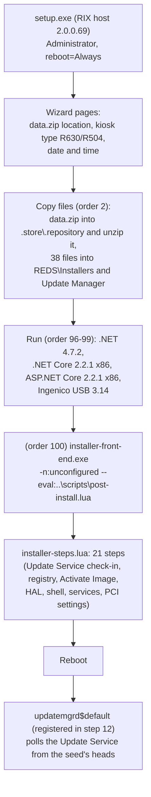

# Store Installer (Windows 10 kiosk setup)

This is how a Redbox kiosk PC was set up from scratch: `Windows10-Store-Installer-3.1.0.48-setup.exe` plus a
`data-<date>.zip` update-store seed. The setup exe lays down the update-store seed and a set of third-party
installers, then starts `installer-front-end.exe` (see [`update-manager.md`](update-manager.md) §11.3). That
front end runs the Lua script `post-install.lua`, which configures the PC and activates every package in the
seed. On the next boot `updatemgrd` takes over.

This document answers the open question in [`update-manager.md`](update-manager.md) §7.4 and §13: what extracts
`data.zip` and what launches `installer-front-end`.

Related docs: [`update-manager.md`](update-manager.md) (the update store, the Lua kernel, `installer start`),
[`common-libraries.md`](common-libraries.md) (KioskShell), [`hal.md`](hal.md) (`HAL.PackageInstaller`),
[`device-service.md`](device-service.md) (`RBAInstaller`), [`../update-store.md`](../update-store.md) (the
seeds).

---

## 1. Overview



The installer has three layers:

| Layer | What it is | Where it is in this repository |
|---|---|---|
| Setup host | `host.exe` 2.0.0.69, "Redbox Installer from XML Setup Host" (**RIX**). A generic Redbox installer engine: one exe with an XML setup script and the payload files as PE resources. | `src/Installer/host` |
| Front end | `installer-front-end.exe` 3.0.1.9 (`Redbox.UpdateManager.StoreInstallerFrontEnd`). A window that runs a Lua script with the Update Manager kernel. Identical (SHA-1) to the copy in the kiosk image. | `src/UpdateManager/installer-front-end` |
| Scripts | `post-install.lua`, `updater-post-install.lua`, `installer-utils.lua`, `installer-heading.lua`, `installer-steps.lua`. All the kiosk-specific work is in `installer-steps.lua`. | not committed (they contain the payload's plain-text credentials); summarised in §5 |

Some things are **not** done by this installer even though their tools ship in it: autologon, demoting the default
user, changing passwords and Dell BIOS settings (KioskAdmin, §7). The Kaseya and McAfee agents and nxlog are
also not installed by it (§3.2).

---

## 2. The setup host (RIX)

### 2.1 File format

`setup.exe` is a .NET 2.0 PE (x86, GUI, `requireAdministrator` manifest) whose Win32 resources carry the setup:

| Resource | Content |
|---|---|
| `PREREQ/SCRIPT` | The setup XML, compressed with `Redbox.Compression` LZMA: 5 LZMA property bytes, an 8-byte little-endian uncompressed length, then the raw LZMA stream (the "LZMA alone" layout). |
| `PREREQ/PROPS` | A `BinaryFormatter`-serialized `Dictionary<string,string>` of build properties: `ProductVersion = 3.1.0.48`, `update-manager = update-manager-prod`. They are merged into the project's values like `-D:` options. |
| `FILE/NNNN` | One resource per embedded `<file>` element, numbered in script order (`0005` ... `0046`). It is stored raw unless the element has a `compression` attribute (only `margin.bmp` uses `lzma`). |
| RT_ICON, RT_GROUP_ICON, RT_VERSION, RT_MANIFEST | Usual. |

The RIX *compiler* (`DefinitionList.SaveToResources`, `FileEntryDefinition.SaveToResource`) builds this from
a source XML. It adds `resource-name="NNNN"` to every embedded `<file>` and writes the files with
`ResourceUpdateSession`. Only the host side ships here.

Inspecting a RIX exe: dump the resources with any PE resource reader, then LZMA-decode `PREREQ/SCRIPT`. 7-Zip's
PE handler does **not** show these custom resource types; it opens the embedded .NET Framework setup instead.

### 2.2 Host start-up (`Redbox.Installer.Host/Program.cs`, `InstallerApplication.cs`)

1. Demands full trust. Requires `%windir%\Microsoft.NET\Framework\v3.5` (the message says ".NET 3.5"), so
   **.NET 3.5 must already be enabled** on the PC.
2. Writes "started ... by <user> running script for <ProductName> <ProductVersion>" to the Application event
   log, source `Redbox Installer from XML Host`.
3. Parses the command line (`Redbox.GetOpts`): `setup [-D:key=value ...] [--nosplash] [--silent] [--remove]
   [--force] [--log <file>] [--logsource]`.
4. Takes a single-instance lock named after the SHA-256 of the exe's first and last MiB.
5. Loads `PREREQ/PROPS`, then `PREREQ/SCRIPT` (`InstallerProject.ParseXml`), then every `FILE` resource to a
   temp file (`DefinitionList.LoadFromResources`).
6. Checks the OS: `OSRequired` 6.2 (Windows 8) or later. Fails with `I020` otherwise.
7. Checks the `security-level` (`Administrator`) and whether an earlier install allows modification.
8. Without `--silent` it shows the wizard (`MainForm`, Divelements WizardFramework). With `--silent` it runs
   `InstallerProject.Execute` directly, applying `-D:` properties to the pages.
9. Reboot: `reboot="Always"`. With `--silent` it reboots without asking; otherwise it asks OK/Cancel first
   (`ShutdownTool.Shutdown(Reboot | Force)`).

Page logic in the script is **JScript.NET** (`<event-handler>` bodies), compiled at run time through
`Microsoft.JScript.Vsa.VsaEngine` (`Redbox.ScriptingHost.Framework.VsaScriptingHost`). The objects `rix` and
`page` are exposed to it.

### 2.3 Execution order (`InstallerProject.Execute`)

Every definition has an `install-order`. The host sorts by it and runs `Install` on each in turn; loadable
modules (`.dll/.exe/.ocx` files with `execute-assembly-installer` on) are then registered (`DllRegisterServer`,
and the assembly's `Installer` classes in a separate AppDomain). Defaults:

| Element | Default order | Used here |
|---|---|---|
| `prohibited-process` | 0 | – |
| `file` | 2 | 41 files |
| `registry` | 3 | – |
| `execute-process` | 9 | 5, with explicit orders 96-100 |
| `shortcut`, `website` | 11 | – |
| `directory` | 12 | – |
| `group`, `firewall-exemption`, `schedule-task`, `user` | 15 | – |
| `queue` | 16 | – |

The framework could also create users, groups, IIS sites, firewall exceptions, scheduled tasks, event logs,
environment variables and MSMQ queues (`Redbox.Installer.Framework/*Definition.cs`). The store installer uses
none of them.

---

## 3. What the setup script does

The script is `<rix id="{ED5CD67C-9BD5-4397-9ADB-4A3AE621AE0D}" name="Store Installer" security-level="Administrator"
uninstall="false" allow-modify="true" reboot="Always">`.

### 3.1 Properties

| Property | Value |
|---|---|
| `ProductName` | `Redbox Store Installer` |
| `ProductVersion` | `1.0.0.0` in the script; `3.1.0.48` in `PREREQ/PROPS` |
| `StoreNumber` | `unconfigured` |
| `REDS` | `C:\Program Files\Redbox\REDS` |
| `UpdateManagerTarget` | `C:\Program Files\Redbox\REDS\Update Manager\bin` |
| `RepositoryPath` | `C:\Program Files\Redbox\REDS\Update Manager\.store\.repository` |
| `InstallPath` | `${REDS}\$(ProductName) $(ProductVersion)` (created by the first custom page; nothing is written there) |
| `OSRequired` | `6.2` |

### 3.2 Pages

| Page | Effect |
|---|---|
| `welcome` | "This installer will take approximately 8 minutes". |
| `select-file-path` | Looks for `data.zip` **next to setup.exe** (`AppDomain.BaseDirectory`). *Browse...* copies the chosen file there under the name `data.zip`. Next is refused until it exists. |
| `select-kiosk-type` | R630 ("90 slots per deck and VMZ machines", default) or R504 ("72 per deck, wide slot machines"). On leaving the page it writes `HKLM\SOFTWARE\Redbox\REDS\Kiosk Engine\Store\MaxSlots` = `90` / `72`, unless the property `ignoreMaxSlots` is set. |
| `select-date-time-page` | Opens `control timedate.cpl`. |
| `install-progress` | Runs the definitions (§3.3). |
| `finish` | "You MUST now use control panel to configure this kiosk with a kiosk number/id. Use Control Alt Enter to start the engine after the reboot." |

### 3.3 Files and processes, in order

**Order 2 — files.** `data.zip` is the only file with `external="true"`: it is copied from the setup folder to
`RepositoryPath\data.zip` and unzipped in place (`explode-on-copy`, `delete-after-explode="false"`). That is why
every kiosk has `.store\.repository\data.zip` (441 MB in the image) next to the extracted repositories. The
zip's layout *is* the store layout ([`update-manager.md`](update-manager.md) §7): `<repo>\.revlog\<n>`,
`.active`, `.current` (all zeros) and `<rev>-<SHA1(path)>.patch`.

The embedded files:

| Destination | Files |
|---|---|
| `${REDS}\Installers` | `Kaseya1Setup.exe` (4.8), `Kaseya2Setup.exe` (5.1), `Kaseya6Install.exe`...`Kaseya9Install.exe` (9.4.0.17), `FramePkg.exe` (McAfee Agent 5.0.6.220), `TimeZoneWindowsPatch.exe` and `WindowsInstaller.exe` (Windows XP-era updates), `AuditPol.exe`, `NDP472-KB4054530-x86-x64-AllOS-ENU.exe`, `dotnet-runtime-2.2.1-win-x86.exe`, `aspnetcore-runtime-2.2.1-win-x86.exe`, `IngenicoUSBDrivers_3.14_setup.exe`, `nxlog-ce-2.9.1716.msi`, `nxlog.conf`, `background.bmp` (shell wallpaper), `backgrounddefault.jpg` (lock screen), `core.zip` (eEye Blink `core.dll` 1.0.0.430), `KioskAdmin.zip` (§7), `kioskshell.zip` (KioskShell 3.1.0.22, identical to the image's), `RemoveBlink.bat`, `digicert.zip`, and the three NAnt zips below |
| `C:\bin\nant\`, `C:\bin\nantContrib\`, `C:\bin\NantTasks\` | `NantInstall.zip` (NAnt 0.85), `NantContribInstall.zip` (NAntContrib 0.85), `CustomNAntTasks.zip` (Redbox NAnt tasks and TimeKeeper 1.7.5.397, `src/Installer/Redbox.NAnt.*`, `Redbox.TimeKeeper*`). These are copied and unzipped (the zips also stay in `Installers`). Nothing in the Windows 10 scripts runs NAnt; they are left over from the XP-era build. |
| `${UpdateManagerTarget}` | `installer-front-end.exe` + `.exe.config` + `-log4net.config`, `bitsadmin.exe` (XP SP2), `lua51.dll`, `xdelta3.exe`, `xdelta3-64.exe`, `Quartz.dll` 2.3.3 |
| `${UpdateManagerTarget}\..\scripts\` | `installer-heading.lua`, `post-install.lua`, `updater-post-install.lua`, `installer-steps.lua`, `installer-utils.lua` |

So before the front end runs, `Update Manager\bin` holds **only** the front end and its helpers. `updatemgrd.exe`
itself arrives in step 6 (Activate Image) from the seed's `kop-update-manager` repository.

The Kaseya agents, McAfee, nxlog, the two Windows patches and `core.zip` are copied but not run by any script
in the installer. They were presumably run by hand or by remote management. The `nxlog.conf` forwards a list of
Security event IDs (4624, 4625, 4672, 4720, 4726, 1102, ...) as Snare syslog over UDP 514 to a Redbox address
(`<redacted>`).

**Orders 96-99 — prerequisites**, each `wait-for-exit`, errors not reported:

| Order | Command |
|---|---|
| 96 | `NDP472-KB4054530-x86-x64-AllOS-ENU.exe /q /norestart` |
| 97 | `dotnet-runtime-2.2.1-win-x86.exe /install /quiet /norestart` |
| 98 | `aspnetcore-runtime-2.2.1-win-x86.exe /install /quiet /norestart` |
| 99 | `IngenicoUSBDrivers_3.14_setup.exe /S /PORT=7 /PID=0057:7` |

**Order 100 — front end** (errors reported):
`"${UpdateManagerTarget}\installer-front-end.exe" -n:${StoreNumber} --eval:..\scripts\post-install.lua`, working
directory `Update Manager\bin`, so `-n:unconfigured`.

---

## 4. The front end and its scripts

`installer-front-end.exe` ([`update-manager.md`](update-manager.md) §11.3) opens the store at
`..\.store\.repository` / `..\.store\.data` and an Update Service client for `UpdateServiceUrl`. In the
installer's `installer-front-end.exe.config` that is **`srcp://updatesvc.redbox.com:7002`**. Logging goes to
`..\logs\front-end.log` (DEBUG). It shows each script step as an event row (pending / running / done / error).

### 4.1 `post-install.lua` (Action = Install)

- Sets `Environment = "QA"`, `RunInitialSync = false`, `InitialSyncType = "background"` and
  `HalProductID = {92E5D7C8-C00B-4416-9120-FE11C59C984C}`, then imports `installer-utils.lua`,
  `installer-heading.lua` and `installer-steps.lua`. `installer-heading.lua` sets **`Environment = "PROD"`**
  again, so production settings are used.
- **Resumable**: the number of the last finished step is written to `C:\.post-install` after each step. A rerun
  starts after it. If it equals the step count, the script reports "already run" and stops. Delete the file to
  run it again.
- A step that returns false stops the run. The front end then exits with -3 and the host reports the error.

### 4.2 `updater-post-install.lua` (Action = Update)

The same, but it runs only the first step (DigiCert certificates) and the last one (Final Image Maintenance).
Nothing in the installer calls it; it was for re-running on an installed kiosk.

### 4.3 `installer-utils.lua`

Helpers: `delete_files` / `delete_folder` with exclusion lists, `execute_file_if_exists`,
`wait_for_service_status` (polls 2 s × 150), `get_hal_path` (from HAL's `SilentUninstallString`), and
`FixService` (quote a service's `ImagePath`).

---

## 5. The installation steps (`installer-steps.lua`)

The active steps, in order. Steps that are commented out in the script are listed after the table.

| # | Step | What it does |
|---|---|---|
| 1 | Install DigiCert Certificates | Unzip `Installers\digicert.zip` to `C:\temp\digicert` and run its `install.cmd`: `certutil -addstore -f root DigiCert_Root.cer`, `certutil -addstore -f ca DigiCert_Intermediate.cer`. Fails if the zip is missing. |
| 2 | Check Internet Connectivity | See §5.1: checks .NET 3.5 SP1, stops updatemgrd, reads the seed's `dvd-data` head, calls `installer start` and `installer log`, sets the clock, writes `installGuid.txt`. **Fails the install if the Update Service cannot be reached.** |
| 3 | Shutdown Legacy Services | Kill `syncpage`, `kioskengine`, `dvd`. Stop `halsvc$default`, `RentalService`, `WatchDog`, `CallbackAgent`; disable the last three. Stop and delete `rbdservice`, `testmachine`, `memoryusage`. Set `HKLM\...\Kiosk Engine\Store\ID = "unconfigured"`. Run `kioskengined.exe --unregister` from `C:\REDS\...` and `${REDS}\...` if present. Wait 30 s. |
| 4 | HAL Maintenance | If HAL is installed (found through its uninstall key), copy its `bin\hal.xml` to `C:\hal.xml` and `C:\Program Files\Redbox\HAL-persistent-configuration.xml`. |
| 5 | Kiosk Engine Configuration | Registry for the PROD (or QA) environment, see §6.1. |
| 6 | Activate Image | For every repository in the store: if it has pending changes, `repositoryupdate` (stage). If it has pending activations, import a staged `beforeactivate.lua`, `repositoryactivate`, then import `afteractivate.lua`. Any failure stops the install (`A999`). See §5.2. |
| 7 | Install HAL | Run `C:\Program Files\Redbox\halservice\bin\HAL.PackageInstaller.exe` (5 min timeout). Wait 5 s, then stop `HalSvc$Default` again. |
| 8 | Setup Card Reader | `HKCU\Control Panel\Desktop\WindowsMetrics` `ScrollWidth`/`ScrollHeight` = -375; `CrashControl\AutoReboot` = true; `HKLM\SOFTWARE\Redbox\CRList` `List = "a,b"` and two values `a`, `b` (base64, `<redacted>`). Then `AuditPol.exe /logon:all /sam:all /policy:all /privilege:all /system:all /object:all /process:all` (enables full auditing). |
| 9 | Install lock screen wallpaper | `HKLM\...\Authentication\LogonUI\Background\OEMBackground = "1"`, copy `backgrounddefault.jpg` to `C:\Windows\system32\oobe\info\backgrounds\`. Copy `background.bmp` to `C:\redbox\background.bmp` (KioskShell's `Wallpaper`). |
| 10 | Install Redbox Shell | Delete the scheduled task `Bootstrap Store`. Unzip `KioskShell.zip` into `${RedboxProgramFiles}\KioskShell`. If Shell Launcher is enabled, make KioskShell the shell (§6.3); otherwise fail. Set `AeDebug\Auto = 0` (no debugger pop-ups) and `Kiosk Engine\Store\WatchDogEnabled = "true"`. |
| 11 | Mute PC sound | `waveOutSetVolume(0)`, `midiOutSetVolume(0)`. |
| 12 | Register Update Manager | `updatemgrd.exe --register`: creates `updatemgrd$default` (automatic, LocalSystem; [`update-manager.md`](update-manager.md) §2.2). It is not started; it starts at the reboot. |
| 13 | Device Service Setup | If `REDS\DeviceService\bin\RBAInstaller.exe` exists: stop `device$service` if it exists, run the installer (15 min; updates the Ingenico reader's firmware), start the service again. Then `sc create device$service displayname= "Redbox Device Service" start= delayed-auto binpath= "...\DeviceService.WebApi.exe"`. |
| 14 | Register Kiosk Client Service | `sc create kioskclient$service displayname= "Redbox Kiosk Client Service" start= delayed-auto binpath= "...\Kiosk Client\bin\KioskClientService.Api.exe"`. Copy `m.VisualStudio.Web.CodeGeneration.EntityFrameworkCore.dll` to its full name (the Update Service had a 64-character file name limit). |
| 15 | Register Update Client Service | `sc create updateclient$service displayname= "Redbox Update Client Service" start= delayed-auto binpath= "...\Update Client\bin\UpdateClientService.API.exe"`. |
| 16 | Turn off Autorun | `HKLM\...\Policies\Explorer\NoDriveTypeAutoRun = 255` (DWORD). |
| 17 | Windows 7 migration - update manager scheduling | Writes `HKLM\Software\Redbox\REDS\Kiosk Engine\Core\SchedulerEntries` with two Quartz jobs: `StatsMediumTimer` (`19 28 1-23/2 * * ?`, `stats_run_medium_timer`) and `StatsDailyTimer` (`19 28 3 * * ?`, `stats_run_daily_timer`). |
| 18 | Quoted Strings | PCI: quote the `ImagePath` of `TwRegSvc` (MicroTouch), `KaseyaAgent` and `halsvc$default` if they are unquoted. |
| 19 | Disable Sticky Keys | PCI: `HKCU\Control Panel\Accessibility\{Keyboard Response, HighContrast, MouseKeys, StickyKeys, ToggleKeys}\Flags` and related values set so that the accessibility hot keys are off (StickyKeys `506`, ToggleKeys `58`, Keyboard Response `122`, ...). |
| 20 | Remove Blink | `RemoveBlink.bat`: `msiexec /x {2AA5B60C-A775-416A-9867-4C0DF3450C30}` (eEye Blink) with `REMOVELICENSE=1 REMOVECONFIGURATION=1`, once with the management password (`<redacted>`) and once without. |
| 21 | Final Image Maintenance | Rename `C:\images.bat` to `C:\images.bat.from.image`, `markscriptcomplete`, reboot (unless `C:\Program Files\Redbox\XPTo7\silent.txt` exists). |

Commented-out steps, which document older images: "1.7.5 Maintenance" (zip `C:\Kiosk Engine`, `C:\REDS`,
`C:\RedboxInstalls`, `C:\gamp` before an upgrade), "File System Maintenance" and "Clean Redbox Directory"
(delete those folders), "Turn off UAC restrictions" (`EnableLUA = 0`), "Apply Windows 7 Timezone Patch",
"Apply Windows Installer 3.1 Patch", and the Windows XP→7 migration steps (restore store and card-reader
registry values, `profile.data`/`inventory.data`, `KaseyaD.ini` from `C:\Windows\Temp\StateStore\XPto7`).

`HKCU` values (steps 8, 19 and the PROD `DisableTaskMgr`) go to the profile of the user running the installer,
which is the kiosk's auto-logon user on a real kiosk.

### 5.1 Step 2 in detail: the Update Service check-in

1. `kernel.getdotnetversions()` must list a `3.5` with service pack 1. Otherwise the step fails with "This
   machine does not have the correct .NET framework installed".
2. `kernel.resettransfers()` (cancel BITS jobs) and `stopservice("updatemgrd$default")`.
3. `hash = kernel.repositorygetheadrevision("dvd-data")`. An empty hash fails the step ("make sure you are
   using a correct data file").
4. `kernel.startinstaller(hash, kernel.getfrontendversion())` sends
   `installer start hash: '<dvd-data head>' version: '<front-end file version>' h: '<credential hash>'` on the
   Update Service connection, up to 3 times. The reply's first message is a JSON object of strings. The step
   fails unless all of `DataFileExpiration`, `InstallerExpiration`, `CurrentDateTime`, `URL`, `HostEntries` and
   `guid` are non-empty. `ErrorMessage`, if not empty, also fails it.
5. Expirations, in days: `0` fails ("This data file has expired" / "This installer has expired"); `1` or more
   only warns; a negative value means "not set". So **the server could retire old seeds and installers.**
6. `kernel.setdatetime(CurrentDateTime)` sets the PC clock (a warning on failure).
7. `kernel.checkconnectivity(URL, 30)` probes the returned URL. The code that would have prepended
   `HostEntries` (`|`-separated) to the hosts file is commented out. Only `hostsFile = "True"/"False"` is
   reported.
8. `installGuid.txt` in `REDS\Update Manager` keeps the `guid` (an existing file wins). It ties this PC to the
   kiosk number assigned later.
9. `kernel.finishinstaller(guid, {serial, manufacturer, hostsFile, action, kiosk})` sends one
   `installer log guid:'<guid>' name:'<key>' value:'<value>' h:'<value>'` per key (up to 3 tries each).
   `serial` and `manufacturer` come from WMI (BIOS / computer system), `kiosk` is `R630`/`R504`/`Unknown` from
   `MaxSlots`. (The client puts the *value* in the `h:` field because of a format-string index bug; see
   `Redbox.UpdateService.Client/UpdateService.InstallerLog`.) The result is ignored, and the log message for it
   is inverted ("Failed" on success).

The kiosk has no store number yet: `installer start` and `installer log` send `kioskId = "installer"`.

### 5.2 Step 6 in detail: how the seed is installed

The seed was extracted by the host (§3.3), so each repository has its `.revlog`, its patch files, and
`.current` = `.active` = 40 zeros. For each repository, step 6 runs the same calls as the Update Manager's
own update script ([`update-manager.md`](update-manager.md) §5.4, §5.5):

1. `repositorypendingchanges(repo)` lists the revisions after `.current`, i.e. all of them.
2. `repositoryupdate(repo)` = `UpdateToHead`. For every changed file it rebuilds the newest version from its
   first seed and the later VCDIFF deltas (`xdelta3.exe` from `Update Manager\bin`, SHA-1 checked at each
   step), and writes it to `<TargetPath>\.staged_\<TargetName>`. `.current` becomes the head.
3. `repositorypendingactivations(repo)` lists the staged files. If one is `beforeactivate.lua`, it is run from
   the `.staged_` folder first.
4. `repositoryactivate(repo)` copies every staged file over its target (locked files are moved at reboot)
   and sets `.active`.
5. If an `afteractivate.lua` is among the files, it is run. In the 2022 image these only delete obsolete files
   (HAL, Kiosk Engine) and copy the long Kiosk Client DLL name. The services are created by steps 12-15
   instead.

The repositories in every seed from 2018 on: `device-service`, `dvd-data`, `kioskclient`, `kop-hal-install`,
`kop-ms-hal-tester`, `kop-rental-bundles`, `kop-scripts`, `kop-shared-bundles`, `kop-tools`,
`kop-update-manager`, `kop-v2-engine`, `updateclient`. Together they install everything under `REDS`
(including `updatemgrd` and its scripts) and `C:\Program Files\Redbox\halservice`.

---

## 6. Settings written

### 6.1 Registry

`Kiosk Engine` = `HKLM\SOFTWARE\Redbox\REDS\Kiosk Engine`. The front end is an x86 process, so its `HKLM\SOFTWARE`
writes land in the **`WOW6432Node`** view on 64-bit Windows, where the 32-bit engine reads them. The setup
host, though, is AnyCPU (MSIL) and runs as a 64-bit process. Its one registry write, `MaxSlots` from the
kiosk-type page, therefore goes to the **64-bit** view. Step 2 then reads `MaxSlots` from the 32-bit view and
reports `kiosk = Unknown` (inferred from the binaries' flags; not observed).

| Key | Value | Data | Step |
|---|---|---|---|
| `Kiosk Engine\Store` | `MaxSlots` | `90` (R630) / `72` (R504) | page |
| `Kiosk Engine\Store` | `ID` | `unconfigured` (set later in the Control Panel) | 3 |
| `Kiosk Engine\Remote Services\{Authentication, Health, Inventory, Merchant, Reservation, Promotion, Store} Services` | `LiveCall` | `true` | 5 |
| `Kiosk Engine\Remote Services\Reservation Services` | `BrokerServicesURL` | PROD `gtcp://blt.accessredbox.net:443/RegistrationBroker/Default.rem`; QA a `gtcp://` IP on port 7890 (`<redacted>`) | 5 |
| `Kiosk Engine\Remote Services\Store Services` | `KioskServicesURL` | PROD `https://bl2.accessredbox.net/KioskServices/MessageService.rem`; QA `http://<QA host>/kioskservices/messageservice.rem` | 5 |
| `Kiosk Engine\Remote Services\Store Services` | `HardwareServiceURL` | `rcp://127.0.0.1:7001` | 5 |
| `Kiosk Engine\Store` | `Environment` | `Production` (QA: `QA`) | 5 |
| `Kiosk Engine\Store` | `RunInitialSync`, `InitialSyncType` | `false`, `background` | 5 |
| `Kiosk Engine\Debugger` | `Enabled` | `true` (QA only) | 5 |
| `HKCU\Software\Microsoft\Windows\CurrentVersion\Policies\System` | `DisableTaskMgr` | 1 (PROD only) | 5 |
| `HKLM\SYSTEM\CurrentControlSet\Control` | `ServicesPipeTimeout` | 60000 (DWORD; "after Blink is installed the update service sometimes times out") | 5 |
| `HKLM\Software\Microsoft\Internet Explorer\Main\FeatureControl\FEATURE_BROWSER_EMULATION` | `KioskEngine.exe` | 8888 (DWORD, IE8 mode "for the new routers' config pages") | 5 |
| `HKCU\Control Panel\Desktop\WindowsMetrics` | `ScrollWidth`, `ScrollHeight` | -375 | 8 |
| `HKLM\SYSTEM\CurrentControlSet\Control\CrashControl` | `AutoReboot` | true | 8 |
| `HKLM\SOFTWARE\Redbox\CRList` | `List`, `a`, `b` | `a,b` and two base64 values (`<redacted>`) | 8 |
| `HKLM\SOFTWARE\Microsoft\Windows\CurrentVersion\Authentication\LogonUI\Background` | `OEMBackground` | `1` | 9 |
| `HKLM\SOFTWARE\Microsoft\Windows NT\CurrentVersion\AeDebug` | `Auto` | 0 | 10 |
| `Kiosk Engine\Store` | `WatchDogEnabled` | `true` | 10 |
| `HKLM\Software\Microsoft\Windows\CurrentVersion\policies\Explorer` | `NoDriveTypeAutoRun` | 255 | 16 |
| `Kiosk Engine\Core` | `SchedulerEntries` | two stats jobs (JSON) | 17 |
| `HKLM\System\CurrentControlSet\Services\{TwRegSvc, KaseyaAgent, halsvc$default}` | `ImagePath` | quoted | 18 |
| `HKCU\Control Panel\Accessibility\...` | various | accessibility hot keys off | 19 |

`kernel.setregistrykey` calls `Registry.SetValue` with the Lua value, so everything it writes is `REG_SZ`:
booleans become `True`/`False`, numbers their text (`-375`, `1`). Only `setdwordregistrykey` writes DWORDs
(`ServicesPipeTimeout`, `FEATURE_BROWSER_EMULATION`, `NoDriveTypeAutoRun`).
(`Redbox.UpdateManager.Kernel/RegistryFunctions.cs`).

### 6.2 Hosts and endpoints

The installer writes **no hosts entries** (that code is commented out) and does not change any service's
configuration file. The endpoints a freshly installed kiosk uses are therefore:

- `srcp://updatesvc.redbox.com:7002` for the front end (installer config) and for `updatemgrd` (the
  `updatemgrd.exe.config` that `kop-update-manager` ships);
- the broker and KioskServices URLs from §6.1;
- whatever `appsettings*.json` the `updateclient`, `kioskclient` and `device-service` repositories ship, plus
  the config files and IoT configuration the backend pushes later.

### 6.3 Shell (Shell Launcher)

`kernel.shelllauncherfeatureinstalled()` reads `SLGetWindowsInformationDWORD("EmbeddedFeature-ShellLauncher-Enabled")`.
So the Windows edition must have **Shell Launcher** (Enterprise/IoT Enterprise/Education) and the feature must
be on. `kernel.replaceshellwith(path)` then runs, elevated, three WMI calls in the
`root\StandardCimv2\Embedded` namespace:

```
wmic /namespace:\\root\StandardCimv2\Embedded CLASS WESL_UserSetting CALL SetDefaultShell Shell="<KioskShell.exe>" DefaultAction=0
wmic /namespace:\\root\StandardCimv2\Embedded CLASS WESL_UserSetting CALL SetCustomShell Sid="S-1-5-32-544" Shell="<KioskShell.exe>" DefaultAction=0
wmic /namespace:\\root\StandardCimv2\Embedded CLASS WESL_UserSetting CALL SetEnabled Enabled=true
```

So **every** user, Administrators included, gets KioskShell instead of Explorer. `DefaultAction=0` restarts
the shell when it exits. KioskShell (`src/Tools/KioskShell`, [`common-libraries.md`](common-libraries.md))
sets the wallpaper `C:\Redbox\background.bmp`, runs `c:\startup.bat` and the Startup folder, and starts
`kioskengine.exe` on **Ctrl+Alt+Enter** (`AttentionSequene`) or when told on `rcp://localhost:8004`.
`updatemgrd`'s watchdog starts the engine on its own as well.

### 6.4 Services after the install

| Service | Created by | Start |
|---|---|---|
| `updatemgrd$default` (Redbox Store Manager Service) | step 12, `updatemgrd --register` | Automatic |
| `halsvc$default` | step 7, `HAL.PackageInstaller` | as the package installer sets it (stopped again at the end of step 7) |
| `device$service` | step 13 | delayed auto |
| `kioskclient$service` | step 14 | delayed auto |
| `updateclient$service` | step 15 | delayed auto |

None of them is started by the installer. They start at the reboot that ends step 21.

---

## 7. OS hardening that the installer does *not* do

`KioskAdmin.zip` is copied to `REDS\Installers` but no installer step uses it. Its Lua scripts expect the zip
at `C:\temp\KioskAdmin.zip` (or `C:\temp\demoteuser.zip`) and call `kernel.sendstatusmessage`, which only the
running `updatemgrd` has. They are **remote scripts** that the Update Service pushed to installed kiosks later
(as download files or scheduled scripts; [`update-manager.md`](update-manager.md) §5.12).

| Script | Calls | Effect |
|---|---|---|
| `DemoteUser.lua` | `KioskAdmin.exe -demoteuser` | Create the local administrator `rbAdmin` if missing (password `<redacted>`, never expires, in Administrators). If the auto-logon user (`Winlogon\DefaultUserName`) is an administrator and not `rbAdmin`: add it to Power Users, remove it from Administrators, set its password to `<redacted>` and re-run Sysinternals `Autologon.exe <user> <machine> <password>` (with `EulaAccepted` set first), then set every other administrator's password to `<redacted>`. Reports the output (`output.txt`) as a status message. Reboot required. |
| `ChangePassword.lua` | `KioskAdmin.exe -setpasswords` | The password part of the above, without the demotion. |
| `dellbios.lua` | `KioskAdmin.exe -runbiosasshell` | Reports manufacturer and serial. On Dell PCs, starts `KioskAdmin -runbios` **in the shell user's session** (token duplicated from the running `KioskShell` process), which schedules `c:\temp\dellbios.exe` (Dell "SCE" self-extracting BIOS configuration package, 30 files) 65 s later with Task Scheduler and waits 5 min. |
| `pci.lua` | all of the above | `NoDriveTypeAutoRun = 255`, `-setpasswords`, and the Dell BIOS step; reboot required. |

`KioskAdmin.exe` also has `-getbackground` / `-setbackground:<path>` (desktop wallpaper of the current user).
Source: `src/Installer/KioskAdmin` (passwords redacted).

Autologon itself (which user, which password) is therefore set **before** the installer runs, as part of the
Windows image. `DemoteUser.lua` only changes it afterwards. The installer also deletes a scheduled task named
`Bootstrap Store` (step 10), which the image presumably used to start the installer at first logon.

---

## 8. Hand-over to the Update Manager

After the reboot:

1. `updatemgrd$default` starts (step 12). Its store is the extracted seed, with every repository activated at
   the seed's head and `.current = .active`.
2. Its schedule and scripts come from the seed's `kop-scripts` and `kop-update-manager` repositories. Its first
   `u p` reports those heads, so the Update Service sends only the revisions after them. Revisions before
   the seed are never downloaded.
3. `RunInitialSync = false`, so the update scripts and the watchdog are not held back. The watchdog starts the
   engine once HAL answers.
4. The kiosk still has `ID = unconfigured`. A technician sets the store number in the engine's Control Panel.
   The store number (`StoreNumber` setting, else the registry `ID`) is then what `updatemgrd`, the Kiosk
   Client, the Update Client and the Device Service identify themselves with.

`updatemgrd` and its own update scripts never extract `data.zip` again. It stays in `.repository` and is not
used further.

---

## 9. Source map

| Topic | Source |
|---|---|
| Host start-up, options, resources | `src/Installer/host/Redbox.Installer.Host/Program.cs`, `InstallerApplication.cs`, `Options.cs` |
| Wizard UI | `src/Installer/host/Redbox.Installer.Host/MainForm.cs`, `WizardPresenter.cs`, `DynamicWizardPage.cs` |
| Script model, execution order | `src/Installer/host/Redbox.Installer.Framework/InstallerProject.cs`, `Definition.cs`, `DefinitionList.cs`, `*Definition.cs` |
| Files, data.zip extraction | `src/Installer/host/Redbox.Installer.Framework/FileEntryDefinition.cs`, `Redbox.Compression/ZipHelper.cs` |
| Script resource compression | `src/Installer/host/Redbox.Compression/LzmaCompressionAlgorithm.cs` |
| JScript.NET page scripts | `src/Installer/host/Redbox.ScriptingHost.Framework/VsaScriptingHost.cs`, `Redbox.Installer.Framework/PageTemplateDefinition.cs`, `ScriptKernelObject.cs` |
| Service-account helper (unused here) | `src/Installer/host/Redbox.Installer.Client/RIXServiceCredentialsInstaller.cs`, `PasswordHelper.cs` |
| Front end | `src/UpdateManager/installer-front-end/*` |
| `installer start` / `installer log` | `src/UpdateManager/Redbox.UpdateManager.Kernel/UpdateServiceFunctions.cs`, `Redbox.UpdateManager.Remoting/UpdateService.cs`, `Redbox.UpdateService.Client/UpdateService.cs` |
| Shell Launcher | `src/UpdateManager/Redbox.UpdateManager.Kernel/ShellLauncherFunctions.cs` |
| Repository update and activation | `src/UpdateManager/Redbox.UpdateManager.Environment/RepositoryService.cs`, `Redbox.UpdateManager.Kernel/RepositoryFunctions.cs` |
| KioskAdmin | `src/Installer/KioskAdmin/*` |
| NAnt tasks, TimeKeeper | `src/Installer/Redbox.NAnt.*`, `src/Installer/Redbox.TimeKeeper*` |
| KioskShell | `src/Tools/KioskShell` |

The Lua scripts, configuration files and third-party installers are not in this repository. They come out of
the setup exe's `FILE` resources (§2.1).

### Building

All ten `src/Installer` projects are in `Redbox.sln`. Differences from the original binaries:

- `host` targets **net461**, not .NET 2.0/3.5: the NuGet builds of Divelements.WizardFramework (1.2.22) and
  IconLib (0.74.3) need .NET 4. On .NET 4 the JScript engine takes `Microsoft.JScript.Vsa.IJSVsa*` types in
  place of `Microsoft.Vsa`'s, so `VsaScriptingHost` was adapted (separate commit). SmartPropertyGrid comes
  from `lib/` (3.1.0.107; the merged copy's version is unknown). The merged 2008-era Redbox libraries are
  kept inline (they predate and differ from `src/Common`). So is the merged TaskScheduler wrapper, of which no
  binary exists. ILMerge's renamed duplicates (`Redbox_002EMacros1309_002E*` types) are kept as decompiled. The
  third-party `host.exe.licenses` resource is not included.
- `KioskAdmin` targets net45 (NuGet `TaskScheduler` 2.12.2 replaces `TaskService.dll`, a renamed build of the
  same open-source Task Scheduler Managed Wrapper). Its passwords are `<redacted>`.
- The NAnt task assemblies (.NET 1.1 originals) target net40 against NuGet `NAnt.Core` 0.92 (the zip has 0.85).
  `Redbox.TimeKeeper` and `Redbox.TimeKeeperGateway` target net35. `Redbox.TimeKeeper` also contains an ASP.NET
  `Global` class of a `Redbox.PaymentService` web application.

---

## 10. Unknowns and doubts

- **The server side of `installer start` / `installer log`** is not known beyond what the script checks. What
  `URL` and `HostEntries` normally held, how expirations were computed, and how the `guid` was later matched
  to a kiosk number are inferred from names only.
- **Which `ProductVersion` wins** (script `1.0.0.0` or `PREREQ/PROPS` `3.1.0.48`) depends on whether
  `ParseXml` overwrites values set earlier. It only affects the unused `InstallPath` folder name.
- **How the Kaseya, McAfee and nxlog payloads were installed**, and how the Windows image (Shell Launcher
  enabled, .NET 3.5 enabled, auto-logon user, the `Bootstrap Store` task) was prepared, is outside the
  installer.
- **When the KioskAdmin scripts were pushed** is not recorded in the image. That they were remote scripts is
  inferred from their use of `kernel.sendstatusmessage` and `C:\temp` paths.
- `installer-steps.lua` is called "store installer", but the front end's `post-install.lua` resumes from
  `C:\.post-install`. Nothing deletes that file, so a second install on the same PC skips every step unless
  someone removes it by hand.
- The installer was never run for this document (only unpacked and read). Behaviour is from the code and the
  scripts.
