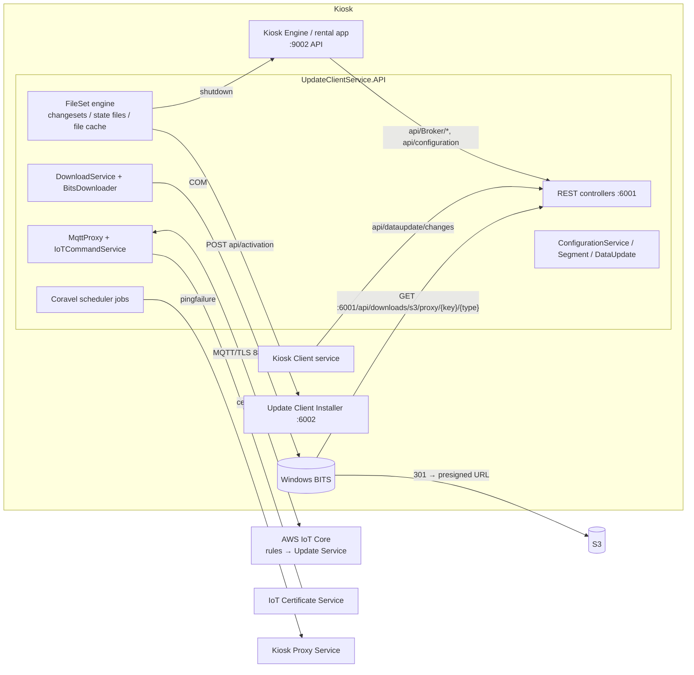

# Update Client Service (UpdateClientService.API)

The Update Client Service ("UCS" in its own logs) is the newer kiosk agent. It is a .NET Core 2.2 ASP.NET
Core app that runs as a Windows service. Over a single **AWS IoT Core MQTT** connection it talks to Redbox's
cloud **Update Service**, and it uses that link to:

- receive and install **file sets**, which are versioned bundles of files with dependencies, staging,
  activation windows and before/after scripts. This is the newer replacement for the legacy Update Manager
  packages;
- run ad-hoc **download-file jobs** (download a file and/or a PowerShell script and run it);
- **upload kiosk files** (logs, data and so on) to S3, and list directories, on request;
- run arbitrary **HTTP requests** for the cloud on the kiosk (remote API proxy);
- pull **kiosk configuration** (segmented setting values) into `C:\ProgramData\Redbox\Configuration\configuration.json`;
- pull **kiosk segments** and **product data updates**;
- relay **kiosk health pings** and **broker (reservation) registration** for the Kiosk Engine;
- sync the system clock and time zone, install certificates, clean up old logs, and reboot the kiosk.

It also hosts a local REST API on `http://localhost:6001`. The Kiosk Engine (rental app) and the Kiosk Client
service use that API to reach the cloud without holding their own IoT connection.

This document also briefly covers the two shared libraries it ships with: `Redbox.NetCore.Middleware` and
`Redbox.NetCore.Logging`.

Related documents: [update-manager.md](update-manager.md) (legacy updater, which installs UCS itself),
[kiosk-engine.md](kiosk-engine.md), [rental.md](rental.md), [kiosk-client.md](kiosk-client.md).

---

## 1. Overview

| Item | Value |
|---|---|
| Assembly | `UpdateClientService.API` 1.2.75.0, `netcoreapp2.2` (`Microsoft.AspNetCore.App` 2.2.1, server GC) |
| Libraries | `Redbox.NetCore.Middleware` 1.0.140.0, `Redbox.NetCore.Logging` 1.3.26.0 (both `netcoreapp2.1`) |
| Key packages | MQTTnet 3.1.2, Coravel 3.6.1 (scheduler), Serilog, Swashbuckle 6.1.5, Nito.AsyncEx, App.Metrics |
| Install path | `C:\Program Files\Redbox\REDS\Update Client\bin` (`UpdateClientService.API.exe`) |
| Windows service | `updateclient$service`, display name "Redbox Update Client Service" |
| Local API | `AppSettings:BaseServiceUrl` = `http://localhost:6001` (no authentication) |
| Cloud transport | MQTT 3.1.1 over TLS 1.2, port 8883, X.509 client certificate, AWS IoT Core |
| Data root | `C:\ProgramData\Redbox\UpdateClient` |
| Log | `C:\ProgramData\Redbox\UpdateClient\Logs\updateclient-{Date}.log` |
| Internal version string | `"2.0"` (`UpdateClientServiceConstants.Version`, sent in the register message) |

The kiosk image also has an `AWSSDK.*` and `M2Mqtt.dll` in `bin`, but this project does not reference them.
They are probably left over from an earlier version.

---

## 2. Deployment

### 2.1 Files in the image

`REDS/Update Client/bin/` holds the published app (`UpdateClientService.API.dll/.exe/.pdb`, `deps.json`,
`runtimeconfig.json`, `web.config`, third-party DLLs), plus:

- `appsettings.json`, `appsettings.Production.json`, `appsettings.Staging.json`, `appsettings.Development.json`
- `fileset.json`, the UCS's own file-set descriptor (format in §7.6):

```json
{ "installPath": "C:\\Program Files\\Redbox\\REDS\\Update Client\\bin", "IncludeAllFilesInZipFile": true,
  "SourcePath": "publish", "windowsServiceName": "updateclient$service",
  "windowsServiceDisplayName": "Redbox Update Client Service",
  "windowsServiceStartFile": "UpdateClientService.API.exe" }
```

- `.staged_/`, a pending update staged by the legacy Update Manager. It contains the original Redbox URLs (see §8).

`web.config` (AspNetCoreModuleV2, in-process) exists for IIS hosting but is not used: the service self-hosts
on Kestrel. There is **no `etc\` folder** in the image, so the `etc\xdelta3.exe` / `etc\xdelta3-64.exe` that
`XDeltaHelper` expects is missing (see §5.4.4).

### 2.2 How UCS itself is installed

In this image the UCS binaries are delivered by the **legacy Update Manager**. They are package `updateclient`
in `REDS/Update Manager/.store/.repository/updateclient` (34 revisions; the current label is `UpdateClient-Donatello`).
The Lua repository script `REDS/Update Manager/scripts/repositories.lua` registers it:

- `beforeactivate`: if service `updateclient$service` exists, stop it and wait 20 s;
- `afteractivate`: if it did not exist, run
  `sc.exe create updateclient$service displayname= "Redbox Update Client Service" start= delayed-auto binpath= "C:\Program Files\Redbox\REDS\Update Client\bin\UpdateClientService.API.exe"`,
  then start the service.

`installer-steps.lua` has the same `sc create` in the step "Register Update Client Service". UCS's own
file-set mechanism can also update UCS: it hands off to an external "Update Client Installer" (§5.4.6).
The Kiosk Engine's `data/versionsneeded.config` lists `UpdateClientService.API.dll` as a required component.
The ASP.NET Core 2.2.1 **x86** runtime installer is in `REDS/Installers`, so the service probably runs as a
32-bit process (inferred).

### 2.3 Ports, endpoints and dependencies

| Direction | Endpoint | Purpose |
|---|---|---|
| Listen | `http://localhost:6001` | Local REST API (§6.1) and the S3 proxy redirector used by BITS |
| Listen | `http://*:60669` | App.Metrics Prometheus endpoint `/metrics`. Metrics are disabled (`MetricsEnabled=false`), but the port is still added to Kestrel's URLs (see §6.5) |
| Out | `{IoTBrokerEndpoint}:8883` (MQTT/TLS) | AWS IoT Core: all cloud commands |
| Out | `{IoTCertificateServiceUrl}` HTTPS | Obtain and validate the IoT device certificate |
| Out | `{ProxyApiUrl or DefaultProxyServiceUrl}` HTTPS | Report ping failures |
| Out | Presigned S3 URLs (HTTPS) | BITS downloads (through the local 301 redirector) and `PUT` uploads |
| Out | `http://localhost:9002` | Kiosk Engine API: `api/engine/shutdown`, `api/engine/processid` |
| Out | `http://localhost:6002` (`UpdateClientInstallerUrl`) | External installer used for UCS self-update |
| Local | Windows BITS (COM) | All downloads |
| Local | `powershell.exe`, `sc.exe` | Scripts, reboot, service install |
| Local | Registry `HKLM\SOFTWARE\Redbox\REDS\Kiosk Engine\Store` (`ID`, `Market`, `Banner`) | Kiosk identity |

Clients of the local API (from source): the rental app inside the Kiosk Engine calls `api/Broker/Ping`,
`api/Broker/Register`, `api/Broker/UnRegister` and `api/configuration/settingvalues/changes`
(`src/Rental/Redbox.Rental.Services/UpdateClientService/*`; base URL `UpdateClientServiceBaseUrl`, default
`http://localhost:6001`). The Kiosk Client service calls `api/dataupdate/changes`
(`src/KioskClient/KioskClientService.API/Services/UpdateClientServiceApi/UpdateClientServiceClient.cs`,
`UpdateClientServiceUrl` = `http://localhost:6001` in its appsettings).

Without a kiosk ID (registry `ID` > 0) UCS cannot get a certificate and never connects to IoT.

---

## 3. Architecture



Main layers (all under `src/UpdateClient/UpdateClientService.API/`):

- **Hosting**: `Program.cs`, `Startup.cs`, `WebHostServiceExtensions.cs`, `ApplicationWebHostService.cs`.
- **Controllers** (`Controllers/`): thin wrappers over the services.
- **IoT** (`Services/IoT/`): the MQTT connection, certificate management, an RPC layer over MQTT
  (`IoTCommandClient`, `ActiveResponsesService`), dispatch of incoming commands to `ICommandIoTController`
  implementations, and the download-file, kiosk-files and file-set-version helpers.
- **FileSets** (`Services/FileSets/`, `Services/FileCache/`): a state machine that downloads, caches, stages and
  activates file-set revisions.
- **DownloadService / Transfer** (`Services/DownloadService/`, `Services/Transfer/`): persistent download
  records processed by a BITS COM wrapper.
- **Configuration / Segment / DataUpdate / Broker / ProxyApi / Kernel / KioskEngine / KioskCertificate /
  Utilities / Files**: the other jobs.
- **Persistence**: `PersistentDataCacheService`, a JSON file store with one process-wide lock.

---

## 4. Start-up and lifecycle

1. `Program.Main`: unless a debugger is attached or `--console` is passed, set the working directory to the
   exe's folder (service mode). Configure Serilog from `appsettings.json` (thread-id enricher, console sink), log
   the `ASPNETCORE_ENVIRONMENT` and assembly version, and force `ServicePointManager.SecurityProtocol = Tls12`.
2. Configuration sources, in order (later ones override earlier ones): `appsettings.json` (required),
   `C:\ProgramData\Redbox\Configuration\configuration.json` (optional, reload on change), then
   `appsettings.{EnvironmentName}.json` (optional; the environment defaults to `Production`).
3. Build the web host: `UseUrls(BaseServiceUrl)`, Serilog, `UseStartup<Startup>()`, then `UseAppMetrics()`, which
   appends `http://*:{AppMetrics:MetricsEndpointPort}/` to the server URLs.
4. `Startup.ConfigureServices`: MVC with `LoggingActionFilter` and `StringEnumConverter`, lowercase routes, DI
   registrations, `AddHttpService` (typed `HttpClient` that auto-redirects and keeps cookies), Swagger
   ("Update Client API" v1). Every type implementing `ICommandIoTController` in any loaded assembly is
   registered as a scoped command handler.
5. `Startup.Configure`: HSTS (non-Development), `UseHttpsRedirection` (has no effect because no HTTPS URL is
   bound), Swagger at `/swagger`, MVC. Then the Coravel scheduler is started (§5.12) and the kiosk configuration
   is written to the log (`kioskConfiguration.Log()`, with secret settings masked).
6. The host runs under `ServiceBase.Run(ApplicationWebHostService)`. Starting, started, stopping and stopped
   events are logged.
7. Steady state: `MqttProxyJob` runs every minute and (re)connects, subscribes and registers (§5.1). The other
   jobs run on their schedules. Incoming MQTT commands are handled on thread-pool tasks.
8. Shutdown: normal ASP.NET Core host shutdown. Nothing is flushed explicitly except Serilog
   (`Log.CloseAndFlush`). All state is already on disk.

---

## 5. How it works

### 5.1 IoT connection (`Services/IoT/MqttProxy.cs`)

`MqttProxyJob` calls `CheckConnectionAsync()` every minute; a re-entrancy guard stops overlapping calls.
`Connect()` does the following, in order and only as needed:

1. **Connect** if not connected. First record a connection attempt (§7.3). The client options are built once
   and cached:
   - TCP server `AppSettings:IoTBrokerEndpoint`, port **8883**, TLS 1.2, `AllowUntrustedCertificates=false`,
     certificates = { root CA, device PFX } from the certificate service (§5.2);
   - MQTT **3.1.1**, **client ID = kiosk ID** (decimal string), keep-alive **300 s**,
     communication timeout 60 s, **clean session**.

   `ConnectAsync` has a 20 s timeout. On an exception it records the exception text in the statistics, calls
   `CertificateService.Validate()` (which may delete the local certificate, §5.2), and drops the cached options
   so they are rebuilt on the next attempt.
2. **Subscribe**, if not yet subscribed, with QoS 1 to:
   - `redbox/kiosk/{kioskId}/command`
   - `redbox/kiosk/market/{Market}/command` (Market from the registry)
   - `redbox/kiosk/all/command`

   Subscribing succeeds only if every topic is granted.
3. **Register and time-sync**, if not yet registered. These run in parallel:
   - publish `UCSRegisterMessage` to `$aws/rules/kioskucsregister` (QoS 1):
     `{"KioskId":59394,"Version":"2.0","UTCDate":"…","DynamoDbTimeToLive":<unix now+1 month>,"AssemblyVersion":"1.2.75.0"}`.
     Registration succeeds if the publish succeeds;
   - **once per process**, publish an `IoTCommandModel` request `SyncTimestampAndTimezone` v1 (no payload) to
     `$aws/rules/kioskrestcall` (§5.9).

A disconnect clears the subscribed and registered flags, so the next job tick re-subscribes and re-registers.
Connected and disconnected events are written to `IoTStatistics.json`. Every publish has a 5 s timeout and is
refused while the client is disconnected; the retain flag is always false.

### 5.2 IoT device certificate (`Services/IoT/Certificate/*`, `Services/IoT/Security/*`)

`CertificateService.GetCertificateAsync(forceNew)`:

1. The kiosk ID must be > 0. Compute:
   - `name = Encrypt(kioskId)` and `type = Encrypt("kiosks")` (`EncryptionService`, below);
   - `password = HashService.GetKioskPassword(kioskId)` (below).
2. If `UpdateClientService.API.dll` was **written more recently than** `iotcertificatedata.json`, or if
   `forceNew` is set, ask for **new** certificates (`POST api/thing-types/certificates`). In practice every
   UCS upgrade re-issues the device certificate.
3. Otherwise load `C:\ProgramData\Redbox\UpdateClient\IoT\iotcertificatedata.json`. If it is missing, call
   `POST api/thing-types/get-certificates`.
4. The response `{DeviceCertPfxBase64, RootCa, CertificateId}` is written to `iotcertificatedata.json` as is
   (it contains the private key). The PFX is opened with `HashService.GetCertificatePassword(kioskId)`.
   `RootCa` is PEM/DER text loaded through `X509Certificate(byte[])`.

`Validate()` (after a failed connect) calls `POST api/thing-types/certificate-valid`. If the answer is
**false**, the local file is deleted, so the next connect fetches the certificate again. If the call fails
(`null`), the certificate is kept.

**Certificate service HTTP API**: base `AppSettings:IoTCertificateServiceUrl`, timeout 90 s, JSON body.
Headers:

```
x-api-key: <AppSettings:IoTCertificateServiceApiKey>   (redacted)
password:  <GetKioskPassword(kioskId)>
```

| Method / path | Body | Response |
|---|---|---|
| `POST api/thing-types/certificate-valid` | `{"type":E("kiosks"),"name":E(kioskId),"thingGroupName":Market,"certificateId":E(certId)}` | JSON `true`/`false` |
| `POST api/thing-types/get-certificates` | `{"type":…,"name":…,"thingGroupName":Market}` | `{"DeviceCertPfxBase64":"…","RootCa":"…","CertificateId":"…"}` |
| `POST api/thing-types/certificates` (generate new) | same as above | same as above |

**`EncryptionService` ("EncryptType1")**, also used to decrypt encrypted kiosk-configuration values (§5.6):

- key derivation: `Rfc2898DeriveBytes(passphrase, 32-byte random salt)`, which uses the .NET defaults of
  1000 iterations and HMAC-SHA1. The first 32 bytes are the AES key and the next 16 bytes are the IV;
- cipher: `AesManaged` (AES-256-CBC, PKCS7) over the UTF-8 plaintext;
- output: `Base64(salt[32] || ciphertext)`; decryption reverses this;
- the passphrase is a hard-coded string constant in `EncryptionService.cs` (`<redacted>`).

**`HashService` passwords**:

```
GetKioskPassword(id)       = Base64( SHA512( UTF8( Base64(SHA512(UTF8(id))) + S1 ) ) )
GetCertificatePassword(id) = Base64( SHA512( UTF8( Base64(SHA512(UTF8(id))) + S2 ) ) )
```

The salt helpers are `async` methods. They are called **without `await`**, so `S1`/`S2` are the `ToString()`
of a `Task<string>`, which should be `"System.Threading.Tasks.Task`1[System.String]"` (inferred). If so, both
passwords are the same. The intended numeric salts would always be `"0"` anyway, because the loops start
from `num = 0` and multiply.

### 5.3 MQTT command protocol (`Services/IoT/Commands/*`, `Services/IoT/IoTCommand/*`)

Every command and response is a UTF-8 JSON **`IoTCommandModel`**:

| JSON field | Type | Notes |
|---|---|---|
| `command` | string enum `CommandEnum` | see the tables below |
| `messageType` | `"Request"` / `"Response"` | |
| `version` | int | the handler is selected by (command, version) |
| `requestId` | string (GUID) | correlates a response with its request |
| `origin` | string | app name; default `"UpdateServiceClient"`, or the `app-name` header for broker calls |
| `payload` | any JSON (object or JSON-encoded string) | |
| `logRequest`, `logResponse` | bool? | logging hints only; omitted when null |
| `sourceId` | string | sender ID: the kiosk ID from the kiosk, or the update-service instance ID from the cloud |
| `requestTimeUtc` | DateTime | set to "now" at serialization |

Models are serialized with Newtonsoft defaults and nulls omitted. Payload property names are therefore
**PascalCase**, and payload enums are **integers** unless the property has a `StringEnumConverter`.

**Kiosk → cloud requests (RPC).** `IoTCommandClient.PerformIoTCommand` sets `sourceId` to the kiosk ID and
publishes to the given topic, almost always the AWS IoT Basic-Ingest topic `$aws/rules/kioskrestcall`. When
`WaitForResponse` is true, it registers a listener for `requestId` and waits for the response, by default
**20 s**. The cloud must publish the response with the **same `requestId`** and `messageType: "Response"` to
one of the kiosk's subscribed topics, which in practice is `redbox/kiosk/{kioskId}/command` (inferred: those
are the only subscriptions). Response payload formats:

- **Typed calls** (`PerformIoTCommand<ObjectResult>`): `payload` is the JSON of an ASP.NET `ObjectResult`.
  The kiosk reads `StatusCode` and `Value`, and deserializes `Value.ToString()` into the expected model.
  Example: `{"StatusCode":200,"Value":{…}}`.
- **String calls** (`PerformIoTCommandWithStringResult`): `payload.ToString()` is used directly (for example
  a URL).
- **Timeout**: the kiosk generates `{"StatusCode":504}` itself.
- **Fire-and-forget** (`WaitForResponse=false`): status is 200 if the publish succeeded, otherwise 500.

**Cloud → kiosk requests.** A message arriving on a subscribed topic is dispatched on a new task. For a
`Request`, the handler whose `CommandEnum` and `Version` match is executed. For a `Response`, the waiting
listener is completed; a response with an unknown `requestId` is ignored. Handlers that reply publish an
`IoTCommandModel` (`messageType: "Response"`, same `requestId`, `sourceId` = kiosk ID) to
**`redbox/updateservice-instance/{request.sourceId}/request`**, usually with the payload as a JSON string of
`MqttResponse<T> = {"Data":…, "Error":"…"}`.

Example exchange (kiosk 59394 reporting file-set state):

```json
// kiosk → $aws/rules/kioskrestcall
{"command":"ReportFileSetVersions","messageType":"Request","version":3,
 "requestId":"8f0c…","origin":"UpdateServiceClient","sourceId":"59394",
 "payload":{"FileSetPollRequests":[{"FileSetId":12,"FileSetRevisionId":345,"FileSetState":0}]},
 "requestTimeUtc":"2024-11-18T00:12:48Z"}
// cloud → redbox/kiosk/59394/command
{"command":"ReportFileSetVersions","messageType":"Response","version":3,"requestId":"8f0c…",
 "payload":{"StatusCode":200,"Value":[ /* ClientFileSetRevisionChangeSet[] */ ]}}
```

#### Commands the kiosk sends

| Command (version) | Topic | Payload | Expected response `Value` | Wait | Caller |
|---|---|---|---|---|---|
| `KioskPing` (1) | `$aws/rules/kioskping` (QoS 0) | `PingRequest` (§6.1.1) | none | no | `BrokerService.Ping` |
| `BrokerRegister` (1) | kioskrestcall | `{"KioskId":n}` | `ObjectResult` status only | 20 s | `BrokerService.Register` |
| `BrokerUnRegister` (1) | kioskrestcall | `{"KioskId":n,"Reason":"…"}` | status only | 20 s | `BrokerService.Unregister` |
| `SyncTimestampAndTimezone` (1) | kioskrestcall | none | none (answered by a command, §5.9) | no | `MqttProxy` |
| `GetPresignedS3Url` (2) | kioskrestcall | `{"Key":s3Key,"Type":DownloadPathType,"IsHead":bool}` | payload is the URL string | 60 s | `DownloadService.GetProxiedS3Url` |
| `ReportFileSetVersions` (3) | kioskrestcall | `FileSetPollRequestList` | `ClientFileSetRevisionChangeSet[]` | 15 s | `KioskFileSetVersionsService` |
| `DownloadFileJobExecutionStatusUpdate` (2) | kioskrestcall | `DownloadFileJobExecution` | status only | 15 s | `DownloadFilesService` |
| `GetConfigChanges` (1) | kioskrestcall | `KioskConfigurationSettingChangesRequest` | `KioskSettingChangesResponse` (paged) | 20 s | `ConfigurationService` |
| `ActivateConfigVersion` (1) | kioskrestcall | `KioskConfigurationVersionActivationRequest` | status only | 20 s | `ConfigurationService` |
| `GetConfigStatus` (1) | kioskrestcall | none | `ConfigurationStatusResponse` | 20 s | `ConfigurationService` |
| `GetKioskSegments` (1) | kioskrestcall | none | `KioskSegmentsResponse` | 20 s | `SegmentService` |
| `GetRecordChanges` (1) | kioskrestcall | `DataUpdateRequest` | `DataUpdateResponse` (paged) | 20 s | `DataUpdateService` |

#### Commands the kiosk accepts (handlers in `Services/IoT/Commands/Controller/`)

| Command | Ver | Payload | Action | Reply |
|---|---|---|---|---|
| `Ping` | 2 | none | none | `MqttResponse<object>` (empty) |
| `DeployFileSet` | 1 | `ClientFileSetRevisionChangeSet` | `FileSetService.ProcessChangeSet` (§5.4) | none |
| `TriggerReportFileSetVersions` | 1 | `{"ExecutionTimeFrameMs":n?}` | report versions now, or after a random delay in [0,n) ms; skipped if another report happened meanwhile | none |
| `ExecuteDownloadFileJob` | 1 | `DownloadFileJob` | §5.5 | status updates via `DownloadFileJobExecutionStatusUpdate` |
| `CancelDownloadFileJob` | 1 | `DownloadFileJob` | cancel BITS downloads and delete records | status updates |
| `GetDownloadFileJobStatus` | 2 | BITS job ID (string) | list download records whose names contain that ID | `MqttResponse<List<DownloadData>>` |
| `PeekFiles` | 2 | `KioskFilePeekRequest` | list files (§5.7) | `MqttResponse<Dictionary<name,lastWrite>>` |
| `UploadFiles` | 2 | `KioskUploadFileRequest` | PUT files to presigned S3 (§5.7) | `MqttResponse<string>` (URL or error) |
| `ExecuteHttpRequest` | 2 | `{"Url":…,"HttpMethod":…,"JsonBody":…}` | run any HTTP request from the kiosk (for example to a local service) | `MqttResponse<string>` with the response JSON/content and errors |
| `RenewIoTCertificates` | 1 | none | `GetCertificateAsync(forceNew:true)` | none |
| `SyncTimestampAndTimezone` | 1 | `{"UtcTimestamp":…,"Timezone":"<Windows TZ id>"}` | §5.9 | none |
| `TriggerGetConfigChanges` | 2 | `{"ExecutionTimeFrameMs":n?,"RequestedConfigurationVersionId":n?}` | config pull (with jitter) | none |
| `TriggerUpdateConfigStatus` | 2 | `{"ExecutionTimeFrameMs":n?}` | `GetConfigStatus` (with jitter) | none |
| `GetIotStatisticsSummary` | 2 | none | §7.3 | `MqttResponse<List<IoTStatisticsSummary>>` |

The other `CommandEnum` values (`RenewCertificates`, `ServerInstance`, `GetKioskFilesDirectories`,
`TestDummy`, and `Default`) have no handler in this build.

### 5.4 File-set update flow

#### 5.4.1 Concepts

- **File set** (`FileSetId`): a deployable product, for example "Update Client" or "Kiosk Client". A
  **revision** (`RevisionId`, with `RevisionVersion` such as `1.2.75.0`) is a complete list of files with their
  destinations.
- **Changeset** (`ClientFileSetRevisionChangeSet`): the cloud's order to move a file set to a revision
  (`Action` 1 = Update, 2 = Delete). Fields: `FileSetId, RevisionId, PatchRevisionId, Path, CompressionType,
  ContentHash, FileHash, ContentSize, FileSize, DownloadOn, DownloadPriority (0 Low, 1 Normal, 2 High,
  3 Foreground), ActiveOn, ActivateStartTime, ActivateEndTime ("hh:mm[:ss]"), DownloadUrl, Action`.
  `Path` is the S3 key of the revision zip and `FileHash` is its SHA-1. `DownloadOn` and `DownloadUrl` are
  stored but not used.
- **State file**: for each file set, the kiosk tracks the **active** revision and at most one **in-progress**
  revision with a `FileSetState` (0 Active, 1 InProgress, 2 NeedsDependency, 3 Error). This is what is reported
  to the cloud.
- **All hashes are `Base64(SHA1(bytes))`** (`StreamExtensions.GetSHA1Hash`).

#### 5.4.2 How the kiosk learns about new revisions

1. **Poll**: `FileSetVersionsJob` runs at cron `"{random 0–58} */12 * * *"`, which is every 12 h at a minute
   picked at start-up. It calls `ProcessPendingFileSetVersions()`: it builds a `FileSetPollRequestList` from all
   state files (`FileSetId`, `FileSetRevisionId` = in-progress revision if any, else active; `FileSetState` =
   in-progress state, else Active), sends **`ReportFileSetVersions` v3**, and runs `ProcessChangeSet` for each
   changeset returned.
2. **Push**: the cloud sends `DeployFileSet` with one changeset, or `TriggerReportFileSetVersions` to make
   the kiosk poll (optionally jittered).
3. **Local**: `POST api/filesets/changesets` (body = changeset), `POST api/filesets/versions`.

`ProcessChangeSet` returns 503 if kiosk config `FileSets.FileSetDownloadEnabled` is false or the processing
lock (20 s) is busy. Otherwise:

- *Delete*: delete the changeset file and both state files for the file set. Installed files are not removed.
- *Update*: write `changesets\{fs}-{rev}.changeSet` with state `Received` (dates converted to local time). Set
  the state file's in-progress revision to `rev`, state InProgress (any previous in-progress revision is
  replaced).

Then it reports that single file set immediately (another `ReportFileSetVersions`) as InProgress, or Error
if writing failed.

#### 5.4.3 Processing state machine

`FileSetProcessingJob` runs every minute (`POST api/filesets/invoke` does the same) and calls
`ProcessInProgressRevisionChangeSets()` under the shared lock:

1. Load the in-progress state files and all changesets. Delete changesets that have no matching in-progress
   state file, and in-progress state files that have no changeset.
2. Load all download records except those named `FILE*` / `SCRIPT*` / `downloadFileList.json`. If there are no
   changesets and no downloads, stop.
3. For each changeset, run the steps below **in sequence within the same tick**, so one tick can move a
   changeset through several states:

| State (value) | Step | Next state |
|---|---|---|
| `Received` (0) | If `filecache\{fs}\{rev}-{patch}.revision` exists, the revision is already known. Otherwise add a download record with key `1,{fs},{rev}-{patch}`, hash `FileHash`, URL `{BaseServiceUrl}/api/downloads/s3/proxy/{urlencoded Path}/None`. | `DownloadedRevision` or `DownloadingRevision` |
| `DownloadingRevision` (10) | Wait for BITS. When the download reaches `PostDownload`, **extract the zip** into the file cache (§7.5) and mark the download Complete. | `DownloadedRevision` |
| `DownloadedRevision` (11) | Parse the `.revision` (a `ClientFileSetRevision`). If all files are already cached with valid hashes, skip ahead. Otherwise choose a download method (below) and add download records. | `DownloadedFileSet` or `DownloadingFileSet` |
| `DownloadingFileSet` (12) | Extract each finished zip into the file cache, applying patches. When nothing is downloading or in error and all files exist, continue. | `DownloadedFileSet` |
| `DownloadedFileSet` (13) | none | `Staging` |
| `Staging` (20) | Copy every file from the cache to `.filesets\staging\{fs}\{rev}\{fileId}-{fileRev}.file` and verify **`ContentHash`**. | `Staged` |
| `Staged` (21) | none | `ActivationDependencyCheck` |
| `ActivationDependencyCheck` (30) | Check `Dependencies` (below). If one is unmet, the error message is `"NeedsDependency"`. | `ActivationPending` |
| `ActivationPending` (31) | Wait until `ActiveOn <= now` and the local time is inside [`ActivateStartTime`, `ActivateEndTime`]. The window may wrap past midnight; an empty, unparsable or equal start/end means "any time". | `ActivationBeforeActions` |
| `ActivationBeforeActions` (32) | `FileSetTransition.BeforeActivate` (§5.4.5) | `Activating` |
| `Activating` (33) | `FileSetTransition.Activate`: move the staged files to their `FileDestination`s | `ActivationAfterActions` |
| `ActivationAfterActions` (34) | `FileSetTransition.AfterActivate`. A failure is only logged as a warning. | `Activated` |
| `Activated` (35) | Set the state file to Active (in-progress → active), delete the changeset, report Active. | (done) |
| `Error` (1) | Set the state file to Error (or NeedsDependency if that was the reason), report it, and **only if the report succeeded** delete the changeset and the in-progress state file. | (done) |

**Retries**: any failed step calls `AttemptRetryAfterError(message)`. This increments `RetryCount`, and while
`RetryCount <= 2` sends the changeset back to `Received` (the whole pipeline is re-checked, but cached files
are reused). On the third failure the state becomes `Error`. The cloud has to deliver the changeset again to
retry after that.

After the steps: if any activation needed a deferred file move, **reboot** (§5.4.5). Finally, any download left
in `PostDownload` is marked Complete.

**Download-method selection** (`FileSetDownloader.GetDownloadMethod`). Consider only files that are not
already cached with a valid `ContentHash`, and pick the candidate with the smallest total size (ties go to fewer
downloads):

| Method | Size counted | Downloads |
|---|---|---|
| `Files` | sum of the missing files' `FileSize` | one per missing file: key `2,{fs},{fileId},{fileRev}`, S3 key `filesets/{fs}/File/{fileId}-{fileRev}-0.zip` |
| `FileSet` | `SetFileSize` | one: key `4,{fs},{rev}`, S3 key `SetPath`, hash `SetFileHash` |
| `Patches` (if `PatchSetFileSize>0`) | patch size where a cached base exists, else file size | per file: patch S3 key `filesets/{fs}/File/{fileId}-{fileRev}-{patchFileRev}.zip` |
| `PatchSet` (if `PatchSetFileSize>0`) | `PatchSetFileSize` + the files without a usable patch | key `5,{fs},{rev}`, S3 key `PatchSetPath`, plus individual files |

A patch is usable only if the `PatchFiles` entry's base revision (`PatchFileRevisionId`) is in the cache and
its `ContentHash` is valid. Every URL has the form
`{BaseServiceUrl}/api/downloads/s3/proxy/{Uri.EscapeDataString(s3Key)}/None`, and the expected hash is the
zip's `FileHash`.

**Dependencies** (`ClientFileSetRevisionDependency`: `DependsOnFileSetId`, `DependencyType` 0 Version /
1 String / 2 Long, `MinimumVersion`, `MaximumVersion`). For each dependency the source version is the
dependent file set's **in-progress** `RevisionVersion` if it has one. That revision must already be staged,
otherwise the dependency is unmet. If there is no in-progress revision, the active `RevisionVersion` is used.
The dependency is met when `min <= version <= max`; an empty `max` means no upper bound. Versions are compared
with `System.Version` for type 0, ordinal string compare for type 1, and `Int64` for type 2. A dependency on a
file set with no state file is unmet.

#### 5.4.4 Verification and patching

- Each downloaded zip is checked against the record's hash (Base64 SHA-1) when BITS finishes (§5.10). On a
  mismatch the record goes to Error, the file is deleted, and the changeset retry logic takes over.
- Each extracted file is later verified against `ContentHash` before staging and again after copying to staging.
- Patches are **VCDIFF/xdelta3**: `XDeltaHelper.Apply` runs `etc\xdelta3-64.exe` (or `etc\xdelta3.exe` on a
  32-bit OS) with `-f -d -s "<base>" "<patch>" "<target>"`, using temp files. These executables are not in the
  image `bin`, so patch-based downloads would probably fail there and fall back through the retries.

#### 5.4.5 Activation details (`Services/FileSets/FileSetTransition.cs`)

*fileset.json*: among the revision's files, the one whose `FileDestination` file name is `fileset.json`
(case-insensitive) describes the product (§7.6). Before activation it is read from the **staged** copy; after
activation it is read from the destination.

**BeforeActivate**

1. If `windowsServiceName == "updateclient$service"`, this is a **UCS self-update** (§5.4.6).
2. Otherwise, if `windowsServiceName` is set and the service exists, stop it (waiting up to 5 min).
3. If a file named `beforeactivate.ps1` is in the revision, run its **staged** copy. Staged files end in
   `.file`, so it is first copied to a temporary `.ps1`. The command is
   `powershell -executionpolicy bypass -file "<path>"`, and the script counts as successful when it writes
   nothing to stderr.

**Activate**: for each file, create the destination directory, delete the existing file, and move the staged
file into place. If that fails, wait 100 ms and retry once. If it still fails (the file is locked), move the
staged file to a temp file and call `MoveFileEx(temp, dest, MOVEFILE_DELAY_UNTIL_REBOOT | MOVEFILE_REPLACE_EXISTING)`,
then set the process-wide "reboot required" flag.

**AfterActivate**: if `windowsServiceName` is set and the service does not exist, run
`sc.exe create {name} displayName= "{display}" binPath= "{installPath}\{windowsServiceStartFile}" type= own start= auto`.
Then start the service (waiting up to 5 min). Finally, run `afteractivate.ps1` from its installed location.

**Reboot** (if required): call `KioskEngineService.PerformShutdown`, which POSTs `http://localhost:9002/api/engine/shutdown`
and polls the engine's PID until it exits. The code passes `KioskEngineShutdownTimeoutMs` as both the timeout
and the attempt count. If the engine stopped, run `Restart-Computer -Force` through PowerShell, but only when
`AppSettings:KernelService:ShutdownEnabled` is true.

The engine is **not** stopped before ordinary activations. Only the Windows service named in `fileset.json` is
stopped. The legacy Update Manager, by contrast, has a per-repository `shutdown_engine` flag.

#### 5.4.6 UCS self-update

UCS cannot replace its own running binaries. When the revision's `fileset.json` names `updateclient$service`,
`BeforeActivate` sends the whole `ClientFileSetRevision` JSON, fire-and-forget, to
`POST {UpdateClientInstallerUrl}/api/activation?waitForResponse=false` (`http://localhost:6002`) and returns
false. That failure puts the changeset back through the retry path, and after three attempts it ends in
`Error`. Presumably the installer stops the service, copies the staged files and restarts UCS. At start-up the
newer assembly date then forces a new IoT certificate, and the next poll reports the new state. This is
inferred: the installer's code and binary are not in the repository or the image.

### 5.5 Download-file jobs (`Services/IoT/DownloadFiles/DownloadFilesService.cs`)

`DownloadFileJob`: `{DownloadFileJobId, FileKey, Metadata{FileKey, Name, FileName, DestinationPath,
ActivationScriptName}, StartDateUtc, StartTime, EndTime, CreatedOnUtc, PresignedFileUrl, PresignedScriptUrl,
TargetKiosks[], BitsJobId (Guid)}`.

1. `ExecuteDownloadFileJob` (MQTT): reject a job if the same `DownloadFileJobId` is already running. A target
   list that does not include this kiosk is only logged.
2. Append the job to `DownloadData\downloadFileList.json` (`DownloadFileJobList`).
3. If `StartDateUtc` is unset, or `StartDateUtc + StartTime` is in the past, run it now. Otherwise the
   `DownloadFilesServiceJob` (every 5 min, only when `AppSettings:DownloadFiles:Enabled`) picks it up later.
   `EndTime` is never checked.
4. Running the job:
   - replace the presigned URLs with local proxy URLs
     `{BaseServiceUrl}/api/downloads/s3/proxy/{FileKey}/DownloadFile` and `/ActivationScript`;
   - add download records `SCRIPT.{BitsJobId}` and/or `FILE.{BitsJobId}` with no hash check;
   - report `InProgress`.
5. On later passes, once every record is `PostDownload`:
   - copy the file to `DestinationPath\FileName`;
   - run the script with PowerShell. The name must end in `.ps1`, otherwise the job is an Error;
   - report `Complete` or `Error`, then remove the job and its records.
6. After `HandleDownloadFileJob`, the kiosk always sends one more status update with state `Scheduled`.

Status update payload (`DownloadFileJobExecution`):
`{"DownloadFileJobExecutionId":null,"DownloadFileJobId":"…","KioskId":n,"Status":"InProgress",
"CompletedOn":"…","CompletedOnUtc":"…","EventTime":"…","EventTimeUtc":"…"}`. `Status` is a **string**, one of
`Created`, `InProgress`, `Scheduled`, `Complete`, `Error`, `CancelRequested`, `Canceled`.

`CancelDownloadFileJob`: report `CancelRequested`, cancel each matching download record, delete the records
matching the BITS ID, then report `Canceled`.

`TryDownloadAndExecuteScript` returns `!success`, so a script that succeeds marks the job `Error`. Combined with
the stderr rule, a script reports `Complete` only if it writes to stderr. This looks like a bug in the shipped code.

### 5.6 Kiosk configuration sync (`Services/Configuration/ConfigurationService.cs`)

The kiosk's segmented configuration lives in `C:\ProgramData\Redbox\Configuration\configuration.json` (§7.7).
UCS is the writer. UCS itself (as an `IConfiguration` source, bound to section `KioskConfigurationSettings`)
and the Kiosk Client service read it.

**Pull** (`GetKioskConfigurationSettingChanges(requestedVersion?)`). Triggers:

- `ConfigurationServiceJob`, every `ConfigurationSettings:TimerIntervalHours` hours (4) at a random minute;
- `ConfigurationFileMissingJob`, every minute while the loaded `ConfigurationVersion == 0`;
- `GET api/configuration/settingValues/changes`, which the Kiosk Engine calls;
- `TriggerGetConfigChanges` over MQTT.

Steps:

1. If the cached `ConfigurationStatus.EnableUpdates` is false, return 503.
2. Read the current file and compute **`ConfigurationVersionHash`**. Build the string
   `"{KioskId},{ConfigurationVersion}"`. For each category, sorted by name, append `",{Name}"`. For each setting,
   sorted by name, append `",{SettingId},{Name},{DataType}"`. For each value, sorted by
   `ConfigurationSettingValueId`, append
   `",{ConfigurationSettingValueId},{EncryptionType+"," if set}{Value},{Rank},{EffectiveDateTime:u},{ExpireDateTime:u}"`.
   The hash is `Base64(SHA512(UTF8(string)))`.
3. Send `GetConfigChanges` v1 with
   `{"SettingChangesRequestId":guid,"KioskId":n,"CurrentConfigurationVersionId":v,"ConfigurationVersionHash":h,"RequestedConfigurationVersionId":null|n,"PageNumber":null}`.
   The response `Value` is a `KioskSettingChangesResponse`:
   `{PageNumber?, PageCount?, VersionIsCurrent, ConfigurationVersionHash, RemovedConfigurationSettingValueIds[],
   RemoveAllExistingConfigurationSettingValues?, OriginalConfigurationVersionId?, NewConfigurationSettingValues{KioskId, ConfigurationVersion, ConfigurationVersionHash, Categories[]}}`.
   While `PageNumber != PageCount`, request `PageNumber+1` and merge the later pages' `NewConfigurationSettingValues`
   into the first page's values.
4. If `VersionIsCurrent`, stop. Otherwise:
   - require `OriginalConfigurationVersionId == CurrentConfigurationVersionId`;
   - remove all values, or the listed value IDs, dropping settings and categories that become empty;
   - merge in the new values (dedupe by ID, keep things sorted);
   - write `configuration v{N}.json`;
   - delete `configuration old.json`, rename the current file to `configuration old.json`, and rename the
     temp file to `configuration.json`;
   - send `ActivateConfigVersion` v1
     `{"KioskId":n,"ConfigurationVersionId":N,"ActivationDateTimeUtc":now,"ModifiedBy":"System"}` without
     blocking.

   On any failure, restore the old file and delete the temp file.

Because the file is a reload-on-change config source, consumers of `IOptionsMonitor` see new values without a
restart.

**Status**: `ConfigurationServiceUpdateStatusJob` runs every 2 h at a random minute. When
`DataCache\ConfigurationStatus.json` is more than 26 h old, it sends `GetConfigStatus` v1 and stores
`{"EnableUpdates":bool}`. `TriggerUpdateConfigStatus` and `POST api/configuration/status` force this.

**Value resolution** (`KioskConfigurationSettingExtensions`): for a (category, setting) pair, case-insensitive,
take the values with `EffectiveDateTime <= now` and (`ExpireDateTime` null or in the future). Order by `Rank`
descending, then `EffectiveDateTime` descending, and take the first. If `EncryptionType` = 0 (`EncryptType1`),
decrypt it with `EncryptionService`. Typed properties fall back to their code defaults.

Kiosk settings UCS itself uses (`Services/Configuration/*.cs`):

| Category | Setting | Default | Use |
|---|---|---|---|
| `Operations` | `SyncTimestamp` | false | allow clock set (§5.9) |
| `Operations` | `SyncTimezone` | false | allow time-zone set |
| `Operations` | `SegmentUpdateEnabled` | false | allow segment pull (§5.8) |
| `Operations` | `SegmentUpdateFrequencyHours` | 26 | segment refresh age |
| `FileSets` | `FileSetDownloadEnabled` | true | gate for `ProcessChangeSet` |
| `KioskHealth` | `ReportFailedPingsEnabled` | true | ping-failure reporting |
| `KioskClientProxyApi` | `ProxyApiUrl` | (none, so `DefaultProxyServiceUrl` is used) | Proxy API base |
| `KioskClientProxyApi` | `ProxyApiTimeout` | 60000 | not used by UCS |
| `KioskClientProxyApi` | `ProxyApiKey` | (none) | `x-api-key` for the Proxy API; masked in logs (last 4 characters shown) |

### 5.7 Kiosk files: peek and upload (`Services/IoT/Commands/KioskFiles/*`, `Services/Files/FileService.cs`)

Named locations (`FileTypeEnum` → path, `FilePaths.TypeMappings`):

| FileType | Path |
|---|---|
| `KioskEngineLogs` | `C:\Program Files\Redbox\reds\Kiosk Engine\logs` |
| `KioskClientServiceLogs` | `C:\ProgramData\Redbox\KioskClient\Logs` |
| `UpdateClientServiceLogs` | `C:\ProgramData\Redbox\UpdateClient\Logs` |
| `UpdateManagerLogs` | `C:\Program Files\Redbox\REDS\Update Manager\logs` |
| `DeviceServiceLogs` | `C:\Program Files\Redbox\REDS\DeviceService\logs` |
| `HALLogs` / `Vend` / `Unknowns` / `Sync` / `Return` / `ErrorLogs` / `VMZ` | `C:\Program Files\Redbox\KioskLogs\{Service,vend,Unknowns,Sync,Return,ErrorLogs,VMZ}` |
| `KioskEngineAnalyticsSessions` | `…\Kiosk Engine\data\AnalyticsSessions` |
| `KioskEngineDataDirectory` | `…\Kiosk Engine\data` |
| `Configuration` | `C:\ProgramData\Redbox\Configuration` |
| `Segment` | `C:\ProgramData\Redbox\Segmentation` |
| `ProfileData` | `C:\ProgramData\Redbox\Data\Profile` |
| `Certificates` | `C:\ProgramData\Redbox\UpdateClient\Certificates\` |

- **PeekFiles** (`KioskFilePeekRequest {date?, endDate?, fileType, fileQuery{path, searchPattern, searchOptions}}`).
  If `fileQuery.path` is set, enumerate **any directory** with .NET `EnumerationOptions` (90 s timeout).
  Otherwise list the top level of the `fileType` folder. With both dates, keep files whose last-write time is
  between `date` and `endDate + 1 day`. With only `date`, keep files whose last-write date equals it.
  `Data` maps file name (or relative path when recursive) to the last-write time string. An empty result is
  returned as an error.
- **UploadFiles** (`KioskUploadFileRequest {KioskId, S3PreSignedUrl, FileType, FileNames[], ZipFiles, BasePath}`):
  - only one upload may run at a time, and at most 30 files;
  - the base folder is `BasePath` (any path) or the `FileType` folder;
  - with more than one file, or `ZipFiles`, the files are zipped into `%TEMP%\{random}.zip`, and any single
    file over 30,000,000 bytes aborts the upload;
  - the result is sent with an `HTTP PUT` of the raw bytes to the presigned URL;
  - the reply `Data` is the presigned URL.

UCS has no screenshot capture.

### 5.8 Segments and data updates

- **Segments** (`Services/Segment/SegmentService.cs`): `SegmentServiceJob` runs hourly at a random minute.
  If `DataCache\segments.json` is older than `SegmentUpdateFrequencyHours` and `SegmentUpdateEnabled` is set,
  it sends `GetKioskSegments` v1 and stores `Segments[] = {Id, Name, Key, SegmentationName, Rank}`. These are
  the segments the configuration values are targeted by. Also available as `POST/GET api/segments`.
- **Data updates** (`Services/DataUpdate/DataUpdateService.cs`, Kiosk Client only):
  `POST api/dataupdate/changes` with
  `DataUpdateRequest {RequestId, TableName (1 = Product), KioskId, RequestType (1 All, 2 List, 3 Query), RecordRequests[{Id, Hash}], Query, PageNumber, FileType?}`.
  UCS sends `GetRecordChanges` v1, pages through the results, and writes the merged
  `DataUpdateResponse {RequestId, TableName, RecordResponses[{Id, RecordStatus (0 NoChange, 1 Changed, 2 Deleted, 3 Error), Data, Hash}]}`
  to `{FileType folder or C:\ProgramData\Redbox\Data}\{Table}\{Table}-update-{RequestId}.json`. It returns
  `{"dataUpdateResponseFileName":"…"}`. Reading that file is up to the Kiosk Client
  (see [kiosk-client.md](kiosk-client.md)).

### 5.9 Time sync, reboot, and shell

- `SyncTimestampAndTimezone` (incoming, v1) with `{UtcTimestamp, Timezone}`:
  - if `Operations.SyncTimezone` is set and `Timezone` (a Windows time-zone ID) differs from the local one, call
    `SetDynamicTimeZoneInformation`, enabling `SeTimeZonePrivilege` for the call;
  - if `Operations.SyncTimestamp` is set and the clock is more than 5 minutes off, call `SetSystemTime`.

  The kiosk asks for this once per process (§5.1). The cloud probably answers with this command rather than
  with a `Response` (inferred: a response would have no listener).
- `POST api/kernel/shutdown?shutdownType=Reboot|Shutdown`: `Restart-Computer -Force` / `Stop-Computer -Force`,
  only when `KernelService:ShutdownEnabled`.
- `POST api/powershell/script?script=…`: passes the text as raw `powershell.exe` arguments.
  `POST api/powershell/file` (multipart `file`): saves it as a temp `.ps1` and runs it. Success means stderr
  was empty. These endpoints and `ExecuteHttpRequest` (§5.3) amount to remote command execution.

### 5.10 Downloads (`Services/DownloadService/*`, `Services/Transfer/*`)

Every download is a **`DownloadData`** record persisted as
`C:\ProgramData\Redbox\UpdateClient\DownloadData\{Key}.dldat.json`:
`{Key, Url, Hash, Path, DownloadState (0 None, 1 Error, 2 Downloading, 3 PostDownload, 4 Complete), DownloadType (1 Bits), DownloadPriority, FileGuid, BitsGuid, Message, RetryCount, CompleteOnFinish, BitsTransferred, BitsTotal}`.

Key conventions: `1,{fs},{rev}-{patchRev}` (revision zip), `2,{fs},{fileId},{fileRev}` (file zip; patches use
the same prefix with the patch base revision), `4,{fs},{rev}` (whole set), `5,{fs},{rev}` (patch set),
`FILE.{guid}` / `SCRIPT.{guid}` (download-file jobs), and a bare GUID for `POST api/downloads`. The second
comma-separated field is parsed as the file-set ID. The `DownloadType` enum in FileSets (1 Revision,
2 File, 3 FilePatch, 4 RevisionSet, 5 PatchSet) matches these prefixes.

`DownloadService` runs every 30 s and processes each record with `BitsDownloader`:

| State | Action |
|---|---|
| `None` | Create a BITS download job named `<UCS::~{Key}~::UCS>` with minimum retry delay 60 s, no-progress timeout 0, and priority mapped from `DownloadPriority`. It has one item, `Url` → `Path.GetTempFileName()`. `Resume` it and store `BitsGuid`; the state becomes `Downloading`. If creation fails, retry on later ticks; at `RetryCount == 10` the state becomes `Error`. |
| `Downloading` | Find the job, considering only UCS-named jobs of the current user. A missing, `Error` or `Suspended` job is cancelled and the record goes to `Error`. `Transferred` → `GetItems` + `Complete`, then compare `Base64(SHA1)` with `Hash` if a hash was given. A mismatch is an `Error` and the file is deleted; otherwise `Path` = the downloaded file and the state becomes `PostDownload`. |
| `PostDownload` | If `CompleteOnFinish`, mark Complete. File-set downloads use false, so the file-set engine completes them after extracting. |
| `Complete` | Delete the record. The temp file is not deleted. |
| `Error` | Log the BITS errors, cancel the job, delete the record. |

At the end of each pass, every UCS-named BITS job without a matching record is cancelled. `Transfer/` is a
complete C# COM-interop wrapper for BITS (`IBackgroundCopyManager`, CLSID `4991D34B-80A1-4291-83B6-3328366B9097`,
jobs up to `IBackgroundCopyJob4`).

**S3 redirector.** BITS never sees presigned URLs. It requests
`GET|HEAD http://localhost:6001/api/downloads/s3/proxy/{key}/{type}`, and the controller:

1. URL-decodes `key`;
2. sends `GetPresignedS3Url` v2 `{"Key":key,"Type":type,"IsHead":true}` and waits up to 60 s for the URL in the
   response payload;
3. caches the URL for 30 minutes (keys `{key}/{type}/head` and `/get`);
4. answers **`301 Moved Permanently`** to the presigned URL.

The GET handler also sends `IsHead: true`. `DownloadPathType`: 0 None (S3 key used as is), 1 DownloadFile,
2 ActivationScript, 3 FileSet. Serilog drops the logging-filter entries for `/api/downloads/s3*`.

### 5.11 Broker relay and kiosk health

- `POST api/broker/ping` (headers `app-name`, `x-redbox-activityid`; body `PingRequest`) → `KioskPing` v1 on
  `$aws/rules/kioskping` (QoS 0, fire-and-forget; `requestId` = activity ID, `origin` = app name). The serialized
  payload also carries `TTL` = Unix seconds of now + 30 days. The result is 200 if published, else 500.
  The rental app's `PingService` sends `AppName = "KioskEngine"` on a timer (see [rental.md](rental.md)).
- `POST api/broker/register` / `unregister` → `BrokerRegister` / `BrokerUnRegister` v1 over kioskrestcall,
  waiting 20 s. The HTTP status is the `StatusCode` of the cloud's `ObjectResult`, or 504 on timeout. The rental
  `ReservationService` registers so that it can create reservations ("RegisterWithAWSBrokerService").
- Every ping outcome updates `DataCache\PingStatistics.json`, a list of intervals
  `{StartInterval(+UTC), EndInterval(+UTC), PingSuccess, PingCount}`. A new interval starts whenever the outcome
  flips, and intervals older than 30 days are pruned. `GET api/broker/pingstatistics` and
  `GET api/broker/lastsuccessfulping` (`{"lastSuccessfulPingUTC":…}`) expose it.
- `ReportFailedPingsJob` (every 15 min) reports a ping failure when all of these hold:
  - the process has been up for more than 30 min;
  - the last successful ping ended more than 60 min ago;
  - the latest interval is a failure;
  - `KioskHealth.ReportFailedPingsEnabled` is set.

  The report is `POST {ProxyApiUrl|DefaultProxyServiceUrl}/api/kiosk/{kioskId}/pingfailure` with headers
  `x-redbox-activityid`, `x-redbox-kioskid`, `x-api-key: <ProxyApiKey>` and body
  `{"KioskId":n,"LastSuccessfulPingUTC":…,"LastUpdateUTC":…}`. This is the only HTTPS call to the Redbox proxy
  service, and it works even when MQTT is down.

### 5.12 Scheduled jobs

Coravel schedule from `Startup.ScheduleServices`, production values (Development values in brackets). All jobs
have `PreventOverlapping`. Cron expressions are probably evaluated in UTC (Coravel default); the cleanup job is
explicitly zoned to local time.

| Job | Schedule | Work |
|---|---|---|
| `MqttProxyJob` | every minute | connect, subscribe, register (§5.1) |
| `DownloadService` | every 30 s (own worker) | BITS state machine (§5.10) |
| `FileSetProcessingJob` | every minute [20 s] | file-set state machine (§5.4.3) |
| `FileSetVersionsJob` | `{rnd} */12 * * *` [5 min] | `ReportFileSetVersions` poll |
| `FileSetCleanupJob` | `0 */12 * * *` | file-cache retention (§7.5) |
| `DownloadFilesServiceJob` | every 5 min [1 min] | scheduled download-file jobs, if `DownloadFiles:Enabled` |
| `ConfigurationFileMissingJob` | every minute | config pull while version = 0 |
| `ConfigurationServiceJob` | `{rnd} */{TimerIntervalHours} * * *` (4 h) [5 min] | config pull (only if `TimerIntervalHours > 0`) |
| `ConfigurationServiceUpdateStatusJob` | `{rnd} */2 * * *` [5 min] | config status refresh if older than 26 h |
| `SegmentServiceJob` | `{rnd} */1 * * *` [5 min] | segment refresh if stale |
| `KioskCertificatesJob` | every 10 min [20 s] | install `*.staged` certificates (§7.4) |
| `ReportFailedPingsJob` | every 15 min [5 min] | ping-failure report |
| `CleanupService` | daily 06:00 and 15:00 local | delete files in each `CleanupFiles[].Path` (top level only) with last-write date older than `MaxAge` days (default 90) |

`{rnd}` is a minute in 0–58 chosen once at process start, which spreads load across kiosks.

### 5.13 Coordination with the legacy Update Manager and the Kiosk Engine

- **Update Manager** ([update-manager.md](update-manager.md)): no code in UCS calls `updatemgrd` or reads its
  store. The two are independent update channels with separate stores:
  - Update Manager: `REDS\Update Manager\.store` (SHA-1/VCDIFF repositories), driven by Lua scripts, and it
    delivers UCS itself;
  - UCS: `ProgramData\Redbox\UpdateClient\.store` (file sets over IoT/S3).

  UCS only touches the Update Manager's logs (upload, `UpdateManagerLogs`; cleanup of `update manager\logs`).
  Both use xdelta3/VCDIFF and SHA-1, but in different encodings (hex filenames there, Base64 here). Which
  products this kiosk actually received as file sets cannot be determined from the image, because
  `C:\ProgramData` is not included.
- **Kiosk Engine**: UCS calls the engine's API on `localhost:9002` only to shut it down before a reboot
  (`POST api/engine/shutdown`, then `GET api/engine/processid` and PID polling, with 3 s steps). In the other
  direction, the engine's rental layer uses UCS as its cloud gateway (ping, broker, configuration).
  `GET api/kioskengine/isrunning` gives 200 Running / 503 Stopped / 500 Unknown.
  `KioskEngineService.GetProcessId` looks for a process named `"kioskengine.exe"`, which never matches because
  .NET process names have no extension, so it always falls back to the HTTP call.

---

## 6. Protocols and interfaces

### 6.1 Local REST API (`http://localhost:6001`)

There is no authentication, no API key and no HTTPS. Routes are case-insensitive and generated in lower
case. JSON responses use **camelCase** (ASP.NET Core 2.2 default) with enums as strings. Most
responses derive from `ApiBaseResponse`: `error` (omitted if null) plus the payload fields. The HTTP status comes
from the response's internal `StatusCode`. Swagger UI is at `/swagger`, and the document is at
`/swagger/v1/swagger.json`.

| Method | Path | Input | Output / status |
|---|---|---|---|
| POST | `api/broker/ping` | hdr `app-name`, `x-redbox-activityid`; body `PingRequest` | 200 / 500 |
| POST | `api/broker/register` | same headers; body `{"kioskId":n}` | cloud status / 504 |
| POST | `api/broker/unregister` | same headers; body `{"kioskId":n,"reason":"…"}` | cloud status / 504 |
| GET | `api/broker/pingstatistics` | none | `{"pingStatistics":[…]}` |
| GET | `api/broker/lastsuccessfulping` | none | `{"lastSuccessfulPingUTC":…}` |
| GET | `api/configuration/settingValues/changes` | `?requestedConfigurationVersionId=` | 200 / 500 / 503, empty body (runs a config pull) |
| GET | `api/configuration/status` | none | `{"configurationStatus":{"enableUpdates":true}}` |
| POST | `api/configuration/status` | none | refreshes from the cloud; same shape |
| POST | `api/dataupdate/changes` | body `DataUpdateRequest` | `{"dataUpdateResponseFileName":"…"}` |
| HEAD/GET | `api/downloads/s3/proxy/{key}/{type}` | `type` ∈ None/DownloadFile/ActivationScript/FileSet | 301 → presigned S3 URL |
| POST | `api/downloads` | `?url=&hash=` | adds a BITS download (key = new GUID; the response's `key` is never filled in) |
| GET | `api/downloads` | none | `{"statuses":[DownloadData…]}` |
| GET | `api/downloads/{key}` | none | `{"status":DownloadData}` / 404 |
| DELETE | `api/downloads/{key}` | none | deletes the record (BITS job cancelled on the next pass) |
| POST | `api/downloads/{key}` | none | marks Complete |
| POST | `api/filesets/invoke` | none | runs the processing state machine once |
| POST | `api/filesets/versions` | `?executionTimeFrameMs=` | poll; returns `{"clientFileSetRevisionChangeSets":[…]}` when run immediately |
| POST | `api/filesets/changesets` | body `ClientFileSetRevisionChangeSet` | 200 / 503 / 500 |
| POST | `api/filesets/cleanup` | none | runs cache cleanup |
| GET | `api/statefile` | none | `{"stateFiles":[StateFile…]}`, 404 if none |
| GET | `api/statefile/{fileSetId}` | none | `{"stateFile":…}` |
| GET | `api/statefile/inprogress` | none | in-progress ones only |
| POST | `api/statefile` | body `StateFile` | saves it (writes `.active`/`.inprogress`) |
| GET | `api/status/versions` | none | `{"data":[{"name":path,"version":FileVersion}]}` for `FileVersionPaths`; a missing file reports `"FileNotFound"` |
| POST | `api/status/versions` | body `["c:\\path\\a.dll",…]` | same, for arbitrary paths |
| GET | `api/iot/statisticssummary` | none | `{"ioTStatisticsSummaries":[…]}` |
| POST | `api/kernel/shutdown` | `?shutdownType=Reboot|Shutdown` | 200 / 500 |
| POST | `api/kioskengine/shutdown` | `?timeoutMs=&attempts=` | `{"error"?, "processId"}` |
| GET | `api/kioskengine/isrunning` | none | `"Running"` 200, `"Stopped"` 503, `"Unknown"` 500 |
| GET | `api/kioskfiles/peek` | query = `KioskFilePeekRequest` | dictionary or error text (500) |
| GET | `api/kioskfiles` | query = `KioskUploadFileRequest` | uploads; returns the URL or error |
| POST | `api/powershell/script` | `?script=` | 200 / 500 |
| POST | `api/powershell/file` | multipart `file` | 200 / 500 |
| POST | `api/segments` | none | refresh from the cloud (503 if disabled) |
| GET | `api/segments` | none | `{"segments":[…]}` / 404 |

#### 6.1.1 Example: health ping from the rental app

```http
POST /api/Broker/Ping HTTP/1.1
Host: localhost:6001
app-name: KioskEngine
x-redbox-activityid: 3b2f0c1e-…
Content-Type: application/json

{"MessageId":"3b2f0c1e-…","KioskId":59394,"AppName":"KioskEngine",
 "UTCDate":"2024-11-18 05:12:48","LocalDate":"2024-11-18 00:12:48","SendToTable":null}
```

UCS publishes, then answers `200 OK` with an empty body:

```json
// → $aws/rules/kioskping
{"command":"KioskPing","messageType":"Request","version":1,"requestId":"3b2f0c1e-…","origin":"KioskEngine",
 "payload":{"KioskId":59394,"AppName":"KioskEngine","UTCDate":"…","LocalDate":"…","TTL":1734500000},
 "sourceId":"59394","requestTimeUtc":"…"}
```

The `UTCDate`/`LocalDate` string format is set by the caller. The values above are illustrative.

### 6.2 MQTT

See §5.1 for the connection and §5.3 for message formats and the command tables. Topic summary:

| Topic | Dir | QoS | Content |
|---|---|---|---|
| `redbox/kiosk/{kioskId}/command` | sub | 1 | requests and responses for this kiosk |
| `redbox/kiosk/market/{market}/command` | sub | 1 | market-wide requests |
| `redbox/kiosk/all/command` | sub | 1 | fleet-wide requests |
| `$aws/rules/kioskucsregister` | pub | 1 | `UCSRegisterMessage` |
| `$aws/rules/kioskping` | pub | 0 | `KioskPing` |
| `$aws/rules/kioskrestcall` | pub | 1 (model default) | kiosk → cloud RPC requests |
| `redbox/updateservice-instance/{instanceId}/request` | pub | 1 | kiosk replies to cloud requests (`instanceId` = request `sourceId`) |

`$aws/rules/<rule>` is AWS IoT Basic Ingest: messages go straight to an IoT rule. The rule targets are not
visible. The `DynamoDbTimeToLive` field suggests the registration rule writes to DynamoDB (inferred).

### 6.3 HTTPS clients

The certificate service (§5.2), the Proxy API (§5.11), presigned S3 `PUT` (§5.7) and the presigned S3 `GET`
reached through the BITS redirect (§5.10). All of them go through `Redbox.NetCore.Middleware.Http.HttpService`
(default timeout 20 s; 90 s for the certificate service), except `PUT`, which uses `HttpWebRequest`.

### 6.4 Local HTTP clients

| Target | Call | Notes |
|---|---|---|
| Kiosk Engine `http://localhost:9002` | `POST api/engine/shutdown` → `{"Error"?, "ProcessId"}` (202 Accepted on success); `GET api/engine/processid` → int | §5.13 |
| Update Client Installer `http://localhost:6002` | `POST api/activation?waitForResponse=false`, body `ClientFileSetRevision` | §5.4.6 |
| Any URL | `ExecuteHttpRequest` v2 MQTT command | remote-initiated |

### 6.5 Metrics port

`UseAppMetrics()` always appends `http://*:{MetricsEndpointPort}/` (60669) to Kestrel's URLs, even when
`MetricsEnabled` is false. App.Metrics restricts only its own endpoints to that port, so the MVC routes,
including `api/powershell/*`, are probably also reachable on `http://<kiosk>:60669/` from the network
(inferred, not tested).

---

## 7. Data and storage

### 7.1 Registry

`HKLM\SOFTWARE\Redbox\REDS\Kiosk Engine\Store`: `ID` (kiosk ID; required, parsed with `Convert.ToInt32`),
`Market` (used for the market topic and as `thingGroupName`), `Banner` (read, not used). In a 32-bit
process on 64-bit Windows this is redirected to `WOW6432Node` (inferred).

### 7.2 Directory layout (`C:\ProgramData\Redbox\UpdateClient`)

```
Logs\updateclient-YYYYMMDD.log
DataCache\IoTStatistics.json  PingStatistics.json  ConfigurationStatus.json  segments.json
DownloadData\{Key}.dldat.json  downloadFileList.json
IoT\iotcertificatedata.json                 device PFX (base64) + root CA + certificate id  (secret)
Certificates\*.staged → installed, then renamed without .staged
.store\.filesets\{fileSetId}.active         ClientFileSetState JSON
.store\.filesets\{fileSetId}.inprogress     ClientFileSetState JSON
.store\.filesets\changesets\{fs}-{rev}.changeSet   RevisionChangeSet JSON
.store\.filesets\staging\{fs}\{rev}\{fileId}-{fileRev}.file
.store\.filecache\{fs}\{rev}-{patchRev}.revision      ClientFileSetRevision JSON
.store\.filecache\{fs}\{rev}-{patchRev}.revisioninfo  info JSON from the zip
.store\.filecache\{fs}\File\{fileId}-{fileRev}.file   file content
.store\.filecache\{fs}\File\{fileId}-{fileRev}.fileinfo   info JSON (read as FileSetFileInfo)
```

Elsewhere: `C:\ProgramData\Redbox\Configuration\configuration.json`, `configuration old.json`,
`configuration v{N}.json` (temp), `C:\ProgramData\Redbox\Data\{Table}\{Table}-update-{RequestId}.json`, BITS
temp files (`GetTempFileName`, under the service account's `%TEMP%`, never deleted by UCS).

### 7.3 `DataCache` wrapper format

Everything written by `PersistentDataCacheService` is indented JSON with nulls omitted:

```json
{ "DataType": "UpdateClientService.API.Services.Broker.PingStatistics",
  "Modified": "2024-11-18T00:12:48.1234567-05:00",
  "Data": [ { "StartInterval": "…", "StartIntervalUTC": "…", "EndInterval": "…", "EndIntervalUTC": "…",
              "PingSuccess": true, "PingCount": 96 } ] }
```

All reads and writes share one process-wide semaphore with a 2 s wait. On timeout the call returns
empty/false and logs an error. `IoTStatistics.Data.ConnectionAttempts[]` holds
`{StartConnectionAttempt, LatestConnectionAttempt, Connected, Disconnected, ConnectionAttempts, ConnectionExceptions{message:count}}`,
and attempts older than 30 days are pruned. The summary groups attempts by date into
`{Date, ConnectionCount, ConnectionAttemptsCount, TotalConnectionAttemptsDuration, ConnectionExceptions[{ExceptionMessage, Count}]}`.

### 7.4 Certificates folder

`KioskCertificatesJob` scans `Certificates\*.staged`. If a certificate (by thumbprint) is not already in
**LocalMachine\My**, it adds it. It then renames the file, dropping `.staged`. How `.staged` files arrive is not
in the code. A download-file job with `DestinationPath` = that folder would work, because the folder is also a
`FileTypeEnum` (inferred).

### 7.5 File cache and zip format

The revision zip, file zips and set zips are all extracted by `ZipDownloadHelper.Extract`:

- for every entry `X.json` there must be a companion entry `X` (same name without `.json`) holding the data;
- the JSON is parsed as a dictionary:
  - with a `RevisionId` key, the data is the revision manifest and goes to `{rev}-{patchRev}.revision`
    (key taken from the changeset, not the JSON), with the JSON as `.revisioninfo`;
  - with a `PatchFileRevisionId` key (plus `FileId`, `FileRevisionId`), the data is an xdelta3 patch from
    revision `PatchFileRevisionId` to `FileRevisionId`. The result goes to `File\{FileId}-{FileRevisionId}.file`;
  - otherwise (`FileId`, `FileRevisionId`), the data is the file content;
- the JSON is stored next to the file as `.fileinfo`.

The entry names are not fixed by the client code.

Revision manifest (`ClientFileSetRevision`, `Services/FileSets/ClientFileSetRevision.cs`):

```json
{ "FileSetId": 12, "RevisionId": 345, "PatchRevisionId": 0,
  "FileSetName": "…", "RevisionName": "…", "RevisionVersion": "1.2.75.0",
  "RetentionDays": 30, "RetentionRevisions": 3,
  "SetPath": "<s3 key>", "SetCompressionType": 0, "SetFileHash": "<b64 sha1>", "SetFileSize": 0,
  "PatchSetPath": "<s3 key>", "PatchSetCompressionType": 0, "PatchSetFileHash": "…", "PatchSetFileSize": 0,
  "Files": [ { "FileId": 1, "Name": "…", "FileDestination": "C:\\Program Files\\…\\x.dll",
               "FileRevisionId": 9, "ContentHash": "<b64 sha1 of content>", "Path": "…",
               "CompressionType": 0, "FileHash": "<b64 sha1 of file zip>", "BlobId": "…",
               "ContentSize": 0, "FileSize": 0 } ],
  "PatchFiles": [ { "FileId": 1, "PatchFileRevisionId": 8, "FileRevisionId": 9, "ContentHash": "…",
                    "Path": "…", "CompressionType": 0, "FileHash": "…", "PatchBlobId": "…",
                    "ContentSize": 0, "FileSize": 0 } ],
  "Dependencies": [ { "FileSetRevisionDependencyId": 1, "DependsOnFileSetId": 7, "DependencyType": 0,
                      "MinimumVersion": "1.0.0.0", "MaximumVersion": null } ] }
```

(The values are illustrative. The field names and types come from the model classes.)

**Cleanup** (`FileSetCleanup`, every 12 h, or `POST api/filesets/cleanup`). For each cached file set that has a
state file:

1. Take the retention from the newest active or in-progress manifest (`RetentionDays`, `RetentionRevisions`).
   If both are 0, keep everything.
2. Walk the cached revisions from newest to oldest. A revision is kept if any of these holds:
   - it is active or in progress;
   - it is no more than 1 day old;
   - it is within the day and count limits.

   Other revisions are deleted, including `.revision`, `.revisioninfo` and the staging directory.
3. Delete cached files that no kept manifest references (either `Files` or patch bases), except files created
   within the last day.

### 7.6 `fileset.json` (product descriptor inside a revision)

| Field | Use |
|---|---|
| `installPath` | Directory for `binPath` when installing the service |
| `windowsServiceName` | Service to stop before and start after activation; `updateclient$service` triggers the self-update path |
| `windowsServiceDisplayName` | Display name for `sc create` (defaults to the service name) |
| `windowsServiceStartFile` | Executable file name under `installPath` |
| `ReleaseName` | In the model, not used |
| `IncludeAllFilesInZipFile`, `SourcePath` | Not read by UCS; probably used by the packaging/build tooling (inferred) |

### 7.7 `configuration.json`

```json
{ "KioskConfigurationSettings": {
    "KioskId": 59394, "ConfigurationVersion": 1234, "ConfigurationVersionHash": "<b64 sha512>",
    "Categories": [ { "Name": "Operations", "Settings": [
        { "Name": "SyncTimezone", "SettingId": 77, "DataType": "bool",
          "SettingValues": [ { "ConfigurationSettingValueId": 9001, "EncryptionType": null, "Value": "true",
                               "SegmentId": 5, "SegmentName": "…", "SegmentationName": "…", "Rank": 10,
                               "EffectiveDateTime": "2024-01-01T00:00:00", "ExpireDateTime": null } ] } ] } ] } }
```

(The structure comes from the code, the values are illustrative. `EncryptionType` 0 = `EncryptType1`, AES as
in §5.2.)

---

## 8. Configuration (`appsettings*.json`)

Load order: `appsettings.json` < `configuration.json` < `appsettings.{env}.json` (env defaults to Production).

| Key | Meaning | Image value (live / `.staged_` original) |
|---|---|---|
| `AppSettings:BaseServiceUrl` | Kestrel URL; also the base for the BITS proxy URLs | `http://localhost:6001` |
| `AppSettings:UpdateClientInstallerUrl` | Self-update installer | `http://localhost:6002` |
| `AppSettings:IoTBrokerEndpoint` | AWS IoT data endpoint | base `a2zxs75ezdmapj-ats.iot.us-east-1.amazonaws.com`; Production overrides it with `aj5a0v5j9z9ai-ats.iot.us-east-1.amazonaws.com` |
| `AppSettings:IoTCertificateServiceUrl` | Certificate service | Production original `https://iotcertificateservice.kiosk.prod.redbox.com`; Staging `https://iotcertificateservice.kiosk.stage.redbox.com`. **The live files in the image point to a non-Redbox replacement host** (`iotcertificateservice-redbox.<custom domain>`) |
| `AppSettings:IoTCertificateServiceApiKey` | `x-api-key` for the certificate service | `<redacted>` (different values for base/Staging and Production) |
| `AppSettings:DefaultProxyServiceUrl` | Proxy API fallback | original `https://proxyservice.kiosk.prod.redbox.com` (Staging `https://proxyservice.kiosk.stage.redbox.com`, Development `http://localhost:5004`); live: replacement host |
| `AppSettings:UpdateServiceInstanceCount` | not used | 3 (Production 4) |
| `AppSettings:CleanupFiles[]` | `{Path, MaxAge=90}` folders cleaned twice daily | Kiosk Engine logs and `logs\ui`, Update Manager logs, DeviceService logs, UCS and Kiosk Client logs, `c:\temp`, `c:\windows\temp` |
| `AppSettings:FileVersionPaths[]` | files for `GET api/status/versions` | `kioskengine.exe`, `deviceservice.webapi.dll`, `updateclientservice.api.dll`, `kioskclientservice.api.dll`, `halsvc-win32.exe` |
| `AppSettings:KernelService:ShutdownEnabled` | allow reboot/shutdown | `true` |
| `AppSettings:FileSet:KioskEngineShutdownTimeoutMs` / `…Retries` | engine shutdown before a reboot (Retries is never read) | 15000 / 2 |
| `AppSettings:DownloadFiles:Enabled` | scheduled download-file jobs | `true` |
| `AppSettings:ConfigurationSettings:TimerIntervalHours` | config pull period | 4 |
| `AppSettings:ConfigurationSettings:FilePath` | not used (the path is hard-coded) | `c:\programdata\redbox\configuration\configuration.json` |
| `AppSettings:SyncTime:*` | not used | (absent) |
| `AppMetrics:MetricsEnabled` / `MetricsEndpointPort` / `IgnoredRouteRegexPatterns` | App.Metrics | `false` / 60669 / swagger, metrics, health, … |
| `Serilog:*` | async rolling file `%PROGRAMDATA%\Redbox\UpdateClient\Logs\updateclient-{Date}.log`, template `{Timestamp:yyyy-MM-dd HH:mm:ss.fff}\|{ThreadId}\|{ActivityId}\|{Level:u3}\|{Message:j}`, minimum level Information (Microsoft/System: Fatal), excludes `LoggingActionFilter` entries for `/api/downloads/s3*` | |
| `KioskConfigurationSettings` | from `configuration.json` (§7.7) | |
| env `ASPNETCORE_ENVIRONMENT` | selects `appsettings.{env}.json` and the Development schedules | unset → Production |

---

## 9. Error handling, logging and recovery

- Nearly every service method catches exceptions, logs them with `LogErrorWithSource`, and returns a 500 or
  false result. Nothing crashes the host. Coravel's global `OnError` logs "Coravel global error".
- MQTT: reconnects every minute. Each failure records statistics and may invalidate the certificate. A
  successful certificate validation keeps the certificate; `false` deletes it, so the next attempt refetches it.
- File sets: three attempts per changeset (`RetryCount > 2` → Error). Errors are reported to the cloud, and the
  local in-progress state is dropped once the report succeeds. Changesets and state files are plain JSON and
  survive restarts, so processing resumes from the persisted state. Locked files during activation are
  deferred to reboot.
- Downloads: BITS retries transient errors itself (60 s minimum delay, no no-progress timeout). Job-creation
  failures are retried for up to 10 ticks.
- Config: all-or-nothing file swap with rollback to `configuration old.json`.
- Logging: Serilog through `ILogger`. Each line is prefixed with `ClassName.Method -> ` (Redbox.NetCore.Logging
  `LogInfoWithSource` and related methods). The MVC `LoggingActionFilter` logs `START: Controller.Action args`,
  the response summary, and `END: …,statuscode=…,elapsed=…`. `HttpService` logs each outbound request and
  response (`Request: POST, Uri: …, Status: OK(200), Time:…, Length:…`). Certificate responses are not logged
  (`logResponse:false`).

Defects visible in the shipped code (useful when reimplementing or debugging):

| Location | Issue |
|---|---|
| `FileSetService.Reboot` | passes `KioskEngineShutdownTimeoutMs` as the attempt count |
| `DownloadFilesService.TryDownloadAndExecuteScript` | inverted success result |
| `DownloadsController.ProxyForS3Get` | requests a HEAD-type URL (`isHead: true`) for GET |
| `DownloadService._lock` | the property creates a new semaphore on every access, so it has no effect (Coravel `PreventOverlapping` still serializes the job) |
| `KioskEngineService.GetProcessId` | `GetProcessesByName("kioskengine.exe")` never matches |
| `HashService` | salt `Task` objects concatenated instead of awaited (§5.2) |
| `CommandLineService.Execute` | reads stdout and stderr to the end before `WaitForExit`, so the 5-minute timeout is ineffective; any stderr output means failure |
| `CleanupService` | takes its semaphore and never releases it. Harmless only because the service is scoped (a new instance per run) |
| `Execute`/`CancelDownloadFileJob` validation | a target-kiosk mismatch is only logged; `job` is dereferenced before the null check |

---

## 10. Source map

All paths are under `src/UpdateClient/`.

| Area | Files |
|---|---|
| Host, DI, schedules | `UpdateClientService.API/Program.cs`, `Startup.cs`, `WebHostServiceExtensions.cs`, `ApplicationWebHostService.cs` |
| Settings models | `UpdateClientService.API/AppSettings.cs`, `CleanupFiles.cs`, `ConfigurationSettings.cs`, `SyncTimeSettings.cs` |
| Constants (topics, headers, cron) | `UpdateClientService.API/App/UpdateClientServiceConstants.cs`, `App/CommonHeaders.cs`, `App/CronConstants.cs` |
| REST controllers | `UpdateClientService.API/Controllers/*.cs`, `Controllers/Models/*.cs` |
| MQTT connection | `UpdateClientService.API/Services/IoT/MqttProxy.cs`, `MqttProxyJob.cs`, `UCSRegisterMessage.cs`, `IoTStatistics*.cs` |
| IoT certificate | `Services/IoT/Certificate/CertificateService.cs`, `IoTCertificateServiceApiClient.cs`, `Certificate/Security/EncryptionService.cs`, `HashService.cs`, `Services/IoT/Security/Certificate/SecurityService.cs` |
| MQTT RPC and dispatch | `Services/IoT/Commands/IoTCommandModel.cs`, `CommandEnum.cs`, `IoTCommandService.cs`, `IotCommandDispatch.cs`, `Services/IoT/IoTCommand/IoTCommandClient.cs`, `Services/ActiveResponsesService.cs` |
| Incoming command handlers | `Services/IoT/Commands/Controller/*.cs` |
| Kiosk files | `Services/IoT/Commands/KioskFiles/*.cs`, `Services/Files/FileService.cs` |
| Download-file jobs | `Services/IoT/Commands/DownloadFiles/*.cs`, `Services/IoT/DownloadFiles/*.cs` |
| File-set reporting | `Services/IoT/FileSets/KioskFileSetVersionsService.cs`, `FileSetVersionsJob.cs` |
| File-set engine | `Services/FileSets/FileSetService.cs`, `ChangeSetFileService.cs`, `FileSetTransition.cs`, `FileSetDownloader.cs`, `FileSetRevisionDownloader.cs`, `ZipDownloadHelper.cs`, `FileSetCleanup.cs`, `StateFile*.cs`, `RevisionChangeSet*.cs`, `FileSetDependencyState.cs`, `Constants.cs` |
| File cache, xdelta | `Services/FileCache/FileCacheService.cs`, `XDeltaHelper.cs` |
| Downloads and BITS | `Services/DownloadService/*.cs`, `Services/Transfer/*.cs` |
| Kiosk configuration | `Services/Configuration/ConfigurationService.cs`, `BaseConfiguration.cs`, `KioskConfigurationSettingExtensions.cs`, category classes |
| Segments, data updates | `Services/Segment/*.cs`, `Services/DataUpdate/*.cs` |
| Broker and pings | `Services/Broker/*.cs`, `Services/ProxyApi/*.cs` |
| Kernel (reboot, time) | `Services/Kernel/KernelService.cs`, `TimeZoneFunctions.cs`, `TokenPrivilegesAccess.cs` |
| Kiosk Engine control | `Services/KioskEngine/KioskEngineService.cs` |
| Certificates install | `Services/KioskCertificate/KioskCertificatesJob.cs`, `CertificateHelper.cs` |
| Utilities | `Services/Utilities/CommandLineService.cs`, `WindowsServiceFunctions.cs`, `CleanupService.cs` |
| Persistence | `Services/PersistentDataCacheService.cs`, `PersistentDataWrapper.cs`, `StoreService.cs` |
| Shared HTTP client | `Redbox.NetCore.Middleware/Http/HttpService.cs`, `APIResponse.cs`, `ApiBaseResponse.cs` |
| Metrics hosting | `Redbox.NetCore.Middleware/Extensions/WebHostBuilderExtensions.cs`, `ServiceCollectionExtensions.cs`, `Metrics/*` |
| Logging helpers | `Redbox.NetCore.Logging/Extensions/LoggerExtensions.cs`, `MvcOptionsExtensions.cs`, `Filter/LoggingActionFilter.cs` |
| Clients of UCS | `src/Rental/Redbox.Rental.Services/UpdateClientService/*`, `src/KioskClient/KioskClientService.API/Services/UpdateClientServiceApi/UpdateClientServiceClient.cs` |

### 10.1 Shared libraries in brief

**Redbox.NetCore.Middleware** (common ASP.NET Core toolkit for Redbox .NET Core services):

- `HttpService` / `IHttpService`: typed `HttpClient` wrapper.
  - `GenerateRequest(baseUrl, endpoint, obj, method, headers)` serializes the body as JSON with nulls omitted.
  - `SendRequestAsync<T>` returns `APIResponse<T>` with `StatusCode`, `IsSuccessStatusCode` (2xx), `Response`
    (deserialized only on 2xx), `ResponseContent`, `Errors`, `HostName` and timings. It logs the request and
    response, and on error turns an exception into a 500 with an `Error`.
  - It records Prometheus-style metrics (`service`, `method`, `statuscode` tags) through `HttpMetrics` when
    registered with `trackMetrics`.
- `ApiBaseResponse`: `{error}` with an internal `StatusCode` and `ToObjectResult()`. `BaseResponse` / `Error`
  (`{Code, Message, Id, ActivityId, KioskId}`).
- `UseAppMetrics()` (used by UCS): App.Metrics with global tags `app_version`, `env` and `server`, web tracking
  (ignoring 405 and the configured routes, Apdex T = 1 s), and the Prometheus text endpoint `/metrics` on a
  separate port.
- Middleware **not used by UCS**, available to other services:
  - `ActivityIdMiddleware` reads `x-redbox-activityid` (or generates one) and `x-redbox-kioskid`, and pushes
    them into the Serilog `LogContext`;
  - `KioskIdMiddleware`, and `SessionIdMiddleware` (`x-redbox-sessionid`);
  - `CompressedRequestPayloadMiddleware` (gzip request bodies);
  - `ExceptionMiddleware`, which returns `{"Code","Message":"Error Reference <guid>","Id","ActivityId","KioskId"}`
    with a 500;
  - Grafana metrics, `MetricsActionFilter`, `ValidateModelAttribute`, the validation attributes
    `NotDefault`/`NotEmptyEnumerable`, and `EncryptionHelper`.

  Header constants: `x-api-key`, `x-redbox-app-name`, `app-name` (old), `x-redbox-activityid`,
  `x-redbox-kioskid`, `X-Correlation-ID`.

**Redbox.NetCore.Logging**:

- `LoggerExtensions.Log{Debug,Info,Warning,Error,Critical}WithSource`, which prefixes `ClassName.Member -> `
  from the caller attributes;
- `LoggingActionFilter`, added to MVC with `AddLoggingFilter()`, for START/response/END logging. Arguments and
  results that implement `IMessageScrub` are logged through `Scrub()`;
- `SensitiveDataConverter` / `ObfuscationHelper` for masking (keep the last 4 characters);
- `UseSerilogLogging()` host helpers and `AddTestableLogging()` (not used by UCS).

---

## 11. Unknowns and inferences

- **Cloud side not available.** Everything about the AWS IoT rules, the "Update Service" instances, the
  certificate service and the Proxy API comes from the client code. Response formats (`ObjectResult` JSON) are
  inferred from how the client parses them. It is not confirmed that responses arrive on
  `redbox/kiosk/{id}/command`; it is inferred from the subscriptions.
- **Update Client Installer** (`localhost:6002`, `api/activation`): no binary or source in the repository or
  the image. The self-update sequence in §5.4.6 is inferred.
- **Zip entry naming** inside revision, file and set zips, and the meaning of `CompressionType`, are not
  determined. The client only needs the `X` / `X.json` pairing and the JSON keys.
- **File-set usage on this kiosk**: `C:\ProgramData` is not in the image, so it is unknown which products (if
  any) were delivered as file sets rather than through Update Manager. No UCS log is available.
- **xdelta3 executables** (`bin\etc\xdelta3*.exe`) are absent from the image; patch application would fail
  unless they are delivered separately.
- **Password salt**: the `Task.ToString()` value used in `HashService` is inferred from the decompiled code
  (an un-awaited async call), not observed.
- **Time-sync reply**: that the cloud answers `SyncTimestampAndTimezone` with a request-type command is inferred.
- **Cron time zone**: Coravel cron is assumed to run in UTC; only the cleanup job is explicitly local.
- **Port 60669 exposure** of the full API is inferred from the hosting code, not tested.
- **32-bit process and registry redirection** are inferred from the x86 runtime installer.
- **Live configuration**: the image's active `appsettings.json` and `appsettings.Production.json` were changed
  to point the certificate service and Proxy API at non-Redbox hosts. The `.staged_` copies hold the original
  Redbox URLs, and the API keys are redacted here.
- `UpdateServiceInstanceCount`, `SyncTime`, `ConfigurationSettings:FilePath`, `FileSet:KioskEngineShutdownRetries`,
  `ChangeSetFileService.CleanUp` (10-day changeset purge) and the `RegistrationFeatures` enum exist but are never
  used. They may be vestigial or used by other builds.
