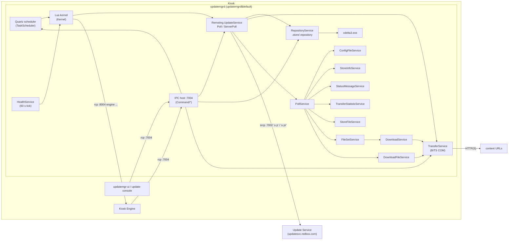

# Update Manager (updatemgrd) and the Update Service protocol

This is the legacy kiosk software-distribution system: the `updatemgrd$default` Windows service, its Lua
"kernel", the on-disk update store (`REDS/Update Manager/.store`), the wire protocol to the central Redbox
Update Service, and the tools around it (`update-console`, `updatemgr-ui`, `installer-front-end`).

It supersedes the format description in [`../update-store.md`](../update-store.md), which still has useful
per-package counts. **One correction to that file:** content files are *not* named
`<fromSHA1>-<toSHA1>.patch`. They are named `<revisionHash>-<SHA1(target path)>.patch` (see
[Patch file naming](#patch-file-naming)).

Related docs: [`update-client.md`](update-client.md) (the newer .NET Core UpdateClientService),
[`common-libraries.md`](common-libraries.md) (Redbox.IPC.Framework, Redbox.Core JSON, Redbox.Compression,
Lua), [`kiosk-engine.md`](kiosk-engine.md) (the engine that updatemgrd starts, stops and configures).

---

## 1. Overview

`updatemgrd` runs on every kiosk as a LocalSystem Windows service. It:

- **Polls the Update Service** (a central Redbox server, `srcp://updatesvc.redbox.com:7002` in the shipped
  configuration) over Redbox's own line-based TCP command protocol ("rcp"/"srcp" = Redbox.IPC.Framework).
- Maintains a set of **repositories** (packages such as `kop-v2-engine`, `device-service`, `dvd-data`). Each
  repository is a linear list of **revisions**; each revision lists changed files with their install path.
  File content is shipped either as a full file ("seed") or as a **VCDIFF delta** applied with `xdelta3.exe`.
- Downloads change sets through **Windows BITS**, verifies **SHA-1** hashes, **stages** new file versions in
  a `.staged_` folder next to each target file, and later **activates** them by copying over the live files
  (deferring locked files to the next reboot).
- Runs **Lua scripts** on a Quartz scheduler (`poll.lua`, `update-store-no-poll.lua`, `watchdog.lua`,
  `cleanup.lua` …). The scripts decide when to update/activate, stop/start Windows services, shut the Kiosk
  Engine down, run installers and reboot.
- Also syncs **config files** (JSON settings generations for the Kiosk Engine and Kiosk Client), **store
  files** (single data files pushed by the server), **file sets** (a newer revision/file-cache model, the
  same one later re-implemented by UpdateClientService), **download files** (BITS/script jobs), store info
  (time zone/clock), and uploads **status messages** and **transfer statistics**.
- Exposes a local command port (`rcp://localhost:7004`) used by the Kiosk Engine, `updatemgr-ui` and
  `update-console`.

State of the image: the shipped config (in `bin/.staged_/updatemgrd.exe.config`, Feb 2022) points at
`srcp://updatesvc.redbox.com:7002`; the active config (Nov 2024) was later changed to `rcp://localhost:7002`
where nothing listens, so every poll in `logs/updatemgrd.log*` fails with `J001 ... actively refused
127.0.0.1:7002`. The logs therefore contain **no captured server replies**; the protocol below is
reconstructed from the client code.

---

## 2. Deployment

### 2.1 Files in the image

| Path (`C:\Program Files\Redbox\REDS\...`) | Content |
|---|---|
| `Update Manager\bin\updatemgrd.exe` (3.0.0.43) | The service. ILMerged: Environment, Kernel, Remoting, BITS, TaskScheduler, DeltaCompression, IPC framework, Lua bindings, Command handlers. |
| `Update Manager\bin\updatemgrd.exe.config` | Settings (§8). |
| `Update Manager\bin\updatemgrd-log4net.config` | Log to `..\logs\updatemgrd.log`, rolling daily + 50 MB, 20 backups, INFO. |
| `Update Manager\bin\update-console.exe`, `updatemgr-ui.exe`, `installer-front-end.exe` | Tools (§11). |
| `Update Manager\bin\Redbox.UpdateService.Client.dll` | Wire client for the Update Service (also shipped in `Kiosk Engine\bin`). |
| `Update Manager\bin\xdelta3.exe`, `xdelta3-64.exe` | VCDIFF decoder used for patching (only `xdelta3.exe` is invoked). |
| `Update Manager\bin\bitsadmin.exe`, `lua51.dll`, `Quartz.dll`, `Common.Logging*.dll` | Support. |
| `Update Manager\bin\.staged_\` | Staged copies of the `kop-update-manager` repository files (see §5.5). |
| `Update Manager\bin\updatemgrd.InstallLog/.InstallState` | .NET installer output from `--register`. |
| `Update Manager\scripts\*.lua` (+ `.staged_\`) | Lua scripts, themselves delivered by the `kop-scripts` repository. |
| `Update Manager\.store\` | All persistent state (§7). |
| `Update Manager\installGuid.txt` | GUID returned by `installer start` (§6.6), written by `installer-steps.lua`. |
| `Update Manager\logs\` | `updatemgrd.log*`, `updatemgr-ui.log*`. |
| `Update Service\activatescripts\{rental-bundles,shared-bundles}\afteractivate.lua` (+ `.staged_`) | Activation scripts delivered as files of the bundle repositories (see §5.5). |
| `Installers\` | Third-party installers and zips used by `installer-steps.lua` (DigiCert certs, .NET, ASP.NET Core 2.2 runtime, Kaseya agents, nxlog, Ingenico drivers, KioskAdmin, kioskshell). Not used by updatemgrd itself. |

### 2.2 Windows service

From `updatemgrd/Daemon/UpdateManagerServiceInstaller.cs` and `updatemgrd.InstallLog`:

| Property | Value |
|---|---|
| Service name | `updatemgrd$default` |
| Display name | `Redbox Store Manager Service` |
| Description | `Manage updates and run scheduled tasks.` |
| Start type / account | Automatic / LocalSystem |
| Depends on | `Tcpip` |
| Extra | `OnAfterInstall` ORs `0x100` (SERVICE_INTERACTIVE_PROCESS) into the service `Type` registry value |
| Event log source | `updatemgrd$default` in *Application* |

Command line (`Daemon/Options.cs`): `--register`, `--unregister`, `--forcestart` (start after register),
`--console` (run in-process instead of under the SCM). The service also acquires a local named lock
`{C423B0E3-95B3-4191-B326-AB3EA516F825}`; `update-console` uses it to detect whether the service runs.

### 2.3 Network endpoints

| Endpoint | Direction | Purpose |
|---|---|---|
| `srcp://updatesvc.redbox.com:7002` (shipped) / `rcp://localhost:7002` (image) | out | Update Service (setting `UpdateServiceUrl`). `srcp` = TLS over TCP, `rcp` = plain TCP. Compiled default `rcp://qa-updatesvc01:7002`. |
| `rcp://localhost:7004` | in | updatemgrd command port (setting `Url`), binds 127.0.0.1, 3 worker threads. Traffic is unencrypted (log: "Traffic is non-encrypted"). |
| `rcp://localhost:8004` | out | Kiosk Engine command port (`KioskEngineUrl`), used for `engine shutdown`, `engine reset-bundle`, `engine ping`. |
| `rcp://localhost:7001` | out | HAL service; `watchdog.lua` sends `help` to check that HAL is up before starting the engine. |
| HTTP(S) URLs from the server | out (BITS) | Change-set / file-set / download-file content. |

### 2.4 Who depends on whom

- **Depends on:** the Update Service (server), BITS service, `xdelta3.exe`, the Kiosk Engine command port,
  HAL (watchdog only), Windows SCM (start/stop services), Windows Installer/RIX (HAL), the registry key
  `HKLM\SOFTWARE\Redbox\REDS\Kiosk Engine\Store` (`ID` = store number, `RunInitialSync`, `RebootTime`,
  `OutOfOrder`, `WatchDogEnabled`, `HealthServiceScriptCheck`).
- **Used by:** the Kiosk Engine (`Redbox.UpdateServices.Proxy`, `Redbox.UpdateManager.Client` — reads config
  files and calls port 7004), `updatemgr-ui`, `update-console`. It installs and updates *everything else* on
  the kiosk, including HAL, DeviceService, KioskClientService and UpdateClientService.

---

## 3. Architecture



| Project (`src/UpdateManager/…`) | Role |
|---|---|
| `updatemgrd` | Service host (`Daemon/`), domain init (`Domain/UpdateManagerService.cs`), IPC command handlers (`Command/`), file sets (`FileSets/`), file cache (`FileCache/`), generic downloader (`DownloadService/`), download files (`DownloadFile/`). |
| `Redbox.UpdateManager.Environment` | Repository store, poll-request/reply services, data store, queue, health, certificates, config/store files. |
| `Redbox.UpdateManager.Remoting` | `UpdateService` (repository download/patch pipeline, installer calls), `IPCPoll`, Kiosk Engine proxy, shell-user process launch, Windows Task Scheduler wrapper. |
| `Redbox.UpdateService.Client` | Wire client: builds every command string sent to the Update Service; credential hash. |
| `Redbox.UpdateService.Model` | Poll DTOs and payload classes shared with the server. |
| `Redbox.UpdateManager.Kernel` | Lua VM host and ~175 `kernel.*` functions. |
| `Redbox.UpdateManager.TaskScheduler` | Quartz-based scheduler persisted in `config-schedule.dat`. |
| `Redbox.UpdateManager.BITS` | COM interop for BITS (`IBackgroundCopyManager` …) and BITS group-policy bandwidth settings. |
| `Redbox.DeltaCompression` | `XDeltaHelper` (runs `xdelta3.exe`), plus an unused key/value instruction codec. |
| `Redbox.UpdateManager.ComponentModel` | Interfaces and small types (`ChangeItem`, `DeltaItem`, `ITransferJob` …). |
| `Redbox.UpdateManager.ServiceProxies` | Proxies that implement the same interfaces over port 7004 (used by UI/console). |
| `Redbox.UpdateManager.Client` | In-engine client: `ConfigurationClient` (reads config files) and an `UpdateManagerService` proxy for port 7004. |
| `TaskScheduler` | Old Windows Task Scheduler 1.0 interop library (used by `Remoting/WindowsTaskScheduler.cs`; its kernel functions are not registered). |
| `update-console`, `updatemgr-ui`, `installer-front-end` | Tools (§11). |

---

## 4. Start-up and lifecycle

`Daemon/Program.cs` → `Daemon/UpdateManagerService.cs` (`ExecuteListener`), in order:

1. Force `ServicePointManager.SecurityProtocol = Tls12`; configure log4net (on failure write
   `..\logs\errors.log` and exit).
2. Take named lock `{C423B0E3-…}`; start a worker thread.
3. Create `MacroService`, set `${RunningPath}` = bin dir. Start `StatusMessageService`, `HealthService`
   (60 s tick) and register three health items (§9.2).
4. `Domain.UpdateManagerService.Intialize(...)` (`Domain/UpdateManagerService.cs`):
   - Store number = setting `StoreNumber`, else registry `HKLM\SOFTWARE\Redbox\REDS\Kiosk Engine\Store\ID`;
     if missing the service throws ("This store does not have a store id").
   - Macros: `${StoreNumber}`, `${REDS}`=`C:\Program Files\Redbox\REDS`, `${RedboxProgramFiles}`,
     `${ProgramFiles}`, `${WorkingDirectory}`, `${engine}` (kioskengine.exe path), `${Scripts}` (script dir).
   - Initialise Kiosk Engine proxy (`rcp://localhost:8004`), Queue + DataStore (`.store\.data`), Lua kernel,
     Quartz scheduler, Windows task scheduler, BITS `TransferService`, `RepositoryService`
     (`.store\.repository`), `ConfigFileService` (`.store\.configfiles`), `StoreFileService`
     (`.store\.storefiles`), `IPCPoll` (protocol version **2**), `PollService`, `Remoting.UpdateService`.
   - Write `config-developer-mode-flag`, `config-initial-subscription-state-flag`, `config-store-number`
     into the data store.
5. `BatchCommandRunner.ExecuteStartupFiles()` (IPC framework start-up files).
6. Start the scheduler: load `config-schedule.dat`; if empty or invalid, run `scripts\default-schedule.lua`
   to create it (§5.1).
7. Start the IPC host on `Url` (port 7004).
8. Start `WorkService` (1 min timer), `DownloadFileService` (55 s, then 5 min), `DownloadService`
   (`.store\.downloads`, 35 s then 1 min), `FileCacheService` (`.store\.filecache`), `FileSetService`
   (`.store\.filesets`, 35 s then 2 min), `CertificateService` (2 min then 10 min).

Shutdown (`StopService`, also on QuerySuspend/OS shutdown): run shutdown script (see §12 – effectively never
runs), stop certificate, fileset, download, downloadfile, health and work services, stop the scheduler,
dispose repository locks, stop the IPC listener, release the named lock. Resume from suspend calls
`StartService()` again.

All Lua execution goes through one `ReaderWriterLockSlim` in `KernelService` with a **3 s** acquire timeout;
scheduled events have a second 3 s lock. Overlapping work is *skipped*, not queued (log:
`Task.ExecuteEvent - TryEnterWriteLock timeout expired prior to acquiring the lock.`).

---

## 5. How it works

### 5.1 Schedule (polling cadence)

`scripts/default-schedule.lua` (PROD) creates, with random offsets `S` = 0–59 s and `M` = 0–14 min:

| Name | Script | Quartz cron (sec min hour dom mon dow) | Meaning |
|---|---|---|---|
| `poll` | `poll.lua` | `S M/15 * * * ?` | Every 15 min: `kernel.pollupdateservice()` → download pipeline (§5.2). |
| `update-store-no-poll` | `update-store-no-poll.lua` | `S (M+7)/15 0-5 * * ?` | 00:00–05:59, 7 min after each poll: stage + activate everything pending (§5.5). |
| `update-inventory` | `update-inventory.lua` | `S (M+7)/15 6-16 * * ?` | 06:00–16:59: only `dvd-data`; imports `dvd-data-repository.lua`, which does **not** exist in the image, so it does nothing (log: "does not exists can not import"). |
| `cleanup` | `cleanup.lua` | `0 0 1 * * ?` | 01:00: delete logs older than 90 days, `kernel.repositorytrim("dvd-data")`. |
| `watchdog` | `watchdog.lua` | simple, every `00:01:08`, start offset 62 s | Reboot at `RebootTime`, (re)start Kiosk Engine (§5.7). |

`startOffset` (60 s / 62 s) delays the first fire after scheduler start. Real values in the image
(`.store\.data\config-schedule.dat`):

```json
[{"Name":"poll","ScheduleType":"Cron","Payload":"poll.lua","PayloadType":"Script","StartOffset":"00:01:00",
  "StartDate":null,"StartTime":null,"EndTime":null,"EndDate":null,"CronExpression":"48 5/15 * * * ?","RepeatInterval":null},
 {"Name":"update-store-no-poll", ... ,"CronExpression":"48 12/15 0-5 * * ?", ...},
 {"Name":"update-inventory", ... ,"CronExpression":"48 12/15 6-16 * * ?", ...},
 {"Name":"cleanup", ... ,"CronExpression":"0 0 1 * * ?", ...},
 {"Name":"watchdog","ScheduleType":"Simple","Payload":"watchdog.lua","PayloadType":"Script","StartOffset":"00:01:02", ... ,"RepeatInterval":"00:01:08"}]
```

Payload types (`ComponentModel/PayloadType.cs`): `Script` (run `${Scripts}\<payload>` in the Lua kernel),
`Shell` (start `<exe> <args>` with working directory `${RunningPath}`), `ServerPoll` (run §5.3). After each
event `KernelService.PerformShutdown()` executes any reboot/shutdown a script requested.

Independent of the schedule, the **health service** runs a ServerPoll (§5.3) whenever 17 minutes passed
without one (`UPDATE_SERVICE_SERVERPOLL`, can be disabled by
`HKLM\SOFTWARE\Redbox\REDS\Update Manager\Health Service\RunServerPoll = false`), and `watchdog.lua` when it
has not run for 5 minutes (`RunWatchdog`).

So there are **two independent server conversations**:

| Conversation | Command | Trigger | Carries |
|---|---|---|---|
| Repository poll | `u p` | `poll.lua` every 15 min, `update-console --poll/--start-download`, `client poll` | Repository heads → change sets to download via BITS. |
| Server poll | `u pr` | health item every 17 min, `client serverpoll`, `ServerPoll` payload | Config files, file sets, store files, transfer statistics, status messages, store info; replies with changes. |

### 5.2 Repository update pipeline (download → verify → unpack → record)

Implemented in `Redbox.UpdateManager.Remoting/UpdateService.cs` (`Poll` = `FinishDownloads` +
`StartDownloads`).

**FinishDownloads** — for every BITS job of the current user whose name matches `<~…~>`:

- `Transferred` or `Error` → `FinishDownload(jobId)`; `Suspended` → cancel; any other state and no
  `ChangeSet` record in the data store → cancel.
- If there are no jobs at all, `DataStore.CleanUp()` deletes every `*.dat` in `.store\.data` whose name does
  not start with `config`.

**FinishDownload(jobId)**:

1. Load the `ChangeSet` saved under `<jobId>.dat`. Missing → `M001`, complete/cancel the job.
2. Job in `Error` → enqueue a failed `TransferStatisticReport` (label `statistic`), cancel.
3. The job must have exactly one file (`D999` otherwise). `job.Complete()` (BITS renames the temp file).
4. If `ChangeSet.ContentHash` is non-empty: SHA-1 of the downloaded file (upper-case hex) must equal it,
   else `D999 "... should have hash X but it hash Y"` (the job is already completed, so the change set is
   re-requested on the next poll because the head did not move).
5. `RepositoryService.UnpackChangeSet(name, jobId, file)`:
   - If `CompressionType != None` decompress with `Redbox.Compression` (`1`=GZip, `2`=Zip, `3`=BZip2,
     `4`=LZMA).
   - If `IsArchive == false`: the payload is a single content file. It is moved to
     `.repository\____\<lastRevision>-<SHA1(path of the last item)>.patch`.
   - If `IsArchive == true`: the payload is a **tar** archive unpacked into `.repository\____\`. Its members
     must already be named `<revision>-<SHA1(TargetPath\TargetName)>.patch` (inferred from how `AddDelta`
     looks them up).
6. `AddRevisions(name, Revisions)`: append one revlog entry `{Hash, Label:null, Changes:[]}` per revision
   hash, in order.
7. If `Label` is set, set it on the last revision.
8. `AddDelta(name, items)`: for each `ChangeSetItem` append a `ChangeItem` to its revision and, unless it is
   a placeholder (`Composite`), move `____\<rev>-<SHA1(path)>.patch` into the repository directory
   (`FileNotFoundException` if missing).
9. Enqueue a successful `TransferStatisticReport` (`AverageSpeedInKPS` = bytes / seconds — the name says KPS,
   the value is bytes per second); delete `<jobId>.dat`.
10. Any exception in 6–8 → `RemoveRevisions` (roll the revlog back) and enqueue a statistic without
    `Success`.

**StartDownloads**:

1. Build `{repositoryName: headRevisionHash}` for every repository directory with a non-empty head.
2. Send `u p` (§6.4). Reply = list of `ChangeSet` (+ the `Store` record).
3. Apply the store's BITS bandwidth schedule (§5.8). If any value changed, **stop and restart the BITS
   service** (waits up to 10 min each way).
4. For each `ChangeSet` whose repository is not already in transit and is subscribed (no `.subscription`
   file): create the repository if missing (`.current`/`.active` = 40 zeros), create a BITS **download** job
   named `<~{Name}-{first 8 chars of Head}~>`, `MinimumRetryDelay` = max(60, `MinimumRetryDelay` setting),
   `NoProgressTimeout` = `Store.NoProgressTimeout`, one file `Url` → `Path.GetTempFileName()`, resume, and
   save the `ChangeSet` JSON as `<jobGuid>.dat` in the data store.

"In transit" = any BITS job whose GUID has a `ChangeSet` record (`BITS/TransferService.GetRepositoriesInTransit`).

### 5.3 Server poll (`u pr`)

`Environment/PollService.cs`. Each participant implements `IPollRequestReply`:

1. Collect requests in this order: ConfigFiles, FileSets, StoreFiles, TransferStatisticReport (drains the
   `statistic` queue), StatusMessage (drains the `StatusMessage` queue), StoreInfo.
2. Send one `u pr` command (§6.5); each reply line is a `PollReplyDTO`.
3. Dispatch: `UpdateConfigFiles`/`ConfigFileChangeSet` → ConfigFileService; `UpdateStoreInfo`/
   `StoreInfoChangeSet` → StoreInfoService; `DownloadFile` → DownloadFileService;
   `StoreFileChangeSet` → StoreFileService; `FileSetChangeSet` → FileSetService.

Queued statistics and status messages are **dequeued before the send**; a failed poll loses them.

Not wired in this build (code exists but nothing calls it): `RepositoryPollService` (would send
`PollRequestType.Repositories` with R/H/A/S/I hashes and a diff/sync-id scheme),
`WorkService.GetPollRequest/ProcessPollReply` (script work items, `WorkResult`), and
`Remoting.UpdateService.ProcessChangeSet` (would handle `RepositoryChangeSet` + `StoreScheduleInfo` replies).
So repository status reaches the server **only** through the `c:` head map of `u p`, and the kiosk never
reports its *active* (as opposed to downloaded) revision for repositories.

### 5.4 Patching a repository (UpdateTo = "stage")

`RepositoryService.UpdateToInternal` / `MoveUpInternal` (`Environment/RepositoryService.cs`). Triggered by
`kernel.repositoryupdate(name)` (= `UpdateToHead`), `repository update-to[-head]`, `update-console --update`.

Definitions: revlog entries are ordered oldest → newest; `.current` holds the **staged** revision hash,
`.active` the **activated** one. The staged copy of file `P = TargetPath\TargetName` is
`TargetPath\.staged_\TargetName`.

1. Find `target` index; find `current` index (-1 when `.current` is all zeros). `target < current` →
   `A999 "Moving to earlier version is not supported."`.
2. For every non-placeholder change in revisions `current+1 … target`, decide where the chain for that file
   starts (first occurrence wins):
   - change is a **seed** → start at that revision;
   - no staged file yet → start at revision 0;
   - else SHA-1 the staged file and find the first revision `j < target` that has a change for the same
     path with `VersionHash ==` that hash → start at `j+1`; none → `P999 "... can not be patched because a
     source version was not found in the revlog"`.
   - A placeholder change in the *target* revision throws `InvalidOperationException` ("can not be upated to
     a version that has a placeholder patch").
3. For every file, walk revisions `start … target` and for each change of that file:
   - patch file `repo\<revision.Hash>-<SHA1(P)>.patch`;
   - **seed**: copy the patch file to a temp working file (it *is* the full file);
   - **delta**: if no working file yet, copy the current staged file to a temp file; then run
     `xdelta3.exe -f -d -s "<working>" "<patch>" "<out>"` (`DeltaCompression/Binary/XDeltaHelper.cs`); any
     text on stderr = error `X999`; replace the working file with `out`;
   - after every step SHA-1 the working file; it must equal the change's `VersionHash` (`H999`).
4. On success, every working file replaces its `.staged_` file (directories created as needed); on error all
   temp files are deleted and the staged tree is untouched.
5. On error (except for repository `dvd-data`) the repository is **rebuilt**: `Reset` (delete all staged
   files from `current` onward and the repository directory), recreate the directory, then run `Poll()` so
   the next `u p` omits that repository and the server resends it from a seed. If that succeeds the error
   list is cleared. Otherwise `F999 "Unable to rebuild tree ... Manual intervention is required."`.
6. If no error, write `.current` = target.

There is no "stage only part of a revision": all files of all revisions up to `target` are rebuilt.

### 5.5 Activation and the update script

`ActivateToInternal` (`kernel.repositoryactivate` = `ActivateToHead`):

1. If `.current != target`, run §5.4 first.
2. If `.active == .current` nothing to do.
3. For each revision after `.active` (in order) and each non-placeholder change, the first time a path is
   seen: `File.Copy(<TargetPath>\.staged_\<name>, <TargetPath>\<name>, overwrite)`. If the staged file is
   missing → `U998` and the whole repository is `Reset`. If the copy fails (file locked) the staged file is
   copied to a temp file and `MoveFileEx(temp, target, MOVEFILE_DELAY_UNTIL_REBOOT|REPLACE_EXISTING)` is
   queued; the result's `should_restart` becomes true. Stop after the revision equal to `target`.
4. Write `.label` = label of the last activated revision (JSON string, possibly `null`), `.active` = target.

Staged files are **copied, not moved**, so `.staged_` folders keep the current version (this is why
`bin\.staged_\` mirrors `bin\`).

The policy lives in Lua (`scripts/update-framework.lua` + `scripts/repositories.lua`):

```
updater:init()          -- update-store.lua only: kernel.pollupdateservice() first
updater:initrepo()      -- abort if registry RunInitialSync == "true"
for each registered repository that exists:
    unfinishedchanges  = kernel.repositorygetunfinishedchanges(name)   -- revisions still in a BITS job
    pendingchanges     = kernel.repositorypendingchanges(name)         -- files after .current
    pendingactivations = kernel.repositorypendingactivations(name)     -- files after .active
    remember any pending file named beforeactivate.lua / afteractivate.lua
UPDATE:   for each repo with pending changes: kernel.repositoryupdate(name)   (stage)
ACTIVATE: for each repo where canactivate():
    if repo.shutdown_engine and engine not yet stopped:
        kernel.kioskengineshutdownblocking(15000, 2)  -- else abort the whole run
        kernel.wait(60000)
    import <dir>\.staged_\beforeactivate.lua if present (staged copy, not yet activated)
    repo:beforeactivate()                              -- per-repo hook from repositories.lua
    r = kernel.repositoryactivate(name)
    if r.should_restart or repo.reboot: reboot_flag = true
    repo:afteractivate(); import afteractivate.lua (activated copy) on success
if reboot_flag: wait 15 s, kernel.reboot()  else if engine was stopped: kernel.kioskenginestart()
```

`canactivate()` requires the repository to exist, its update to have succeeded, pending activations, and —
for repositories with `update_group > 0` — that no other repository of the same group has unfinished
changes or failed. Group 1 = `kop-v2-engine`, `kop-hal-install`, `kop-rental-bundles`, `kop-shared-bundles`,
`device-service`, `kioskclient`, `updateclient`, so engine, bundles, HAL and services activate together.

Per-repository hooks in `repositories.lua` (registered order: `kop-tools`, `kop-scripts`, `shell` (absent),
`kop-update-manager`, `dvd-data`, `kop-ms-hal-tester`, `kop-v2-engine`, `kop-hal-install`,
`kop-rental-bundles`, `kop-shared-bundles`, `device-service`, `kioskclient`, `updateclient`):

| Repository | shutdown_engine | Activation actions |
|---|---|---|
| `kop-update-manager`, `dvd-data`, `kop-v2-engine`, `kop-rental-bundles`, `kop-shared-bundles` | yes | — |
| `kop-ms-hal-tester` | no | before: kill `mshaltester`, wait 15 s |
| `kop-hal-install` | yes | before: kill `halmgmtc`, stop `halsvc$default`, wait 20 s; if the RIX/MSI product `{92E5D7C8-C00B-4416-9120-FE11C59C984C}` is installed back up `hal.xml` to `C:\hal.xml` and `C:\Program Files\Redbox\HAL-persistent-configuration.xml`, uninstall it and set `reboot`. After: run `halservice\bin\HAL.PackageInstaller.exe` (5 min timeout), start `halsvc$default`. |
| `device-service` | yes | before: stop `device$service` if it exists. After: run `DeviceService\bin\RBAInstaller.exe` (15 min) if present; if the service did not exist `sc create device$service ... start= delayed-auto binpath= "...\DeviceService.WebApi.exe"`; start it. |
| `kioskclient` | yes | Same pattern for `kioskclient$service` → `Kiosk Client\bin\KioskClientService.Api.exe`; also copies `m.VisualStudio.Web.CodeGeneration.EntityFrameworkCore.dll` to its full name ("too long for update service 64 char limit"). |
| `updateclient` | **no** | Same pattern for `updateclient$service` → `Update Client\bin\UpdateClientService.API.exe`. |

Example of a repository-delivered activation script, `REDS/Update Service/activatescripts/rental-bundles/afteractivate.lua`:

```lua
kernel.markscriptcomplete()
kernel.log("running afteractivate.lua from rental-bundles repo")
kernel.filedelete( "${REDS}\\Kiosk Engine\\bundles\\library-tickets.bundle" )
```

### 5.6 Rollback

There is **no rollback to an older revision**. `UpdateTo` refuses earlier targets, and `ActivateTo` to an
older revision only works between `.active` and `.current` — and even then it copies the *current* staged
files (the staged tree only holds one version per file). Recovery paths are:

- automatic rebuild on patch failure (§5.4 step 5);
- `repository repair` (`RepositoryService.Repair`): set `.current` and `.active` to zeros and re-run
  `ActivateToInternal(head)` — re-patches from the stored seeds/deltas and re-copies every file;
- `repository reset` / `reset-all`, `update-console --reset`, `kernel.repositoryreset`: delete the
  repository (and staged files, locked ones on reboot) so it is downloaded again;
- the server may publish a *new* revision whose content equals an old version (the usual way to "roll back").

`repository verify` checks: every non-placeholder seed file's SHA-1 = `VersionHash`, every non-seed file's
SHA-1 = `ContentHash`, every staged file and every active file = its latest `VersionHash`. Note that in the
image `ContentHash` of delta changes never equals the SHA-1 of the stored patch (see §13), so `verify` would
report every delta as corrupt.

`TrimRepository` (`kernel.repositorytrim`, used for `dvd-data` nightly) removes revlog entries `1 … current-1`
that contain no seed. It does **not** delete the corresponding `.patch` files (the image's `dvd-data` has 4
revlog entries but 1545 patch files).

### 5.7 Watchdog, reboots and the engine

`watchdog.lua` (every 68 s, and by the health service): exit if `OutOfOrder == "true"`; exit unless
`kioskshell` runs; if `kernel.shouldreboot()` (uptime ≥ 1 h and now within ±1 min of registry `RebootTime`)
and `RunInitialSync` is not true → shut the engine down (kill if needed) and reboot; else if
`WatchDogEnabled` and the engine is not running and HAL answers `help` on `rcp://localhost:7001` → start the
engine. The engine is started as the interactive shell user (`Remoting/ShellHelper.cs`,
`kioskengine.exe --bundle:"Rental Application,*"` when started by the proxy).

`kernel.kioskengineshutdownblocking(timeout, tries)` sends `engine shutdown` to `rcp://localhost:8004` and
waits `timeout` ms per try until the process is gone (`T999` otherwise).

Health item `UPDATE_SERVICE_SCRIPT_LOCKED` (every 60 s, disable with registry `HealthServiceScriptCheck`):
if the Lua kernel lock cannot be taken, records since when; if it stays locked for > 1 h and `shouldreboot()`
was true meanwhile, shuts the engine down and reboots.

### 5.8 BITS bandwidth policy

`BITS/BandwidthUsageSettings.cs` writes `HKLM\SOFTWARE\Policies\Microsoft\Windows\BITS`:

| Store field (`u p` reply) | Registry value |
|---|---|
| `MaxBandwidthWhileWithInSchedule` | `MaxTransferRateOnSchedule` |
| `MaxBandwidthWhileOutsideOfSchedule` | `MaxTransferRateOffSchedule` |
| `StartOfScheduleInHoursFromMidnight` | `MaxBandwidthValidFrom` |
| `EndOfScheduleInHoursFromMidnight` | `MaxBandwidthValidTo` |
| (fixed false) | `UseSystemMaximum`; `EnableBITSMaxBandwidth` |

### 5.9 Config files

`Environment/ConfigFileService.cs`. Request (`ConfigFiles`, PRT 2): when the SHA-1 of the current CCFDTO list
changed, or the server asked for it, `SId = 0` and `D` = full list; otherwise only `SId = <last sync id>`
with no data. Reply `UpdateConfigFiles` (PRT 3) → reset sync id; `ConfigFileChangeSet` (PRT 4) → `D` is a
JSON list of `ConfigFileChangeSetData`, each one is:

1. written to `.configfiles\<OID>\.config` and `archive\<GenerationOID>.config`; `.staged` (and
   `archive\<gen>.staged`) = `{"GenerationId":gen,"Created":now}`;
2. **staged** to the consumer: `<Path>\<Name>` with extension `.config` (full JSON) plus a placeholder
   `<Name>.configstaged`.

The consumer (`Redbox.UpdateManager.Client/ConfigurationClient.cs`, in the Kiosk Engine) periodically sees
the `.configstaged` file, reloads the JSON, calls `configfile activate configfileid:<OID>` on port 7004,
which writes `.active` (+ archive) and deletes the `.configstaged` file. The reply `SId` is remembered.

Real files in the image: `system.config`, `versionsneeded.config`, `marketing.config`,
`kioskhealth.config`, `kioskengine.config` (all in `Kiosk Engine\data`), `kioskclient.config`
(`C:\ProgramData\Redbox\KioskClient\Configuration`).

### 5.10 Store files, store info, certificates

- **Store files** (`StoreFileService.cs`): request `StoreFiles` (PRT 8) `D` = `"storeFile,storeFileData,syncId|…"`
  for every `.storefiles\<id>.state`. Reply `StoreFileChangeSet` (PRT 10), `D` = `StoreFileChangeSetData`:
  `Action` 1 = Update: `Base64Data` decoded, SHA-1 must equal `DataHash` (`USF03`), written to
  `<id>.staged`, state file written and the file copied to `Path` (up to 3 attempts across polls); 2 =
  Delete: delete destination, staged and state files. Examples in the image: `RapidStatus.data`,
  `InventoryAction.data` in `Kiosk Engine\data`.
- **Store info** (`StoreInfoService.cs`): request `StoreInfo` (PRT 3) with `ClientStoreInfo` when its hash
  changed (SId 0), else only the sync id. Reply `StoreInfoChangeSet` (PRT 5) can set the Windows time zone
  (`CorrectTimeZone` + `TimeZoneInfoString`) and clock (`CorrectDateTime` + `CurrentUTCDateTime`).
- **Certificates** (`CertificateService.cs`): every 10 min, any `*.staged` file in
  `C:\Program Files\Redbox\reds\Kiosk Engine\data\certs` is imported into `LocalMachine\My` (if the
  thumbprint is new) and renamed without `.staged`. (These files are delivered by other channels.)

### 5.11 File sets

A newer distribution model (`updatemgrd/FileSets/*`, `FileCache/*`, `DownloadService/*`) that is identical in
data model to UpdateClientService's file sets (same `ChangesetState` enum and `ClientFileSetRevisionChangeSet`
class). In the image four file sets are active (1 *Rebalance*, 2, 3, 4).

- Request `FileSets` (PRT 9): `D` = `"fileSetId,revisionId,state|…"` from `.filesets\<id>.active`, overridden
  by `<id>.inprogress` when present. `state`: 0 Active, 1 InProgress, 2 NeedsDependency, 3 Error.
- Reply `FileSetChangeSet` (PRT 11): `D` = `ClientFileSetRevisionChangeSet` JSON. `Action` 2 = Delete
  (remove change set and state); 1 = Update: write `changesets\<fs>-<rev>.changeSet` (a `RevisionChangeSet`
  with `State` 0 Received) and `<fs>.inprogress`.
- Every 2 min each change set advances through the state machine (`ChangeSetFile.cs`):

| State | Value | Action |
|---|---|---|
| Received | 0 | If the revision JSON is not cached, queue download key `1,<fs>,<rev>-<patchRev>` from `<DownloadUrl>/<Path>`. |
| DownloadingRevision / DownloadedRevision | 10 / 11 | On BITS completion extract the zip into the file cache (below). |
| DownloadingFileSet / DownloadedFileSet | 12 / 13 | Choose the cheapest method: whole set zip (`SetPath`, key `4,…`), patch set (`PatchSetPath`, key `5,…`), individual files (`Files[].Path`, key per file), or individual patches; download and extract. |
| Staging / Staged | 20 / 21 | Copy each `File/<fileId>-<fileRevId>.file` to `staging\<fs>\<rev>\` and check SHA-1 = `ContentHash`. |
| ActivationDependencyCheck | 30 | Each `Dependencies[]` entry must be met by the active/in-progress version of `DependsOnFileSetId` (`DependencyType` 0 Version, 1 String, 2 Long; min/max version). Otherwise the state file shows NeedsDependency. |
| ActivationPending | 31 | Wait until `ActiveOn` passed and now is within `ActivateStartTime`–`ActivateEndTime` (TimeSpans, may wrap midnight). |
| ActivationBeforeActions | 32 | Run a file whose destination name is `beforeactivate.lua`; its `Results` table may contain `Success`, `Failed`, `Message`. |
| Activating | 33 | Move each staged file to `FileDestination` (retry after 100 ms, then `MoveFileEx` on reboot + mark reboot required). |
| ActivationAfterActions | 34 | Run `afteractivate.lua`. |
| Activated | 35 | `<fs>.active` = revision, delete `.inprogress` and the change set. |
| Error | 1 | Any failure increments `RetryCount` and returns to Received; after 3 failures → Error. |

Cache layout and zip format: a downloaded zip contains pairs `X` and `X.txt`. `X.txt` is JSON; if it has a
`RevisionId` key, `X` is the revision JSON → `.filecache\<fs>\<rev>-<patchRev>.revision` and the `.txt` is
saved as `.revisioninfo`; else it has `FileId`, `FileRevisionId` → `File\<fileId>-<fileRevId>.file` +
`.fileinfo`; with `PatchFileRevisionId` it is a VCDIFF applied (`xdelta3`) to the cached
`<fileId>-<patchFileRevId>.file`. Every BITS download is checked against the expected SHA-1 (`FileHash`,
`SetFileHash`, …). If a moved file was locked, the kiosk engine is stopped and the PC rebooted after the
pass.

Real revision JSON (`.filecache\1\358260-0.revision`, trimmed):

```json
{"FileSetId":1,"FileSetName":"Rebalance","RetentionDays":5,"RetentionRevisions":0,"RevisionId":358260,
 "RevisionName":"Austin, TX","RevisionVersion":"20150717023812","PatchRevisionId":0,
 "SetPath":"1/Set/358260-0.zip","SetCompressionType":2,"SetFileHash":"AC0B5598A5311F3D3C701F2B9F6423F7E3E6E6A3","SetFileSize":3341,
 "PatchSetPath":"","PatchSetCompressionType":0,"PatchSetFileHash":"","PatchSetFileSize":0,
 "Files":[{"FileId":22,"Name":"RebalanceIn","FileDestination":"C:\\Program Files\\Redbox\\reds\\Kiosk Engine\\data\\RebalanceIn.json",
           "FileRevisionId":220007,"ContentHash":"8090501EEE875B53795E60216A9D23520A15F33E","Path":"1/File/22-220007-0.zip",
           "CompressionType":2,"FileHash":"8BA62139FFE7D2EE29B67470F66E43125B02883F","BlobId":220007,"ContentSize":3451,"FileSize":863}, ...],
 "PatchFiles":[],
 "Dependencies":[{"FileSetRevisionDependencyId":357849,"DependsOnFileSetId":2,"DependencyType":1,"MinimumVersion":"20150717023812","MaximumVersion":null}]}
```

`ContentHash` = SHA-1 of the extracted file, `FileHash` = SHA-1 of the downloaded zip, `ContentSize` /
`FileSize` likewise.

### 5.12 Download files

`updatemgrd/DownloadFile/*`. Reply `DownloadFile` (PRT 8) carries `DownloadFileChangeSetData`
(`DownloadFileType` 0 Bits, 1 WUA, 2 Script). Stored as `<guid>.downloaddat` with index `.download` in
`.store\.data`; processed every 5 min:

- **Bits**: BITS job `<:~{Name}-{Id}~:>` from `Url`; on completion SHA-1 must equal `FileKey`; file moved
  to `DestinationPath\FileName`; then (within `StartTime`–`EndTime`) the optional `ActivateScript` (Base64 of
  UTF-16LE Lua) is run; states `None → PendingDownload → Downloading → PostDownload → PendingInstall →
  Installing → PostInstall → Complete` (or `Error`).
- **Script**: only the activate script is run inside the time window.
- Progress is reported as status messages (key = `StatusKey`, description e.g. `DownloadFile transfer
  status`, data = JSON `{DownloadFileId, Name, DownloadFileType, Success, TotalBytesTransfered,
  AverageSpeedInKPS, DownloadFileState}`).

---

## 6. Protocols and interfaces

### 6.1 Transport (Redbox.IPC.Framework)

Full details in [`common-libraries.md`](common-libraries.md); what matters here
(`src/Common/Redbox.IPC.Framework/ClientSession.cs`, `ClientCommand.cs`, `ServerSession.cs`, `IPCProtocol.cs`):

- URL schemes: `rcp://host:port` = plain TCP, `srcp://host:port` = TLS over TCP (certificate validation can
  be disabled by `HKLM\SOFTWARE\Redbox\ValidateCallback = false`), `rcp-p`/`srcp-p` named pipes.
- ASCII, line-based, lines end with CRLF. On connect the server sends
  `Welcome! <name>, Version <v>, <copyright>`. The client writes one command line; the server answers with
  zero or more message lines terminated by a status line:
  `203 Command Success. (Execution Time:<ms>)` or `545 Command failed. … (Execution Time:<ms>)`.
- Errors are embedded as `|*[CODE] ERROR: description|details*|` (may span lines; `WARNING` instead of
  `ERROR` for warnings). Lines starting `[MSG]` are asynchronous server events.
- Command syntax: `<command> <form> key: value key: 'quoted value' …`. JSON arguments are embedded in
  single quotes after `EscapedJson()` (`\` → `\\`, `'` → `\'`). Because replies are line-based, JSON
  payloads in replies are single-line.
- Client timeout: `UpdateServiceTimeout` (default 30 s) for the daemon, 120 s for the tools; timeout yields
  `J888`, connection failure `J001`, other exceptions `J999`. A fresh session is opened per operation and
  closed with `quit`.

### 6.2 JSON conventions

Redbox.Core `ToJson()` (JavaScriptSerializer style): property names as in the C# classes, enums as integers
(except where a class stores a string), `DateTime` as an object (`Redbox.Core/DateTimeConverter.cs`), e.g.
`{"theDate":638342357081076401,"dateTimeKind":"Utc","dateString":"2023-10-30T04:08:28.1076401Z"}`
(`theDate` = .NET ticks). Hashes are **upper-case hex SHA-1** (`ToASCIISHA1Hash`).

### 6.3 Authentication: the `h:` credential hash

`Redbox.UpdateService.Client/UpdateServiceCredentials.cs`:

```
h = UPPERHEX( SHA1( ASCII( "<id>-<Key1>-<Key2>" ) ) )
```

`<id>` is the store number for `u p`/`u pr`, the literal `installer` for `installer start/log`. `Key1`/`Key2`
come from `usdata.active` next to `Redbox.UpdateService.Client.dll` (bytes decrypted with Redbox.Core
`Decrypt()`, then JSON `{"Key1":…,"Key2":…}`); a `usdata.staged` file replaces it on next use. If the file is
absent — as in the image — two GUID constants compiled into the DLL are used (`<redacted>`). There is no
other authentication; the store number is sent in clear.

### 6.4 `u p` — repository change-set request

Built in `UpdateService.GetChangeSet`:

```
u p n: '<storeNumber>' c: '<JSON {repositoryName: headRevisionHash}>' h:'<credentialHash>'
```

Example (store from the image, hashes real, credential hash redacted):

```
u p n: '59394' c: '{"device-service":"34AAD43076BABE2B4F7BDF892FAE1EF495F1D846","dvd-data":"6A9C40C4597B8F72CD3C2E43451FB2D3CEEF60C8","kop-update-manager":"84DCB6566626DCB496DCB77E1960CE0F43B437D7", ...}' h:'<redacted>'
```

Reply on success:

- message line 0: JSON `List<ChangeSet>` (empty list `[]` = nothing new);
- message line 1 (only when the list is non-empty): JSON `Store`;
- status line `203 Command Success. …`.

Repositories not in `c:` (not yet present or reset) get a full history from a seed (inferred from the rebuild
logic).

`ChangeSet` (`Redbox.UpdateService.Client/ChangeSet.cs`):

| Field | Type | Meaning |
|---|---|---|
| `Name` | string | Repository name. |
| `Head` | string | Newest revision hash in this change set (used in the BITS job name). |
| `Revisions` | string[] | Revision hashes, oldest → newest; appended to the revlog. |
| `Label` | string | Optional label set on the last revision (e.g. `kop-v2-engine-Calvin`). |
| `Url` | string | HTTP(S) URL of the payload, fetched by BITS. |
| `ContentHash` | string | SHA-1 of the downloaded payload (checked if non-empty). |
| `CompressionType` | int | 0 None, 1 GZip, 2 Zip, 3 BZip2, 4 LZMA (applied to the whole payload). |
| `IsArchive` | bool | true = tar of `<rev>-<SHA1(path)>.patch` files; false = a single content file. |
| `Items` | `ChangeSetItem[]` | One per changed file per revision. |

`ChangeSetItem`: `Revision` (hash it belongs to), `TargetName` (file name), `TargetPath` (directory),
`VersionHash` (SHA-1 of the resulting file), `ContentHash` (see §13), `IsFirst` (→ `IsSeed`: content is the
full file), `Composite` (→ placeholder: no content shipped, file only listed).

`Store`: `ID`, `Number`, `Group` (`Identifier {ID, Reference}`), `MaxBandwidthWhileOutsideOfSchedule`,
`MaxBandwidthWhileWithInSchedule` (uint), `StartOfScheduleInHoursFromMidnight`,
`EndOfScheduleInHoursFromMidnight` (byte), `AllowedBandwidthInMB` (int), `NoProgressTimeout` (uint seconds,
BITS), `LastCheckIn` (DateTime), `Enabled`, `Repositories`, `Tags` (`Identifier[]`), `Node` (`Identifier`).

### 6.5 `u pr` — server poll

Built in `UpdateService.Poll`:

```
u pr n:'<storeNumber>' v:'2' c:'<JSON List<PollRequestDTO>>' h:'<credentialHash>'
```

`v` is the client protocol version (constant 2, `Domain/UpdateManagerService.cs`). DTOs
(`Redbox.UpdateService.Model/PollRequestDTO.cs`, `PollReplyDTO.cs`) use short names:

```json
{"PRT": <PollRequestType|PollReplyType int>, "SId": <int sync id>, "D": "<string payload, usually JSON>"}
```

Reply: **every message line** is one `PollReplyDTO` (unparsable lines become `POLL` errors).

`PollRequestType`:

| # | Name | Sent by this build | `D` payload |
|---|---|---|---|
| 0 | None | – | – |
| 1 | Repositories | no (RepositoryPollService unused) | minimised `RepositoryDiffWrapper` (`O` hash, `A` list of `{R,I,S,A,H}`, `U`, `D`) |
| 2 | ConfigFiles | yes | SId 0: JSON `[{"Id","Name","SGId","SGD","AGId","AGD"}]` (`CCFDTO`: config file OID, name, staged/active generation id and date); else empty with SId = last reply SId |
| 3 | StoreInfo | yes | SId 0: JSON `ClientStoreInfo` `{TimeZoneInfoString, UTCDateTime, Version, Info:{"OS Version","OS VersionString","OS Platform","OS ServicePack","IP Address","DNS Suffix"}}`; else empty |
| 4 | WorkResult | no | `{StoreNumber, ScriptID, Results}` |
| 5 | StatusMessage | yes, one per queued message | JSON `StatusMessage` `{Type:1 Info/2 Error/3 Warning, Key, SubKey, Description, TimeStamp, Data, Encode}`; if `Encode` then `Data` = Base64(UTF-16LE text) |
| 6 | TransferStatisticReport | yes, one per queued report | `{End, AverageSpeedInKPS, ChangeSet (head hash), Repository, StoreNumber, TotalBytesTransfered, Success}` |
| 7 | GiveMeRepositoryChangesets | no | – |
| 8 | StoreFiles | yes, if any state file | `"storeFileId,storeFileDataId,syncId|…"` |
| 9 | FileSets | yes, if any state file | `"fileSetId,revisionId,state|…"` |

`PollReplyType`:

| # | Name | Handled by | `D` payload |
|---|---|---|---|
| 1 | UpdateRepositories | (RepositoryPollService, unused) | – |
| 2 | RepositoryChangeSet | unused | – |
| 3 | UpdateConfigFiles | ConfigFileService | none: forget sync id, send full list next time |
| 4 | ConfigFileChangeSet | ConfigFileService | JSON `List<ConfigFileChangeSetData>`; reply `SId` becomes the new sync id |
| 5 | StoreInfoChangeSet | StoreInfoService | `{TimeZoneInfoString, CorrectTimeZone, CurrentUTCDateTime, CorrectDateTime}` |
| 6 | UpdateStoreInfo | StoreInfoService | none: resend full store info |
| 7 | Work | (WorkService, unused) | `{ID, Command}` (Command = Base64 UTF-16LE Lua) |
| 8 | DownloadFile | DownloadFileService | `DownloadFileChangeSetData` `{Id, Name, DownloadFileType, StatusKey, FileName, DestinationPath, FileKey, ActivateScript, StartTime, EndTime, Url}` |
| 9 | StoreScheduleInfo | unused | `{EndOfScheduleInHoursFromMidnight, StartOfScheduleInHoursFromMidnight, MaxBandwidthWhileOutsideOfSchedule, MaxBandwidthWhileWithInSchedule, NoProgressTimeout}` |
| 10 | StoreFileChangeSet | StoreFileService | `{StoreFile, Name, Path, StoreFileData, SyncId, SyncHash, DataHash, Base64Data, ModifiedOn, Action:1 Update/2 Delete}` |
| 11 | FileSetChangeSet | FileSetService | `ClientFileSetRevisionChangeSet` `{FileSetId, RevisionId, Path, CompressionType, ContentHash, FileHash, ContentSize, FileSize, PatchRevisionId, DownloadOn, DownloadPriority (0 Low…3 Foreground), ActiveOn, ActivateStartTime, ActivateEndTime, DownloadUrl, Action}` |

`ConfigFileChangeSetData` = `{OID, Name, Path, GenerationOID, ConfigurationData:[{CategoryID, CategoryName,
SettingName, SettingDataType, DefaultTypeName, DefaultTypeRank, DefaultTypeDataType, DefaultTypeKey,
DefaultTypeValue, Value, EffectiveTime, ExpireTime}]}`. Example (from `.configfiles\1\.config`):

```json
{"OID":1,"Name":"system.config","Path":"C:\\Program Files\\redbox\\reds\\Kiosk Engine\\data","GenerationOID":1171,
 "ConfigurationData":[{"CategoryID":1,"CategoryName":"General","SettingName":"DefaultBundle","SettingDataType":"string",
   "DefaultTypeName":"all","DefaultTypeRank":0,"DefaultTypeDataType":0,"DefaultTypeKey":0,"DefaultTypeValue":"*",
   "Value":"Rental Application,*","EffectiveTime":{"theDate":634609728000000000,"dateTimeKind":"Unspecified","dateString":"2012-01-01T00:00:00.0000000"},
   "ExpireTime":null}, ...]}
```

`DefaultTypeName`/`DefaultTypeValue` describe the scope a value applies to (`all`/`*`, `market`/`Austin, TX`,
…); the kiosk receives every scoped value and the consumer picks (see `kiosk-engine.md`).

Illustrative `u pr` exchange (shape from code; values invented where marked):

```
> u pr n:'59394' v:'2' c:'[{"PRT":2,"SId":0,"D":"[{\"Id\":1,\"Name\":\"system.config\",\"SGId\":1171,...}]"},{"PRT":9,"SId":0,"D":"1,358260,0|2,358617,0|3,786916,0|4,786713,0"},{"PRT":8,"SId":0,"D":"2,7425866,2411|3,7798489,2095"},{"PRT":3,"SId":0,"D":"{\"TimeZoneInfoString\":...}"}]' h:'<redacted>'
< {"PRT":4,"SId":<n>,"D":"[{\"OID\":4,\"Name\":\"marketing.config\",...}]"}
< {"PRT":5,"SId":<n>,"D":"{\"CorrectTimeZone\":false,...}"}
< 203 Command Success. (Execution Time:<ms>)
```

### 6.6 Other Update Service commands used by the kiosk

| Command (exact format) | Used by | Reply |
|---|---|---|
| `installer start hash: '<dvd-data head hash>' version: '<front-end version>' h: '<hash("installer")>'` | `kernel.startinstaller` (installer-steps.lua) | message 0 = JSON object of strings; script requires `DataFileExpiration`, `InstallerExpiration` (days), `CurrentDateTime`, `URL`, `HostEntries` (`\|`-separated hosts lines), `guid`, optional `ErrorMessage`. Retried 3×. |
| `installer log guid:'<guid>' name:'<name>' value:'<value>' h: '<value>'` | `kernel.finishinstaller` (name `FinishInstallerData`, value = JSON `{serial, manufacturer, hostsFile, action, kiosk}`, dropped if > 252 chars) | success only. Bug: the format string puts the *value* in `h:`, not the hash. |
| `subscription status name: '<repo>'` | `client get-dvd-data-state` | `SubscriptionStatus {ModifiedOn, State: 0 Processing, 1 Idle}` |
| `subscription publish name: '<repo>'` | `client force-data-files`, only if `HKLM\SOFTWARE\Redbox\REDS\Update Manager\AllowForceDataFiles = true` | – |
| `repository link-to-store / remove-link-to-store name: <repo> number: <store> modifiedby: '…' system: '…'` and `… link-to-group / remove-link-to-group … groupName: …` | `kernel.updateaddstoretorepository` etc. (`modifiedby: 'UpdateService.Kernel'`, `system: 'Update Service'`) | `Store` / `StoreGroup` JSON |

`Redbox.UpdateService.Client/UpdateService.cs` also contains the administrative API used by Redbox's own
tools (not by the kiosk): `<type> list|get id:` for `repository`, `store`, `store-group`, `file`, `revlog`,
`update-script`, `patch`, `label`, `transfer-statistic`, `release`; `repository create|commit` (commit
uploads file data with `data-upload begin-upload` / `data-upload append id: data: '<base64 gzip, 10 MB
chunks>'`), `file get-data|hash|delete`, `store create|enable|delete|update|last-check-in|add-to-release`,
`STORE-GROUP create|update|delete|list`, `update-script create|update` (Base64 UTF-16LE text),
`SUBSCRIPTION create`, `FILE-GENERATOR create`, `setting set`, `configdefault create|update`,
`downloadfile set-file|upload-file|set-script` (1 MB chunks), `storecache list`, `STATUSMESSAGE list`,
`work-result download`, `INTERSERVER ping|quickpost|batchpost`. These reveal the server's data model
(repositories linked to stores and store groups, releases of labels, subscriptions generating `dvd-data`).

### 6.7 updatemgrd command port (`rcp://localhost:7004`)

Handlers in `updatemgrd/Command/*.cs`. Values in `'…'` are strings; replies are JSON lines.

| Command | Parameters | Effect / reply |
|---|---|---|
| `client poll` | – | `Poll()` (§5.2) |
| `client serverpoll` | – | `ServerPoll()` (§5.3) |
| `client execute-script` | `script:`, `reset:` | Run Lua text; reply = JSON of global table `Results` |
| `client execute-scriptfile` | `file:`, `reset:` | Same with a file path (macros expanded) |
| `client force-data-files` | – | `subscription publish name: 'dvd-data'` (if allowed) |
| `client get-dvd-data-state` | – | two lines: last run DateTime, state |
| `client list-current-downloads` | – | JSON list of BITS jobs |
| `client send-status-message` | `type:` info/warning/error, `key:`, `description:`, `data:` | Enqueue a status message (encoded) |
| `configfile activate` | `configfileid:` | Mark staged config generation active (§5.9) |
| `data get/set/delete/reset/cleanup` | `id:`, `o:`, `extension:` | Raw access to `.store\.data` |
| `queue enqueue/dequeue/peek` | `label:`, `entry:` | Raw access to `.store\.data\.queue` |
| `repository …` | `name:`, `hash:`, `revision:`, `label:`, `revisions:` (JSON), `file:`, `id:`, `archive:`, `isSeed:`, `isPlaceHolder:`, `contentHash:`, `versionHash:` | Forms: `list-repositories`, `contains-repository`, `add-repository`, `add-revisions`, `remove-revisions`, `add-delta`, `unpack-change-set`, `get-head-hash`, `get-active-revision`, `get-staged-revision`, `get-active-label`, `get-label`, `set-label`, `list-unfinished-changes`, `list-pending-changes`, `list-pending-activations`, `list-all-changes`, `list-applied-changes`, `list-activated-changes`, `update-to`, `update-to-head`, `activate-to`, `activate-to-head` (reply: deferred-move bool), `rebuild-to`, `rebuild-to-head`, `verify`, `repair`, `reset`, `reset-all`, `trim-repository`, `subscribed`, `enable-subscription`, `disable-subscription`, `format-stage-file-name` |
| `transfer …` | `id:`, `name:`, `url:`, `file:`, `priority:`, `timeout:`, `seconds:`, `allusers:` | BITS: `list`, `get-job`, `create-download`, `create-upload`, `add-item`, `resume`, `suspend`, `cancel`, `complete`, `cancel-all`, `set-priority`, `take-ownership`, `set-no-progress-timeout`, `set-minimum-retry-delay`, `get-errors`, `get-items`, `are-jobs-running`, `repositories-in-transit` |
| `schedule-event …` | `name:`, `payload:`, `payloadType:` script/shell/serverpoll, `startOffset:` (s), `startTime:`, `endTime:`, `cronExpression:` xor `repeatInterval:` | `list`, `create`, `delete`, `clear`, `start`, `stop`, `restart`, `isRunning`, `force` |
| `engine …` | `path:`, `bundle:` | `export-queue`, `export-sessions`, `load-bundle`, `show-offline-screen`, `reset-bundle`, `bring-to-front`, `shutdown`, `start [bundle:]`, `execute-script` (forwarded to the Kiosk Engine) |

Clients: the Kiosk Engine (`KioskServices/Redbox.UpdateServices.Proxy/UpdateManagerServiceProxy.cs`, URL from
machine setting `Remote Services\Store Services\UpdateManagerServiceURL`, default `rcp://localhost:7004`;
uses `client get-dvd-data-state`, `client force-data-files`, `client list-current-downloads`,
`schedule-event force`, `data get id: 'config-…'`, `configfile activate`), `updatemgr-ui` and `update-console`
(through `Redbox.UpdateManager.ServiceProxies`). The proxies also send `client dowork`, which has no handler
in this build (fails).

### 6.8 Lua kernel API (selection)

Registered from `[KernelFunction]` methods in `Redbox.UpdateManager.Kernel/*Functions.cs` into table
`kernel`. Update-related ones:

| Function | Implementation |
|---|---|
| `pollupdateservice()` | `Poll()`; returns `{success, errors={code=desc}}` |
| `serverpoll()`, `startupdate()`, `finishupdate(jobId)`, `finishallupdates()` | §5.2/5.3 parts |
| `repositorylist()`, `repositorygetheadrevision(n)`, `repositoryisactivated(n)` | queries |
| `repositorypendingchanges(n)` / `repositorypendingactivations(n)` / `repositorygetunfinishedchanges(n)` | list of full target paths in revisions after `.current` / after `.active` / in running BITS jobs |
| `repositoryupdate(n)`, `repositoryupdateto(n,h)` | stage (§5.4) |
| `repositoryactivate(n)`, `repositoryactivateto(n,h)` | activate (§5.5); result has `should_restart` |
| `repositoryverify`, `repositoryrepair`, `repositoryreset`, `repositorytrim` | §5.6 |
| `startinstaller(hash, version)`, `finishinstaller(guid, table)`, `sendstatusmessage(type,key,subKey,desc,data,encode)`, `sendscreenshot(scale)` | §6.6 / status messages |
| `schedulecronscript(name, script, startOffsetSec, cron)`, `schedulesimplescript(name, script, startOffsetSec, "hh:mm:ss")`, `eraseschedule[nodefault]`, `scheduleeventlist/delete`, `scheduler{start,stop,restart}` | scheduler |
| `kioskengineshutdownblocking(ms, tries)`, `kioskenginestart[withbundle]`, `kioskengineisrunning()` | engine control |
| `stopservice/startservice/serviceexists/getservicestatus/setservicestarttype/installservice/uninstallservice` | SCM |
| `rixisproductinstalled/rixuninstallproduct/rixinstall` | MSI |
| `reboot()`, `shutdown()`, `shouldreboot()`, `wait(ms)`, `markscriptcomplete()`, `import_script(path)`, `log(text)`, `movelockedfile`, `deletelockedfile`, `markrebootrequired()` | system |
| `resettransfers()`, `transferarejobsrunning()`, `checkconnectivity(url, sec)` | BITS / network |

Plus file system, registry, process, zip/tar, version, time-zone, COM registration and UI-notification
(`notify*`, `input*`, only meaningful in installer-front-end) functions — about 175 in total.
`markscriptcomplete()` sets `ScriptCompleted`, which the installer front-end and work items use as "done".

---

## 7. Data and storage (`REDS\Update Manager\.store`)

```
.store/
  .repository/                  RepositoryService
    ____/                       staging area for unpacked change sets (empty when idle)
    data.zip                    installer seed snapshot of all repositories (441 MB in the image)
    <repository>/
      .current                  JSON string: staged revision hash (40 zeros = none)
      .active                   JSON string: activated revision hash
      .label                    JSON string: label of the active revision (may be null)
      .subscription             optional; presence = subscription disabled ("0")
      .revlog/0, 1, 2, ...      one RevLog JSON per revision, oldest first (PersistentList)
      <revHash>-<SHA1(path)>.patch   content files
  .data/                        DataStoreService: "<id>.dat" or "<id>" when id has an extension
    config-schedule.dat         scheduler (§5.1)
    config-store-number.dat     "59394"
    config-developer-mode-flag.dat, config-initial-subscription-state-flag.dat   false / true
    <bitsJobGuid>.dat           ChangeSet of a running repository download
    <guid>.dldat + .dl          DownloadService records + index (file sets)
    <guid>.downloaddat + .download   DownloadFile records + index
    <guid>.workdat + .incomplete     work items (unused path)
    .queue/0, 1, ...            QueueService: {"Label":..., "Entry":"<json>"} — labels StatusMessage, statistic, upload-report, script
  .configfiles/<OID>/.config, .staged, .active, archive/<gen>.config|.staged|.active
  .storefiles/<id>.state, <id>.staged
  .filesets/<fs>.active, <fs>.inprogress, changesets/<fs>-<rev>.changeSet, staging/<fs>/<rev>/<fileId>-<fileRevId>.file
  .filecache/<fs>/<rev>-<patchRev>.revision|.revisioninfo, <fs>/File/<fileId>-<fileRevId>.file|.fileinfo
  .downloads/                   DownloadService root (created; not otherwise used in the code read)
```

`PersistentList<T>` (`Environment/PersistentList.cs`): a directory whose files are named `0…n-1`, one JSON
item each; removals delete files and renumber ("pack"); an unreadable item truncates the list from there.
A legacy single-file list (a file instead of a directory) is converted on first open.

### 7.1 RevLog entry

`Environment/RevLog.cs`, `ComponentModel/ChangeItem.cs`. Real example
(`.repository\kop-update-manager\.revlog\0`, trimmed):

```json
{"Hash":"E37000CF91A3ADE989F248DB2730615B536C6CFE","Label":null,"Changes":[
 {"VersionHash":"E3381ED4B57376C29E4648B72EFA39B6658825F4","ContentHash":"E3381ED4B57376C29E4648B72EFA39B6658825F4",
  "TargetName":"bitsadmin.exe","TargetPath":"C:\\Program Files\\redbox\\REDS\\Update Manager\\bin","IsSeed":true,"Composite":false},
 {"VersionHash":"F5B84F8FDDB0D4D52BBF98757E30C9445F5A8D34","ContentHash":"F5B84F8FDDB0D4D52BBF98757E30C9445F5A8D34",
  "TargetName":"updatemgrd.exe","TargetPath":"C:\\Program Files\\redbox\\REDS\\Update Manager\\bin","IsSeed":true,"Composite":true}, ...]}
```

and a delta revision (`kop-v2-engine\.revlog\363`):

```json
{"Hash":"654EECD2239C9616B300B810995F83E12D3FA7E4","Label":"kop-v2-engine-Calvin","Changes":[
 {"VersionHash":"0BDC6A2BF08ECEF01067E9972272347E3E5BF6D3","ContentHash":"091472E4301C7A3FE7EBB55C9E00DD942814D4F5",
  "TargetName":"kioskengine.exe","TargetPath":"C:\\Program Files\\Redbox\\REDS\\Kiosk Engine\\bin","IsSeed":false,"Composite":false}, ...]}
```

| Field | Meaning |
|---|---|
| `Hash` | Revision id (40 hex). Server-assigned; not a hash of anything the kiosk can recompute. |
| `Label` | Release label (only on some revisions). |
| `VersionHash` | SHA-1 of the file *after* this revision. |
| `ContentHash` | Seeds: equals `VersionHash`. Deltas: not the SHA-1 of the stored patch (§13). |
| `IsSeed` | Content file is the complete file. |
| `Composite` | Placeholder: file is listed but no content file exists; it cannot be the target revision. |
| `TargetPath` + `TargetName` | Absolute install path, exact case. |

Survey of all repositories in the image (made by hashing every content file): 12,219 placeholder
changes; 458 seeds, all raw files whose SHA-1 equals `VersionHash`; 1,278 deltas, all VCDIFF (magic
`D6 C3 C4 00`); no missing content files.

### 7.2 Patch file naming

```
<RevLog.Hash>-<UPPERHEX(SHA1(ASCII(TargetPath + "\" + TargetName)))>.patch
```

(`RevLog.HashFileName`, `Path.Combine(TargetPath, TargetName)`). Verified in the image:
`SHA1("C:\Program Files\redbox\REDS\Update Manager\bin\bitsadmin.exe") = E0609285…` and
`kop-update-manager\E37000CF…-E0609285AD1C8DD8BFBD1586D4BAFA73D46BB01D.patch` exists. The path string is
hashed byte-for-byte, so case matters (`redbox` vs `Redbox` give different names).

To reconstruct a file version offline: take its first seed at or before the wanted revision, then apply each
later delta for the same path with `xdelta3 -d -s <prev> <patch> <out>`, checking SHA-1 against
`VersionHash` at each step.

### 7.3 Delta algorithm

`Redbox.DeltaCompression/Binary/XDeltaHelper.cs` shells out to `xdelta3.exe` (from the process's working
directory / PATH):

- apply: `xdelta3.exe -f -d -s "<source>" "<patch>" "<target>"`
- create: `xdelta3.exe -f -e -s "<source>" "<target>" "<patch>"` (not used by the kiosk)

So the format is standard **VCDIFF (RFC 3284) as produced by xdelta3**; any non-empty stderr is treated as
failure. `Redbox.UpdateService.DeltaCompression.Instruction.Encoder/Decoder` is an unrelated key/value
"table delta" codec (Insert/Update/Delete/CacheUpdateInsert/CacheDelete records with length-prefixed ASCII
strings) that nothing in the kiosk uses.

### 7.4 data.zip and the installer seed

`.repository\data.zip` contains `<repository>/.active`, `.current`, `.revlog/<n>` and `.patch` files for all
12 repositories as of Feb 2022 (1,848 entries). `installer-steps.lua` ("Activate Image") expects these to be
present already and calls `repositoryupdate` + `repositoryactivate` for every repository; extracting the zip
is presumably done by the outer installer that launches `installer-front-end` (not in this repository —
inferred).

---

## 8. Configuration

### 8.1 `updatemgrd.exe.config` (`Redbox.UpdateManager.Daemon.Properties.Settings`)

| Key | Image value | Compiled default | Meaning |
|---|---|---|---|
| `Url` | `rcp://localhost:7004` | same | Command port. |
| `MaximumWorkerThreads` | 3 | 3 | IPC worker threads. |
| `ScriptLocation` | (config has misspelled `ScriptLocaion` → ignored) | `..\scripts` | `${Scripts}`. |
| `KioskEnginePath` | `${REDS}\Kiosk Engine\bin\kioskengine.exe` | same | `${engine}`. |
| `UpdateServiceUrl` | `rcp://localhost:7002` (shipped: `srcp://updatesvc.redbox.com:7002`) | `rcp://qa-updatesvc01:7002` | Update Service. |
| `DeveloperMode` | False | False | Stored in `config-developer-mode-flag`; read by the engine. |
| `InitialSubscriptionState` | True | True | Stored in `config-initial-subscription-state-flag`. |
| `StoreNumber` | empty | empty | Empty = registry `…\Kiosk Engine\Store\ID`. |
| `TrimWorkingSetInterval` | 120103 | 3503 | Passed to init, not used further in the code read. |
| `UpdateServiceTimeout` | – | 00:00:30 | Command timeout. |
| `MinimumRetryDelay` | – | 60 | BITS minimum retry delay (s), floor 60. |
| `ShutdownScriptPath` | – | `${Scripts}\shutdown.lua` | See §12. |
| `KioskEngineUrl` | – | `rcp://localhost:8004` | Engine command port. |
| `WcfUpdateServiceUrl` | – | `http://bundle-dev-02:8002` | Accepted but unused. |
| `SliceInterval` | 5000 | – | Not a setting of this build (ignored). |

Other tools: `update-console.exe.config` (`DataStoreRoot ..\.store\.data`, `ManifestRoot ..\.store\.repository`,
`UpdateServiceUrl`, `KioskEnginePath`; defaults also `UpdateManagerUrl rcp://localhost:7004`,
`MinimumRetryDelay 60`), `updatemgr-ui.exe.config` (`UpdateManagerUrl rcp://localhost:7004`,
`UpdateServiceUrl rcp://updatesvc.redbox.com:7002`), `installer-front-end.exe.config`
(`UpdateServiceUrl rcp://localhost:3019` in the image, compiled default `rcp://devtools01:7002`,
`ManifestRoot`, `DataStoreRoot`).

### 8.2 Registry

| Key | Value | Used for |
|---|---|---|
| `HKLM\SOFTWARE\Redbox\REDS\Kiosk Engine\Store` | `ID` | Store number. |
| same | `RunInitialSync` | `"true"` blocks update scripts, watchdog reboot and health reboot. |
| same | `RebootTime` | Daily reboot time for `shouldreboot()`. |
| same | `OutOfOrder`, `WatchDogEnabled`, `HealthServiceScriptCheck` | watchdog / health. |
| `HKLM\SOFTWARE\Redbox\REDS\Update Manager\Health Service` | `RunServerPoll`, `RunWatchdog` | Disable health items. |
| `HKLM\SOFTWARE\Redbox\REDS\Update Manager` | `AllowForceDataFiles` | Allow `subscription publish`. |
| `HKLM\SOFTWARE\Redbox` | `ValidateCallback` | TLS certificate validation for `srcp`. |
| `HKLM\SOFTWARE\Policies\Microsoft\Windows\BITS` | see §5.8 | Bandwidth. |

---

## 9. Error handling, logging and recovery

### 9.1 Errors and logs

Every operation returns an `ErrorList` of `{Code, Description, Details, IsWarning}`; codes are informal
strings (`J001` connect, `J888` timeout, `D999` download/hash, `P999` no patch source, `H999` version hash
mismatch, `X999` xdelta, `U998`/`U999` activation, `A999` update target, `F999` rebuild failed, `M001`
missing job record, `CFS*` config files, `SFS*`/`USF*` store files, `RPS*`, `FS*`, `DFS*` …). Errors are
written to `logs\updatemgrd.log` (format `date|thread|level|message`) and returned to Lua as
`{success=false, errors={[code]=description}}`. Lua runtime messages appear as `Lua Runtime|<text>`.
Start/stop also go to the Windows event log.

### 9.2 Health service

Checks every 60 s; a registered item whose `Update` was not called within its interval runs its rescue
action:

| Key | Interval | Rescue |
|---|---|---|
| `UPDATE_SERVICE_SCRIPT_LOCKED` | 60 s | Lua lock check / reboot after 1 h stuck (§5.7) |
| `UPDATE_SERVICE_SERVERPOLL` | 17 min | ServerPoll |
| `UPDATE_SERVICE_WATCHDOG` | 5 min | run `watchdog.lua` (updated whenever the scheduled watchdog runs) |
| `FILESETSERVICE.CLEANUP`, `FILESETSERVICE.FILESETCLEANUP` | 12 h | delete stale change-set files; enforce file-set retention |

### 9.3 Recovery behaviour

- BITS retries transient errors itself (minimum retry delay 60 s); jobs in `Error` are cancelled and the
  change set is requested again on the next `u p` (head unchanged).
- Repository patch failures trigger a reset + redownload (§5.4).
- Locked files are replaced at reboot (`MoveFileEx`), and the update script reboots.
- File-set and download-file steps retry 3 (file sets) / 10 (BITS job creation) times before `Error`.
- Corrupt data-store / persistent-list JSON is deleted on read.

---

## 10. Relation to UpdateClientService

- updatemgrd **installs** UpdateClientService: it is the `updateclient` repository, and its
  `afteractivate` hook creates `updateclient$service` (`Update Client\bin\UpdateClientService.API.exe`,
  delayed-auto) and starts it. Likewise for KioskClientService and DeviceService.
- UpdateClientService re-implements the **file-set** half of this system (identical `ChangesetState` values,
  `ClientFileSetRevisionChangeSet`, `FileSetRevisionChangeSet`, file cache naming) but stores it in
  `C:\ProgramData\Redbox\UpdateClient\.store\.filesets` / `.filecache`
  (`src/UpdateClient/UpdateClientService.API/Services/FileSets/Constants.cs`), separate from updatemgrd's
  `.store`.
- No code path in UpdateClientService talks to port 7004 or reads `REDS\Update Manager\.store`; it only
  collects `REDS\Update Manager\logs` (`Services/IoT/Commands/KioskFiles/FilePaths.cs`). The two run side by
  side; UpdateClientService is the successor (inferred from the shared model and from the image, where the
  legacy Update Service URL was disabled). See [`update-client.md`](update-client.md).

---

## 11. Tools

### 11.1 update-console (`src/UpdateManager/update-console`)

Command-line tool (one instance, lock `{4C9D4DA5-8E6C-40a0-867C-65E462A71ADB}`). Needs `--store-number:N`
or `--kaseya-id:[redbox-]<id>.<group>` (store number = text before the dot without `redbox-`), except for
resets. If updatemgrd is running it uses the port-7004 proxies, otherwise it opens the store directly.

| Option | Action |
|---|---|
| `-p/--poll` | FinishDownloads + StartDownloads |
| `--start-download` | StartDownloads |
| `-u/--update [-t tree] [--hash h]` | UpdateTo (stage) one or all repositories |
| `-a/--activate [-t tree] [--hash h]` | ActivateTo one or all |
| `-d/--diff`, `-l/--list`, `--list-all`, `--print-unfinished-changes` | Print JSON |
| `--dump active\|current\|label\|revlog --repository-name n` | Print repository files |
| `-r/--reset`, `--reset-bits`, `--reset-repository` | Reset store / cancel BITS / delete repositories |
| `--eval <script.lua>` | Run a Lua script in the kernel |
| `--update-service-url` | Override URL |

Reboots/shuts down at exit if a script requested it.

### 11.2 updatemgr-ui (`src/UpdateManager/updatemgr-ui`)

WinForms admin UI over port 7004: repositories (active/staged versions, labels, revisions, Update To /
Activate To / Rebuild To / Reset / Trim / toggle subscription, change details), BITS transfers (list, reset),
"Poll" / "Server Poll", and schedule events (list, create script/shell/serverpoll event, delete, force,
start/stop/restart).

### 11.3 installer-front-end (`src/UpdateManager/installer-front-end`)

`installer-front-end.exe --eval:<script> -n <storeNumber>`: a WinForms "Store Installer" window that runs a
Lua script on a background thread with its own kernel, repository service (`..\.store\.repository`), data
store, BITS service and an Update Service client (`UpdateServiceUrl`, 120 s timeout). It implements the
`kernel.notify*` (event list with start/complete/error), `kernel.notifyinfo`, `kernel.inputyesno` and
`kernel.inputfindfile` (file dialog defaulting to `HAL.xml`) callbacks. Exit codes: 0 completed, -1 not
completed / instance exists, -2 init errors, -3 run failed.

Scripts: `post-install.lua` (Action = Install, resumable: last finished step number stored in
`C:\.post-install`) and `updater-post-install.lua` (Action = Update: runs only the first and last step). Both
import `installer-utils.lua`, `installer-heading.lua` and `installer-steps.lua`, whose ~25 steps include:
install DigiCert certificates; check .NET, stop updatemgrd, read the `dvd-data` head, call `installer start`
(§6.6), set the clock, write `installGuid.txt`, report `installer log`; stop/disable legacy services
(RentalService, WatchDog, CallbackAgent, rbdservice, …), set store `ID` to `unconfigured`; HAL backup and
uninstall; archive old folders; registry configuration of Kiosk Engine endpoints and environment (QA vs
Production), `RunInitialSync`, `HardwareServiceURL rcp://127.0.0.1:7001`; **Activate Image** (update +
activate every repository, running staged `beforeactivate.lua` / `afteractivate.lua`); install HAL, card
reader settings, lock-screen wallpaper, Redbox shell, Windows patches; **Register Update Manager**
(`updatemgrd.exe --register`); install/register DeviceService, KioskClientService and UpdateClientService;
Windows 7 migration restores (store settings, Update Manager schedule, databases, Kaseya); quote service
paths and disable sticky keys (PCI); remove Blink; reboot.

---

## 12. Source map

| Topic | Source |
|---|---|
| Service entry, start/stop, health items | `src/UpdateManager/updatemgrd/Daemon/Program.cs`, `Daemon/UpdateManagerService.cs`, `Daemon/UpdateManagerServiceInstaller.cs`, `Daemon/Properties/Settings.cs` |
| Domain initialisation, macros, store number | `src/UpdateManager/updatemgrd/Domain/UpdateManagerService.cs` |
| Port-7004 commands | `src/UpdateManager/updatemgrd/Command/*.cs` |
| Repository download pipeline, installer calls, scripts | `src/UpdateManager/Redbox.UpdateManager.Remoting/UpdateService.cs` |
| `u pr` poll wrapper | `src/UpdateManager/Redbox.UpdateManager.Remoting/IPCPoll.cs`, `src/UpdateManager/Redbox.UpdateManager.Environment/PollService.cs` |
| Wire command strings, credential hash | `src/UpdateManager/Redbox.UpdateService.Client/UpdateService.cs`, `UpdateServiceCredentials.cs`, `ChangeSet.cs`, `ChangeSetItem.cs`, `Store.cs` |
| Poll DTOs and payloads | `src/UpdateManager/Redbox.UpdateService.Model/*.cs` |
| Repository store, patching, activation, verify/repair/trim | `src/UpdateManager/Redbox.UpdateManager.Environment/RepositoryService.cs`, `RevLog.cs`, `PersistentList.cs` |
| xdelta3 invocation | `src/UpdateManager/Redbox.DeltaCompression/Binary/XDeltaHelper.cs` |
| Config files / store files / store info / status / statistics | `src/UpdateManager/Redbox.UpdateManager.Environment/ConfigFileService.cs`, `StoreFileService.cs`, `StoreInfoService.cs`, `StatusMessageService.cs`, `TransferStatisticService.cs` |
| Data store and queue | `src/UpdateManager/Redbox.UpdateManager.Environment/DataStoreService.cs`, `QueueService.cs` |
| Health, certificates, work (unused) | `src/UpdateManager/Redbox.UpdateManager.Environment/HealthService.cs`, `CertificateService.cs`, `WorkService.cs`, `RepositoryPollService.cs` |
| File sets and file cache | `src/UpdateManager/updatemgrd/FileSets/*.cs`, `updatemgrd/FileCache/FileCacheService.cs`, `updatemgrd/DownloadService/*.cs` |
| Download files | `src/UpdateManager/updatemgrd/DownloadFile/*.cs` |
| BITS COM wrapper and bandwidth policy | `src/UpdateManager/Redbox.UpdateManager.BITS/TransferService.cs`, `TransferJob.cs`, `BandwidthUsageSettings.cs` |
| Scheduler | `src/UpdateManager/Redbox.UpdateManager.TaskScheduler/Scheduler.cs`, `Task.cs` |
| Lua kernel and functions | `src/UpdateManager/Redbox.UpdateManager.Kernel/KernelService.cs`, `*Functions.cs` |
| Kiosk Engine control | `src/UpdateManager/Redbox.UpdateManager.Remoting/KioskEngineService.cs`, `KioskEngineProxy.cs`, `ShellHelper.cs` |
| Engine-side clients | `src/UpdateManager/Redbox.UpdateManager.Client/ConfigurationClient.cs`, `UpdateManagerService.cs`; `src/KioskServices/Redbox.UpdateServices.Proxy/UpdateManagerServiceProxy.cs` |
| Tools | `src/UpdateManager/update-console/*`, `src/UpdateManager/updatemgr-ui/*`, `src/UpdateManager/installer-front-end/*`, `src/UpdateManager/Redbox.UpdateManager.ServiceProxies/*` |
| IPC transport | `src/Common/Redbox.IPC.Framework/ClientSession.cs`, `ClientCommand.cs`, `ServerSession.cs`, `IPCProtocol.cs`, `Error.cs` |
| Scripts (image) | `REDS/Update Manager/scripts/*.lua` |

---

## 13. Unknowns and doubts

- **No captured server traffic.** Every poll in the image's logs failed (URL repointed to an unused local
  port; before that `updatesvc.redbox.com` resolved to 127.0.0.1 and was refused). Reply formats are
  inferred from how the client parses them; exact server-side behaviour (e.g. that a repository missing
  from `c:` gets a full history from a seed, how many revisions one change set holds, when `IsArchive` is
  used) is inferred.
- **`ContentHash` of delta changes** is not the SHA-1 of the stored `.patch` file (checked for all 1,278
  deltas in the image) nor any file version's hash. Its meaning is unknown — possibly the hash of the patch
  as the server stored it before re-encoding. Consequently `repository verify` would flag every delta as
  corrupt. For seeds `ContentHash == VersionHash == SHA-1(file)`.
- **Revision `Hash`** values are server-generated; how they are computed is unknown.
- The **`usdata.active` credential file** format beyond "Redbox.Core `Decrypt()` then JSON" and the server's
  check of `h:` are not visible; the image has no such file and uses compiled defaults (redacted).
- How **`data.zip`** gets extracted, and what launches `installer-front-end.exe` (and with which script), is
  outside this code base.
- `Composite` is interpreted as "placeholder, no content" from `DeltaItem.IsPlaceHolder`; why most seed-era
  changes are placeholders (12,219) is not documented — probably files installed by the image rather than
  shipped.
- Observed defects (from code, not confirmed at runtime): the shutdown script path uses the script
  *directory* (`m_scriptLocation`), so `shutdown.lua` never runs; `FileSetTransition.RunScript` passes the
  script *path* as Lua source, so file-set before/after-activate scripts cannot work as written;
  `installer log` sends the value instead of the hash in `h:`; `client dowork` has no handler; after an
  automatic rebuild `.current` is written for a repository that was just emptied; `update-inventory.lua`
  imports a missing `dvd-data-repository.lua`.
- `TrimWorkingSetInterval`, `.store\.downloads` and the `Instruction` codec appear unused; possible callers
  outside the projects read were not searched exhaustively.
- `AverageSpeedInKPS` is computed as bytes/second despite its name; the server's interpretation is unknown.
